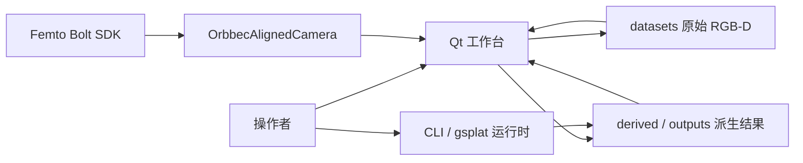
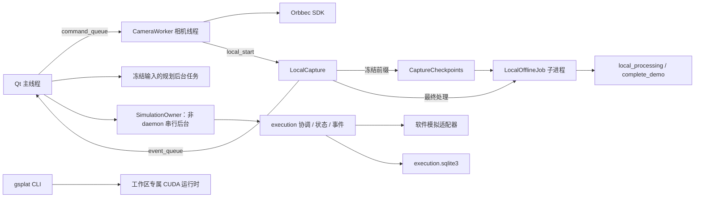
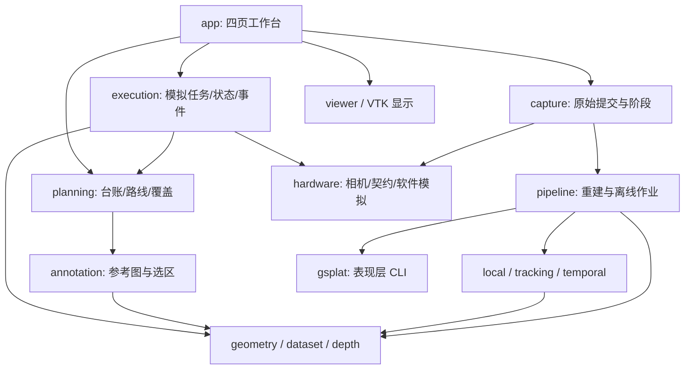
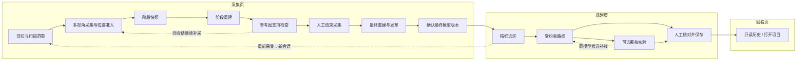
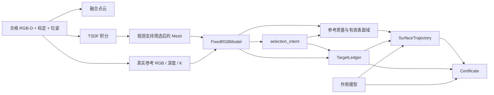
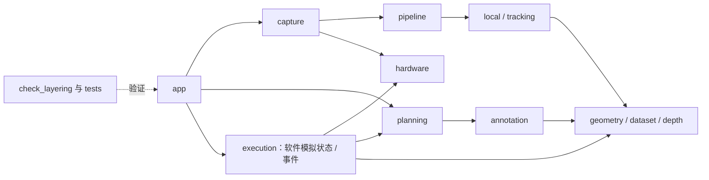
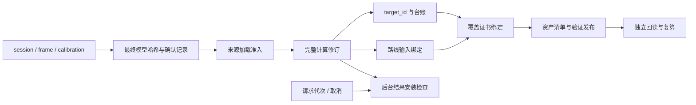
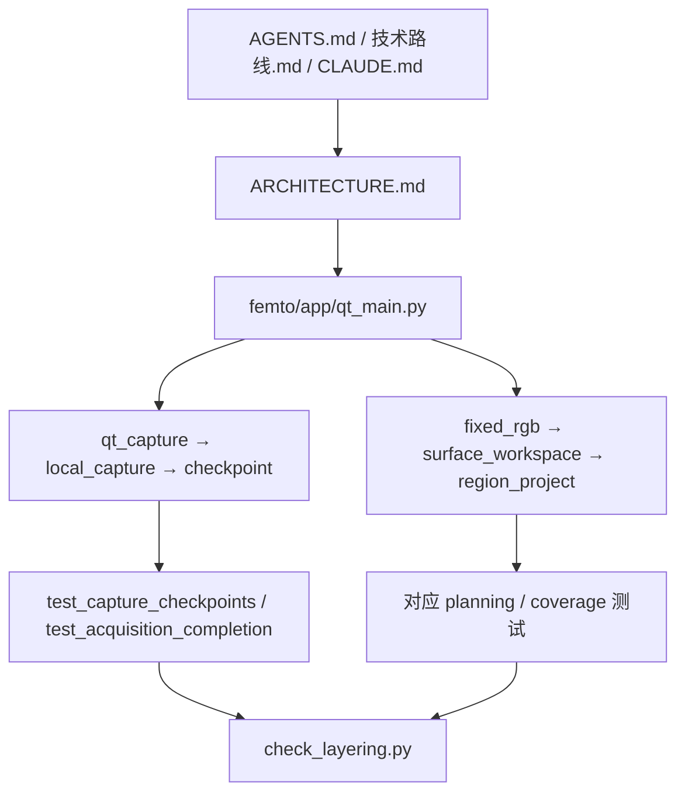
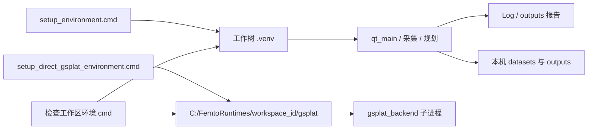

# Architecture Diagrams

日期：2026-10-20；2026-10-21 同步设备模拟与本地数据库。按当前 UI 工作树源码恢复关系；产品目标或未接线的后端能力不画成已实现调用。各图分开回答控制、数据、依赖或导航问题。

## 1. System Context

用途：说明系统边界。Confidence: High。

工作台连接本机相机并把完整帧写入本地文件；规划与历史回看只读这些文件。历史索引和模拟任务事件各用独立本地 SQLite，没有远端 API。设备箭头表示数据进入系统，不表示 Qt 主线程持有 SDK。真实机器人执行仍未实现。

边依据：`femto/app/qt_main.py`、`femto/hardware/orbbec_rgbd.py`、`femto/capture/local_capture.py`、`femto/planning/region_project.py`。gsplat CLI 是可选旁路，见 `femto/gsplat/gsplat_backend.py`。

## 2. Container and Runtime View

用途：区分页面、线程与进程。Confidence: High。

线程节点不是网络服务。阶段检查与最终处理共用离线作业边界，但阶段结果不发布。未在本次走查中启动硬件或训练进程。

边依据：`femto/app/qt_capture.py` 的 `CameraHost`、`femto/app/camera_worker.py`、`femto/capture/local_checkpoint.py`、`femto/pipeline/local_offline.py`、`femto/paths.py`。

## 3. Component or Module View

用途：对照 `tools/check_layering.py` 的包职责。Confidence: High。

这是选取的直接依赖摘要，不是完整 import 图。完整层次由分层检查的 `ORDER` 定义；本次运行 `upward edges: 0`。`prototype/` 不在这张生产图中。

## 4. Current Product Control Flow

用途：给非技术读者说明先做什么、何时继续、何时必须新开会话。Confidence: High（软件调用）；现场实拍验收另见主文。

覆盖核验是显式操作。补采不以「质量全部通过」自动终止。阶段模型不能进入规划页。`--project` 与打开项目进入回看页，不是规划编辑。

边依据：`femto/app/qt_workflow.py`、`femto/capture/local_checkpoint.py`、`femto/dataset/acquisition_completion.py`、`femto/planning/surface_workspace.py`、`femto/app/qt_main.py` 的 `rescan_region` / `open_review`。

## 5. Geometry and Planning Data Flow

用途：说明计算消耗什么、产生什么，避免混入人工动作。Confidence: High。

图中的分叉是依赖关系，不承诺这些计算同时运行。纹理支线和持久化清单已省略。

边依据：`femto/pipeline/scene_reconstruction.py`、`femto/annotation/fixed_rgb_geometry.py`、`femto/planning/surface_workspace.py`、`femto/planning/coverage_workflow.py`。

## 6. Dependency Direction

用途：区分代码依赖与产品时间顺序。Confidence: High。

当前依赖方向是单向分层，由 AST 扫描强制。import 箭头不能代替产品数据流。`femto.paths` 被分层检查豁免，各层都可引用路径常量。

## 7. Boundary and Contract View

用途：解释不同身份为什么不能混用。Confidence: High。

保存 UUID 不等于完整计算摘要。UI 任务完成不等于模型获准规划。确认记录不改质量字段。便携 ZIP 里的采集评估不能当作当前患者的新核验。

边依据：`femto/dataset/acquisition_completion.py`、`femto/planning/planning_revision.py`、`femto/planning/coverage_workflow.py`、`femto/planning/region_project.py`。

## 8. AI-Agent Navigation View

用途：给后续 agent 一条最短安全阅读路径。Confidence: High。

先用当前源码核对 CLAUDE 概述：回看页已经存在。改证明语义、预算、坐标或 marker 前先停下来向人确认。不要编辑 `prototype/standalone.py` 或原始 `datasets/` 证据。

## 9. Runtime and Deployment View

用途：说明本机环境，而不是云部署。Confidence: High（路径与脚本）；干净机器重装未验证。

这是单机研发装配。仓库内未见 CI 工作流。每个 git worktree 有独立被忽略数据目录和独立 workspace_id，不能混用环境或 marker 绝对路径。

边依据：`start_femto_app.cmd`、`femto/paths.py`、`doc/使用说明/启动入口说明.md`。

## 10. Assumptions and Omissions

未重新执行实物精度、现场多轮操作或 gsplat 训练。图中省略取消/超时路径、P4/P5 可选显式入口、以及仅后端保留的固定视角/手持扫描 Qt 入口。旧外部产品 MD 不作为本仓库架构图的一部分。
