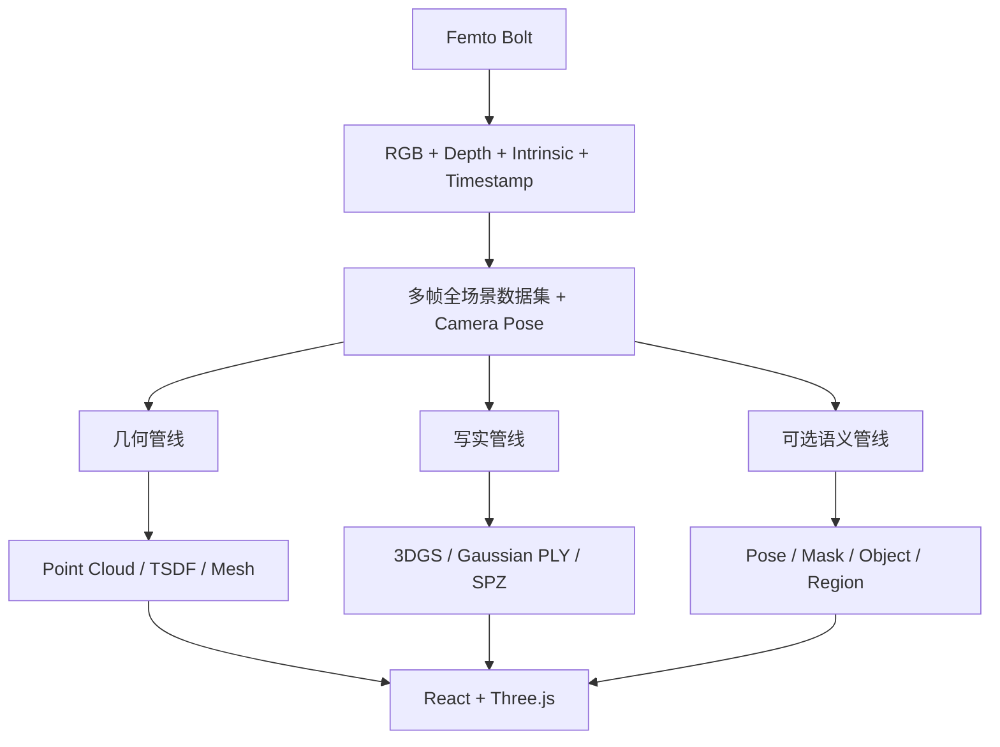

# Femto Bolt 真实场景三维重建项目

本项目使用 Orbbec Femto Bolt 同步采集 RGB、Depth、相机内参、时间戳和多帧相机位姿，对相机实际拍到的人体、物品、床体、设备及环境进行整体三维重建。人体 Pose、人体 Mask 和物体语义是可选标注层，不能裁掉或覆盖原始全场景 RGB-D。

目标输出包括：

- **Gaussian Splatting**：写实场景与新视角渲染，输出 Gaussian PLY，可选 SPZ；
- **Mesh**：有实际表面的 TSDF/清理网格，输出 GLB、OBJ、PLY；
- **Point Cloud**：原始、配准和融合点云，输出 PLY；
- **RGB-D**：完整 RGB、`uint16` 毫米深度、内参、时间戳和逐帧 Pose；
- **Semantic / Pose**：人体 3D 关键点、Mask、物体类别和区域标注；
- **Web Viewer**：React + Three.js，在写实、网格、点云、RGB-D 和标注模式间切换。

坐标约定、数据格式、当前状态和稳定规则维护在 [`技术路线.md`](./技术路线.md)；完整日期变更记录按月保存在 [`doc/变更记录/`](./doc/变更记录/技术路线_变更记录_2026-09.md)。

当前代码可以继续用于商用产品研发，但尚未达到“可直接对外发布”的合规状态。发布前必须完成 Orbbec Extension EULA/三方 LGPL 义务、安装包 LICENSE/NOTICE、权利人确认、隐私与（若有医疗用途）产品注册评估。详细门禁见 [`COMMERCIAL_READINESS.md`](./COMMERCIAL_READINESS.md)。项目文档分类入口见 [`doc/README.md`](./doc/README.md)。

## 当前实现状态

### 三维表面扫描轨迹（研发预览，2026-09-21）

固定 RGB 页只负责选区、保存和导出。在“历史区域导出记录”选中区域后点击“生成三维扫描轨迹”；已有轨迹时可重新生成，每个区域下只显示一条当前轨迹。新结果生成并校验成功后删除该区域的旧轨迹目录，失败或取消保留旧结果。规划按网格连通关系分块：一块内逐行折返扫完再进入下一块，块间只记 gap、不连线；无法规划的小块会在报告中列出原因。选中轨迹可预览、打开文件夹、查看路线图或播放；播放器在 gap 和块间停止，继续只定位下一段或下一块起点，可按块过滤显示。

也可把区域导出目录拖到根目录 `生成三维蛇形扫描轨迹.cmd`，或运行 `python -m femto.planning.mesh_slice_planner <导出目录或 region_N.json>`。输出仍固定 `execution_ready=false`、`physical_accuracy_verified=false`，没有姿态、自由空间过渡、碰撞安全或设备执行含义。完整操作和文件说明见 [三维表面轨迹使用说明.md](doc/使用说明/三维表面轨迹使用说明.md)。

### 实拍验收与结果质量报告（2026-09-10）

重启后完成建模，点击原“报告”按钮查看 `result_quality.html`。报告包含筛帧/位姿/几何统计与床位＋平躺人体验收计划；实物尺寸参考、容差和至少3次独立采集的测点齐全后，可生成指定距离误差与重复性结论。缺证据保持“待实测”。操作见 [床位与平躺人体_实拍验收说明.md](doc/使用说明/床位与平躺人体_实拍验收说明.md)。

### 移动采集优化（2026-09-10）

重启主程序后选择“手持移动多视角（场景静止）”。采集进度新增当前图像/Depth质量提示；已确认移动后仍会显示后续模糊、缺深度或运动判断不可靠的警告。提示不等于实时定位或重叠率测量。

建模自动执行图像/Depth质量过滤 → 连续帧双向位姿检查 → 按视角变化筛关键帧 → 现有TSDF/3DGS输入流程。连续跟踪丢失时阻断重建，提示重新采集；此版未实现重定位、回环或全局优化。原始帧完整保留，筛选报告在派生目录。

已有90帧实拍离线回放得到66个关键帧（24个重复帧仍用于跟踪），220项测试中212通过、8环境跳过。详细参数、证据和限制见 `技术路线.md` 的2026-09-10记录；尚未验收新采集时的现场反馈与实物尺度。


### 单帧 RGB-D 3DGS（固定视角）

在控制页先“一键关键帧采集并建模”，再点“关键帧 3DGS 建模”，完成后点“单帧固定视角”。3DGS 使用当前关键帧模型选中的同一张 RGB-D 和标定，按钮下显示来源模型；不再读取“最近拍照”，也不会在关键帧缺失或多视角输入时回退到旧照片。`单帧3DGS建模.cmd` 同样读取最近完成的关键帧模型；`查看单帧3DGS.cmd` 打开已保存结果。旧控制页需重启加载修复。单独照片仍可通过 CLI `python -m femto.gsplat.scene_single_gs build <照片目录>` 显式建模。

查看器支持滚轮/按钮缩放、左键框选区域放大、复位、保存区域和回读区域。相机位置、朝向锁定，缩放仅调整投影，三维点位不变。结果是真实 Gaussian 渲染，但仅拟合这一帧有深度的可见表面；无深度处保持空缺，不能补出背面，也不能靠放大恢复未采集的细节。尺度未经过实物验证，不直接用于机械臂控制。

默认 500 步、最多 30 万高斯点、最高 1920×1080 训练、4 GiB PyTorch 保留显存阈值、至少 1.5 GiB 可用显存；每 100 步保存检查点。固定视角查看器按源分辨率渲染，最高 1920×1080，并启用高 DPI 原生显示，避免系统放大低分辨率窗口；状态栏显示实际渲染分辨率，显存压力下仍会降级。显示修复只需重新打开查看器，不用重训或重新保存区域。源 RGB-D 不覆盖，模型和区域保存在独立的 `outputs/single_gs_*`，不修改多视角训练门禁。旧模型需要重新训练才能获得更密的高斯采样；旧区域标注不自动迁移到新模型。

**表面标注操作（2026-09-08）**：打开三维模型，显示“重建 Mesh”，勾选“选点模式”或使用 Ctrl+左键。

1. **表面选点**：点击网格显示 XYZ（米，World RDF：X 右、Y 下、Z 前），所有有效选点保留；空白不生成标注。
2. **两点测距**：选择“两点测距”，依次点击两处表面。黄色连线和侧栏显示最近两点的三维直线距离（米/毫米）；继续点击更新最近两点。
3. **区域圈选**：选择“多边形圈选”，保持视角，依次点击边界，再点击“完成圈选”。黄色轮廓、绿色区域线框；三角面中心在圈内且未被遮挡才选中，不做精确裁边。视角改变需重画。
4. **保存回读**：“保存标注及区域”创建 `reconstruction/annotations/时间戳/annotations.json` 和区域网格 PLY、网格顶点云 PLY。再次打开同一模型，点击“回读标注”选择 JSON，恢复后继续操作；源模型几何指纹不匹配会拒绝加载。

“撤销末项”优先撤销未完成圈选的末个边界点；圈选模式下撤销末个区域，其他模式下撤销末个选点。“清空标注”清空内存标注，已保存文件保留；“清除选点”只清除当前命中显示。取消勾选选点模式恢复左键旋转。

**未经过实物尺度验证**：小数位不代表精度，距离是空间直线长度而非表面弧长。导出点云来自所选网格顶点，不是原始 RGB-D 点云裁剪；PLY 保留顶点色，不含 UV 纹理。尺度或标定变化后须重新计算标注和测量，实物尺寸验证仍是后续验收项，细小误差尚不能归因到相机或算法。

当前主界面使用 **WFOV 未合并 1024×1024、0.25–2.21 米、15 FPS**，RGB 为 1080p MJPG/15 FPS。保留单帧关键帧建模，已恢复手持移动多视角采集和位姿估计后融合；固定多帧与跨模式合并仍暂停。

**手持移动采集（2026-09-08 恢复）**：重新打开主程序，模式选择“手持移动多视角（场景静止）”，默认 15 秒、保存 6 FPS（目标 90 帧），点击“开始移动采集并重建”。围绕静止目标缓慢平移并调整观察角度，保持约 70% 重叠；到时自动停止，也可提前停止。自动执行：待估位姿原始 RGB-D → 派生 RGB-D 里程计 Pose → 数据检查 → TSDF 网格/融合点云 → 3DGS 输入转换。成功后可查看模型，再点击“训练写实 3DGS”。当时的完整步骤归档于 [REAL_FEMTO_NEXT_STEPS.md](doc/历史开发记录/REAL_FEMTO_NEXT_STEPS.md)。

移动帧保存 `pose_valid=false / T_WC=null`，位姿只写派生目录，不覆盖采集证据；失败显示原因，不回退单帧或生成固定单位位姿。开始新采集后，本次界面清除旧重建结果的操作关联，避免失败后训练上一模型（磁盘旧结果仍保留）。3DGS 仍要求至少 12 个合格视角、平移跨度 ≥0.05 m 或旋转 ≥5°以及其他输入检查；尺度实测属于后续验收。软件通过 40 项相关测试与 24 帧未知位姿合成输入的完整重建演练；真实手持效果尚待实拍验证，顺序里程计仍有累计漂移。

“关键帧建模（仅选一帧，不合并）”保留未清理 PLY、清理后深度和点云，直接连接相邻有效深度像素生成可见表面，深度明显跳变处不连面。当前单帧不做 TSDF 体素重建、平滑、碎片删除或补孔。点击“查看最新三维模型”默认显示“原始 RGB 纹理”，可勾选“未清理点云（对照）”检查边缘与缺面。

单帧网格文件为 `scene_surface_mesh_m.glb`（内嵌 RGB 纹理，便于完整分享），`scene_surface_mesh_m.obj` 必须连同 `.mtl` 和 `texture_rgb.jpg` 一起复制；PLY 仅保留顶点色。纹理清晰度来自原始 RGB，不代表深度精度或原生深度分辨率提高。旧 TSDF 模型仍可打开。

**多帧高清融合（2026-09-08）**：新重建默认使用完整对齐 RGB-D 分辨率（当前 1920×1080）、5 mm TSDF 体素、20 mm 截断、点步长 1。几何融合仍需正确位姿，1920×1080 不代表同等独立深度分辨率，也不表示 5 mm 实物精度。`scene_tsdf_mesh_m.glb` 现在带多视角原始 RGB 图集；OBJ 须附同目录 MTL 和 `texture_multiview.png`。从轨迹均匀选最多 12 张完整 RGB，不缩图，按标定和位姿投影到三角面；顶点及面中心深度一致且朝向相机才赋纹理，缺少支持的面保留融合色。未做位姿优化、曝光校正或接缝优化。

本次既有 90 帧对照保存于 `outputs/fullres_multiview_20260908_141848/`，运行其中“查看高清融合模型.cmd”打开，默认原始 RGB 纹理。旧模型和标注保留；因网格几何和索引变化，旧标注不能直接套用到新网格。新采集将自动使用上述参数。

结果目录的 `demo_report.html` 展示单帧清理与几何偏差，`reconstruction/source_evidence.json` 记录输入 SHA-256，`reconstruction/single_frame_quality.json` 保存详细统计。原始 RGB-D/标定不覆盖；几何单位为米。清理只删除缺乏近深度邻居的孤立点，不平滑或补孔。

真实尺寸精度目前为**待实测**。画面中放置尺量过的两标记点后，从项目目录运行 `validate_scene_scale.cmd --pick --ground-truth-mm 实测毫米数`，按 Shift+左键选取对应两个端点后关闭窗口。不要直接使用示例尺寸作为真值；2.21 米物理端点效果尚未验收。

| 能力 | 状态 |
|---|---|
| Femto RGB-D 同步、Depth→Color 对齐、内参和时间戳 | 已实机实现 |
| 持续预览，点击按钮后才开始采集 | 已实现 |
| 中英双语一体化操作页面 | 实时切换中文/English，RGB/Depth、单帧拍照、扫描、自动建模、查看模型/报告已实现；记住上次语言；首个 aligned RGB-D 使用 15 秒真实截止时间与分类读取诊断 |
| 单帧 RGB-D 照片 | JPG + `uint16` 毫米 Depth PNG + 标定/时间戳 + 米制 PLY 已实机验证 |
| MediaPipe 33 点 Pose 与人体 Mask | 已实现，属于可选语义分支 |
| 人体区域固定机位点云、TSDF、Mesh、PLY/OBJ/GLB | 已实现原型 |
| 不经过人体 Mask 的全场景公共数据集 | 已实现第一版；移动 Pose 默认明确标记待估计 |
| 数据集完整性、同步、标定和 Pose 门禁 | 已实现第一版 |
| Femto 数据→Nerfstudio/gsplat 数据转换 | 已实现自研第一版；只接受有效且有视角变化的 `T_WC` |
| 移动相机逐帧 Pose 与多视角 TSDF | 已实现顺序 RGB-D 里程计测试版和全场景 TSDF Demo；生产级位姿仍待接入 |
| 3D Gaussian Splatting 训练与查看 | 直接 `gsplat` 产品训练器已完成：真实 Depth 损失、致密化/裁剪、检查点恢复、PSNR/SSIM/LPIPS 与 Depth RMSE/覆盖率验收、训练后 PLY；2026-09-04 在 RTX 5060 上完成 800 步合成 14 视角 GPU 链路复演（五项训练门禁全部通过）。官方 Niantic SPZ tag v3.0.0 已构建为 `spz==1.1.0` 并完成 PLY→SPZ 官方回读核对；真实 Femto 多视角数据的完整训练待验收 |
| 专业桌面查看器 | 自定义中英双语 Open3D GUI；Mesh、点云、Gaussian、真实相机轨迹/视锥可独立叠加，支持真实线框、法线/深度着色、点大小、坐标轴/地面/网格和八种视角；React + Three.js 未实现 |

`scene_capture.py` 是当前全场景 RGB-D 入口；`top_scan.py` 是已经跑通的**人体可选分支原型**。固定相机帧的 `T_WC=I` 只对同一机位成立；移动相机后禁止继续使用单位位姿。

## 真实 Femto 闭环状态（2026-09-05）

当前 **BLOCKED / accepted=false**：软件侧连接、门禁、103 项测试、500k/1M 合成 Gaussian 查看器规模回放和既有合成模型的真实 Gaussian 渲染回放通过；没有合格的真实移动多视角 Pose，也没有实测长度/端点证据，因此没有报告本阶段真实训练指标。合成预演的 Demo、训练、验收和尺度报告均显式标记 `data_kind=synthetic`，不计入真实验收。

主界面已正式使用 `gsplat_backend → scene_gsplat_trainer`，保留 `low_vram / balanced / quality`。新增“3DGS 验收报告 / 结果目录”；原 Open3D 几何查看器不变，其 Gaussian 中心点显示不能当作 3DGS 渲染。

2026-09-08 当时的静态场景摆放、15 秒移动采集和尺度选点步骤归档于 [REAL_FEMTO_NEXT_STEPS.md](doc/历史开发记录/REAL_FEMTO_NEXT_STEPS.md)。其中引用的旧证据目录可能已清理，以 `技术路线.md` 顶部的当前状态为准。顺序 RGB-D Odometry 仅是 research/demo pose，没有回环、重定位或全局 Pose Graph。

## 当前可运行入口

日常使用优先启动统一操作页面：

```text
E:\测试3D人体关节坐标\start_femto_app.cmd
```

页面固定使用 **WFOV_UNBINNED（广视场未合并）1024×1024、120°×120°、0.25–2.21 m、15 FPS**；RGB 使用 1920×1080 MJPG@15，与深度帧率一致。预览、拍照和扫描均使用这一档位，不自动切换；移动多视角融合已恢复，固定多帧和跨模式合并仍暂停。“四档全量采集与融合”按钮及主程序相关 CLI 已移除。

页面自动连接 Femto Bolt，左侧实时显示 RGB 与 Depth，右侧可完成：

- 右上角 `中文 / English` 即时切换整个操作页面；选择保存在 `%LOCALAPPDATA%\FemtoSceneDemo\ui_preferences.json`，下次启动和打开模型时继续使用；
- `拍摄当前 RGB-D`：保存 `color.jpg`、无损 `depth_mm.png`、深度预览、完整标定、同步时间戳和 `point_cloud_m.ply` 到 `photos\femto_photo_*\`；
- 调整连续扫描时长与保存 FPS；
- `打开实时点云预览`：打开参考 `E:\测试` 实现的 Open3D 三维窗口。左键拖动旋转、Ctrl+左键拖动平移、滚轮缩放；支持 RGB/深度颜色切换、1–6 像素点大小、坐标轴开关、“恢复相机视角”和“适配全部点云”。窗口复用主程序相机帧，拍照仍在主界面操作；取景与颜色调整只影响显示；
- `关键帧建模（仅选一帧，不合并）`：相机不动，可保存多张候选帧，但只选择其中一张 RGB/Depth 同源的完整帧建模；不进行时间中值、多帧或跨模式合并；
- 页面实时显示“有效/过近/过远/无返回”比例；低于 35% 时应调整距离、角度或拍摄对象，报告不会把这种结果标成完整场景 PASS；
- `训练写实 3DGS`：只接受至少 12 个通过门禁且具有视角变化的帧；单帧和固定机位数据会被阻断；`查看写实 3DGS` 打开独立 Tkinter + gsplat CUDA 查看器；正式页面只接受真实 Femto 来源，不会训练最新 marker 中的合成样例；
- 直接打开最新三维模型、HTML 验收报告和结果目录。

当前开放单帧拍照、实时单帧点云、关键帧建模及手持移动多视角建模。固定多帧融合仍暂停，旧数据和离线模块保留。单帧结果不能训练需要多视角的写实 3DGS。无有效深度的 RGB 像素不会生成真实几何；视野外或无返回区域保持未知。2.21 m 端点实物效果仍待现场测试。

有效深度限定为 250–2210 mm，包含两端；范围外、零值和非有限值不生成点云。原始 RGB-D 仍完整保存，范围筛选只用于统计与派生几何。Depth→Color 对齐后的网格为 1920×1080，这不是深度传感器的原生分辨率。旧四档采集数据与底层工具保留供历史复核，主界面不再读取四档结果 marker。

直接 gsplat 查看器会在大模型渲染前按显存和像素预算规划；超时或明确 OOM 时仅对内存副本降分辨率或确定性采样，并在报告中保留模型 Gaussian 总数、实际渲染数、每帧耗时、峰值显存和原因，磁盘 PLY 不变。其他 CUDA 错误不会伪装成 OOM 降级，而是原样写日志并失败。

页面里的 `Gaussian Init (untrained)` 是诊断初值；用户给出的 SIBR 类写实效果对应**训练后的 3DGS**。正式候选后端 `scene_gsplat_trainer.py` 直接调用 Apache-2.0 `gsplat`，不依赖 Nerfstudio、PyMeshLab 或 Graphdeco。旧 `scene_3dgs.py`/`.venv-3dgs` 只作为内部 Splatfacto 效果对照，不随闭源产品分发。

3DGS 使用独立 `.venv-gsplat`，避免影响 Femto 采集依赖。产品安装入口为 `setup_direct_gsplat_environment.cmd`，固定 Python 3.10 x64、PyTorch 2.7.1+cu128、torchvision 0.22.1+cu128 和 `gsplat==1.5.3`；不安装 Nerfstudio/PyMeshLab。当前机器 RTX 5060 8GB、Python 3.10.11、CUDA Toolkit 12.8 `nvcc` 与 VS2022 C++ Build Tools 均已安装，`.venv-gsplat` 已完成安装、`sm_120` CUDA 内核 JIT 编译和 800 步 GPU 训练验收。手动安装与校验见 [`CUDA_GSPLAT_手动下载安装指南.md`](./doc/技术资料/CUDA_GSPLAT_手动下载安装指南.md) 和 [`PYTORCH_GSPLAT_手动下载清单.md`](./doc/技术资料/PYTORCH_GSPLAT_手动下载清单.md)。

**2026-09-08 训练资源保护**：默认低显存档改为 6000 步、图像下采样 4、初始 25000 点、持续上限 400000 点，3000 步停止增点，每 250 步保存。平衡/高质量上限分别 80 万/100 万点。所有档位监测 CUDA 内存，进程保留量达到 5120 MiB 或 GPU 可用低于 1536 MiB 时保护退出，另设 PyTorch 分配器上限；界面显示显存与点数上限。日志 `resource_stop_*.json` 说明退出原因，最近完整检查点保留，超限旧检查点在 CPU 校验时拒绝恢复，原文件不变。更保守参数可能影响最终画质，需重新验收。

当天两次重启已确认是 Windows `0x20001 HYPERVISOR_ERROR`；GPU 确实可用，不是 NVIDIA App 没打开。具体原因仍缺转储堆栈，训练保护不能代替系统故障修复。原崩溃分析证据目录已清理，仅保留此历史结论。短程 CUDA 测试通过，不代表长时间训练稳定性验收通过。

LPIPS 验收需要 torchvision 官方 AlexNet 权重 `alexnet-owt-7be5be79.pth`。训练器不会自行联网下载：先从 <https://download.pytorch.org/models/alexnet-owt-7be5be79.pth> 手动下载到 `%USERPROFILE%\Downloads\`，再运行下面的安装器，它会校验官方 SHA-256 后放入 torch hub 缓存；缺失或哈希错误时在优化前直接阻断；仅 `--skip-lpips` 冒烟允许跳过，且不能通过验收：

```text
E:\测试3D人体关节坐标\install_lpips_weights.cmd
```

新的 3DGS 输入会在 `nerfstudio/` 同时保存去畸变 RGB、无损毫米 Depth、`transforms.json`、输入质量报告和 `rgbd_init_points.ply`。PLY 由 Femto 对齐 RGB-D 按真实内参反投影并用每帧 `T_WC` 变换到世界坐标，`transforms.json` 通过 `ply_file_path` 明确引用它；这样 direct gsplat 从相机实际测得的尺度和表面开始，而不是随机初始化。原始完整场景不做人体 Mask。

直接训练器提供 `8GB 显存 / 平衡质量 / 高质量` 三档。它把保存的毫米 Depth 转为米，在有效深度像素上计算 Smooth-L1 并真实加入训练损失；RGB 使用 L1+SSIM，`gsplat.DefaultStrategy` 执行复制、分裂、低透明度裁剪与透明度重置。检查点同时保存动态 Gaussian、Adam、策略和随机状态，并用完整 RGB-D 输入 SHA-256 防止跨数据误恢复。训练结束对留出视角计算 PSNR、SSIM、LPIPS 和 Depth RMSE/MAE/AbsRel，保存渲染证据、训练后 SH3 PLY、可选 Niantic 官方 SPZ 和 `model_manifest.json`。Depth 验收把模型没渲染出来的黑洞像素按真实缺失计入误差，并另设 ≥90% 深度覆盖率门槛，因此漏渲染不会把误差"做好看"。

检查直接产品运行时：

```text
E:\测试3D人体关节坐标\start_direct_gsplat_status.cmd
```

训练最近一组通过门禁的多视角数据：

```text
E:\测试3D人体关节坐标\start_direct_gsplat_train.cmd --profile low_vram
```

SPZ 是可选交付格式。运行 `setup_spz_environment.cmd` 会从 Niantic 官方 MIT tag v3.0.0 的本机校验源码缓存构建 `spz==1.1.0`，固定 zlib 1.3.1、zstd 1.5.6、`nanobind==3.0.1` 及其 `tsl::robin-map` 1.4.0 头文件，最终以 `--no-deps` 安装并只部署经哈希核验的 zlib 1.3.1 DLL；`scene_gsplat_export.py` 会用官方 binding 转换并回读核对数量。构建组成的 tag、commit、缓存/产物 SHA-256，以及 Adobe、zstd 旧解码器和 libdivsufsort-lite notice 见 `THIRD_PARTY_NOTICES.md`。若 SPZ 环境不可用，训练仍会完成标准 PLY，并在报告中明确记录转换失败，不会生成伪 SPZ。

先运行**不依赖相机移动和位姿估计**的一键完整测试 Demo：

```text
E:\测试3D人体关节坐标\start_complete_demo.cmd
```

它会生成一组带真值 `T_WC` 的完整 RGB-D 测试场景，然后依次执行数据门禁、多视角融合点云、TSDF Mesh、Nerfstudio/gsplat 数据转换和标准属性的 Gaussian 初始化 PLY，最后打开桌面查看器。查看器使用项目自定义双语控制面板，避开 Open3D 内置英文侧栏和控件重叠；Mesh、原始点云、未训练 Gaussian、相机轨迹和相机视锥是独立场景对象，可以同时显示。渲染区提供 Mesh 着色/真实线框/法线/顶点色，以及点云 RGB/单色/法线/深度颜色；辅助区和八种视角不会重新读取模型。适配视图只统计当前可见的模型对象。结果保存在 `outputs\complete_demo_*\`，其中 `demo_report.html` 是本次验收报告。

相机轨迹和视锥只读取源数据集中通过刚体校验的真实 `T_WC`。单帧结果不会生成虚假轨迹；没有有效位姿或内参时，对应选项会自动禁用。

Gaussian 初始化 PLY 只是由 RGB-D 点云生成的 splat 初值，**没有经过 3DGS 训练**，不能当成写实 Gaussian 成品。这个区分会写入 manifest 和报告。

使用 Femto 实拍并尝试顺序 RGB-D 里程计的完整 Demo：

```text
E:\测试3D人体关节坐标\start_real_scene_demo.cmd
```

点击采集后，在 10 秒内围绕静态场景缓慢移动，保持相邻画面约 70% 重叠。实拍原始 `pose/` 不会被改写；Open3D 估计位姿会生成独立的 `derived\posed_rgbd_odometry_*\` 数据层。异常帧会被跳过并写入 `pose_quality_report.json`；合格帧不足或整体视角变化不足时才阻断，不会写入伪 Pose。

重新打开最近一次完整 Demo 查看器：

```text
E:\测试3D人体关节坐标\start_complete_demo_viewer.cmd
```

首次安装：

```text
E:\测试3D人体关节坐标\setup_environment.cmd
```

启动全场景连续 RGB-D 采集：

```text
E:\测试3D人体关节坐标\start_scene_capture.cmd
```

全场景入口启动后先预览。点击 `START CAPTURE` 后默认以 10 FPS 保存最多 150 组完整 RGB-D；再次点击 `STOP AND SAVE` 可提前结束。默认 pose 写为 `pose_valid=false`，供后续 SLAM/COLMAP 求解。只有相机已物理固定时才可用 `--fixed-camera` 写入有效单位位姿。

检查最近一次全场景数据的文件、格式、RGB/Depth 同步、标定和 Pose：

```text
E:\测试3D人体关节坐标\validate_latest_scene.cmd
```

校验器会把报告写入数据集的 `quality/validation_report.json`。Pose 不完整时允许采集归档通过，但明确输出 `ready_for_multiview_reconstruction=false`；使用 `--require-pose` 时会把它作为阻断错误。

当所有帧已有经过验证的 `T_WC` 后，转换最近数据为 Nerfstudio/`gsplat` 输入：

```text
E:\测试3D人体关节坐标\convert_latest_scene_to_nerfstudio.cmd
```

转换器会对 RGB 和 `uint16` 深度执行同一套 Brown-Conrady K6 去畸变，把 Orbbec/OpenCV 的 RDF 相机轴转换为 Nerfstudio/OpenGL 的 RUB 相机轴，并写入 `derived/nerfstudio/transforms.json`。无 Pose 或所有机位相同会被阻断。

检查当前开发树是否混入受限源码、依赖版本或许可证缺失：

```text
E:\测试3D人体关节坐标\check_commercial_readiness.cmd
```

启动人体 Pose/Mask 预览与短时 TSDF 原型：

```text
E:\测试3D人体关节坐标\start_top_scan.cmd
```

人体入口启动后也只做持续预览，不计时、不保存。调整相机和拍摄内容后，点击画面上方绿色 `START CAPTURE`，或按空格/`S`，才开始 12 秒人体筛帧采集。

查看最近的人体分支模型：

```text
E:\测试3D人体关节坐标\start_latest_viewer.cmd
```

## 总体数据流



多视角的共同前提是每个 RGB-D 帧有可信 `T_WC`。eye-in-hand 使用同步机器人位姿与手眼标定；普通移动相机需要经过验证的 RGB-D/视觉 SLAM 或 COLMAP。错误位姿会同时破坏 TSDF 和 3DGS。

## 3DGS 商用代码边界

- `graphdeco-inria/gaussian-splatting` 只用于阅读论文、核对算法行为和比较结果。其官方许可证把免费使用限制在非商业研究/评估，未经 INRIA 书面许可，不复制其源码进入本产品，也不作为运行时或发布依赖。
- 正式训练与渲染内核优先采用 Apache-2.0 的 `nerfstudio-project/gsplat`；复制或修改其代码时保留许可证、版权和 NOTICE/修改说明。
- Femto 每帧在 SDK/固件可提供时保存曝光、增益、白平衡、自动曝光、激光状态和传感器时间戳；转换阶段检查亮度/曝光变化、RGB-Depth 同步差和有效深度覆盖。元数据缺失会被明确记录，不会伪造数值。
- 任何新第三方依赖都先登记到 [`THIRD_PARTY_NOTICES.md`](./THIRD_PARTY_NOTICES.md)，再进入产品管线。许可证结论属于工程筛选，产品发布前仍应完成正式法务复核。

## 当前人体原型输出

成功采集保存在 `outputs\patient_top_YYYYMMDD_HHMMSS\`，包含选中 RGB、对齐 Depth、人体 Mask、每帧 Pose、3D 关节、融合点云、原始/小孔修复 TSDF、PLY/OBJ/GLB、质量报告和 manifest。

这些结果只证明现有 Python 链路可运行。人体标注未经过临床验证；Gaussian 也不是可用于碰撞或尺寸测量的工程表面。
