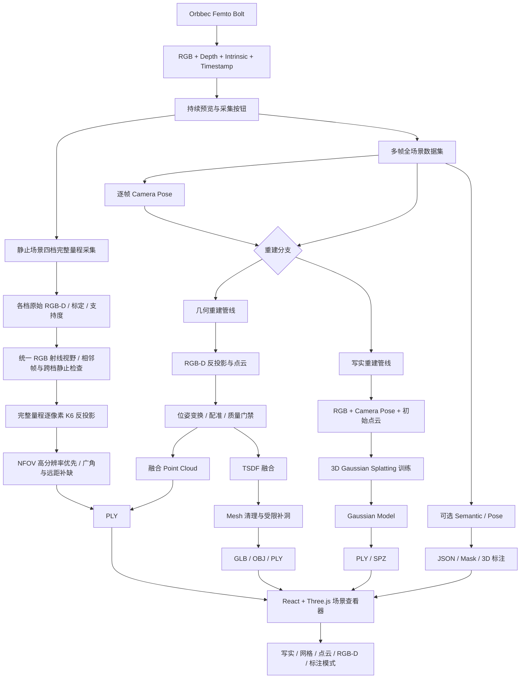
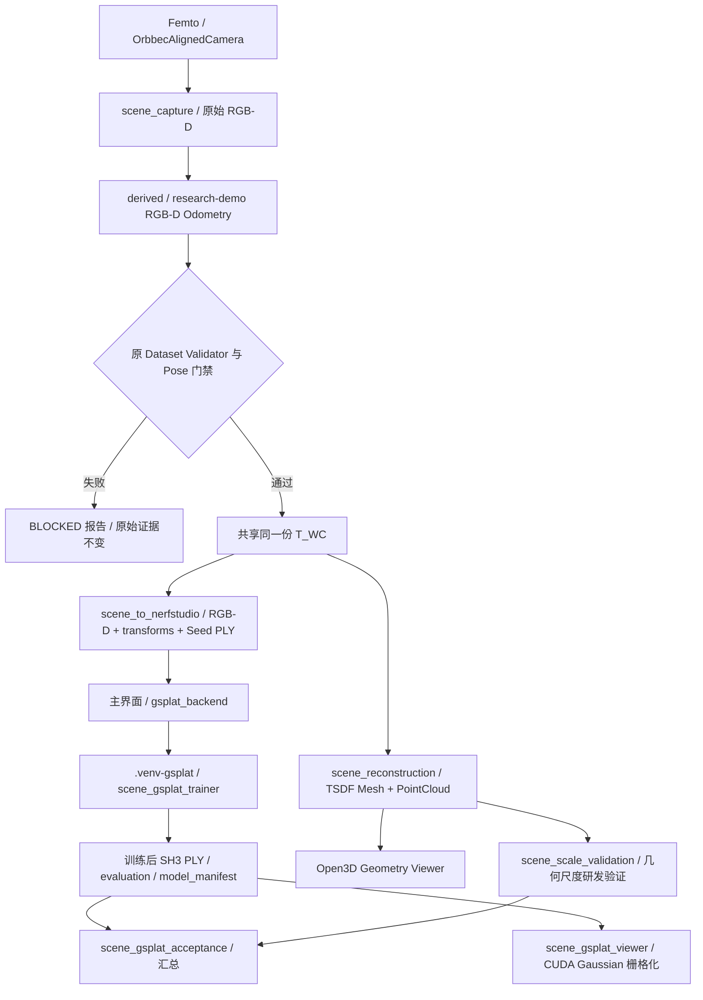
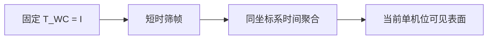

# 技术路线历史技术章节（2026-09 归档）

> 文档瘦身时从根目录 `技术路线.md` 原样迁出的历史技术章节；当前约束以根目录技术路线和 `CLAUDE.md` 为准。

## 1. 项目目标与范围

项目目标定义为：**基于 Orbbec Femto Bolt RGB-D 深度相机，对相机实际扫描到的人体、物品、床体、设备和环境进行多视角整体重建与可视化。**

人体不再是重建主数据的默认裁剪范围。系统必须先完整保存同步 RGB、Depth、相机内参、时间戳和逐帧相机位姿；人体 Pose、人体 Mask、物体类别和区域标注是可选派生层，不得覆盖或替代原始全场景数据。

最终支持五种表现层：

- Gaussian Splatting：高真实感场景还原；
- Mesh：具有实际几何表面的模型；
- Point Cloud：原始、配准或融合点云；
- RGB-D：同步彩色、深度、内参和时间戳；
- Semantic / Pose：人体关键点、物体类别与区域标注。

### 1.1 产品级定位与当前阶段边界

本项目当前代码仓库是未来聚焦超声治疗设备的软件技术底座之一，
并非仅以 3DGS 或单一三维重建算法作为最终产品。

最终产品设想包括：

- 深度相机；
- 三维扫描与重建软件；
- 治疗区域交互；
- 后续路径规划；
- 六轴机械臂；
- 超声治疗模块；
- 安全保护；
- 治疗记录；
- 推车式整机及计算平台。

当前研发阶段仅聚焦：

1. Femto Bolt RGB-D 数据采集；
2. 多视角三维重建；
3. Point Cloud / Mesh / Gaussian 多表现层；
4. 真实尺度与坐标体系；
5. 3D 查看、测量和后续治疗区域交互所需的数据基础；
6. 商业可分发的重建运行时。

当前阶段不实现：

- 机械臂运动控制；
- ROS / MoveIt；
- 治疗路径自动执行；
- 超声能量控制；
- 临床治疗决策。

但架构必须为未来这些模块保留明确扩展边界，
不得因为当前未实现而将坐标体系、场景几何或数据结构设计为无法扩展的形式。

### 1.2 当前实现状态

2026-09-15 六阶段接续：以实际代码、独立346项基线和本轮新日志为依据。阶段1/2的报告与候选提示已接入；阶段3独立A/B/C及主界面/历史入口已实现；阶段4固定RGB、未保存状态与历史来源检查已补齐。新增后台取消和发布凭证，状态不得覆盖别的会话。软件/合成/历史回放与新的实物验收分开记录，完整结果见《局部优化分阶段开发记录_20260915.md》。

本轮最终软件回归：482项，474通过、8项专用PyTorch/gsplat环境跳过、0失败/错误；unittest耗时146.788秒，外层149.543秒。日志为 `outputs/local_optimization_20260915_125849_718a7329/final_full_v3.log` 与同名前缀的 `_summary.json`。独立346项基线之后测试总数增加136项；跳过项不计通过。开发基线最终复核 `development_baseline_passed=true, errors=[], release_ready=false`，报告为本轮证据目录 `development_baseline_final_report.json`，旧合规报告未覆盖。最终中英文1120×720候选/完成窗口的10个操作控件通过尺寸与边界检查；未取得本轮屏幕截图，不计视觉或实物验收。

| 范围 | 当前代码与证据 | 实物验收 |
|---|---|---|
| 优化状态和质量反馈 | 结果绑定 processing_report，缺指标为未记录；未采用仍保存原因 | 待新采集 |
| 候选稳定帧 | 复用原采集时间戳与唯一SDK线程，最多5个轻量描述，单帧补采保持 | 操作节奏、帧率和降噪效果待测 |
| 同源A/B/C | 独立目录、原始/派生/报告分层、固定投影；真实101826四视角回放通过，B/C均未采用且逐字节复用前版 | 不代表物理误差通过 |
| 固定RGB/历史 | 高亮、遮挡、孔洞、支持像素、草稿/dirty、缺文件和刷新选择已补齐；83项专项通过 | 新实物交互待测 |
| TSDF候选 | 新增有界 `local_parameter_study.py`；真实5/5组完成，合成4/5组完成、2/20内存预算失败；默认5/20不变 | 噪声、重影、ROI和尺寸待独立参考 |
| 联合位姿图 | 本批精配准未整组通过，尚无可靠多视角边/退化证据，不实施或启用候选 | 需新的适合数据再评估 |

离线预算：生产局部结束任务总时长600秒、Windows Job Object任务组提交内存4096 MiB；对照每阶段300秒/3072 MiB、最多20视角、单worker。有界子进程取消包含Python启动器的后代；提交内存不是RSS。关闭应用的stop_event和同会话取消Event直接参与监督与最终发布检查，不等待SDK读取返回。结果目录创建即写publication.json=pending，全部任务与报告完成后才提交published和业务索引；异常回滚仅回滚本次写入并记录实际状态。旧无凭证结果兼容，新取消/失败/未知凭证格式不能恢复为最新成功。

Mask来源门禁：新增 source_binding（femto-local-temporal-mask-source-v1），绑定原RGB/Depth文件、解码uint16毫米值、frame/session/reference/时间戳、标定/参考证明及五帧窗口文件SHA；像素格为原始对齐彩色图。旧Mask仅在旧报告和完整来源哈希能重建证明时用于新重建，否则明确拒绝，不自动去Mask冒充成功；旧模型只读查看保留。support_mask和stationary_window算法及原接纳门限未改变，16项专项通过。

参数研究最终报告位于上述证据目录的 `phase5_parameter_study_20260915_145941_0642bd45/real_parameter_summary_final_v2/` 和 `synthetic_parameter_summary_final_v2/`。新增汇总器逐项校验实际RGB-D/Pose/Mask、实现哈希、W0与固定投影；最多8组，新研究1800秒、只读汇总300秒、累计JSON 64 MiB、哈希读取16 GiB，不发布latest。真实5/20→2/20的内部几何RMS从2.316降至1.878 mm，但命中深度RMS从3.238升至3.566 mm，峰值提交内存从1203.3增至2561.9 MiB，W0包围盒X变化约+13 mm；这些都不是物理尺寸误差或精度通过。现有证据不支持更改默认或启用联合位姿图；详见《阶段5TSDF参数对照与阶段6评估交付记录_20260915.md》。

2026-09-15 局部优化阶段2：新增 local_stability_feedback.py 的五描述符有界旁路，复用并行工具提供的 local_stability.py 共享窗口条件。单帧接纳仍执行原3秒请求、3mm/1°停稳、10mm/2°视角差与20mm范围门禁；不会等满五帧才接纳。界面显示候选稳定帧数、实际采集时间跨度、候选间隔Pose FPS，以及对应已接纳帧ID。候选只检查可信位姿、同参考/同步/时效/时间递增和相对锚帧≤1mm/0.2°，不表示图像/深度或降噪通过。暂停/取消/越界/失跟/不同步/过期清零，接纳后最多观察4秒，5帧仍须结束后完整审核。专项80项全部通过；无新真机操作。

2026-09-15 局部优化阶段1：新增 local_processing.py，逐阶段记录未执行/执行中/已采用/未采用/失败及实际输入数据集和位姿来源。完成模型绑定独立 processing_report.json/html，未采用时也保留理由与候选内部残差；局部页和历史页可直接查看。历史缺指标显示未记录，不扫描新尝试替旧模型宣称成功。二值筛选只统计实际应用 Mask 的剔除量，未采用的候选剔除量不计入。专项 74 项通过，无跳过；实物精度待验收。

2026-09-15 五帧稳定性筛选：局部结束后、精配准后执行 local_temporal_support.prepare。复用已保存跟踪帧检查停稳窗口，生成二值支持 Mask，保留关键帧深度原值，只拒绝不稳定像素。TSDF 和最终网格支持检查读取同一 Mask；初始对照点云仍来自未筛选原始帧。不是时域均值/中值替换，不增加新的深度点。操作提示补采前后停稳约3秒，但是否通过取决于实际位姿与图像证据。

2026-09-15 精配准：局部采集结束后新增固定 W0 的离线多尺度鲁棒点到平面 ICP 候选流程；仅所有视角都通过修正幅度、双向和未参与拟合的样本对照时写入新派生数据集，否则沿用原在线位姿。不是位姿图优化或时域融合；不保证物理精度。参数及证据见《局部精配准交付记录_20260915.md》。

2026-09-15 历史入口：局部页标题右侧新增“历史记录”，后台只读扫描 datasets/scene_*_local_* 和 outputs/complete_demo_* 的局部模型。已完成模型可打开固定 RGB 或高级三维查看，失败/缺文件记录可查报告与目录；历史窗口不修改当前会话、原点、成功索引或原始数据。固定查看器继续核对完整来源，历史列表的文件存在检查不等于精度/来源验收。

2026-09-15：局部新增 20 mm 接纳半径和固定 RGB 选点/圈选，按参考照片映射到 W0 的真实 Mesh，显示坐标与原点距离；高级三维和 3DGS 保留。位姿跨度诊断已有记录，几何与实物精度仍待现场验证，RGB 还原度不等于三维精度。

2026-09-14 中断修复：连续跟踪增加上一可信运动初值的一次受门禁重试，保留固定 W0；实际失败录制中的一种匹配失败已通过回放改善。失跟、断流与处理过期原因可见并写入报告，真正丢失后仍需新会话。软件和录制回放已验证，修复后的新真机移动与物理精度尚未验收。

2026-09-14 第三轮：最终模型表面点已增加 mm 坐标和原点直线距离、已存标记选择、兼容保存/回读与保守原点来源判定。参考系和坐标随模型固定；未证明首次相机原点的模型明确使用“模型坐标原点”。软件验证结果见顶部记录；实物定位/尺度精度仍待现场验收。

2026-09-14 第二轮：关键帧接纳后异步更新累计实测采样预览已接入；实时TSDF网格仍未实现，最终标记模型在结束采集后生成。


2026-09-14 增量状态：局部在线位姿与停稳补采软件已实现；新旧入口保留。结束后几何融合和标记已通过软件回归，真实移动精度/人体补洞验收待完成。参数与限制以上方最新变更为准。


#### 当前单帧建模流程（2026-09-08）

- 2026-09-08 新增标注闭环（`scene_annotations.py` / `scene_annotation_ui.py`）：保留连续表面选点，显示最近两点欧氏直线距离（m/mm）和连线，固定提示“未经过实物尺度验证”。米制 World RDF 不变，显示位数不代表精度。
- 区域采用屏幕多边形，按三角面投影中心在圈内且近裁剪面射线首次命中该面筛选当前可见表面；不穿透、不补孔，不裁切跨边界三角面。圈选时依次点击边界再完成，视角/窗口改变须重画；清空、撤销、切换模式使旧异步结果作废。
- 保存至独立 `reconstruction/annotations/时间戳/`：JSON 包含源网格绝对路径、几何 SHA-256、XYZ/三角面索引、相邻选点距离、区域索引/圈选相机、单位/坐标系和未验证状态；每区域导出网格 PLY 与网格顶点云 PLY（顶点色，不含 UV，不是原始 RGB-D 点云裁剪）。不覆盖源数据。
- 回读校验版本、模型几何指纹、单位和坐标系后恢复标记，可继续操作和另存；几何变化拒绝回读，不自动迁移。尺度或标定改变后须重新计算。实物尺寸验证及相机/算法误差归因继续列为待验收，坐标仅用于研发可视化。
- 验证：28 项选点/查看器/区域与存储测试通过，包含遮挡排除、毫米换算、中文路径导出、模型不匹配拒绝和无覆盖保存；真实网格窗口完成两点、57,548 面圈选、导出、回读、标记恢复、撤销和中英文提示，证据 `outputs/surface_annotations_verification.json`。此为软件链路验证，不是实物尺度验收。

- 表面选点：查看器“选点模式”启用后左键点击，或 Ctrl+左键；后台 `scene_surface_picker.py` 对实际 Mesh 做最近三角面射线求交，空白/孔洞无命中，不吸附附近点。标记红色球半径 3 mm，仅用于显示；侧栏 XYZ 和原点距离自 2026-09-14 起显示 mm、1 位小数，落盘仍为米制 RDF。来源为当前报告中的网格，是否属于初始相机 W0 需通过顶部所述来源核对。坐标是三角面上的交点而非保证为某个深度像素；尺寸精度未实测验证。清除/隐藏 Mesh 会移除选择，旧异步结果作废；不修改原始数据，不写入模型。普通模式保持旋转/平移，选点模式左拖动不旋转。

- 主程序固定 WFOV_UNBINNED 1024×1024@15，RGB 1920×1080 MJPG@15；处理区间包含 250 与 2210 mm 两端。单帧模式从候选序列选取一张同步 RGB-D；2026-09-08 恢复同档位手持移动多视角，固定多帧与跨模式合并仍暂停。
- 恢复记录：主界面 `SCAN_MODE_KEYS=(keyframe,moving)`，切换移动模式默认 15 秒、6 FPS，目标 90 帧。移动采集 `fixed_camera=false`，原始帧 `pose_valid=false/T_WC=null`；采集完将原始多帧目录送入 `run_demo`，执行 `estimate_poses` → 数据校验 → TSDF/融合点云 → 3DGS 输入转换，Pose 写独立 derived 目录。固定数据不能重新标成移动输入；位姿失败无单位矩阵/单帧回退。新采集开始时清除界面旧模型操作关联，磁盘旧结果保留。
- 2026-09-08 多帧高清优化：`complete_demo` 和 `scene_reconstruction` 默认图像缩放 1.0、TSDF 体素 0.005 m、截断 0.02 m、点步长 1（原为 0.5/0.01/0.04/2）。顺序 RGB-D 里程计仍使用默认缩放 0.25、fitness ≥0.15、RMSE ≤0.06 m、单步 ≤0.25 m/25°，无回环/重定位。正式 3DGS 输入要求至少 12 帧及跨度 ≥0.05 m 或旋转 ≥5°和其余质量/来源检查；尺度验收仍待完成。
- 新模块 `multiview_texture.py` 从轨迹均匀取最多 12 张完整 RGB，按原始 RGB K6 标定及 `T_WC` 投影顶点和三角面中心，正面且四个采样位置与测量深度相差 ≤15 mm 才赋纹理。15 mm 是纹理投影启发式，不是精度验收值；以正视/距离评分选择每面来源，保留逐面来源数组及源 RGB SHA-256。未得到投影支持的面使用融合颜色。图集不缩放，最大边 8192；不做曝光/接缝/位姿优化，局部遮挡与接缝仍可能存在。
- PLY 几何与索引保持原融合结果，查看器新增逐三角面 UV 加载（`mesh_triangle_uv.npy`）并默认显示 RGB 图集；GLB 仅在纹理接缝复制显示顶点，OBJ 使用独立角点 UV，全部 XYZ 仍为米/World RDF。源采集、旧网格及标注不覆盖；新网格指纹不同，旧标注不能自动复用。
- 实拍对照：同一已通过门禁的 90 帧和已有位姿，独立重建于 `outputs/fullres_multiview_20260908_141848`。约 61 秒，点云 68164→380409，三角面 89928→380976；86.88% 三角面获得照片纹理，其余保留融合色。图集 7680×3292，单图 1920×1080。`comparison.json` 保存输入 SHA-256 并验证未变；此为重建/外观对照，未优化位姿，不是实物尺度精度或 3DGS 训练验收。
- 高清融合验证：39 项相关测试通过，包括深度遮挡/背面拒绝、原 RGB 像素保留、GLB 几何与角点 UV 回读、单帧/选点/区域/移动采集回归。Open3D 实际窗口确认逐面 UV 纹理加载与默认纹理模式；同相机参数截图 `old_same_view.png` / `new_same_view.png` 可对比木纹、地毯与电脑细节，仍存在局部接缝和缺面。
- 恢复验证：40 项采集、位姿门禁、单帧回归及双语测试通过；24 帧合成数据移除输入真值 Pose 后，经实际移动处理入口成功估算全部 24 帧位姿并融合出 117429 个三角面，训练输入转换成功，源文件 SHA-256 不变。证据 `outputs/restored_moving_verification_20260908_132413/verification.json`，明确 synthetic，不计入真实手持采集与尺寸验收。未启动实际采集或 3DGS 训练。
- 原始 RGB、uint16 毫米深度、标定和 Pose 保持原文件；派生结果写新输出目录。`source_evidence.json` 记录输入绝对路径、SHA-256、源帧与坐标约定。输出 `scene_raw_points_m.ply` 是原始对齐像素的 K6 反投影、范围内未清理点云，不做降采样。
- 新模块 `single_frame_quality.py` 在单帧深度上检查 8 邻域：至少 2 个邻居与当前深度差不超过 30 mm，否则置为未知；不平均、不平滑、不填洞、不合帧。此保守方法主要删除孤立返回，连续异常区域可能残留，极细孤立特征也可能被删除，必须保留原始对照。
- `cleaned_depth_mm.png` 为清理后的派生深度；`scene_fused_points_m.ply` 因历史查看器/测量接口兼容而保留文件名，本模式实际是单帧清理点云，不含时序融合或体素点合并。点和网格为米、World RDF，`T_WC` 把相机坐标映射到世界，当前选帧单位 Pose 下与相机 RDF 重合。
- 当前单帧不再走 TSDF：`single_frame_mesh.py` 对原始对齐像素使用 K6 反投影，保留实际深度位置，以相邻 2×2 像素构建三角面，按较小深度差选择对角线。每条边要求深度差 ≤ max(10 mm, 较近端深度×2%)、三维边长 ≤ 此限值×√2；三点必须有效。阈值是边界连续性启发式，不是精度指标。没有图像重采样、体素化、网格平滑、连通分量删除或补孔；细小深度阶跃和连续噪声仍可能保留。
- 新输出 `scene_surface_mesh_m.ply/.obj/.glb`：PLY 为顶点色兼容几何，OBJ+MTL+`texture_rgb.jpg` 为原始 RGB 贴图，GLB 内嵌同源 RGB 纹理。原始 JPG 逐字节复制，UV 使用像素中心 `((列+0.5)/宽, 1-(行+0.5)/高)`；`mesh_vertex_uv.npy` 用于查看器。所有磁盘 XYZ 仍为米制 World RDF。历史 TSDF 文件保留，查看器/尺度工具从报告选择实际网格路径。
- `single_frame_quality.json` 记录源/清理点云到网格的距离及网格顶点到清理点的距离（最多 100000 点确定性索引采样，中位/P95/采样最大值/超过 10 mm 比例）。10 mm 仅用于定位缺面差异，不是验收容差。直接网格顶点与源点重合是构造结果，零偏差不代表真实测量精度提高。
- 查看器新增独立“未清理点云（对照）”图层，可与 Mesh/线框和处理后点云叠加。带纹理结果默认显示“原始 RGB 纹理”Mesh，关闭点云叠加避免遮盖纹理；仍能切换顶点色、着色、法线、线框。HTML 报告展示清理数量、偏差、缺面提示与证据链接。
- 未提供已知尺寸物体，因此真实尺度 accepted=null、待人工尺量后使用 `validate_scene_scale.cmd --pick --ground-truth-mm <实测毫米>` 验证。2.21 m 物理端点效果仍待实测；同源偏差与软件导出成功不等于尺寸精度通过。

当前代码仍处于三维重建产品化的第一阶段。

已完成：

- 参考 `E:\测试\05_point_cloud.py` 的 Open3D 实时三维交互已接入主界面；独立渲染进程接收主程序 RGB-D，不再由 Tk 按像素绘制点云，也不另开相机。
- 主界面固定使用 WFOV_UNBINNED 1024×1024@15 / 0.25–2.21 m；RGB 为 1920×1080 MJPG@15。移除四档采集融合按钮、主程序跨档 CLI 和自动切档逻辑；历史分段工具与原始证据保留。
- Femto 实机 RGB-D 对齐；
- 按钮触发的全场景数据集；
- 数据质量门禁；
- 固定相机人体分支；
- 已知 / 顺序里程计 Pose 的全场景 TSDF Demo；
- 3DGS 输入质量门禁；
- direct gsplat 产品训练器；
- 独立 CUDA / gsplat 运行环境；
- 合成多视角 GPU 完整训练验收；
- PSNR / SSIM / LPIPS / Depth RMSE / Depth Coverage 验收；
- LPIPS 权重离线装载与哈希校验；
- 商业合规门禁与第三方许可证登记。
- 主界面正式 direct gsplat 后端、三档训练、后台门禁/进度、验收报告与结果目录入口（implemented / tested software）。
- 独立 Tkinter + gsplat Gaussian 查看器：实际 PLY 回读栅格化、中英文与相机交互；增加显存/像素预算、超时/确认 OOM 临时降级和每帧耗时/峰值显存审计；非 OOM CUDA/运行时错误原样记录并阻断（tested synthetic model replay；不是新一轮合成训练）。
- 独立 PointCloud/TSDF 顶点尺度测量工具与失败 Pose 证据报告（implemented / tested unit）。
- Niantic 官方 SPZ `v3.0.0`（实际 Python distribution `spz==1.1.0`）已在本机安装；既有训练 PLY 已完成官方转换、`load_spz` 回读和 Gaussian 数量核对。zlib 1.3.1 运行 DLL、zstd 1.5.6、nanobind 3.0.1 / `tsl::robin-map` 1.4.0，以及 Adobe、zstd 旧解码器和 libdivsufsort-lite 文件级 notice 均已补齐版本/来源、SHA-256 与许可证登记。
- 移动采集辅助反馈已接入异步单线程 worker：相机独占线程约每 1 秒提交起始帧/当前帧的低分辨率 RGB 副本并非阻塞轮询，复用背景光流+单应性函数；UI 初始显示“尚未移动”，含义是尚无可靠移动证据，不是固定 Pose。pending/不可靠/异常结果不能制造“已移动”；一旦可靠确认移动，状态和对应证据保持粘滞，不因后续固定或不可靠抽样回退。
- 相机启动/切档改为按单调时钟最多等待 15 秒，只有取得首个真实 aligned RGB-D 才报告 ready；SDK 读取失败按 timeout、空 frameset、Align、缺流、解码与深度尺寸分类计数并写入 smoke/错误证据。

尚未完成：

- 真实 Femto 多视角数据完整 gsplat 训练与验收；
- 真实尺度误差验证；
- 真实移动采集仍需人工完成（当前数据固定机位，不能进入多视角链路）。

本文不得将：
- Gaussian 初始化 PLY；
- 顺序 RGB-D 里程计；
- 合成数据 GPU 验收；

描述为已经完成真实 Femto 场景的生产级验收。

2026-09-05 真实阶段状态：**BLOCKED，accepted=false**。Femto 单帧连通性实测通过（2026-09-04 22:25 一次 smoke 因“无对齐 RGB-D 帧”失败且没有照片 manifest；2026-09-05 00:36、01:36、02:59 与 03:24 四次 smoke 通过，成功照片 manifest 均为 `connection_type=USB2.1`，最新一次前三次读取 `align_none`、第 4 次成功，证据见第 11 节）；最新 `scene_20260903_145140` 的 60 帧背景预检检查 59 个相邻帧对并保留首末对，共 60/60 对可靠且固定（中位位移 0.0992 px、最大 1.8341 px、单应性内点比例中位 100%），没有可用移动 Pose。真实训练、五项图像/深度指标及已知尺寸实测均未完成，数值必须为缺失而非沿用合成指标。操作清单见 `REAL_FEMTO_NEXT_STEPS.md`；修正后最新 Pose 证据见 `datasets/scene_20260903_145140/derived/posed_rgbd_odometry_20260905_045752/pose_quality_report.json`。`outputs/real_femto_closure_20260904_143047/` 仅是历史汇总，不代表随后全部最新证据。
## 2. 总体架构



几何管线负责可量测表面和真实尺度；3DGS 管线负责新视角写实渲染。两者共享同一组相机内参、外参、时间戳和源 RGB 图像，但输出含义不同。Gaussian 不是工程碰撞几何，Mesh 也不应凭空封闭未观测区域。

## 3. 技术栈与选型状态

| 模块 | 方案 | 当前状态 |
|---|---|---|
| Femto RGB-D、内参、时间戳/曝光元数据 | `pyorbbecsdk2==2.1.2` | 已实机实现；SDK/固件可提供时逐帧保存曝光、增益、白平衡、激光状态和传感器时间戳 |
| Depth→Color 对齐 | Orbbec `AlignFilter` | 已实机实现 |
| 一体化操作页面 | Tkinter + Pillow + `ui_i18n.py`：中英即时切换、实时 RGB/Depth、拍照、参数、扫描、自动重建、结果入口 | 已实机实现；语言偏好持久化；移动反馈异步执行，不占用相机采集线程 |
| 单帧 RGB-D 照片 | `femto-rgbd-photo-v1`：JPG、`uint16` 毫米 Depth PNG、标定/时间戳、米制 PLY | 已实机实现 |
| 全场景原始数据集 | `scene_capture.py`：RGB、`uint16` Depth、intrinsic、timestamp、pose、manifest | 已实现第一版 |
| 数据集门禁 | `scene_dataset_validator.py`：帧文件、格式、同步、标定、Pose、深度覆盖 | 已实现第一版 |
| 数据来源分类 | `scene_data_kind.py`：报告入口共享的 `synthetic / real_femto / unknown` 保守判定 | 已实现；只有原始 manifest 精确记录 `Orbbec Femto Bolt` 才可判 `real_femto`，合成标记优先 |
| 3DGS 数据转换 | `scene_to_nerfstudio.py`：K6 去畸变、RDF→RUB、RGB-D/`T_WC`→`transforms.json` + 世界坐标 `rgbd_init_points.ply` + 输入质量报告 | 已实现第二版；接受已知/估计 Pose，生产级 Pose 尚未接入 |
| 商用机械门禁 | `commercial_compliance_check.py`：版本、模型哈希、许可证、受限依赖 | 已实现；人工发布门禁仍待完成 |
| 一键端到端测试 | `complete_demo.py` + 合成真值 RGB-D：校验→TSDF/点云→Nerfstudio→Gaussian 初始化→查看器 | 已实现；合成与真机模式分开标识 |
| 固定机位降噪 | NumPy 时间中值 | 已实现 |
| RGB-D 点云 | NumPy + Open3D | 已实现 |
| 多视角主位姿 | 机器人正运动学+手眼，或经验证的 RGB-D/视觉 SLAM | Open3D 顺序 RGB-D 里程计 Demo 已实现；有默认关闭的同会话关键帧重定位实验，无回环/位姿图，生产方案未实现 |
| 几何残差配准 | Open3D ICP / RGB-D Odometry / Pose Graph | 顺序 Hybrid RGB-D Odometry 与残差门禁已实现；回环/Pose Graph 未实现 |
| TSDF | Open3D | 固定相机人体分支、已知/估计 Pose 全场景 Demo 已实现 |
| Mesh / GLB / OBJ | Open3D + Trimesh | 人体分支已实现 |
| 3DGS 开发训练 | `scene_3dgs.py` 调用 Nerfstudio Splatfacto/Apache-2.0 `gsplat` 独立运行时 | ≥12 视角、位姿跨度与 RGB-D Seed 门禁已实现；三档训练质量和运行时能力探测已接入；Nerfstudio 传递依赖含 GPL-3.0 PyMeshLab，仅限内部验证，不随闭源产品分发 |
| 3DGS 产品训练 | `scene_gsplat_trainer.py` 直接调用 Apache-2.0 `gsplat==1.5.3` 公共 API | 已实现：RGB L1+SSIM、真实米制 Depth、DefaultStrategy 致密化/裁剪、数据指纹检查点恢复、留出集 PSNR/SSIM/LPIPS/Depth 验收；2026-09-03 在 RTX 5060 完成 800 步合成 14 视角 GPU 验收，五项门禁全部通过；LPIPS AlexNet 权重按官方 SHA-256 离线装载 |
| Gaussian 输出 | 标准训练后 3DGS PLY；Niantic SPZ 压缩 | 标准 SH3 PLY 与模型血缘已实现；SPZ 只调用官方 MIT Python binding，源码 tag `v3.0.0`/commit `5bf2945…c7e7` 构建实际 `spz==1.1.0`，已在既有训练 PLY 上转换、官方回读并核对数量；PLY 仍是训练主格式 |
| 直接 3DGS 查看器 | `scene_gsplat_viewer.py` 调用 gsplat 公共 rasterization；显存/像素预算、离屏 orbit 与 Tkinter 交互 | 已实现合成训练 PLY 的真实 Gaussian 回放及 500k/1M 规模测试；仅帧超时或明确 OOM 临时降分辨率/采样，其他 CUDA 错误原样记录并失败，磁盘模型不变 |
| 专业桌面查看器 | 自定义 Open3D `Window + SceneWidget + Open3DScene`：多对象场景注册、中英即时切换、Mesh / Point Cloud / Gaussian / Camera Path / Frustums 独立叠加、材质与八种视角控制 | 已实现 Demo；不再依赖无法本地化的内置英文侧栏 |
| Web Mesh/Point Cloud | React + Three.js，GLTFLoader / PLYLoader | 未实现 |
| 最终模型点坐标与原点距离 | 已有 Mesh 求交、米制 RDF 标记、mm 读数与 origin_reference 来源绑定 | 已实现软件流程与双语窗口回归；缺初始原点证明时仅显示模型坐标原点；实物精度未验收 |
| Web Gaussian | Three.js 兼容的专用 splat renderer / SPZ WASM | 待选型，Three.js 核心不直接等同于 3DGS renderer |
| 人体 Pose / Mask | MediaPipe，候选 RTMPose / YOLO Pose / YOLO Seg | MediaPipe 原型已实现，可选层 |
| 物体语义 | YOLO Seg / 开放词汇检测 / SAM 类模型 | 未实现，可选层 |
| K4A Wrapper | Orbbec 官方兼容路线 | 待验证，当前代码未使用 |

MediaPipe 当前模型文件为 `pose_landmarker_full.task`，SHA-256：

```text
5134a3aad27a58b93da0088d431f366da362b44e3ccfbe3462b3827a839011b1
```

人体数据在本机推理。正式医疗产品仍需完成隐私评审、患者授权、数据留存与访问控制；MediaPipe Tasks 的性能/使用统计策略也应在部署网络策略中单独核查。

商用工程采用独立实现规则：公开论文和数学公式用于设计，产品代码只调用许可证兼容的官方 API；不得复制 Graphdeco 受限源码。Orbbec 示例中用于颜色帧解码的 Apache-2.0 适配已在源码中保留来源和修改说明。完整依赖、许可证与发布门禁见 `SOURCE_PROVENANCE.md`、`THIRD_PARTY_NOTICES.md` 和 `COMMERCIAL_READINESS.md`。

### 3.1 全场景公共数据底座

多种重建输出必须从同一个不可变源数据集派生：

```text
datasets/scene_YYYYMMDD_HHMMSS/
├─ rgb/000000.jpg                 # 完整彩色画面，不做人体裁剪
├─ depth/000000.png               # 对齐后的 uint16 毫米深度
├─ confidence/000000.png          # 可选深度置信度/有效性
├─ pose/000000.json               # T_WC 或明确的 pose_invalid
├─ semantic/                      # 可选 Pose、Mask、类别；可删除重算
├─ calibration/
│  ├─ color_intrinsic.json
│  ├─ depth_intrinsic.json
│  └─ depth_to_color.json
├─ frames.jsonl                   # 帧号、相机/系统时间戳、可用曝光/增益/白平衡/激光元数据和文件关系
└─ manifest.json                  # 设备、固件、版本、参数、坐标和血缘
```

原始 RGB-D 不得写入人物 Mask 后的数据。人体、床、设备等局部点云应放在 `derived/` 或 `semantic/`，并指向源帧。官方 BAG 可以作为连续原始流证据，但它不能自动提供外部机器人位姿，不能独立替代上述带 pose 的产品数据集。

#### 3.1.1 统一操作页面与单帧拍照格式

`start_femto_app.cmd` 启动 `femto_control_app.py`，页面启动后自动连接相机并持续显示对齐后的 RGB 与 Depth。页面的相机线程独占 SDK Pipeline，按钮只通过线程安全命令队列改变采集状态，避免 UI 线程和保存/重建线程同时调用设备。启动与切换深度档位时按 `time.monotonic()` 最多等待 15 秒，取得首个完整 aligned RGB-D 后才发送 `camera_ready` 并缓存该帧；不能用固定读取次数提前制造失败。读取诊断按 timeout、空 frameset、Align 失败、缺 Color/Depth、颜色解码与深度尺寸分类累计，并进入 smoke 成功/失败 JSON。

`拍摄当前 RGB-D` 生成：

```text
photos/femto_photo_YYYYMMDD_HHMMSS/
├─ color.jpg
├─ depth_mm.png                 # 原始 uint16 毫米深度；0 为无效
├─ depth_preview.jpg            # 只供人眼查看，不参与重建
├─ point_cloud_m.ply            # 单帧派生米制 XYZRGB 点云
├─ calibration/
│  ├─ color_intrinsic.json
│  ├─ depth_intrinsic.json
│  ├─ depth_to_color.json
│  ├─ distortion.json
│  ├─ factory_calibration.json
│  └─ camera_metadata.json
└─ manifest.json                # 时间戳、同步差、帧元数据、单位、范围和文件血缘
```

单帧照片的 `pose_valid=false`，不能伪装为多视角模型。实机测试已确认 RGB 和 Depth 都为 `1920×1080`，Depth 可回读为 `uint16`，RGB/Depth 相机时间差约 1.07 ms；该帧在 0.50–3.86 m 范围生成 8,771 个降采样有效点。玻璃、反光/吸光表面和范围外像素为零属于传感器观测限制，必须保留为未知区域。

主界面保留 `关键帧建模（仅选一帧，不合并）`：启动默认 10 秒、6 FPS 保存候选帧，可调整 3–30 秒、1–15 FPS；选择其中一张 RGB 与 Depth 同源的完整帧建模。此模式候选帧只用于选择，不执行深度时间中值或多帧几何合并；派生 RGB/Depth 是所选源文件的副本，派生数据集 `frame_count=1`。相机保持固定，人物可活动；低于 35% 有效深度覆盖率仍明确警告。

2026-09-08 已恢复 `moving` 手持移动多视角模式：切换时默认 15 秒、6 FPS，将全场景原始帧交给位姿估计和多帧处理。固定机位多帧融合及跨模式融合继续暂停，采集命令和重建入口仍阻断 `static`、`wide` 等未启用模式。此次通过合成输入软件验证，真实移动多视角/3DGS 验收仍需实拍数据。

实时预览、单帧拍照、连续扫描和 `--smoke-test` 均固定使用 `WFOV_UNBINNED 1024×1024@15 / 0.25–2.21 m / 120°×120°`；RGB 显式选择 `1920×1080 MJPG@15`，Depth→Color 对齐后的图像网格为 1920×1080。有效范围为 250–2210 mm（含端点），原始深度完整留档，范围外/零值/非有限值不参与派生几何；点云预览和重建沿用同一范围。当前采用固定单档与单源帧建模，界面显示模式说明，不提供深度范围切换，暂停跨模式及多帧合并，也不自动回退到其他档位。范围来自 Femto Bolt 官方规格，实际覆盖仍受反射率、遮挡、入射角和环境条件影响。页面实时显示有效、过近、过远和无返回比例；每次采集把 profile、模式和门限写入 manifest，验证、关键帧、里程计与重建统一读取该范围。`AlignedFrame.frame_metadata` 在设备支持时另外保留 Color/Depth 的曝光、增益、白平衡、自动曝光状态、实际帧率、激光状态与传感器时间戳；字段缺失表示该流/固件未提供，不填伪值。

实时点云现由 `live_point_cloud.py` 提供 Open3D `SceneWidget` 三维窗口，替换此前 Tk 二维投影。交互参考 `E:\测试\05_point_cloud.py`，以当前项目米制几何与相机独占架构重新接入；运行不依赖或修改参考目录。默认从彩色相机原点看向主要深度层，显示垂直 FOV 为 60°；“恢复相机视角”可重置，“适配全部点云”可查看完整有效点范围。鼠标左键旋转、Ctrl+左键平移、滚轮缩放；提供 RGB/深度伪彩色、1–6 px 点大小、坐标轴开关，中英文随主界面切换。新帧更新保持用户调整后的视角。

| 实时点云参数 / 模块 | 当前实现 |
|---|---|
| `femto_control_app.py` | 相机唯一持有者；仅开放单帧拍照与单源关键帧建模；传递已有 `AlignedFrame`、对齐内参及真实 RGB K6 畸变；打开、关闭和轮询三维窗口，不在 Tk 线程生成三维点云 |
| `live_point_cloud.LivePointCloudPreview` | Windows spawn 独立渲染进程；容量 1 的非阻塞 RGB-D 队列，最多每 0.20 s 提交一次不同帧；繁忙时跳过显示提交，不改变保存帧 |
| `CalibratedCloudBuilder` | 子进程工作线程缓存 K6 去畸变射线，逐有效像素反投影；250–2210 mm 含端点；XYZ 米制、彩色相机坐标 +X 右、+Y 下、+Z 前；与单帧保存点云坐标一致 |
| 完整性 | 全部有限且范围内点参与显示，无体素降采样、统计删点、跨帧或跨档合并；关闭 Open3D 的交互降采样副本；显示伪彩色不修改原始 RGB |
| 默认取景 | 50 mm 深度分箱选主要连续深度层，再取 0.5%–99.5% 主层边界作为视线目标；仅影响视角，不删去背景几何；“适配全部点云”使用全体包围盒 |
| 空帧与停止 | 空有效帧清除上一帧几何；2 s 无新显示帧标记等待；关闭时先停止转换，再由 Open3D 主线程退出窗口，释放队列和进程；主界面按钮可再次打开 |
| 依赖与证据 | 复用已登记 Open3D 0.19.0、OpenCV、NumPy 和 Windows 系统字体，不新增分发依赖；不修改原始 RGB-D、保存点云、Pose 或相机模式 |

#### 3.1.2 历史四档采集实现（2026-09-07 已退出主界面）

以下记录旧实现及其证据，当前主程序仅使用 3.1.1 的单档配置；四档按钮、事件处理、自动切档和 `--capture-full-range` / `--legacy-three-modes` 参数均已删除。旧数据不修改，底层 `scene_segmented_capture.py` 继续保留供历史复核，当前主界面也不再加载 `latest_full_range_cloud.txt`。

`scene_segmented_capture.py` 负责四档采集、原始证据、静止检查、时域中值、K6 反投影和融合；`femto_control_app.py` 曾提供按钮与 `--capture-full-range` CLI（现已移除）；`segmented_cloud_viewer.py` 通过中文路径安全回读显示最终 PLY。参考 `E:\测试\start_point_cloud.cmd` 调用的三档方式，新增高清广角，不沿用互斥距离带裁剪。原 `--capture-full-range --legacy-three-modes` 曾提供三档 30 FPS/5 帧对照（主程序参数现已移除）；该旧对照模式没有新增静止检查，不用于宣称调优通过。

| 参数 | 当前实现 |
|---|---|
| 采集顺序 / 标称完整范围 | wide_detail：WFOV unbinned，1024×1024，250–2210 mm；wide：WFOV 2×2，512×512，250–2880 mm；near：NFOV unbinned，640×576，500–3860 mm；far：NFOV 2×2，320×288，500–5460 mm；均为 15 FPS |
| RGB | 两档 WFOV 使用 1920×1080 MJPG@15，保留 80° 水平视场；两档 NFOV 使用 1280×960 MJPG@15，按官方建议使用 4:3；RGB 与 Depth 帧率匹配，每档使用自身真实内参与畸变 |
| 帧数 / 等待 | 每档先丢弃 15 个完整同步预热帧，再保存 10 个不同帧号/时间戳的完整对齐帧；每次启动后真实 20 秒采样截止时间，失败最多重试 3 次 |
| 原始证据 | `segments/<mode>/raw/`：PNG RGB、float32 NPY 对齐深度和对齐前 native 深度、非零有效 Mask、逐帧时间戳与元数据；不对原始深度做范围截断 |
| 时域融合 | 每像素完整档位量程内中值，至少 6/10 帧支持；颜色来自该像素与中值深度最近的有效源帧；保存支持度及中值 NPY；不降低支持比例来强行填黑区 |
| 静止检查 | 用各档标定投影到统一 480×320 RGB 射线视野；检查所有相邻帧、首末帧及相邻档位交界，复用背景光流可靠性阈值。存在移动或证据不足即留原始帧并阻断融合；这是背景检查，不是所有物体静止的证明或外部 Pose |
| 反投影 | 所有有效像素 stride=1；按各档 RGB BROWN_CONRADY_K6 去畸变射线，米制彩色相机坐标 +X 右、+Y 下、+Z 前 |
| 重叠处理 | NFOV unbinned → WFOV unbinned → WFOV 2×2 → NFOV 2×2；NFOV 较窄视场的角采样更密，仍优先保留；新增 1024 广角优先于 512 广角，补近处和侧面细节；后档三维距离 >6 mm 才补入 |
| 清晰度 | 高分辨率档点坐标和颜色原样保留，不做跨档均值、体素降采样或互斥距离带裁剪；原始整合 PLY 另存供复核 |
| 产物 | 每档 `derived/point_cloud_m.ply`、`static_check.json`；全量候选和细节优先融合 PLY；v3 manifest 记录原生/对齐有效点、无返回、范围外、弱支持、静止检查、实际 Profile 与采集设置；原三档兼容 v2 |
| 发布条件 | 四档成功且静止检查通过才更新 latest marker；失败留 manifest 与已保存分段，不覆盖上次成功结果 |

实机补充边界：新增 `wide_detail` 作为可选增强。若该档已成功采集且静止检查通过，但 10 帧均无至少 6 帧支持的对齐深度，则保留其原始证据并写 `skipped_no_stable_aligned_depth`，继续必需的原三档；manifest 明示 `requested_modes`、实际 `capture_modes`、`skipped_modes` 和 `enhancement_applied=false`，界面显示三档回退。发生运动、SDK/传输失败或原三档无有效深度仍阻断，不将失败伪装为成功。

该四档入口现已从 UI 移除；主程序固定使用 WFOV_UNBINNED 单档。

15 FPS 用于降低传输/处理压力并提供稳定采样时间，不能据此声称 ToF 单帧曝光翻倍。官方 20.3 ms/12.8 ms 是模式时序，未作为任意手动曝光值写入设备；未修改激光功率。3840×2160 和 1920×1080 的 RGB 标称视场相同，升为 4K 不会补回视野外深度；Passive IR 不提供深度，不参与融合。保存原生深度用于后续区分原生无返回与对齐视野缺失，当前不把无 RGB 对应的原生几何假染色加入最终点云。

目标覆盖 0.25–5 m，并保留 5–5.46 m 的有效远距观测；0–0.25 m 在标称盲区，不能声称已覆盖。远距 320×288 原生细节不能通过融合提升为近距 640×576。全量指 RGB 对齐视野内的全部有效像素，深度传感器超出 RGB 视野的区域不在此彩色点云中。相机与场景必须全程静止；该路径不输出移动 Pose、背面模型或训练后的 3DGS。

自动结束或提前停止后均在后台执行所选管线；完成后按钮直接打开模型、报告和结果目录。重建失败不会删除原始 RGB-D，也不会回写伪造 Pose。固定融合派生层保存 `temporal_support.png`；关键帧派生层保存逐帧评分、所选 RGB-D 源帧和深度覆盖率，便于审计。

### 3.2 Camera Pose 是多视角共同前提

每个移动帧必须有对应的刚体位姿，并明确变换方向。项目沿用 `T_AB` 把 B 系坐标变换到 A 系：

```text
p_W = T_WC(t) · p_C
```

固定相机的重复帧可以写 `T_WC = I`；相机移动后禁止继续写单位矩阵。位姿来源按设备条件选择：

1. eye-in-hand：机器人 `T_BF(t)` 与手眼 `T_FC`，得到 `T_BC(t)=T_BF(t)·T_FC`；
2. 手持/移动相机：RGB-D SLAM、视觉惯性 SLAM 或 COLMAP/SfM；
3. 几何 ICP：用于相邻帧残差检查和有界微调，不能在无初值时假装可靠全局位姿。

几何 TSDF 和 3DGS 必须消费同一份经过验证的 pose。错误位姿会让 Mesh 重影、表面变厚，也会让 Gaussian 出现漂浮和模糊。

### 3.3 两条重建管线的职责

| 管线 | 主要输入 | 主要输出 | 适合用途 |
|---|---|---|---|
| 几何管线 | RGB-D、内参、`T_WC` | 融合点云、TSDF Mesh | 尺寸、表面、空间关系、碰撞/分析前置数据 |
| 3DGS 管线 | 多视角 RGB、内参、`T_WC`、可选深度初始点 | Gaussian PLY/SPZ | 写实显示和新视角渲染 |
| 语义管线 | RGB-D、Pose/Seg 模型、几何结果 | 3D 关键点、实例/类别、区域 | 标注叠加、检索和交互 |

3DGS 第二版已经用已有 pose 和对齐 RGB-D 点云初始化 Splatfacto：每帧在 Orbbec/OpenCV 相机坐标中按内参反投影，用原始 `T_WC` 变换到共同世界坐标，1 cm 体素降采样后写标准 XYZRGB `rgbd_init_points.ply`，再由 `transforms.json.ply_file_path` 引用。相机矩阵仅在写入 transforms 时右乘 RDF→OpenGL RUB 轴变换，世界点坐标不重复翻轴。Graphdeco 官方实现仅用于阅读论文、核对算法行为和比较结果；其许可证限制为非商业研究/评估，未经 INRIA 书面许可，不复制源码、不链接、不打包到本产品。SPZ 是压缩交付格式，不应作为训练主格式；导出时必须处理 Orbbec RDF、Web/OpenGL 和 SPZ 坐标之间的轴转换。

### 3.4 3DGS 商用依赖策略

| 项目 | 工程用途 | 许可证处理 |
|---|---|---|
| `nerfstudio-project/gsplat` | 首选训练、CUDA 栅格化和可独立封装的 Python 后端 | Apache-2.0；允许商用，发布时保留许可证、版权和修改说明 |
| Nerfstudio / Splatfacto | 当前内部训练流程和效果验证工具 | 主项目 Apache-2.0，但 PyPI 强制依赖含 GPL-3.0 PyMeshLab；不得把完整环境打进闭源客户端，内部使用和输出权利仍需法务确认 |
| Graphdeco Gaussian Splatting | 论文与行为基准 | 非商业限制；不进入产品源码、安装包或容器，商业使用需先取得 INRIA 许可 |

项目不得从 Graphdeco 受限源码复制实现片段后声称为自有实现。可以采用论文公开的数学方法和接口思想，由本项目基于 `gsplat` 的公开 API 独立编写适配层。所有第三方代码先在 `THIRD_PARTY_NOTICES.md` 登记来源、固定版本、许可证、修改和分发方式。

### 3.5 完整测试 Demo 的边界

`start_complete_demo.cmd` 使用程序生成的全场景 RGB-D、零畸变 K6 标定和已知 `T_WC`，运行与真机数据相同的校验、反投影、世界坐标变换、TSDF、Nerfstudio 转换和导出代码。合成场景同时保存解析真值 Mesh，自动报告融合点到真值表面的中位数、P95 和最大距离。这用于证明代码链路与坐标约定，不能代替 Femto 深度噪声、标定误差和真实位姿的测试。

`start_real_scene_demo.cmd` 采集 10 秒、6 FPS、最多 60 帧，再使用 Open3D Hybrid RGB-D Odometry 估算最近合格帧到候选帧的 `source→target`，按 `T_WC(i)=T_WC(i-1)·inv(T_current_previous)` 累积。当前门禁为相邻位移不超过 0.25 m、旋转不超过 25°、点云重叠 fitness 不低于 0.15、inlier RMSE 不高于 60 mm，并要求至少 3 帧通过且全轨迹至少有 20 mm 或 2° 视角变化。异常帧只进入报告，不进入派生 Pose 序列。结果写入 `derived/posed_rgbd_odometry_*`，不覆盖原始 `pose/`。

默认顺序里程计没有回环，会累积漂移，只用于静态场景研发 Demo。同会话关键帧锚定/重定位已作为默认关闭实验，不等于回环或全局优化。eye-in-hand 正式产品仍优先使用同步机器人 `T_BF` 和手眼 `T_FC`；普通手持方案还需增加回环、全局优化与真值靶测试。

`scene_gaussian.py` 输出 `gaussian_init_untrained.ply`，包含位置、SH DC 颜色、opacity、三轴 log-scale 和单位四元数，供后续 `gsplat` 初始化。当前没有优化损失、致密化、裁剪或训练，因此状态固定写为 `initialization_only_untrained`。

`scene_to_nerfstudio.py` 的派生目录固定为：

```text
nerfstudio/
├─ images/*.png                    # K6 去畸变后的完整 RGB
├─ depth/*.png                     # 同像素网格的 uint16 毫米 Depth
├─ rgbd_init_points.ply            # T_WC 世界坐标 XYZRGB 初值
├─ quality/3dgs_input_report.json  # 深度覆盖、同步、亮度和曝光稳定性
├─ transforms.json                 # 相机与 ply_file_path
└─ conversion_manifest.json        # 坐标变换、参数、来源与质量摘要
```

`scene_gsplat_trainer.py` 是正式产品候选训练层，直接调用 `gsplat` 的 `rasterization` 与 `DefaultStrategy` 公共 API，不依赖 Nerfstudio、PyMeshLab 或 Graphdeco。它将 `transforms.json` 的 OpenGL/RUB `T_WC` 右乘 `diag(1,-1,-1,1)` 恢复为 Orbbec/OpenCV RDF 相机轴，然后求逆得到 gsplat 使用的 world-to-camera `viewmat`。Depth 以 `uint16 × depth_unit_scale_factor` 转为米，使用有效像素上的 Smooth-L1 参与每一步损失，不再只是初值或质量统计。RGB 使用 L1+窗口 SSIM；尺度与透明度保留轻量正则。

初始 Gaussian 来自 `rgbd_init_points.ply`，保持源 `T_WC` 世界坐标和米制尺度。`gsplat.strategy.DefaultStrategy` 负责梯度驱动的复制、分裂、低透明度裁剪和周期透明度重置；本项目负责调用顺序、参数与报告，不复制其实现。每个检查点保存动态变化后的 Gaussian、逐参数 Adam 状态、策略状态、Python/NumPy/PyTorch/CUDA 随机状态、完整输入字节 SHA-256 和坐标信息；恢复时数据指纹不一致会阻断。

训练结束在留出视角计算 PSNR、SSIM、LPIPS、Depth RMSE/MAE/AbsRel，并保存 RGB 与毫米 Depth 渲染证据。Depth 验收口径：统计所有具有有效 Femto 深度的目标像素；模型没有渲染出几何的像素（期望深度为 0 的"黑洞"）按预测 0 m 计入 RMSE/MAE/AbsRel，而不是被排除，因此漏渲染不会让误差看起来更好；同时单独输出 `coverage_ratio`（已渲染有效像素 / 有效像素）。当前门槛为 PSNR ≥20、SSIM ≥0.65、LPIPS ≤0.40、Depth RMSE ≤0.12 m、Depth 覆盖率 ≥0.90，五项同时满足才写 `accepted=true`；`--skip-lpips` 只用于冒烟，会使验收不通过并在报告中注明。LPIPS 使用 torchmetrics 的 BSD-2 线性头加 torchvision AlexNet 主干；主干权重 `alexnet-owt-7be5be79.pth` 不允许训练器隐式联网下载，必须由 `install_lpips_weights.cmd` 校验官方 SHA-256 `7be5be79…dee02` 后装入 torch hub 缓存，缺失或哈希不符时 `LpipsMetric` 直接拒绝构造并把原因写入 `lpips_error`，评估报告同时记录实际使用的主干路径与哈希。标准训练 PLY 包含 `f_dc_0..2`、`f_rest_0..44`、opacity logits、log scales 和 scalar-first quaternion。SPZ 仅通过 Niantic 官方 MIT `spz` Python binding 执行 RDF→RUB 转换；缺少 binding 或源世界坐标并非明确 RDF 时只保留有效 PLY，不伪造 `.spz`。`model_manifest.json` 记录输入、轴转换、检查点、指标和输出血缘。

产品环境使用独立 `.venv-gsplat`，固定 PyTorch 2.7.1+cu128、torchvision 0.22.1+cu128、`gsplat==1.5.3` 和最小评测依赖。入口为 `setup_direct_gsplat_environment.cmd`、`start_direct_gsplat_status.cmd` 与 `start_direct_gsplat_train.cmd`；SPZ binding 单独由 `setup_spz_environment.cmd` 从官方固定 tag 构建。旧 `scene_3dgs.py`/`.venv-3dgs` 仅保留为内部 Splatfacto 效果对照候选，不进入闭源产品发行物；当前该目录是 Python 3.12.10 且没有 `ns-train`，因此内部对照后端并未就绪。

`scene_3dgs.py` 是开发训练/查看控制层：读取 `demo_summary.json`、`conversion_manifest.json` 与 Nerfstudio `transforms.json`，拒绝固定机位、少于 12 个合格视角、位姿跨度不足或缺少 RGB-D Seed PLY 的数据；运行时只查找独立 `.venv-3dgs` 中的 `ns-train splatfacto` 与 `ns-viewer`。页面可选 `low_vram / balanced / quality`，默认 8GB 显存档。启动器实时读取安装版本的 `ns-train splatfacto --help`，仅启用其声明支持的 `antialiasing`、`scale_regularization`，曝光/亮度变化过大时再请求 `bilateral_grid`；实际启用和跳过原因都写入 v2 训练报告，不能靠文案假定能力存在。Graphdeco 不是运行依赖。Nerfstudio 环境也不是闭源交付依赖；产品目标是直接 `gsplat` 适配器，以免把 GPL-3.0 PyMeshLab 等非必要传递包带进客户设备。

### 3.6 专业桌面查看器对象与控制约定

`scene_demo_viewer.py` 继续使用原有 `SceneWidget + Open3DScene`，不更换窗口框架，也不改变 Mesh、点云和 Gaussian 的落盘格式或加载入口。`SceneObjectManager` 作为唯一场景注册表，统一负责添加、移除、显示、材质更新和当前可见边界计算。稳定 geometry name 为：

| 对象 | geometry name | 说明 |
|---|---|---|
| 重建 Mesh | `scene_mesh` | 连续表面；着色、法线和顶点色共用同一 Mesh |
| Mesh 线框 | `scene_mesh_wireframe` | 由 `TriangleMesh.create_from_triangle_mesh` 生成的真实 `LineSet`，按需注册 |
| 原始/融合点云 | `scene_pointcloud` | RGB、单色、法线或深度着色；点大小只更新材质 |
| Gaussian 初值 | `gaussian_points` | 未训练诊断数据，不冒充写实 3DGS |
| 相机轨迹 | `camera_path` | 至少两个真实相机中心连接成的 `LineSet` |
| 相机视锥 | `camera_frustums` | 用真实 `T_WC` 与彩色相机内参生成的 `LineSet` |
| 参考网格 | `scene_grid` | 独立辅助对象，不参与模型自动取景 |

Mesh、PointCloud 与 LineSet 可以同时显示，不再由单一“显示模式”互斥控制。场景复选框只调用 `show_geometry`；点大小和材质只调用 `modify_geometry_material`，不会重新读取或重新上传几何。Mesh 线框是三角网格边组成的 LineSet，不使用虚假的 shader 线框。

坐标轴使用 Open3D 原生显示开关；地面保留 `show_ground` 兼容路径；参考网格是独立 LineSet。传感器正视、前/后/左/右/顶/底视图和适配全部模型都只修改 camera。自动取景只合并当前可见且标记为 `fittable` 的模型边界，隐藏对象和辅助网格不参与；当前没有可见模型时保持现有相机并提示。

相机数据坚持“没有真实 Pose 就不显示”：轨迹优先读取重建报告中的真实相机中心；视锥读取源数据集 `frames.jsonl`、逐帧 pose JSON 和 `color_intrinsic.json`，并检查 4×4 有限矩阵、齐次底行、旋转正交性和行列式。任一所需位姿无效时不生成视锥；单帧只有视锥、没有伪造轨迹。所有用户文本均由 `ui_i18n.py` 同一翻译表提供。

### 3.7 真实 Femto → direct gsplat 闭环（2026-09-04）

复用原有 `OrbbecAlignedCamera / AlignedFrame`、三种采集模式、`datasets/scene_*`、Pose、几何重建和转换器；没有第二套 Dataset 或 CameraFrame。当前正式 UI 调用链：



- `gsplat_backend.py` 只负责跨 Python 环境启动、进度与结果定位。正式页面使用 `require_real=True`，拒绝 synthetic/unknown 来源；命令行回归仍可显式使用合成输入。`scene_3dgs.py` 和内部 Splatfacto 启动器保留，不进入正式调用链。`outputs/latest_direct_gsplat.txt` 协议不变。
- 新的 `input_provenance` 顺着已有 `source_dataset` 找到原始采集设备、帧数和 Pose 来源。仅有 `conversion_manifest.json` 不能证明实拍；已发现并修复该误标。几何与转换若引用不同的 Pose 数据集，训练阻断。
- 3DGS 门禁仍为 ≥12 个移动视角、≥0.05 m 或 ≥5°。跨度改从实际刚体矩阵核算，不能用旧 manifest 的非零跨度绕过全单位 Pose；固定采集明确拒绝，Seed PLY 必须能读出有限点。读入同时检查旋转正交/行列式、标定尺寸、正焦距、uint16 毫米深度（0.001 m/单位）；不修改源图像。
- Pose 原门禁与里程计算法未改。背景运动预检现在审计全部相邻保存帧，并另保留首末端点对；报告保留兼容字段 `median_background_displacement_px`，以稳定 schema 记录每对帧索引、位移、跟踪数、内点比例和判定。无法计算的指标写 JSON `null`；单应性内点比例低于既有 0.85 边界时，即使位移很大也只能标不可靠，不能当成可靠移动。任一可靠移动帧对即不判固定；只有全部预定帧对可靠且固定才可判固定；若可靠固定子集之外仍有不可靠帧对，则整体 `reliable=false, appears_fixed=null`，不能误宣告固定。失败也写 `derived/<本次输出>/pose_quality_report.json`，不更新成功 marker，不拿单位矩阵替代失败轨迹。顺序 RGB-D Odometry 仍是 **research/demo pose**，有累计漂移、无回环/重定位/全局 Pose Graph。
- 移动模式相机线程每约 1 秒把 RGB 副本提交给单线程异步 worker，复用 `scene_pose_estimator.assess_rgb_motion_pair` 做低分辨率反馈；相机线程只轮询完成结果，因此计算不阻塞 RGB-D 读取。UI 从“尚未移动”（尚无可靠移动证据）开始，pending/不可靠/异常结果不会变成“已移动”；一旦有可靠移动证据，“已移动”及其匹配报告保持粘滞。它只表示操作提示，不是位姿/定位或固定机位分类。采集结束可做最多 1 秒的有界等待；仍为“尚未移动”时，开始重建前弹窗建议改用固定机位模式，但不自动切换、不伪造 Pose。
- 五项指标与阈值不变：PSNR ≥20，SSIM ≥0.65，LPIPS ≤0.40，Depth RMSE ≤0.12 m，Coverage ≥0.90。目标有深度而渲染为 0 的像素仍计完整缺失误差。LPIPS 权重缺失/哈希错误现在在优化前直接阻断；`--skip-lpips` 仅冒烟且不能 accepted。未改 loss、致密化策略或训练循环设计。
- 训练完成写 `acceptance_report.json`；训练/评估/模型血缘带来源标识、Pose 局限与实际运行版本。主界面新增独立“3DGS 验收报告 / 结果目录”，保留几何模型/报告按钮。GPU/哈希门禁运行在工作线程，不阻塞 Tk 主线程；失败弹窗保留具体原因。
- `scene_scale_validation.py` 仅接受融合点云或 TSDF Mesh 顶点，按最近实测顶点计算 World 米制欧氏距离；修复邻域均值会移动边缘端点的问题。报告保留有符号偏差，`absolute_error_mm` 与 `relative_error_percent` 改为非负，包含两端 World 坐标、几何 SHA-256、数据集、方法和时间，并显式记录 `data_kind`（synthetic/real_femto/unknown）。没有提供工程容差时 `accepted=null`、待审阅；不得据此声称临床、探头或机械臂定位精度。
- Open3D 的 Gaussian 仍仅是 **Gaussian diagnostic point display**。`scene_gsplat_viewer.py` 才执行真正的 XYZ/scale/rotation/opacity/SH → Gaussian projection、splat rasterization 与 alpha compositing。它用现有 gsplat 公共 API、NumPy/Pillow/Tkinter，无新增运行时依赖；大模型先按显存/像素预算规划。连续确认 OOM 会逐级降分辨率并继续确定性减半采样直到预算耗尽，超时降级作用于下一帧；强制降级后重新核算 `temporary_sampling` 与估算显存。只有 `torch.cuda.OutOfMemoryError` 或明确含 `out of memory` 的错误属于 OOM，其他 CUDA/运行时错误原样记录并抛出，不得用降级掩盖。所有降级都只改内存副本并在 UI/JSON 标明状态，磁盘 PLY 不删不改；每帧耗时、峰值显存、交互首帧/启动错误写入报告或 `viewer_stdout.log`。现阶段仅验证合成训练 PLY 回放，真实 Femto 新视角质量未验收。
- SPZ binding 已安装并完成转换验收；`scene_gsplat_export.py` 对 Windows 中文路径通过 ASCII 临时路径调用官方 C++ reader/writer，再把结果复制回目标目录，报告明确记录这一 IO 兼容层和回读数量。构建约束固定 `nanobind==3.0.1`，其中 `tsl::robin-map` 1.4.0 头文件随 binding 静态编入 `.pyd`；zstd 1.5.6 静态构建的旧解码器/libdivsufsort-lite notice 与 SPZ `load-spz.cc` 的 Adobe MIT notice 均已保留。最终安装使用 `--no-deps`，只部署哈希核验的 zlib 1.3.1 DLL，不改变锁定的 NumPy。正式训练主格式仍是完整 PLY，SPZ 是可选压缩交付格式。当前没有 Web/React 查看器，也没有任何机器人或治疗控制。

## 4. 坐标、单位与 RGB-D 反投影

Depth 已对齐到彩色画面，因此关键点像素和深度使用同一套彩色相机内参。磁盘数据采用：

- `+X`：画面右侧；
- `+Y`：画面下方；
- `+Z`：相机朝前；
- 深度 PNG：毫米；
- 3D 关节、点云与网格：米。

对齐像素 `(u, v)` 和深度 `Z` 的反投影为：

```text
X = (u - cx) * Z / fx
Y = (v - cy) * Z / fy
Z = depth
```

全场景点云对每个有效深度像素执行上述反投影。可选人体关键点分支不会只取一个深度像素，而是在关键点邻域内限制人体 Mask 和 `500–3860 mm`，再用前景分位数和中位数抵抗背景串入、边缘飞点与小空洞。

查看器中的 Y 翻转只作用于显示副本。自动视角从物理相机所在的 `-Z` 一侧看向人体，并启用双面显示，避免开放薄壳的面绕序造成缺面；磁盘坐标始终保留上述相机约定。

### 4.1 最终模型选点坐标与距离（2026-09-14）

局部采集 `p_W0 = T_W0_Ct · p_Ct` 在建模阶段完成。选点交点已经在同一 W0 中，直接读取 XYZ，禁止再次乘当前相机位姿或查看矩阵。原点直线距离 `d = sqrt(X² + Y² + Z²)`；显示 XYZ 和 d 时乘 1000 换算为 mm，保留 1 位小数，落盘保留米制坐标精度。

相机后续移动、窗口旋转/平移/缩放只影响视图，不改变保存点或参考原点。两点距离 `||p_b - p_a||` 独立保留；原点距离既不是相机累计移动路程，也不是当前相机到所选点的距离。未知初始来源的旧模型只可称“模型坐标原点”。显示步进不是精度保证。

## 5. 当前 `start_top_scan` 人体可选原型

正式默认参数：

| 门禁 | 默认值 | 目的 |
|---|---:|---|
| 目标通过帧 | 30 | 有限采集，达到后立即停止 |
| 最长时长 | 12 s | 避免把长时间人体变化融在一起 |
| 最少通过帧 | 8 | 不足则报告失败，不输出伪正式结果 |
| 有效 3D 关节 | ≥12 | 拒绝严重裁切、关键点无深度的画面 |
| Mask 内有效深度像素 | ≥5,000 | 拒绝过小或几乎无深度的人体区域 |
| 躯干运动 | ≤45 mm | 相对首个通过帧筛除明显姿态变化 |
| 人体深度残差 | ≤35 mm | 筛除运动、遮挡和异常深度帧 |
| Mask 阈值 | 0.55 | 形成患者候选区域 |

每一帧的结果均写入 `frame_events.jsonl`。被接受帧保存相机时间戳、系统时间戳、帧号、33 点结果、质量指标和当前 `T_WC` 来源。

预览阶段仍实时计算人体 Mask 和 3D 关节用于摆位反馈，但不计入采集时长、不写入选中帧，也不记录为拒绝帧。点击按钮、按空格或按 `S` 后，筛帧参考、计时器和帧计数从零开始。命令行 `--auto-start` 可跳过等待；`--no-window` 自动开始。

`--allow-missing-stability` 只为链路调试。启用时 `quality_report.json` 明确标为 `complete_diagnostic`。

## 6. 当前固定相机人体 TSDF 原型

通过帧先在 Mask 内做逐像素时间中值，并保留每个像素的支持帧数。最少支持数为 `max(3, ceil(通过帧数 × 30%))`。融合深度再反投影为表面点云，执行 3 mm 体素降采样和统计离群点清理。

TSDF 当前默认：

| 参数 | 默认值 |
|---|---:|
| 体素边长 | 5 mm |
| SDF 截断距离 | 20 mm |
| 融合图像比例 | 0.5 |
| 深度截断 | 3.86 m |
| 最小保留连通片 | 50 个三角面 |
| 每帧世界到相机外参 | 单位矩阵，仅限固定相机 |

固定相机下，所有帧处在同一个相机坐标系，单位外参是明确前提。相机一旦移动，继续使用单位外参会产生错误的重影和几何厚化，必须改用逐帧同步位姿。

## 7. 当前人体 Mesh 小孔修复与开放边界

系统同时输出两套网格：

1. `patient_surface_tsdf_m.*`：原始 TSDF 可见表面；
2. `patient_surface_tsdf_filled_m.*`：Open3D 只填半径不超过 8 mm 的有界孔，再由 Trimesh 处理孤立三角/四边微孔并修正绕序。

每套网格分别报告顶点、三角面、水密性、绕序一致性、边界边和非流形边。顶部相机只能看到上表面，所以正常结果通常不是水密模型。大外轮廓、未看到的侧面和背面必须保持开放；将这些区域封闭只会生成没有测量依据的几何。

当前诊断模型由局部上身产生：

| 指标 | 原始 TSDF | 8 mm 小孔修复版 |
|---|---:|---:|
| 顶点 | 4,492 | 4,490 |
| 三角面 | 7,847 | 7,874 |
| 边界边 | 1,189 | 1,118 |
| 非流形边 | 0 | 0 |
| 绕序一致 | 是 | 是 |
| 水密 | 否 | 否 |

修复版只新增 27 个三角面。该结果说明受限补孔工作正常，不代表人体模型质量达标。查看器使用最大连通片进行自动取景，避免离散碎片把人物缩小；这个显示选择不会改写磁盘模型。

## 8. 可选 3D 骨架与人体区域

33 个关节以逐关节时间中值融合，并记录支持帧数。区域层目前从可用关节派生以下研发标记：

- 头；
- 左肩、右肩；
- 胸、腹、腰；
- 左髋、右髋；
- 左手、右手；
- 左腿、右腿。

胸、腹、腰等位置是关节之间的几何插值中心，不是解剖分割、器官位置或治疗 ROI。后续应在仰卧真实数据集上引入身体朝向、轮廓、床平面和人体比例约束，并用人工标注做误差评估。

## 9. 当前人体原型输出目录

```text
outputs/patient_top_YYYYMMDD_HHMMSS/
├─ selected/
│  ├─ color/                 # 对齐 RGB，JPEG
│  ├─ depth/                 # 对齐 Depth，uint16 mm PNG
│  ├─ mask/                  # 人体二值 Mask
│  └─ pose/                  # 每帧时间戳、T_WC、关节和门禁指标
├─ camera_intrinsic.json
├─ camera_metadata.json
├─ frame_events.jsonl
├─ fused_color.jpg
├─ fused_depth_mm.png
├─ fused_human_mask.png
├─ temporal_support.png
├─ patient_surface_points_m.ply
├─ joints_3d_m.json / .csv
├─ patient_regions_3d_m.json
├─ patient_surface_tsdf_m.ply / .obj / .glb
├─ patient_surface_tsdf_filled_m.ply / .obj / .glb
├─ mesh_report.json / mesh_filled_report.json
├─ quality_report.json
└─ manifest.json
```

这套 `patient_top_*` 目录是现有可选人体分支的派生格式，不是未来全场景公共数据底座，也不等同于 Orbbec 官方 BAG。全场景实现后必须采用 3.1 节的 `datasets/scene_*` 格式，先保留未经过人体 Mask 的完整 RGB-D，再从它生成本目录中的人体产物。

## 10. 固定相机原型到多视角整体扫描

第一阶段固定顶部相机：



相机随机械臂移动时，主位姿必须来自机器人正运动学和手眼标定：

```text
T_BC(t) = T_BF(t) · T_FC
p_B = T_BC(t) · p_C
```

其中 `T_AB` 表示把 B 系坐标变到 A 系，`B` 为机器人基座、`F` 为法兰、`C` 为相机。每帧 RGB-D 必须和 `T_BF(t)` 可靠同步。若设备不是 eye-in-hand，则使用经过回环与尺度验证的 RGB-D/视觉 SLAM 或 COLMAP 位姿。ICP 只用于残差检查或经验证的有界微调。

## 11. 当前验证

- 2026-09-14 采集中断修复：323 项中 315 通过、8 环境跳过；5 段本日实录只读回放，截图对应 52/52 帧保持跟踪，另 3 段仍被失跟保护拒绝，正常对照 60/60。中英最小窗口状态条和全部操作按钮完整可见，开发基线通过。详见顶部记录；未重开设备执行新的运动或精度验收。

- 2026-09-14 第四轮软件验证：306 项中 298 通过、8 环境跳过；标记管理和会话追溯新增 23 项测试。实际合成模型 Open3D 窗口和中英文布局通过，开发基线通过但 release_ready=false。证据及参数见本文顶部本周需求完善记录；本轮未执行新的真实移动/人体/精度验收。以下设备与采集记录按各自日期保留，不自动成为本轮物理验收结论。

- 官方参数调优：设备枚举确认 1024×1024、512×512、640×576、320×288 Y16@15 与 1920×1080/1280×960 MJPG@15 均存在。40 项相关回归通过，包括 1024 档禁止 30 FPS、40 帧原生深度留档、15 帧预热、四档优先级和移动/证据不足阻断。
- 相机释放后的 `162158` 批次通过高清广角静止检查，但该档 10 张对齐深度全零；首张原生 1024×1024 深度只有 1,497 个非零像素，不能把枚举到该模式等同于现场有效覆盖。增加可选高清档无稳定深度回退并通过 41 项相关测试。原生无返回具体成因（现场遮挡/传感器状态等）未确定，不归因为融合筛选；未修改曝光或激光功率。
- 四档试拍原生 NPY 回读确认分别为 1024×1024、512×512、640×576、320×288，每档 10 帧 float32 毫米深度；融合 PLY 可回读且原 NFOV 点坐标/颜色保持。中英文四档按钮、高清档进度 UI 冒烟通过。移动批次 `155123/manifest.json` 追记 `status=quality_rejected`、`quality_accepted=false` 并保留全部证据；latest marker 恢复至用户上一批 `152124`，该历史结果未由本轮静止门禁追认。
- 四档硬件批次 `outputs/full_range_cloud_20260907_155123` 完成四种模式采集与 40 帧留档，但后验统一视野运动审计不通过：各档最大背景位移约 63.05、98.36、19.13、24.01 px，`tuning_verification.json` 明确 `quality_accepted=false`。其 3,810,197 点不可解释为清晰度改善；与对照批次 `154950` 的机位不同，不能计算因果提升。新增静止门禁后重测批次 `160341` 被另一个 `E:\测试\05_point_cloud.py --mode all --frames 15` 相机使用进程挡住，记录 MFT `0xc00d3704` / SDK 设备组件错误。待相机释放后复测；不声称黑区已修复或 5 m 性能已验证。

- 2026-09-07 三段范围/去重/留档、相机、双语与既有真实 Femto 软件回归共 36 项通过；覆盖 250/2880、500/3860、500/5460 mm 端点、非法深度、单帧噪声、15 帧原始留档、失败保留上次结果、重叠区保留高分辨率原坐标/颜色和不丢广角/远距独有点。
- 实机批次 `outputs/full_range_cloud_20260907_145912` 完成三档各 5 帧：wide 264,341 点、NFOV unbinned 801,022 点、far 805,092 点；未合并 1,870,455 点，融合 1,139,949 点。PLY 与原始 NPY 回读通过；最终 PLY 的前 801,022 点及颜色与高分辨率分段 PLY 完全相等，wide 中 248,235 点位于 0.25–0.50 m。实测 Z 为 0.25–3.668 m，现场未观察到 5 m 靶标，因此未验证 5 m 处细节或测量精度；标称量程仍为 0.25–5.46 m。证据：该目录 `manifest.json`、`verification.json` 与逐档原始/派生文件。

- Femto Bolt 固件 1.1.3；Depth `640×576@30`，Color `1920×1080@30`。
- 实机完成 Depth→Color 对齐、MediaPipe 模型加载、人体 Mask、关键点反投影、有限帧落盘、时间中值、点云和 TSDF。
- PLY、OBJ、GLB 已回读；GLB 保留顶点色；网格非流形边为 0。
- 几何与网格单元测试 5 项通过：主点反投影、前景深度簇、深度残差、关节与表面共用内参，以及“只补内部小孔并保留外轮廓”。
- 历史诊断记录曾引用 `outputs/patient_top_20260901_164646`：它使用放宽参数、只拍到局部上身且只有 1 个融合关节，只是端到端冒烟测试。该目录当前已不在工作区，不作为本轮可访问证据。
- 直接 `gsplat` 产品训练器历史 GPU 验收（2026-09-03，RTX 5060 Laptop 8GB，`.venv-gsplat`）：当时输入 `outputs/complete_demo_20260903_092044/nerfstudio`（合成 14 视角，RGB-D Seed PLY），`low_vram` 档加 `--downscale 4 --max-init-points 5000 --iterations 800 --refine-start 100`。5,000 初值增长到 24,924 个 Gaussian，期间发生分裂/复制与裁剪；留出帧 PSNR 47.71、SSIM 0.9973、LPIPS 0.00048、Depth RMSE 48.3 mm、MAE 16.2 mm、AbsRel 1.13%、深度覆盖率 100%（4,733/4,733 像素），五项门禁全部通过，`accepted=true`；峰值显存 54.7 MB；含首次 CUDA JIT 预热总耗时 75 s，纯优化约 10 s。结果目录 `outputs/direct_gsplat_20260903_165702` 仍保留，但原输入目录当前已不在工作区，因此本条只作历史记录；当前可复核合成证据以后续 2026-09-05 闭环为准，且均不代表真实 Femto 场景质量。
- 2026-09-04 最近一次完整“Demo→训练→验收→尺度”合成闭环复演：`complete_demo.py --mode synthetic --no-viewer` 生成 `outputs/complete_demo_20260904_233323`（`demo_summary.json` 显式 `data_kind=synthetic`；融合点 26,707、Mesh 45,048 顶点 / 83,556 三角形；对合成真值 Mesh 的误差中位 1.75 mm、P95 3.52 mm、最大 4.97 mm）；`gsplat_backend.py train --input outputs/complete_demo_20260904_233323 --profile low_vram --iterations 800 --downscale 4 --max-init-points 5000` 生成 `outputs/direct_gsplat_20260904_233427`（14 视角中 13 训练 / 1 留出，5,000 初值增长到 12,636 Gaussian，训练器记录耗时 18.9 s、峰值显存 36.0 MiB；留出帧 PSNR 46.66、SSIM 0.9970、LPIPS 0.000545、Depth RMSE 57.4 mm、MAE 22.5 mm、AbsRel 1.42%、Coverage 1.0，训练验收 `accepted=true`；SPZ 同步导出且官方回读 12,636 个 Gaussian 与 PLY 一致；training/acceptance 报告均显式 `data_kind=synthetic`、`real_femto_rendering_accepted=false`，这不是真实 Femto 验收）。随后 `scene_gsplat_acceptance.py` 输出 `end_to_end_status=BLOCKED`（合成数据不计真实闭环），`scene_scale_validation.py --spec` 输出 `outputs/synthetic_closure_20260904_233323/scale_validation.json`，合成真值 Mesh 两点 445.587 mm、测得 442.615 mm、绝对误差 2.973 mm、`data_kind=synthetic`、`accepted=null`（未指定工程容差）。同日更早一轮 `complete_demo_20260904_224834` / `direct_gsplat_20260904_224941`（12,760 Gaussian，PSNR 47.28、SSIM 0.9969、LPIPS 0.000481、Depth RMSE 54.3 mm、尺度误差同为 2.973 mm）结论一致，作为历史证据保留在 `outputs/`。
- 2026-09-05 完整合成链路预演以 `outputs/complete_demo_20260905_031950` 为输入：14 帧、融合点 26,707、Mesh 45,048 顶点 / 83,556 三角形、真值误差中位 1.750 mm / P95 3.518 mm / 最大 4.974 mm，`data_kind=synthetic`。随后以 `low_vram --iterations 800 --downscale 4 --max-init-points 5000` 训练到 `outputs/direct_gsplat_20260905_033348`，5,000 初值增长为 12,754 Gaussian，训练耗时 83.81 s、峰值显存 36.1 MiB，PSNR 47.2528、SSIM 0.997125、LPIPS 0.000515、Depth RMSE 54.223 mm、Coverage 1.0。训练五项门禁在合成数据上 `accepted=true`，但验收报告明确 `data_kind=synthetic`、`real_femto_rendering_accepted=false`、`end_to_end_status=BLOCKED`。`scene_scale_validation.py --spec outputs/synthetic_closure_20260905_031950/scale_spec.json` 得到 445.587 mm 真值、442.615 mm 测量、绝对误差 2.973 mm，`accepted=null`；最新验收/尺度日志为 `outputs/final_synthetic_closure_acceptance_20260905_0410.log` 与 `outputs/final_synthetic_closure_scale_20260905_0410.log`。最终代码收口后又按硬性命令生成 `outputs/complete_demo_20260905_053211`，随后 `start_direct_gsplat_status.cmd` 确认 runtime/input 均 `ready=true`、13 train/1 eval、跨度 0.6023 m/22.2245°、`dataset_lineage_complete=true`，来源仍是 synthetic；持久证据为该目录的 `demo_summary.json`、`nerfstudio/`、`compliance/current_report.json` 及 `outputs/final_complete_demo_synthetic_20260905_053209.log` / `outputs/final_direct_gsplat_status_20260905_053226.log`。这些都只是接口预演，不是真实 Femto 验收。
- SPZ 实机安装/转换：2026-09-05 最终运行 `setup_spz_environment.cmd`，使用固定 tag `v3.0.0`、commit `5bf2945de1a003cee07133b1e495fe9c6ffdc7e7` 和已校验缓存构建 `spz==1.1.0`；zlib 1.3.1、zstd 1.5.6、nanobind 3.0.1（tag `v3.0.1` / commit `db4827f…a8b` / wheel SHA-256 `4b4949…7764`）及其 `tsl::robin-map` 1.4.0 均锁定。最终 SPZ wheel SHA-256 `9cd40e…951e5`，安装扩展 SHA-256 `0b9dfd…7a59e`；运行时不再复制 torchvision zlib 1.2.13，而只部署构建出的 zlib 1.3.1（SHA-256 `2f08f3…22baa`）。Adobe、zstd 旧解码器、libdivsufsort-lite notice 已补齐，日志 `outputs/spz_setup_20260905_0345.log`。`outputs/direct_gsplat_20260904_140102/model/trained_gaussians.ply` → `.spz` 在新 binding 上再次成功，官方 `load_spz` 回读 12,781 个 Gaussian 与 PLY 一致，`training_report.json`/`model_manifest.json` 的 `model_spz` 非空且 `spz_error=null`；转换日志 `outputs/spz_export_verify_20260905_0350.log`。Windows 中文路径回读通过 ASCII 临时 staging，报告有明确记录。
- 查看器规模回放（RTX 5060 Laptop 8 GB，`.venv-gsplat`，`--orbit 3 --width 320`，即 320×180，合成合法训练 PLY）在最终稳健性补丁后再次执行：500,000 Gaussian（PLY 124,001,573 B）每帧 67,215.25/51.28/5.71 ms，首帧包含本轮 CUDA JIT 冷启动，峰值显存 285.20 MiB；1,000,000 Gaussian（PLY 248,001,574 B）每帧 795.99/11.01/11.01 ms，峰值显存 561.30 MiB。两组均 `degradation.state=full`、无超时/OOM，兼容字段 `peak_cuda_memory_mb` 与新字段 `peak_cuda_memory_mib` 数值一致；最终报告分别在 `outputs/viewer_scale_20260904_214000/gaussian_500k/orbit_v4/orbit_render.json` 与 `outputs/viewer_scale_20260904_214000/gaussian_1m/orbit_v4/orbit_render.json`。`orbit_v3` 与其 Gaussian 根目录下的 `viewer_stdout_v3.log` 继续作为补丁前历史对照；成功的 v4 控制台只有非致命 MSVC 版本检查编码警告，没有启动错误，错误路径仍会持久写入标准 `viewer_stdout.log`。
- Femto 单帧 smoke（`femto_control_app.py --smoke-test`，Depth `640×576@30` NFOV_UNBINNED → 对齐到 Color `1920×1080@30`）：2026-09-04 22:25 失败，日志 `outputs/femto_gui_camera_smoke_20260904_222500.log`，错误为 `Camera produced no aligned RGB-D frame`；该失败没有照片 manifest，SDK 日志显示 Align 缺 Depth/配对帧。2026-09-05 00:36、01:36、02:59 依次通过，结果为 `photos/femto_photo_20260905_003625`、`013600`、`025916`；03:24 第四次通过，最新结果 `photos/femto_photo_20260905_032418` 为 1920×1080 RGB-D、同步差 -1057 μs、量程内有效深度 59.2%，持久日志 `outputs/final_femto_gui_camera_smoke_20260905_0325.log` 如实记录 4 次读取、前三次 `align_none`、第 4 次成功（`attempts=4`、`failure_counts={"align_none":3}`），总耗时 5.453 s。四次成功 manifest 均为 `connection_type=USB2.1`，本机尚未在 USB3 连接下复测。因此 22:25 的失败不能单独归因于 USB 版本，属 SDK/帧同步启动间歇问题，USB2.1 可能加剧但未被证明为唯一原因；单帧 `pose_valid=false`，不构成多视角数据。新版软件使用 15 秒 aligned-frame 截止时间与分类诊断计数；正式 15 s / 6 FPS 移动采集前仍建议改接 USB3 口并在 `manifest.json` 核对 `connection_type`。
- 最终修正后的真实背景预检于 2026-09-05 写入全新目录 `datasets/scene_20260903_145140/derived/posed_rgbd_odometry_20260905_045752`；59 个相邻帧对加首末对共 60/60 对均可靠且固定，中位 0.0991731 px、最大 1.8340628 px、内点比例中位 1.0，`unreliable_pair_count=0`、`all_pairs_reliable=true`，结论仍为 **BLOCKED**，没有输出有效 Pose 或改动原始数据。旧首末报告 `...144256`、首版多对报告 `...162348` 和五位置抽样报告 `...024701` 继续只作历史对照。
- 当前 103 项 `unittest` 全部通过；持久日志 `outputs/final_unittest_20260905_053138.log` 包含实际 `Ran 103 tests ... OK`，其中覆盖移动提示证据粘滞和非 OOM CUDA 错误不降级。`commercial_compliance_check.py` 同时检查 `spz==1.1.0`、SPZ/zlib/zstd 源归档、SPZ 扩展/zlib 运行产物、nanobind 构建约束/缓存哈希，以及全部构建组成许可证快照。`development_baseline_passed=true` 仍不等于发布就绪，`release_ready=false` 保持人工法律/隐私/硬件发布门禁。

Python 环境有一个已知的包元数据提示：`pyorbbecsdk2` 声明依赖 `opencv-python`，MediaPipe 声明并需要 `opencv-contrib-python`。OpenCV 官方建议同一环境只装一种 wheel，因此本项目只安装 contrib 这个超集，再用 `--no-deps` 安装 pyorbbecsdk2。运行导入和真机采集已通过；`pip check` 会把缺少 `opencv-python` 发行包名报告为名义警告。

## 12. 后续实施顺序

1. 明确生产移动位姿来源：当前已有顺序 RGB-D 里程计 Demo；优先接入机器人位姿+手眼，没有机器人时补回环 RGB-D SLAM/COLMAP 对照路线。
2. 扩展现有 `scene_dataset_validator.py`：已检查文件、格式、同步、标定、Pose、深度覆盖和模糊分数；后续增加曝光跳变与相邻 Pose 速度/加速度门禁。
3. 已实现多视角 RGB-D 世界坐标变换和全场景 TSDF，输出融合 PLY 与 GLB/OBJ；后续补 Pose Graph 回环、轨迹全局优化和几何真值误差门禁。
4. Nerfstudio v2 转换、RGB-D 世界坐标 Seed PLY、Gaussian 诊断初值、输入质量门禁、三档训练、直接训练器与查看启动器已完成；独立 CUDA 环境 `.venv-gsplat` 已在合成 14 视角上完成 800 步 GPU 验收。下一步仅剩真实人工移动采集后跑完整 `low_vram`/`balanced` 档并验收真实指标。
5. PLY→SPZ 的坐标、球谐、文件体积和官方回读已在既有训练 PLY 上验证；SPZ 仅作为交付压缩格式。
6. 建立 React + Three.js 查看器：GLB、PLY、RGB-D 相机视锥和语义标注先上线，再接入专用 3DGS renderer。
7. 把当前 MediaPipe 人体 Pose/Mask 接到 `semantic/`，后续增加物体检测/分割；任何标注都不改写原始场景。
8. 建立静态几何靶、室内场景和动态人体三套验收集，分别评价几何误差、渲染质量与动态伪影。

## 14. 官方参考

- [Femto Bolt 官方硬件规格](https://doc.orbbec.com/documentation/Orbbec%20Femto%20Bolt%20Documentation/Femto%20Bolt%20Hardware%20Specifications)：NFOV/WFOV 分辨率、帧率和标称工作范围。
- [Orbbec pyorbbecsdk 应用指南](https://orbbec.github.io/pyorbbecsdk/source/5_Application_Guide/ApplicationGuide.html)：深度比例、对齐和相机内参。
- [MediaPipe Pose Landmarker Python 指南](https://developers.google.com/mediapipe/solutions/vision/pose_landmarker/python)：VIDEO 模式、33 点输出和可选分割 Mask。
- [MediaPipe 隐私说明](https://developers.google.com/mediapipe/privacy)：本地输入处理与使用统计说明。
- [Graphdeco 3D Gaussian Splatting 官方实现](https://github.com/graphdeco-inria/gaussian-splatting)：仅作论文和行为参考；官方许可证限制非商业研究/评估，商业使用需要 INRIA 许可。
- [gsplat 官方仓库](https://github.com/nerfstudio-project/gsplat)：Apache-2.0 的 CUDA Gaussian 栅格化与 Python 接口，作为商用代码基线。
- [gsplat COLMAP 训练示例](https://docs.gsplat.studio/main/examples/colmap.html)：从带相机位姿的 COLMAP 数据训练 Gaussian。
- [Nerfstudio Splatfacto](https://docs.nerf.studio/nerfology/methods/splat.html)：Splatfacto、相机位姿与稀疏点初始化说明。
- [Niantic SPZ](https://github.com/nianticlabs/spz)：Gaussian 压缩格式与坐标约定。
- [Three.js GLTFLoader](https://threejs.org/docs/pages/GLTFLoader.html)：Web 端加载 GLB/glTF。
