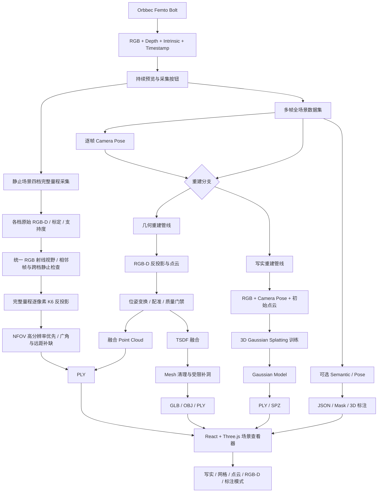
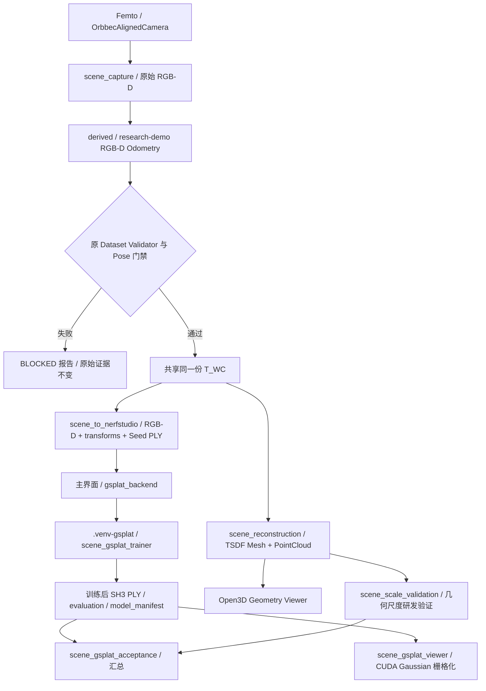
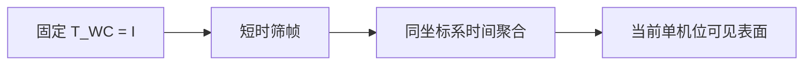

# Femto Bolt 真实场景多视角三维重建技术路线

> 当前实现的唯一技术基线（Source of Truth）  
> 适用目录：`E:\测试3D人体关节坐标`  
> 最后更新：2026-09-20

### 2026-09-20 拆分超长函数（结构整理，不改算法与格式）

- 将 `femto/` 与 `commercial_compliance_check.py` 中 18 个不少于 150 行的函数按处理阶段提取为同模块私有辅助函数，统计结果降为 0 个；测试 patch 使用的模块级名字保持可达。
- 保持算法、门限、线程与副作用顺序、异常和日志文本、JSON 键及构造顺序、文件名和数据格式不变；商业合规脚本只做 import 干扫描，未运行主检查。
- 分层检查为 0 条向上依赖，132 个模块与 gsplat 运行时导入通过；全量回归 699 项通过、8 项跳过，另有 6 项 gsplat guard 通过。详见《拆分超长函数交付记录_20260920.md》。

### 2026-09-20 源码迁入 femto/ 包并消除循环依赖（结构整理，不改算法与格式）

- 118 个根目录模块按依赖层次迁入 `femto/` 包 16 个子包（`femto` → `depth` → `dataset` → `geometry` → `hardware` → `reports` → `annotation` → `tracking` → `temporal` → `local` → `planning` → `viewer` → `pipeline` → `gsplat` → `capture` → `app`），**文件基名不变**；根目录只留 `commercial_compliance_check.py`、`.cmd` 入口、`tests/`、`tools/`。所有入口与子进程改为 `python -m femto.<pkg>.<module>` 并以仓库根为 `cwd`；`femto/paths.py` 统一提供 `REPO_ROOT / DATASETS_ROOT / OUTPUTS_ROOT / PHOTOS_ROOT / MODELS_ROOT / LOG_ROOT`。
- 拆循环依赖只搬纯函数，不改行为：K6 反投影 `depth_cloud` → `femto.geometry.depth_cloud`；`distortion_maps` / `prepare_rgbd` / `load_poses` → `femto.geometry.rgbd_frames`；位姿跨度 `pose_diversity` → `femto.tracking.moving_quality`；`prepared_depth` / `load_temporal_confidence` → `femto.depth.temporal_depth_layer`；采集包络 `local_workspace`（30 mm / 10°）→ `femto.tracking.local_frame_selection`；`write_calibration` → `femto.dataset.calibration_files`；`validate_exclusions` → `femto.annotation.scene_annotations`；单帧来源解析 `resolve_source` → `femto.dataset.single_frame_source`；采集会话生命周期（`ActiveScan`、`save_scan_frame`、`finalize_scan`、`save_rgbd_photo`、运动提示状态机、`wait_for_aligned_frame`）从主界面抽到 `femto.capture.scan_session`（主界面由 2007 行减到约 1700 行）。`scene_reconstruction`、`local_comparison*`、`local_parameter_study`、`local_history` 归入 `femto.pipeline`，`local_geometry`、`local_processing` 归入 `femto.local`。
- `tools/check_layering.py` 按上述顺序检查跨包 import（含函数内延迟 import），当前 0 条向上依赖；迁移前同口径为 7 个强连通簇、21 条向上边。
- 实现指纹（`local_comparison` / `local_parameter_study.IMPLEMENTATION_FILES`、`local_tracking_replay.tracking_code_sha256`）改为包相对路径并加入 `rgbd_frames.py`，旧对照报告按既有规则判为实现已变更。历史回放 `--baseline` 快照按裸名 import 兄弟模块，`load_baseline` 先注册包模块别名。
- 迁移脚本 `tools/_migrate_packages.py`、`tools/_restructure_layers.py` 留档；详见《包结构迁移交付记录_20260920.md》。

### 2026-09-20 IO 工具收口与实验脚本归位（结构整理，不改算法与格式）

- 新增 `io_utils.py` 作为全仓库唯一的 JSON / JSONL / 图片读写实现（`load_json` 统一 `utf-8-sig`、`write_json` 原子写并建父目录、`write_json_strict` 拒绝 NaN、`imread_unicode` / `imwrite_unicode` 走 `np.fromfile` + `cv2.imdecode` / `imencode`）。`cv2` 在图片函数内延迟导入，gsplat 运行时可直接使用 JSON 函数。删除 29 处分散在 20 多个模块里的同类定义，各模块用别名保留旧名字，调用点与测试 mock 目标不变。
- 图片编解码失败统一抛 `ImageCodecError`（同时继承 `ValueError` 与 `RuntimeError`），兼容原来两套异常口径。`scene_dataset_validator` 的 JSON 读取由 `utf-8` 改为 `utf-8-sig`；`scene_single_gs` / `synthetic_scene_demo` / `scene_quality_report` / `research_validation` 的 JSON 写由非原子改为原子。`local_*` 系列继续 `allow_nan=False`。
- 22 处"为写 JSON 而 import `scene_capture`"改为 import `io_utils`，局部补采 / 时域 / 重建模块不再因 IO 传递依赖 Orbbec SDK。`local_comparison` 与 `local_parameter_study` 的实现指纹文件列表新增 `io_utils.py`，旧对照报告按既有规则判为实现已变更。
- `benchmark_depth_quality.py`、`diagnose_local_span.py`、`scene_gsplat_experiments.py`、`validate_temporal_keyframe.py`、`verify_temporal_fusion.py` 移入 `tools/`（无 `.cmd` 入口、无 import、无测试的实验脚本），从仓库根目录 `python tools\<name>.py` 运行，输出仍在 `outputs/`；见 `tools/README.md`。
- 新增 `tests/test_io_utils.py`。详见《IO工具收口与实验脚本归位交付记录_20260920.md》。

### 2026-09-20 产品汇报与数据收口

- 固定RGB产品页改为单次区域提交与保存：每次“完成区域选择”计算成功后原子替换上一条区域，计算失败保留旧结果；底层多区域格式和研发接口不删除。产品页隐藏“应用名称备注”“删除所选 / 可撤销”“清除当前选中”三个管理按钮，保留涂抹草稿/已提交结果的撤销。名称与备注在切换操作或“保存并导出当前结果 GLB / PLY”时自动应用，单次导出最多包含一个区域。
- 当前运行数据只保留 `datasets/scene_20260917_102907_local_3e8ddeec` 与 `outputs/complete_demo_20260917_102931`；三个 latest 指针已核对并继续指向该原始会话、重建目录和结果目录。历史窗口扫描结果为1条采集记录。
- 依用户要求删除其余旧采集、旧模型、验证输出、备份、规划草稿与工作区；同时删除最新模型中的 `annotations`、`region_paths`、`region_projects`、`region_project_history`、`measurement_validation` 和 `region_library.json`。区域导出历史当前为0条。源 RGB-D、标定、派生位姿、TSDF网格、纹理、点云、相机轨迹、depth quality与Gaussian目录保留。
- `产品与技术汇报文档.html` 已按当前产品主线重写为“局部采集 → 固定RGB方形涂抹工作区/禁止区 → 自动组合 → 导出区域文件”，并使用唯一保留模型的实际指标。2026-09-05旧版归档至 `doc/历史开发记录/产品与技术汇报文档_20260905.html`。
- 本节之后引用的部分 `outputs/` / `datasets/` 证据路径属于清理前的历史记录，文件已不再保留；历史文字不得当作当前可回读证据。算法与代码状态仍以当前仓库和本文件顶部记录为准。

### 2026-09-19 固定 RGB 方形涂抹选区

- 涂抹性能：笔画内保留背景与未变化区域图层，仅更新当前涂抹图层；鼠标轨迹逐段记录，预览刷新合并为最多30fps。按图像尺寸与轮廓缓存两类区域掩码，轮廓改变自动失效；像素判定与轮廓追踪限定在选区包围盒内。松开、重置、关闭时取消待执行刷新，保留工作/禁止组合、擦除与逐笔撤销语义。

- 已完成区域按列表选择隔离显示：单选只显示该区域的填充、边界与禁区；多选显示所选区域的并集填充和对应边界；清除选中后隐藏已完成区域叠加。查看已完成区域时暂时隐藏未完成涂抹草稿，草稿保留。仅改变显示，区域数据与导出流程不变。

- 产品展示界面收敛为“采集结果 → 区域涂抹 → 导出当前结果”。暂时隐藏标记回读、实测/几何诊断/精度报告、区域方案保存与恢复，以及旧式“先选主区域再加禁区”入口；实现与历史数据保留，未删除底层能力。
- 产品入口中的历史窗口收敛为“历史区域导出记录”，只列出实际区域导出结果，可预览区域模型、打开包含GLB/PLY/CSV/JSON的导出文件夹并刷新。区域工程、路径结果、方案版本、索引编辑/修复、来源详情和工程ZIP入口从该界面隐藏；原区域方案库实现和已有文件不删除。
- 方形涂抹可在“工作区域”和“禁止区域”之间切换，切换不丢失另一类标记，完成时自动判断并组合：仅工作区导出工作区；仅禁止区导出全部有效范围减禁止区；两者同时存在则导出工作区减禁止区，工作区外的禁止标记自然忽略。橙色显示工作区、红色显示禁止区，粉色高亮表示最终导出内容；输出仍为GLB、网格PLY、顶点点云PLY、边界CSV和来源JSON。
- 固定 RGB 查看器以“方形涂抹”替代逐点圈选：按住左键连续涂选，可勾选“擦除已涂部分”修正草稿；“完成涂抹”后仍调用原可见三角形质心及深度一致性校验生成三维区域。禁区使用同一涂抹交互。
- 方块边长默认40屏幕像素，滑块范围8–160；光标实时显示方形范围。笔画开始时换算为参考RGB像素，连续事件之间扫掠方形，图像边缘裁剪；缩放和平移不改变已涂草稿的参考像素坐标。
- 方形笔刷是选区编辑，不改RGB、原始深度、源网格、W0坐标或采集证据。橙色为尚未提交的涂抹选区；完成后按实际三维支持显示选中表面。
- 每次松开鼠标提交一笔，最多保留100笔草稿撤销；完成后沿用已有区域撤销。像素格边界转换为偶奇规则轮廓，保留孔洞与分离区域并兼容现有草稿、保存、导出与路线裁剪。超过512角点时使用最多1参考像素的轮廓简化；仍超预算则拒绝本笔并保留上一笔，不用凸包填补孔洞。
- 新增`square_brush.py`和笔刷测试，覆盖连续拖动、擦除、孔洞/分离区域、边界裁剪、长斜线、复杂度拒绝、方形光标、逐笔撤销与完成后生成三维区域；同步回归固定RGB、草稿恢复和覆盖规划。

### 2026-09-18 局部补采跟踪实验：特征初值、关键帧锚定和有界重定位

- `scene_live_tracker` 新增三个独立实验开关，当前 `feature_seed/keyframe_anchor/relocalization` 默认均为 false。ORB 只在1/4分辨率提取，互匹配后需旧帧原始深度、至少 12 内点、比例≥0.5、源/目标均至少覆盖4个4×3网格单元、目标深度支持≥0.5和20 mm一致性。PnP 只是稠密双向 RGB-D 里程计的第三初值，不能直接成为 Pose。
- 关键帧只能由本会话已落盘、已接纳的当前可信帧加入，最多128帧。锚定的预测初值固定为 `inv(T_W0_current_candidate) @ T_W0_keyframe`；帧间候选与关键帧候选分歧超过10 mm/2°就拒绝整帧。若采用锚定候选，停稳检查使用最终位姿相对上一可信位姿的变化，位姿修正超过1 mm/0.2°会重置停稳窗口。
- 重定位只在当前会话内对最近5个已接纳关键帧求解，窗口最长15 s，同时保留每帧≤2 s时效。特征候选间、特征初值与稠密结果、以及连续2帧恢复候选均需在10 mm/2°内一致；坏帧、重复时间戳、间隔>2 s、计算或落盘过期都打断确认。恢复不重设 W0，恢复帧 XYZ 只在通过后输出，且恢复帧不直接接纳，需重新停稳。失败保留原始丢失原因及尝试证据。
- 报告/派生 Pose 记录 `tracking_algorithm=local-evidence-tracker-v2`、开关、关键帧数、特征初值/锚定统计和重定位事件；W0/RDF/米及旧 schema 保留。无回环、无位姿图、无跨会话续接，不改 TSDF/融合/采集包络。
- 软件/合成测试覆盖变换方向、特征证据、锚定冲突、新鲜连续确认、落盘边界、UI和报告。4段正常历史会话在各变体下分别保持71/71、51/51、278/278、258/258可信帧，特征第三初值未触发；锚定计算P50约602–708 ms（基线292–346 ms），对基线的位姿分歧P95为5.45–64.85 mm/0.43–7.62°。2段旧失跟会话均在最后一帧才打开恢复窗口，没有后续帧确认，仍明确失败。输入哈希不变；这些同源结果没有物理真值，不能证明锚定更准或现场不会误恢复，默认开关因此保持关闭。详见《局部跟踪特征锚定与重定位交付记录》。

### 圈选区域通用格式导出

固定RGB“保存并导出区域 GLB / PLY”对每个已完成区域输出PLY网格、顶点点云、GLB、独立来源JSON和边界CSV。PLY与CSV保持W0 RDF米制坐标；GLB通过场景节点diag(1,-1,-1,1)转换为右/上/后，JSON记录双向变换、源几何哈希和导出文件哈希。使用已有完整选中三角面，保留孔洞，不新增边界插值。GLB为顶点色外观，无照片纹理。边界CSV是含孔洞的无序边集合，不是执行路径。

### 2026-09-16 圈选区域扫描路径预览（新增）

- 新增毫米曲面路径：`metric_region_path.py` 在所选三角面边图上按真实米制边长求多源最短距离，再在面内线性插值得到距离等值线。每个连通区域以W0 Y最小的边界顶点为起点；首条等值线为半个间距，后续按指定毫米递增。默认5 mm间距、沿路径最大1 mm采样，参数范围均为0.1–100 mm。孔洞保留，各等值线/岛屿独立，不生成段间移动。面内分段采样贴合原三角面，顶点色和原模型不变。
- 毫米算法为**网格边最短距离近似**，不是精确曲面测地距离；网格粗细、三角形方向、曲率和边界形状会影响实际相邻路径的间距。无全区域覆盖或边界退让保证；非流形边及无边界闭合分量拒绝生成。预算为200000采样点、约2000万次等值线/面检查，后台支持取消。像素路径入口保留，旧JSON仍可核验回读；毫米路径使用`femto-region-metric-path-v1`并记录起点规则和顶点索引。
- “导出区域＋路径 GLB / JSON / CSV”新增`region_with_path.glb`：区域源三角面与黄色路径显示管为两个独立对象，显示管半径0.15 mm，不是工具几何或测量表面。两对象局部顶点均为W0 RDF米，场景节点使用diag(1,-1,-1,1)转换到glTF；JSON记录正逆转换、GLB哈希和显示半径。段间无连线；黄色管的厚度可能覆盖相邻边缘，不表示路径跨越孔洞。GLB只提供顶点色，无照片纹理。

- 接续完善：断段阈值可在界面设置0.01–100 mm（默认5 mm，不是采样间距）；状态栏和导出JSON显示段数、点数及段内折线总长，长度不含段间移动，也不是精确曲面弧长。新增JSON回读：核对W0/米、源几何哈希、原点、局部上下文、区域签名与研发状态，再按文件参数从当前投影重算并逐点比对；不匹配拒绝加载。文件大小限制100 MB，回读不修改模型/标记。

- `region_path.py` 在固定初始视角的已选可见三角面支持范围内逐行采样射线/网格交点，行方向交替。默认行间距10图像像素，可选1–500像素；不是等毫米曲面覆盖规划。沿行每像素采样，单步距离超过5 mm、无支持像素或非共边面之间均分段，单点段不输出，各段不自动连接。最多200000采样点，支持后台预算取消。
- 固定RGB窗口新增生成、清除路径预览与导出按钮，黄色折线随图像平移/缩放。绑定模型对象及区域内容签名，切换区域或修改区域后不使用不匹配的旧路径。预览沿用完整选中三角面口径，边缘不新增多边形裁剪插值。
- 导出到当前重建目录`region_paths/path_<唯一编号>/path.json`与`path.csv`。保留W0 RDF米制XYZ、原网格绕序法线、分段编号与顺序；CSV额外提供段内累计长度（米）。JSON包含源网格/几何哈希、原点引用、局部会话上下文与参数。原采集和模型不变。
- 法线不是工具姿态。该版本仅为离散曲面采样路径预览，不保证采样点之间连续贴面、等距覆盖或碰撞安全，没有段间抬刀/过渡、机械臂逆解、手眼标定或治疗执行；`execution_ready=false`。坐标未做实物精度验证。

### 2026-09-15 本轮接续：跟踪稳定性与合格中断前缀（阶段一）

- 最终完整回归为501项（493通过/8项专用环境跳过/0失败），保留已实现的30 mm半径、相对初始朝向总旋转10°、W0/RDF/米、固定RGB/网格测量/点云诊断/距离着色/多选管理。历史20 mm门限按各会话当时记录解释。本轮融合链路收口见《融合链路优化交付记录_20260916.md》及 `outputs/opt_feedback_20260916/codex_execution_20260916/final_audit.json`。
- 局部输入队列容量 1，单在途原始保存与跟踪重叠；匹配 frame_id/采集/彩色/深度时间戳且落盘成功后才能接纳、写跟踪记录和加入预览。保存过期拒绝并保持此前最后可信截止帧。缓存等价低分辨率深度映射、内参，免去无用彩色点云与 native depth 复制；未裁剪原始 RGB-D。
- 质量、准备和写入耗时分别记录。新增诊断 P50/P95、纹理支持、当前深度/清晰度和短暂不稳定/重新验证标签；失效坐标为空，保持 2 s / 5 帧和原配准质量门限。反向也执行同值单步上限。背景运动外点二值筛选、反向初值策略仅在回放中显式启用，默认关闭，不是重定位。
- 独立 `local_interrupted.py` 可审核≥3个不同已接纳视角，仅重建同一 W0 最后可信时刻之前的证据。原失跟记录保留，新模型明确“中断前数据建模”，不写业务 latest。5段同源回放默认优化保持311/323通过；12帧离线保存+跟踪P50约383→303 ms，仅处理开销证据。实物连续采集、遮挡/人体及精度待现场验证。
- 完整文件、参数、命令、失败记录和证据见《局部补采稳定性优化记录_20260915.md》。证据与201文件备份：`outputs/local_resilience_20260915_174923_64d3e718/`。

### 2026-09-15 固定 RGB 选区与局部半径门禁

- 排查真实 scene_20260915_093300_local_5389e373：位姿跨度逐帧增长，非单帧跳变。独立 SIFT/原始深度/PnP 对 0→24 估计平移 350.6 mm，在线为 387.0 mm，两变换分歧 44.2 mm/4.34°；两者都没有独立物理真值。未发现毫米/米或变换方向误用证据，不能把 PnP 直接替换为正确 Pose。104 个原始源文件哈希未变，证据 outputs/span_diagnosis_20260915/diagnosis.json。
- 按用户新要求，局部接纳增加相对初始光学原点欧氏半径 ≤0.02 m；超过时持续跟踪、保留原始数据、不接纳关键帧。可信链内返回范围可请求继续，失跟仍锁定。逐帧 local_workspace、报告与派生 manifest 记录范围，导出再核对。不裁剪位姿或放宽原有同步/配准/时效门禁；高级移动采集不受此局部约束。
- 新增 fixed_rgb_geometry.py / fixed_rgb_viewer.py 和 start_fixed_rgb_viewer.cmd；局部模型入口默认固定初始 RGB 选区。局部点云展示停止自由旋转，高级三维查看器继续保留。固定照片经同源 K6 去畸变；缩放/平移只影响屏幕映射。
- 几何在 W0 中保持不变；初始相机射线取最近 Mesh 交点，初始有效深度处要求 Z 一致性 ≤0.01 m，否则拒绝；无几何或无源图像像素不生成点。首帧缺深度处可显示融合模型已有的实测支持，并单独青色叠加，不视为真实覆盖率或精度证明。
- 圈选保留多边形内可见三角面中心所对应真实区域和孔洞，复用 AnnotationStore 管理/导出。固定标记追加 view_reference（RGB/Depth SHA-256、参考帧/会话、去畸变内参、图像尺寸和映射规则），固定窗口回读复核；米制 RDF、模型哈希与原点来源门禁保持。
- 完整回归 333 项：325 通过、8 专用环境跳过；实际历史模型中英文窗口完成选点/滚动检查；商业开发基线通过、release_ready=false。证据 outputs/fixed_rgb_full_final_20260915.log 与 outputs/fixed_rgb_ui_final_20260915。固定 RGB 保留拍摄外观，本轮不追加 3DGS，不宣称旧模型几何误差已修复。详见《固定RGB选区与位姿排查交付记录_20260915.md》。

### 2026-09-15 局部采集结束保护与失败读数

- 局部工作台在接纳视角数小于 3 时禁用结束建模，并在计数旁说明最低数量；直接调用结束操作同样被拦截，提示继续补采，保持当前会话与原点。取消仍可执行。后台的至少 3 个有效不同视角和最终位姿门禁保持不变，数量达标不代表建模必然成功。
- 任意 local_error 终止后，定时刷新均保持 XYZ/角度为空，并显示任务失败；避免标定变化、存储或重建错误后重新显示末次可信位姿。正常处理阶段仍可明确显示末次记录。
- 此轮只改交互保护，不改变 SDK、位姿估计、原始数据、融合、坐标或标记格式。新增不足三帧保持会话、取消与任意失败后多次刷新回归。
- 验证：局部专项 56 项通过；完整回归 326 项，318 通过、8 专用环境跳过，退出码 0。证据 outputs/capture_ui_guards_full_20260915.log；本轮未打开真实相机，详见《采集交互保护交付记录_20260915.md》。

### 2026-09-14 采集中断排查与连续跟踪重试

- 根据用户的实际失败会话核对原因。截图对应 datasets/scene_20260914_174841_local_37552cc6：接纳关键帧 0/21/35、累计预览 92,356 点；原始跟踪 52 帧中最后出现 4 次 pair_quality，随后与末次可信帧的接收间隔为 2.125 s，触发 tracking_gap。此时仍有新的同步 RGB-D 输入，不能把该会话结论写成相机断开。295 次 dropped_input_frames 是有界队列替换未处理输入，不能当作 SDK 断流次数。
- 原代码对每个帧对都从单位矩阵初值求解。第 46→47 帧的原始数据回放复现前后向配准平移残差约 360.8 mm，触发既有门禁；这是算法内部不一致，不是实物位移误差。新增一次有条件重试：首次求解失败且存在上一次已验证的帧间变换时，以该变换及其逆作为两个方向各自的求解初值。每个方向重新执行 RGB-D 里程计，初值本身不成为有效位姿，不重设参考帧、不检索历史关键帧、不进行丢失后的重定位。
- 保持 K6、0.25 图像缩放、[30,20,10] 迭代、depth_diff_max=0.07 m、fitness≥0.15、RMSE≤0.06 m、单步≤0.25 m/25°、双向一致性≤0.01 m/2°。额外拒绝非有限 fitness；无深度、清晰度、同步、表面标记支持门限均未放宽。每帧最多两次双向求解，失败计数仍按帧计；连续 5 帧拒绝或 2 s 时效/连续性门限仍锁定丢失，耗时重试的过期结果也不能接纳。
- 首个有效彩色相机参考 W0 及 T_W0_Ct 的方向保持不变；只在当前帧最终通过时推进上一可信帧、位姿及下一次可用初值。暂停只停止关键帧接纳，继续跟踪；丢失后不恢复旧会话，不发布失败前缀模型或更新成功索引。最终模型选点的 XYZ、原点距离和两点测距不变。
- 新逐帧记录保留失败的 pair_failure / pair_attempts，成功重试在 pair.initialization=previous_valid_step 及 attempts 中记录首轮拒绝指标。增加 consecutive_failures、last_valid_frame_id，以及 queue_wait/raw_write/pose_processing 分段 timing_ms。总结增加重试/恢复帧数、分段耗时均值/P95和 termination；恢复计数不计入拒绝帧数，不能解释为定位准确率。
- local_failure.json 兼容原 error/session_id，增加来源、参考帧、接纳帧、终止原因、前一拒绝及失败指标、设备错误和未发布模型状态。空队列看门狗区分无输入与有输入但无可信位姿，不伪造 RGB-D 记录。相机读取异常传入当前局部会话，关机清理不再将设备错误覆盖成用户取消；原始写入失败也有错误报告。
- 主视图上方保留可见状态条：黄色表示暂不可信及停稳操作，红色显示中断原因和已保留帧数。右侧区分中断、处理中与末次记录；中断时步骤栏变红、无效读数清除。右侧短操作成对排列，使报告按钮在中英文 1120×720 窗口中完整显示。布局测试同时检查实际尺寸≥请求尺寸，避免把被压成细线的按钮误判为可用。
- 文件审计发现旧 finalize_scan 总向全局 DATASETS_ROOT 写 latest_scene，临时测试因此污染真实索引。已改为写当前 session.parent 的索引，默认真实采集路径不变；恢复本轮开始时已核对的真实会话指向，新增隔离回归，并检查最终完整回归前后索引字节不变。未回写任何原始 RGB-D、标定、Pose 或旧模型。
- 实录回放：截图会话从原先 47/52 有效、末尾丢失，改善为现有 52/52 录制帧有效，参考帧始终为 0；原正常对照 60/60 保持。另三段记录仍因质量不合格丢失，未放行。5 个源会话共 1,127 个文件 SHA-256 不变，回放未开相机、未发布模型。回放只验证已有记录范围，缺失的相机输入无法补造，不能等同重启后的在线性能或真实精度验收。
- 最终 .venv 回归 323 项：315 通过、8 个专用 PyTorch/gsplat 环境相关测试跳过；新增 17 项覆盖重试、原点、过期、失跟锁定、报告、设备/存储错误和可见布局。开发基线 errors=[]、release_ready=false。证据 outputs/capture_interruption_20260914_180426_fb4d93b9/full_regression_verified.log、replay_v1.json、ui_final/failure_ui_verification.json、development_baseline_verified_report.json；初次窗口截图发现报告按钮被压缩，保留为中间失败证据，不作为最终通过截图。
- 修改前独立备份 E:/悠自元产品分析解读/工作文件/采集中断修复前备份_20260914_180426_fb4d93b9（156 文件），未覆盖旧备份。操作及仍待实测项见《局部补采使用说明.md》和《采集中断问题修复交付记录_20260914.md》。

### 2026-09-14 本周需求完善：标记管理与会话追溯

- 本轮先核对 F01–F07 的实际代码，再补齐已有点/区域的选择、名称和备注编辑、单项删除与撤销。保留第三轮的原点 XYZ/距离读数、两点测距和表面支持门禁。查看器列表可选择点或区域；区域以红色线框标识，区域选中时不显示单点 XYZ。选点/圈选启动时固定名称、备注、模型与视角；清除、回读、换模型后丢弃迟到结果。
- 标记 JSON 仍为 version=1，点和区域新增稳定 annotation_id、created_at、updated_at；新建时间带时区，编辑保留创建时间。旧记录缺少 ID 时生成导入 ID，缺少单项创建时间时保留 null 并提示未知，不拿回读时间冒充创建时间。重复 ID、非法元数据或模型/会话/参考系不匹配整批拒绝，失败不部分替换现有集合。
- 区域的 triangle_indices 必须有效且不重复；边界为绑定网格中所选三角面的真实边界线段，保存和回读均重算 boundary_world_m，保留孔洞边缘，不使用文件中可能过期的派生边界造面。屏幕轮廓只记录选择过程，不作为三维路径。有限坐标、单位、来源校验和原有深度支持门禁不放宽。
- 内存撤销按操作先后处理新增、编辑、删除和清空，保留最近 100 步；未完成圈选时先撤销末角点。成功回读或换模型开始新历史；保存不清除历史，也不修改旧保存目录。修改名称/备注后需点“应用修改”，未应用时保存明确提示；删除后清除读数，撤销删除后恢复对应 ID 和选择。
- 新增 local_reference.py：对 calibration 中既有 6 个 JSON 文件分别算 SHA-256，再对文件名/哈希映射按键排序、紧凑 JSON 编码算组合指纹。首次有效 RGB-D 写 derived/local_reference.json，包含会话 ID、参考帧、采集/彩色/深度时间戳、米制 RDF、T_W0_Ct 和标定指纹；派生 Pose、manifest、重建元数据和标记绑定继承同一 reference_provenance。导出前核对实际标定字节、帧号、时间戳、参考帧和刚体 Pose，不匹配不发布。
- 新来源包还必须与当前派生数据集的实际标定、参考 RGB-D 行及 Pose 相符，才能称初始相机原点；来源缺失的旧模型仍显示模型原点/来源未知，不回写旧采集补造证明。已在 W 中的模型 XYZ 不再应用相机变换。
- 局部工作台在点击开始时生成会话 ID，后台复用该 ID；命令及事件均绑定当前会话，旧会话的开始/位姿/完成/取消消息不能抢占新会话。修复拍照保存期间直接调用开始仍能提交、结束期间重复暂停的问题。原 SDK 单读取线程、暂停时持续跟踪与全部位姿门限保持。
- 初始/最终对比点云文件在独立后台读取，每份显示副本最多 35,000 点、完成邮箱最多 1 项，Tk 主线程只接收当前会话/模型的结果。加载中显示状态并锁定冲突任务；加载失败仍可打开已生成模型和报告，不显示伪点云。
- 跟踪总结新增 duration_s、processed_fps、valid_pose_fps、有效/拒绝数量与原因、lost 次数及延迟均值/P95。帧率为整次会话平均值；延迟从主机收到帧到完成位姿计算，含排队和原始保存，不宣称传感器到屏幕的端到端延迟或定位精度。
- 软件验证：.venv 全量 306 项，298 通过、8 项需专用 PyTorch/gsplat 环境而跳过；标记专项 42/42、局部专项 36/36。实际 Open3D 合成模型窗口完成点/区域编辑、删除、撤销、保存/回读、视图变换和中英文各自 1120×720 布局验证。开发基线通过，errors=[]，release_ready=false。原点距离数学与合成测试均不是实物精度验收。
- 本轮证据在 outputs/weekly_requirements_20260914_162721_3e4e796b；最终窗口报告为 native_gui_171751_8634d3/native_viewer_verification.json。修改前独立备份 157 个源文件/测试/文档并校验哈希，未覆盖前轮备份。详细交付和仍待现场验收项见《本周产品需求完善交付记录_20260914.md》。

### 2026-09-14 最终模型选点：初始原点坐标与距离

- 在实际代码核对后扩展 scene_annotations.py、scene_annotation_ui.py、scene_demo_viewer.py 和 ui_i18n.py，继续使用最终 Mesh 的最近三角面求交；不向稀疏累计预览增加选点，不改主工作台、SDK、在线位姿或融合输入。
- 选中项显示名称、XYZ 与距原点直线距离，统一为 mm、1 位小数，并显示参考系、当前模型来源与完整路径悬停提示。W0 固定于首次有效彩色相机的位置和朝向，内部为米制 RDF（X 右 / Y 下 / Z 前）。最终网格坐标已经属于 W，读数不再次应用 T_W0_Ct。距离为 sqrt(X² + Y² + Z²)；需求原文漏写平方，以其 (0.3, 0.4, 0) m → 0.5 m 示例及欧氏距离定义为准。
- 初始原点来源采用保守核对：local_geometry.json 的会话、参考帧、RDF/米和 T_W0_Ct，须与重建报告的实际网格路径、局部采集记录、源派生 manifest、跟踪总结及第一参考帧 Pose 一致；参考 Pose 必须有效、来自在线 RGB-D、同一会话/参考帧且为单位矩阵。只存在 RDF 标签或单位 Pose 不足以证明首次相机原点。证据缺失的旧/独立模型显示“距模型坐标原点”，并注明初始相机原点来源未知；不补写或改造旧模型证据。
- 标记 JSON 保持 version=1 兼容扩展：每点保存 point_world_m、distance_to_origin_m；增加 origin_reference，记录已核对的参考来源或 unknown。沿用几何 SHA-256、local_context 会话/参考帧、单位与坐标系绑定，并核对源网格路径。保存和回读都从 XYZ 重算原点距离及已有两点距离；旧标记缺少新字段可回读，磁盘原 JSON 不被回写。同几何但不同模型路径、会话、参考帧、坐标系或原点证据不匹配时拒绝直接套用。
- 输入坐标必须为三个有限实数、能转换为有限 mm，且位于其引用的有效三角面。1e-5 m 是射线/PLY 数值舍入容差，不能当作物理精度。局部网格原有“三顶点及中心在同一原始视角内获得 ≤10 mm 深度一致支持”的门禁和融合策略保持不变。
- 增加“选中已存标记”列表。无效点击立即清除当前读数和红色选中标记，不新增点；越界、忙碌时再次点击、清除、撤销、切换模型或回读会使旧异步结果失效。忙碌时的新点击提示稍后重试。撤销最后一点后选中剩余末点；全部删除后无当前读数；回读成功选中末点，失败保留原标记集合但清除当前读数。原相邻两标记间距离、连线、区域导出继续保留。
- 新增中英文字段与真实 Open3D 字体宽度换行。固定说明“估计值，未经过实物精度验证”“显示 0.1 mm 不代表测量精度”，只用于研发可视化，不用于机械臂或治疗设备控制。
- 最终本轮 .venv 完整回归 283 项：275 通过、8 项需 PyTorch/专用 gsplat 环境而跳过；标记专项 30/30 通过。证据 full_regression_final.log / regression_summary.json；商业开发基线 development_baseline_passed=true、errors=[]、release_ready=false。未将环境跳过、公式计算或合成模型行为称为真实相机精度通过。
- 本轮验证与备份见 outputs/origin_distance_20260914_152407_919cdfa5/ 和《原点坐标与距离开发交付记录_20260914.md》。修改前独立备份 112 个相关文件并核对 SHA-256；无 Git。实际窗口首次发现 1120×720 英文文本溢出，已按字体实测宽度修复；失败证据保留，最终复验 native_gui_161327_2476f1/native_viewer_verification.json 通过，含中英文各自的 1120×720 布局记录。所有数学、合成几何及窗口检查均不属于真机精度验收。

### 2026-09-14 增量：边补采边更新三维预览

- 按用户确认优先级，新工作台增加“累计预览”、新增采样点高亮、初始/累计切换、水平/垂直查看旋转和复位视角。初始化后默认进入累计预览，只有通过位姿/质量门禁且接纳为关键帧的数据才加入；暂停或拒绝帧不加入。
- 新模块 `local_live_preview.py` 独立工作线程只读已经落盘的RGB PNG、原始Depth与同帧 `T_W0_Ct`；不访问SDK、不在跟踪线程构建点云、不参与最终TSDF输入。K6去畸变网格每4像素采样，Depth最近邻，沿用有效距离；相机点变换到固定W₀。5mm体素保留首个真实样本及其源帧，不平均XYZ或填造表面。
- 预览保留上限120000点，显示子集上限30000点；达到上限明确提示，最终模型仍使用全部接纳关键帧。更新请求仅含路径/位姿描述，队列最多128项，显示快照邮箱最多1项且仅保留最新，避免UI积压。预览错误单独提示，原始采集与跟踪仍继续；预览失败不会发布成功模型。
- 绿色高亮最新关键帧带来的新采样体素，可关闭。新体素也可能来自噪声/采样变化，不称作补洞数量、覆盖率或实物精度。界面显示已更新帧数/接纳帧数，采样预览与最终融合模型名称和入口区分；未完成预览不可用于标记。
- 同会话 `derived/live_preview_report.json` 记录参数、源帧/时间戳、逐次点数、预览时延和上限状态；坐标仍为World RDF米、`T_W0_Ct`。最终重建与区域标记继续使用原结束后链路，尚无实时TSDF网格、自动重定位或跨会话追加。
- 同步修复补采拒绝提示被下一条位姿事件立即覆盖、结束后正常重建误报位姿过期、重启会话沿用旧预览构图的问题。
- 验证：完整257项软件回归249通过、8环境跳过，日志 `outputs/live_preview_regression_20260914.log`。包括变换方向、新增点来源、缺深度拒绝、重复体素、预算、只读源数据、多帧后台预览、会话隔离与旧功能回归。
- 开发基线扫描修正：`imported_modules` 使用Python原生字节解码以支持合法UTF-8 BOM/编码声明；受限依赖规则不变。专项测试确认带BOM的受限导入仍被检测，当前 `outputs/live_preview_compliance_20260914.log` 的开发基线通过、release_ready=false。
- 真机6秒静止检查：13次有效跟踪，首帧累计预览30526点、预览时延250ms，正常取消且无预览错误；证据 `outputs/live_preview_camera_smoke_20260914/report.json`。只有首帧被接纳，未移动设备，不能作为真实多视角补洞或精度验收。

### 2026-09-14 局部补采工作台与在线 RGB-D 位姿

- 原 `start_femto_app.cmd` 入口默认显示局部补采页：建立原点、在线位姿、停稳补采、暂停/取消、结束后融合、初始/融合点云对照及模型标记入口。原操作面板保留在“固定采集与高级功能”，补回显式固定时域融合入口；两页任务互斥，仍只有一个 SDK 读取线程。
- 新增 `scene_live_tracker.py`、`local_capture.py`、`app_local_panel.py`。RGB-D 逐帧使用现有 K6 去畸变和 0.25 缩放、正反向混合里程计；沿用 fitness 0.15、RMSE 0.06m、单步 0.25m/25°、双向一致性 0.01m/2°。原离线移动流程不替换。
- 第一有效帧定义 W₀，矩阵 `T_W0_Ct` 将当前彩色相机 RDF 转到初始彩色相机 RDF，内部米；界面 mm 和角度仅为估计显示。角度约定俯仰 Rx、偏航 Ry、滚转 Rz，`R=Rz·Ry·Rx`，奇异时不显示不稳定角度。过期/无效位姿不当成当前值。
- 后台队列最多2帧，满队列替换尚未处理的旧输入、保留较新帧并记录丢帧；已进入跟踪的 RGB（PNG）和 uint16 mm Depth、标定、时间戳不可变保存，原始 Pose=null。在线 Pose 和选帧写 derived，融合使用同帧派生位姿而不离线改变原点。
- 新门限：RGB-D同步≤5ms、数据/跟踪间隔≤2s、连续5次失败丢失、原点初始化15s、会话300s、补采请求3s。停稳帧要求相邻估计变化≤3mm/1°，距前关键帧至少10mm或2°；至少3个有效不同视角才能重建。全部为初始工程门限，非实物精度保证。
- 暂停补采继续跟踪；失败/取消保留证据，不发布成功模型。尚无回环/重定位，跟踪丢失需新会话；不支持跨会话续补，也不提供持续实时融合。主面板对比为同视角/尺度的轻量点云显示，完整标记仍复用独立Open3D查看器。
- 新增 `local_geometry.py`：局部链路不积分推算修复Depth；TSDF标记面要求三个顶点和中心在至少一个源深度视角内有≤10mm的一致支持，过滤后为空则阻断。此为深度一致性门禁，不保证微小孔洞/几何全部正确；原始缺失不作为有效深度。固定/旧多视角补洞策略保留。
- `initial_observed_points_m.ply`、`local_geometry.json` 和在线质量报告随新结果保存。区域标记新增名称、备注、实际区域边界三维线段、会话/原点绑定；同几何但不同会话也拒绝误用。未改已有模型坐标、训练依赖与3DGS门禁。
- 软件验证：完整249项回归，241通过、8环境跳过；覆盖实际Open3D配准、合成端到端局部融合、原始数据不变、丢失/暂停/同步、来源绑定与1120×720布局。日志 `outputs/local_capture_regression_20260914.log`。本条此前将商业开发基线误记为通过：对应旧日志实际有UTF-8 BOM解析误报，已在本日第二轮修正扫描器并复验通过；本轮未新增依赖，不代表发布或临床验收。
- 真机短测：修复NumPy布尔序列化与队列旧帧积压后，6秒静止后台采集获得13次有效跟踪，正常取消、保存原始PNG/Depth和跟踪记录。证据 `outputs/local_worker_smoke_20260914_v2/report.json`；首次队列过期失败记录保留。此为静止链路检查，不是移动精度或补洞验收。
- 使用说明：`局部补采使用说明.md`。真实移动补洞、位姿/尺寸精度与长期性能仍待新采集现场验收；历史数据已清理，不将历史数字作为本轮结果。

### 2026-09-11 按采集模式查看最新几何模型

- “查看最新三维模型”按当前下拉模式选取 `latest_keyframe_result` 或 `latest_moving_result`，按钮中英文同步显示固定视角/移动多视角类型；模式切换立即更新按钮状态。对应模式没有成功重建时禁用，不回退到另一类共享结果。
- 查看器启动时再次读取当前模式对应来源；3DGS两种训练来源继续各自独立。新增GUI断言覆盖两种实际查看器路径、模式切换、无对应结果时禁止启动。验证不打开相机或实际三维查看器。

### 2026-09-10 固定关键帧与移动多视角3DGS来源分离

- 主界面独立维护 `latest_keyframe_result` 与 `latest_moving_result`：关键帧3DGS仅使用最新成功的真实固定视角关键帧重建（包括1/5/10/15帧采集派生的单视角结果）；写实3DGS仅使用最新成功的真实移动多视角重建。下拉采集模式只控制下一次采集，不重定向训练来源。
- `reconstruction_sources.py` 验证模式及必要产物，成功重建分别写 `outputs/latest_keyframe_reconstruction.txt`、`outputs/latest_moving_reconstruction.txt`。启动时核对独立标记并扫描已有demo_summary恢复旧安装数据，忽略合成、缺失和不符合模式的结果；按重建记录时间选择各类最新成功结果。训练自身原有固定/多视角输入质量门禁继续执行。
- 两类来源互不覆盖；新采集进行中统一禁止训练，失败/取消后保留上一次成功来源，并明确显示为“最新成功重建”。一般几何查看仍使用原共享latest_result。单视角与多视角训练输出标记原本独立，继续保留各自最新训练模型；查看按钮表示最新训练产物，不宣称对应最新采集。
- 移动多视角训练质量档位移到写实3DGS按钮区域；中英文分别显示固定与移动训练来源的时间、派生RGB-D帧数和结果目录名。固定10帧融合后显示1个派生RGB-D视角，不冒充10个移动视角。
- 本轮未开启相机或运行GPU训练；来源恢复、交替写入、错误来源拒绝、两训练按钮实际分派和GUI模式切换使用无硬件测试验证。
- 最终完整回归233项：225通过、8环境跳过，日志 `outputs/gs_source_separation_regression_20260910.log`。旧结果只读恢复确认两种来源分别存在；未改写原始采集与训练产物。运行中的旧界面需要重启才能加载改动。

### 2026-09-10 实拍验收与结果质量报告

- 新增 `scene_quality_report.py`、`生成实拍验收报告.cmd` 和 `床位与平躺人体_实拍验收说明.md`。`complete_demo.run_demo` 完成后自动生成 `result_quality.html/json` 和空白验收模板；原报告入口优先打开新质量报告，旧结果仍可回退。位姿失败报告同样生成，失败不产生有效Pose。旧Demo里的“PASS”显示改为“流程完成”，避免与尺寸验收混淆。
- 报告汇总源/跟踪/关键帧、冗余和拒绝原因、双向残差及几何统计，历史缺少指标时保留缺失。配准残差不称作实物误差；有效深度比例不称作目标覆盖率。源报告/manifest及验收spec记录SHA-256。
- 复用 `scene_scale_validation.validate_scale` 从真实测量几何重新计算距离，默认吸附半径2mm。用户明确给出参考距离、测量来源、尺寸容差和重复极差容差；至少3次独立真实Femto采集才允许指定距离项目PASS。用原始全部RGB-D文件字节指纹拒绝复制录像/重复建模冒充独立采集，记录每个模型文件哈希和端点。非真实Femto、空表面、无效容差或不属于当前模型的验收spec拒绝。
- 按用户指定场景安排床位＋平躺人体计划：床体固定标记用于刚性尺度/重复性；人体体表ROI、呼吸/体动、缺面/重影独立待验收。未实现自动人体尺寸识别、曲面长度/围度或ROI覆盖检测；选点直线距离不等于标准身高。历史回放不标为该场景新采集。
- 自动回放报告：`outputs/moving_quality_replay_20260910_v1/result_quality.html`（90跟踪帧→66关键帧，仅位姿回放）；历史完整几何报告：`outputs/complete_demo_20260908_170532/result_quality.html`（旧位姿，无新版双向统计）。不把不同重建版本的位姿指标混写。实物参考距离、容差及三次测点尚缺，结论PENDING。
- 新增9项报告/验收测试，覆盖三次独立测量通过、误差超限失败、缺项待测、重复源拒绝、合成源拒绝、空表面/非法容差拒绝、模型血缘不匹配拒绝、HTML转义及失败报告。完整回归229项：221通过、8环境跳过；日志 `outputs/field_acceptance_regression_20260910.log`。本地浏览器检查报告中文、表格与待实测状态显示正常。本次未开启相机新采集或训练3DGS。

### 2026-09-10 移动采集质量反馈、关键帧筛选与位姿稳定性

- 新增 `moving_quality.py`，接入 `femto_control_app.py` 与 `scene_pose_estimator.py`。保持原始全场景 RGB-D、uint16 毫米深度、K6 标定、RDF 米制和移动原始 `T_WC=null`；所有筛选仅作用于派生重建输入。
- 移动采集每约1秒在原有单线程异步 worker 上评估最近抽样 RGB 对和当前 Depth；不访问 SDK，不阻塞等待。当前提示独立于“曾经移动”的粘滞证据，提示低有效深度、模糊/低纹理、运动判断不可靠、图像变化过大、变化不足或图像质量可用。比较参考从起始帧改为上一次提交的抽样帧，避免远离起点后永远无法匹配。提示不是实时位姿、真实重叠率或移动速度测量。
- Depth 有效率按源数据采集范围统计，默认至少20%；灰度缩至最多480像素宽后 Laplacian 方差至少20。图像位移超过宽度15%提示变化过大。这些是初始工程门限，不能解释为精度或正确概率；低纹理也可能触发清晰度拒绝。采集帧仍完整保存，历史提示另存 `derived/capture_quality.json`。
- 位姿前过滤低深度质量和低清晰度帧；首个合格帧建立局部世界坐标原点。所有合格中间帧参与顺序跟踪，位姿完成后才筛关键帧：相对上一关键帧平移至少0.01m或旋转至少2度。重复帧不进入TSDF/3DGS，但不从原始数据删除；不为凑够帧数放宽多视角训练门禁。
- 保留原正向 fitness/RMSE/单步限制，新增反向独立 RGB-D 里程计、反向几何质量检查，以及 `T_previous_current @ T_current_previous` 一致性门禁：平移不超过0.01m，旋转不超过2度。连续丢失导致距上次可信帧超过5帧，或采集末尾连续5帧被拒绝时，阻断整段输出，不在失踪后继续拼接或使用单位位姿。
- `pose_quality_report.json` 保存逐帧图像/深度质量、连续跟踪帧、被筛出的重复帧、关键帧源序号、拒绝原因、双向残差和策略门限。失败同样保留报告，不发布有效Pose或更新成功marker。此版仍无回环、重定位或全局Pose Graph；丢失后需要重新采集，未宣称生产级SLAM。
- 新增6项针对性测试（含模拟配准集成），验证重复帧仍参与跟踪、关键帧导出、异常双向位姿/连续缺深度阻断、原始帧索引字节不变、当前警告不会被历史移动覆盖。完整回归220项：212通过、8环境跳过，日志 `outputs/moving_quality_regression_20260910.log`。
- 实拍离线回放 `datasets/scene_20260908_170451`：90源帧、90跟踪帧、66关键帧、24重复帧、0质量拒绝；输出 `outputs/moving_quality_replay_20260910_v1`。双向一致性最大平移残差约1.412mm、最大旋转残差约0.111度，仅是内部配准自洽指标，不是实物误差。未开启硬件新采集、未重新训练3DGS，现场提示效果和实物尺度仍待验证。

### 2026-09-09 Temporal Fusion接入主界面（最新）

- `start_femto_app.cmd` 原入口不变，`femto_control_app.py` 在拍照旁新增时域融合按钮，打开 `app_temporal_panel.TemporalPanel` 选择5/10/15帧、fast/quality、开始/停止、查看点云/对照/报告/目录。无需第二个相机程序。
- 相机线程接收 `temporal_start/temporal_stop` 并用现有SDK帧填充 `app_temporal.TemporalBurst`（有界20秒、最多15帧，时间戳去重、RGB-D和标定拷贝）。后台非daemon `process_burst` 保存原始证据并调用 `build_temporal_dataset`；相机继续预览，后台不访问SDK。取消/超时/停止保存部分帧，不融合；旧扫描、拍照、训练在任务期间禁用，旧过滤和标定/坐标/3DGS接口不变。
- 结果由Tk事件队列更新；失败或拒绝不关联旧模型，独立面板可回读此前standalone采集的最新temporal报告。原有latest_scene/latest_complete_demo/3DGS标记不改，时域输出不自动变成原单帧模型。
- 新增7项GUI测试，覆盖唯一SDK所有者、短序列后预览继续、取消与相机关闭的部分帧保存、后台异常、UI忙碌状态/恢复、失败后面板重开、默认窗口控件可见边界。整套208项：200通过8环境跳过；日志 `outputs/temporal_gui_regression.log`。未自动开启真实相机或关闭用户应用，实机FPS待复测。使用方法见 `Temporal融合使用说明.md`。

### 2026-09-09 独立固定场景 Temporal Fusion（最新）

- 用户确认先交付独立固定5/10/15帧时域Depth、连续confidence及点云，验证后再接TSDF。新增 `scene_temporal_fusion.py`、`temporal_depth_fusion.py`、`start_temporal_fusion.cmd`、验证脚本和测试。当前GUI/旧static median/单帧/TSDF/3DGS入口不替换，不修改标定、过滤、RGB-D格式或模型指针。详见 `Temporal融合使用说明.md`。
- 主要证据仅为原始有效观测，权重1/0；逐帧原有质量与保守补洞独立保存，但补点不参与时域测量。加权中值选实际观测，至少max(3,ceil(.6N))个inlier、inlier比例≥.8、距中值≤30mm、MAD≤15mm；confidence=真实inlier数/N×纯度×exp(-MAD/15mm)，未知0，方差/MAD/支持数落盘。
- 复用 `assess_rgb_motion_pair` 的背景检查，并收紧为位移≤1px；每相邻及首帧对其他帧均须可靠固定，否则只报告不生成模型。局部RGB变化>35扩张1像素后排除。不同时间戳、同网格/内参、RGB-D同步≤5ms。参考RGB固定首帧，XYZ继续K6、彩色相机RDF米，无世界Pose。
- 新采集固定wide_detail/1920×1080/15FPS，有限5/10/15帧内存拷贝，停止设备后编码与处理；raw原始RGB/Depth、metadata/calibration保留，confidence属derived。两处PLY/K6函数通过显式 `temporal_confidence=True` 接受连续权重，默认旧0/.3/1严格接口不变。新产物不直接传旧TSDF或3DGS，禁止丢失confidence后等权融合。
- 派生输出 `source/derived/temporal_fusion_<时间>/`：fused_depth_mm、temporal_confidence.npy/PNG、带confidence的fused_pointcloud.ply、支持/方差/MAD、逐帧质量、运动报告、源SHA-256、点数/invalid/confidence/耗时/内存与对照图。rate为0–1，原始基准为首帧，另给输入均值。
- 201项主环境测试193通过8跳过；五类合成模式1/5/10/15帧比较，白桌MAE约1.71→1.08→.83→.65mm，玻璃两层冲突区域保持未知。1080p纯融合约1.1/2.1/3.7秒，48行分块，离线执行；不承诺实时融合或硬件FPS。测试详情/性能脚本见使用说明。
- 已有实拍 `scene_20260909_103220` 前5/10/15帧及 `scene_20260907_101251` 前5帧均因运动未通过，失败证据保留且没有融合PLY。未放宽门禁，未声称真实场景效果改善；需要新的固定相机、固定场景数据完成实物验收。
- 最终复核：1px门禁后10项专项通过；`outputs/temporal_validation_20260909_174821/validation.json` 重复纯融合5/10/15帧平均1.22/2.39/3.72秒，验证进程峰值工作集约227.5MiB（含依赖与测试负载，不含完整实拍管线峰值）。

### 2026-09-09 几何误差门禁、逐点confidence与Depth Debug（最新）

- 按先分析调用链、再设计、再局部修改、最后原始数据回放的顺序实施。读取入口 `OrbbecAlignedCamera.read`、实时 `CalibratedCloudBuilder.build`、K6 `scene_segmented_capture.depth_cloud`、拍照 `save_rgbd_photo`、重建 `reconstruct_scene` 已核对；SDK采集、对齐、实时点云、现有深度清理和TSDF过滤逻辑保留。
- 新增 `depth_error_check.depth_error_check`：对原始有效像素按同坐标比较修复Depth，记录MAE、最大绝对误差、绝对差直方图；任何原有效观测变化都阻止输出。缺失像素没有真实测量值，单独以原始有效8邻域的最大绝对差作为一致性代理，至少5个有效邻居、差值超过50mm即撤回整块孔洞、Depth/confidence归零，禁止进入点云。恰好50mm通过此项，但仍需满足所有既有门禁。报告明确 `repair_ground_truth_error_mm=null`，不得把邻域一致性称为补点真实精度。
- `assess_and_fill_depth` 强制执行候选及撤回后检查，`save_depth_quality` 落盘前复核；派生目录新增 `depth_error_check.json`。`depth_confidence_cloud.build_confident_depth_cloud` 在K6反投影前再次检查，并验证1/0.3/0置信度与真实/修复/未知像素血缘一致。
- `depth_cloud` 新增可选confidence参数：原调用返回值不变；带confidence调用返回 `(cloud, point_confidence)`，采用同一有效像素及finite索引。拍照、单帧重建、回放的派生PLY使用 `write_confident_point_cloud`，每个顶点包含float confidence，XYZ为float64米；未知像素不生成XYZ。Legacy Open3D读PLY会丢弃自定义属性，因此显示可使用它，但后续融合仍必须读取Depth+confidence，禁止仅凭普通PLY重读把补点当真值。
- TSDF仍统一使用每帧10次真实和3次修复独立积分，保持相对1:0.3权重；未知0次，不使用30%抽样近似。现有3DGS种子confidence/训练加权策略保留。新增误差门禁位于所有调用 `process_depth_quality` 的TSDF/3DGS入口前。
- 新增 `DepthQualityConfig.mode`：默认quality，完整8连通域、原始邻域门禁和确定性RANSAC局部像素/深度平面复核（非K6三维平面真值）；估计优先级仍为edge-aware、局部中值、平面后备。fast仅检测被8个原始有效像素包围的孤立单像素孔，不调用全图Connected Components或RANSAC；未分析区域数不冒充完整大孔分类。两个模式同样执行3%/10%、50mm和原始观测完整性门禁，不迭代扩张。
- 新增 `depth_debug_viewer.py` / `start_depth_debug.cmd`：读取已有derived目录，四模式 Original Depth / Invalid Mask / Filled Depth / Confidence Map；绿为真实、黄为修复、红为未知，Depth模式用亮度表示量程内毫米深度。数字键1–4切换，支持1:1、缩放、滚动和鼠标像素读数。全图缩小可能看不到单像素黄色补点，可1:1放大检查。Debug不写源数据、不打开SDK、不训练。
- 原始数据回放quality：`datasets/scene_20260909_103220/derived/fixed_keyframe_20260909_103230/derived/depth_quality_replay_20260909_172112_593738/`；2073600像素，原始无效15448，修复60，剩余15388，无效率 **0.744985%→0.742091%**。2058152个原始有效点MAE=0mm、最大误差=0mm；补点最大邻域偏差的均值11.6mm、最大38mm，非补点几何真值误差。源证据哈希不变。相较前轮64点，本轮撤回不满足50mm规则的一块4像素孔。
- fast实拍回放目录末尾为 `172110_235170`：此帧无通过全部门禁的孤立单像素孔，补0点，无效率不变。预热后10次1080p纯Depth内存计算：fast中位161.7ms/P95 166.7ms；quality中位202.4ms/P95 228.3ms。计时不含PNG/NPY/PLY写入和XYZ生成；不能承诺15FPS同步处理。质量模块仅在现有拍照工作线程或离线重建/回放执行，未插入SDK实时采集及实时原始点云循环。实机持续采集FPS未在本轮验收。
- 测试：191项主环境回归，183通过、8环境跳过；独立PyTorch两项confidence损失测试通过。新增覆盖50/51mm边界、整孔回滚、有效像素误差直方图、PLY confidence逐顶点回读、错误Depth/血缘禁止点云、fast无CC/RANSAC、quality平面复核、Debug颜色/模式和Tk缩放。日志 `outputs/depth_error_debug_tests.log`；四面板图和performance.json保存在上述quality回放derived目录。

### 2026-09-09 Depth 质量检测与保守补洞

- 本轮代码审查更新：`femto_control_app.save_rgbd_photo` 在原始点云反投影前输出质量报告，另存 `derived/point_cloud_hole_filled_m.ply`，原始点云仍使用原始浮点毫米观测，落盘 Depth 仍为 uint16 毫米。`depth_quality.py` 连通域改为包围盒加1像素边界局部分析，避免每个小孔重复扫描1080p全图；报告增加孔洞位置、量程、深度极差和全局策略拒绝计数，不再把全局禁止的小孔误记为大孔。
- `scene_to_nerfstudio.convert` 新转换产物的补洞深度与置信度统一放在 `derived/depth/`、`derived/confidence/`，`transforms.json` 引用同步更新；按manifest路径读取的现有3DGS加载器兼容，已有训练输入目录不迁移、不覆盖。
- 新增边界极差门禁 `maximum_depth_span_mm=60`，与原有标准差 `<30 mm` 联合使用，防止少数跨深度层观测被标准差稀释。配置校验禁止放宽3%/10%、60%邻域支持、30mm标准差、60mm极差及0.3修复置信度约束。对原始无效值的派生表示统一为0，不修改原始输入。
- 新增 `depth_quality_replay.replay_depth_quality`：从已保存照片/数据集读取一帧，在源目录下新建 `derived/depth_quality_replay_<时间>/`，输出原始Depth副本、Mask、补洞Depth、Confidence、质量JSON、K6米制派生PLY和SHA-256复核；不打开相机或训练，不修改原始模型指针。命令：`.venv\\Scripts\\python.exe depth_quality_replay.py datasets/scene_20260909_103220/derived/fixed_keyframe_20260909_103230`。
- 本轮实拍回放（原始Depth-to-Color网格，尚未K6图像重映射）：1920×1080，原始无效15448像素，修复64像素，剩余15384，无效率 **0.744985%→0.741898%**。结果：该数据集 `derived/depth_quality_replay_20260909_154836_711987/replay_verification.json`；源RGB、Depth、标定等哈希不变，有效Depth逐值不变。此口径不同于下方历史K6去畸变后的网格，禁止直接比较二者无效率。
- 五类材料名称对应合成深度模式回归：白桌小孔、黑色物体连续小孔、手机玻璃深度跳变、透明物体大孔、医疗外壳缓变小孔。只验证算法约束，不构成五类材料实物验收；仅凭RGB和Depth连续性不能识别材料，不能保证连续背景前的透明物体一定被识别。修复点只作低可信派生估计，原始点云和原始Mesh仍是测量依据。
- 本轮验证：主环境182项测试，174通过、8项环境跳过；独立gsplat/PyTorch环境2项confidence训练损失测试通过。新增管线实测断言：保存照片原始PLY4799点、派生PLY4800点且米制深度不变；四帧TSDF中仅一帧有补点时共43次积分（4×10真实+3修复），补点观测与真实观测分开。完整日志 `outputs/depth_quality_review_tests.log`。

- 后续真实性复核（覆盖下方首轮记录）：逐个候选像素检查原始 8 邻域，至少5/8有效且标准差<30mm；整块孔洞必须全部满足，禁止用已修复像素递推。插值仅使用通过检查的3×3邻域，避免较远且颜色相近的另一深度层拉偏结果。新增3×3孔洞中心无支持、较远颜色匹配表面干扰两项回归。
- TSDF 修正：30%空间采样不能代表逐点0.3权重，已停止使用该近似。现用 legacy Open3D 单位观测 API，以每帧真实深度10次、修复深度3次积分实现相对权重1:0.3；真实帧无修复时仍统一积分10次以保证跨帧权重一致。代价是 TSDF 积分调用次数增加，尚未做真实长序列性能验收；原始点云和单帧原始Mesh不加入修复点。
- 最新实拍重训 `outputs/single_gs_20260909_154118_418300`：无效率0.656684%→0.652874%，仅修复79像素，剩余13538。500步，229032个Gaussian，其中4个修复Seed，源证据哈希不变。174项主运行时测试：166通过、8跳过。首轮279像素和旧模型仅作历史记录；本轮仍不构成透明/反光材料实物验收，深度连续性无法单独判断材料或证明估计几何真实。

- 新增 `depth_quality.py`，在 XYZ 反投影前按 `depth==0`、小于有效量程或大于有效量程生成 Invalid Mask，并统计总像素、有效/无效像素和无效率。无效率 `<=3%` 允许小孔洞自动修复，`3%..10%` 仅允许面积更小的局部高可信修复，`>10%` 只报告不补洞；不采用 1% 硬阈值。
- 无效连通区域记录面积、宽高、边界有效深度比例、局部 8 邻域有效率和边界深度标准差。仅修复面积/宽高受限、局部有效率 `>=60%` 且深度标准差 `<30 mm` 的 A 类连续小孔；触边或大面积 B 类、深度跳变/低支持 C 类保持未知。像素估计顺序为 RGB 引导的边缘感知加权中值、局部中值、确定性 RANSAC 局部平面；禁止全图 Blur。
- 每帧派生目录保存 `original_depth_mm.png`、`invalid_mask.png`、`filled_depth_mm.png`、`confidence.npy/.png` 和 `depth_quality.json`（并提供同内容 `quality_report.json`）。原 RGB、原始 `uint16` 毫米 Depth 和原始 PLY 不修改；原始观测置信度 1.0、修复值 0.3、未知 0。
- Open3D TSDF 使用上述10:3重复积分实现相对贡献（不是抽取30%修复像素）；原始帧始终10次，修复观测3次，不进入原始点云。3DGS Seed 仍只来自原始深度；训练深度可读取修复值并按 confidence 加权，验证/测试 Depth 指标只读取原始观测。单帧固定视角 GS 可加入修复 Seed，但初始 opacity 为 0.3 且训练中上限保持 0.3。
- 当前实拍案例 `complete_demo_20260909_103234` 经 K6 去畸变后的 1920×1080 深度：原始无效 13617/2073600（0.656684%），保守修复 279 像素，无效降至 13338（0.643229%）；14 个大/触边区域、1 个深度跳变区域和 8 个低支持区域未修复。验证输出为 `outputs/single_depth_quality_verification_20260909_123000`，只生成派生质量数据，未覆盖原模型或启动训练。
- 同一案例已按新规则完成固定视角实拍训练 `outputs/single_gs_20260909_152026_734300`：500 步、229052 个 Gaussian，其中采样命中的修复 Seed 24 个且 opacity 全部受限于 0.3；训练约 19.95 秒，峰值 allocated 254.5 MiB、reserved 302 MiB，同视角 PSNR 37.96 dB。源文件哈希复核不变；172 项主运行时测试通过（8 项环境跳过），直接 gsplat 运行时的 2 项 confidence 加权测试通过。

### 2026-09-09 单帧 RGB-D Gaussian 固定视角建模

- 高 DPI 显示修复：截图中训练虽为 1920×1080，查看器仍按 Tk 逻辑宽度渲染到 1100×619，再被系统缩放。新增进程级 Per Monitor V2 DPI awareness（旧系统回退 Per Monitor），仅作用于查看器；渲染尺寸改为源分辨率，最大 1920×1080，不依赖窗口逻辑尺寸。显示到实际画布时仅做必要缩放，显存不足仍允许原有降级。固定投影和 viewport 格式不变，现有模型无需重训、保存区域可继续回读。23 项相关测试通过。

- 区域回读修复：当前模型没有 viewport.json 时，提示先框选/缩放并保存，不抛文件路径异常、不伪造区域。模型不匹配、数据损坏、访问失败分别提示，失败保持当前视图。保存采用同目录临时文件、fsync 和原子替换，写入失败保留已有区域；区域依然绑定源/模型指纹。回归覆盖首次未保存、中英提示、保存复位回读、损坏文件、错误模型与保存失败。

- 清晰度优化（覆盖下方初始参数）：单帧训练默认宽度 960→1920，高斯上限 100000→300000；实际原 1920×1080 网格 stride=5→3，仍不增点、不移动几何中心。500 步/4 GiB reserved/1.5 GiB free/检查点与血缘保护保留。查看器按实际画面宽度最高 1920 渲染，并显式给单帧开放 2073600 像素预算；多视角默认 150 万像素预算不变，内存降级逻辑保留，状态栏显示实际渲染分辨率。
- 同一来源 `complete_demo_20260909_100556` 独立新结果 `outputs/single_gs_20260909_101531_618400`：223045 点，500 步训练计时 20.109 秒，reserved=358 MiB，peak allocated=281.2 MiB。原 80289 点模型、标注和原始 RGB-D 保留。21 项单帧/查看器/语言测试通过；1080p 新旧同视角对比及渲染预算写入新结果 hd_comparison.json。这些图像拟合指标不代表实物尺度或新视角准确性。

- 来源修复：主界面/一键脚本改为当前 `complete_demo` 的 `source_dataset`，严格要求完成的固定关键帧和唯一帧，不再自动使用 photos/latest_photo。读取 frames.jsonl 指向的同一 RGB-D，记录 source_model、源帧序号、原采集目录、关键帧选择报告/frames/标定/RGB-D 哈希及模型 summary 哈希；保留原 Mesh 和原数据。输入错误直接阻断，禁止静默回退到旧照片。界面显示源模型，切换源后旧 GS 查看入口失效；查看器标题显示源模型。CLI 仍支持显式照片输入。

- 独立入口 `scene_single_gs.py` 接收 `photos/femto_photo_*` 的单帧 RGB-D/标定/manifest；原始文件不改。按 RGB rational Brown-Conrady K6 去畸变，RGB 线性、对齐深度最近邻插值；仅允许上述 A 类小孔以 0.3 置信度进入派生训练输入，其余无效深度保持未知，禁止凭空补背面。
- 从深度网格确定性采样反投影得到传感器局部 RDF 米坐标。相机局部投影 viewmat=I 仅定义本地坐标基准，源外参仍 `T_WC=null`、external_pose_valid=false，绝不生成多视角伪位姿。几何中心和旋转固定，优化 SH0/opacity/scale；不增点、不优化点位，不提供多视角验收结论。
- 默认 500 步，训练最高 1920×1080（原 RGB-D 1920×1080 保留），高斯上限 300000，实际按有效深度采样；scale 限制到初值 0.5..1.5 倍。CUDA reserved 4096 MiB/free 1536 MiB 保护，每步监测，10 ms 间隔，每 100 步 CPU 原子检查点。失败不发布 single_report 和 latest 标记。没有新增第三方依赖，准备在采集环境运行，优化/查看在现有 CUDA 环境运行。
- `scene_single_gs_viewer.py` 用真实 gsplat 渲染 PLY，固定相机位置与朝向。滚轮/按钮缩放 1..16 倍，左键框选区域放大，仅改变投影 K 中焦距/主点；不轨道旋转、不平移相机。保存/回读 viewport.json，以源数据指纹和模型 SHA-256 绑定。区域放大不等于提高采样精度。
- 控制页新增“单帧 3DGS 建模”“单帧固定视角”；使用最近保存照片，和多视角结果各自独立。命令行 `单帧3DGS建模.cmd` 与 `查看单帧3DGS.cmd` 可独立使用，已有主界面须重启加载新按钮。
- 输出 `outputs/single_gs_<时间戳>` 保存源血缘、去畸变 RGB-D、配置、日志、检查点、Gaussian PLY、同视角渲染和报告；`latest_single_gs.txt` 独立于多视角入口。same_view_psnr 只是拟合图像指标，不是留出集、实物尺度或机械臂坐标验收。
- 验证：5 项专用测试覆盖投影/鼠标锚点、区域边界与复位、点数预算与深度反投影、区域模型绑定、原始数据保留；46 项现有后端/导出/门禁/语言测试通过。真实照片 `femto_photo_20260908_091430` 完成 500 步，37191 点，训练计时 18.75 秒，PyTorch reserved=74 MiB、peak allocated=56.5 MiB，同视角 PSNR=35.13 dB；结果 `outputs/single_gs_20260909_095912_242200`。模型回读及区域渲染、viewport 回读、深度点位与检查点一致检查通过。该单次运行不代表系统蓝屏根因已修复或所有数据稳定性通过。

### 2026-09-08 严格分区与 gsplat 顺序优化（运行中）

- 修复旧重建结果训练入口兼容：页面后台和 direct backend 在训练前检测旧转换缺少分区时，从其 conversion_manifest 的源 RGB-D/Pose 重新转换到同级独立 `nerfstudio_strict_<时间戳>`；继承 Seed 体素和点数预算，保留旧数据和报告，再执行严格输入门禁。已有分区不重复转换，损坏分区仍由门禁拒绝；状态查询只读。运行中的旧页面需重启以加载新入口。
- 入口修复验证：152 项测试，146 通过、6 项专用环境跳过；真实 `complete_demo_20260908_170532` 转换至 `nerfstudio_strict_1788858993260664100`，90 帧为 68/11/11，Seed 119926 点，real_femto 门禁 ready=true、reasons=[]。仅输入转换及门禁通过，不是此数据的新一轮训练验收。

- 新增 `scene_gsplat_split.py`：转换前按帧序号固定 train/validation/test，1-based 每 8 帧第 4 帧验证、第 8 帧测试；90 帧为 68/11/11。Seed PLY 只反投影训练帧；记录分区、Seed SHA-256、源帧与 RGB-D 指纹。旧转换目录不覆盖；缺少严格分区的旧输入须重新转换后训练。
- 验证集用于调参，测试集不参与 Seed、Gaussian 优化或配置选择。相机位姿仍为已有顺序 RGB-D 里程计结果，使用共同标定/位姿；“严格”只表示外观/深度未进入初始化和优化，不声称独立相机轨迹或实物精度测试。
- means 学习率按 `1.6e-4*scene_scale*final_ratio^(step/iterations)` 衰减，默认 final_ratio=0.01；逐步记录实际 lr。调度由绝对步数确定，恢复要求 iterations、ratio、depth_weight、grow_grad2d、antialiased 与检查点一致，不接受旧固定学习率检查点混用。
- 新增 `scene_gsplat_experiments.py`（2026-09-20 起位于 `tools/`）：先训练严格 Seed 的固定 lr 对照及衰减对照，再按 grow_grad2d=[0.0002,0.0004,0.0006,0.0010] → depth_weight=[0.10,0.20,0.35] → antialiased/classic 顺序选择；重复配置复用同一完整结果。验证五项全过优先，之后按 Depth RMSE、LPIPS、PSNR 排序；最终锁定模型与 checkpoint 哈希后只评一次 test。
- 实验沿用 low_vram：6000 步、downscale=4、25000 初值、400000 点上限、5120 MiB reserved 上限、1536 MiB free 保留、10 ms pause；不根据测试集回调参数，不改五项阈值。试验不更新 latest 模型入口，每组配置、日志、模型、渲染和报告独立保存。
- 新增 CLI `--depth-weight`、`--means-lr-final-ratio`、`--antialiased/--no-antialiased`、`--no-publish-latest`。本轮不改变坐标轴、Mask、原始证据、依赖或 SPZ 约定；尺度/关键区域仍仅研发可视化。测试及真实实验结果待本轮完成后登记。

### 2026-09-08 训练资源保护与系统崩溃诊断

- 新增 `scene_gsplat_guard.py`：增点前限制候选预算，父点最多临时追加两个点，调用固定 gsplat 1.5.3 复制/分裂/裁剪逻辑；总数及增点临时行数不超过配置上限。低显存 40 万、平衡 80 万、高质量 100 万；屏幕半径触发增点禁用以保持预算约束。
- 低显存改为 6000 步/downscale=4/25000 初始点/refine_stop=3000/checkpoint_every=250，每步间隔 10 ms；不改变相机标定、Pose、几何坐标、源 RGB-D 或质量验收阈值。1920×1080 源训练时为 480×270，更低开销可能影响质量，必须实测验收。
- 各档 CUDA reserved 上限 5120 MiB、最小 free 1536 MiB，每步/渲染/增点前检查，并设 PyTorch allocator 比例后备上限。日志记录 allocated/reserved/peak/free/total 和 Gaussian cap，主界面中英双语显示 reserved/free/cap。内存阈值或 CUDA OOM 写资源停止报告，不发布新成功模型，保留最近完整检查点。
- 检查点中的参数、优化器、策略状态 CPU 化保存，flush/fsync 后原子替换。恢复先在 CPU 验证数据指纹、点数和原 downscale/sh_degree/packed，拒绝把超过配置上限的旧模型加载 GPU，不静默裁点。最近中断检查点 4000 步/1823126 点成功 CPU 回读，旧文件未改；不能直接用新低显存参数恢复。
- 系统记录两次 HYPERVISOR_ERROR 0x20001，不能归结为模型坏或 GPU 未开启；VBS 运行中，Win11 26200、BIOS FX608LMG.302、驱动 591.91。Minidump/WER 内容受 Windows 权限保护，未取得堆栈，根因未定；未改 ACL/驱动/BIOS/VBS。诊断 `outputs/crash_diagnosis_20260908/分析结论.md`。
- 验证：6 项保护测试及 44 项后端/来源门禁/双语/导出回归通过；约 1000 点的真实输入 GPU 20 步加 2 步续跑通过，上限 1100、实际 1099，峰值 PyTorch 分配约 18.4 MiB；输出 `guard_gpu_smoke_20260908_151815`，accepted=false，仅短程冒烟，不是成品质量或系统长期稳定性验收。

## 1. 项目目标与范围

项目目标定义为：**基于 Orbbec Femto Bolt RGB-D 深度相机，对相机实际扫描到的人体、物品、床体、设备和环境进行多视角整体重建与可视化。**

人体不再是重建主数据的默认裁剪范围。系统必须先完整保存同步 RGB、Depth、相机内参、时间戳和逐帧相机位姿；人体 Pose、人体 Mask、物体类别和区域标注是可选派生层，不得覆盖或替代原始全场景数据。

最终支持五种表现层：

- Gaussian Splatting：高真实感场景还原；
- Mesh：具有实际几何表面的模型；
- Point Cloud：原始、配准或融合点云；
- RGB-D：同步彩色、深度、内参和时间戳；
- Semantic / Pose：人体关键点、物体类别与区域标注。

### 1.1 产品级定位与当前阶段边界

本项目当前代码仓库是未来聚焦超声治疗设备的软件技术底座之一，
并非仅以 3DGS 或单一三维重建算法作为最终产品。

最终产品设想包括：

- 深度相机；
- 三维扫描与重建软件；
- 治疗区域交互；
- 后续路径规划；
- 六轴机械臂；
- 超声治疗模块；
- 安全保护；
- 治疗记录；
- 推车式整机及计算平台。

当前研发阶段仅聚焦：

1. Femto Bolt RGB-D 数据采集；
2. 多视角三维重建；
3. Point Cloud / Mesh / Gaussian 多表现层；
4. 真实尺度与坐标体系；
5. 3D 查看、测量和后续治疗区域交互所需的数据基础；
6. 商业可分发的重建运行时。

当前阶段不实现：

- 机械臂运动控制；
- ROS / MoveIt；
- 治疗路径自动执行；
- 超声能量控制；
- 临床治疗决策。

但架构必须为未来这些模块保留明确扩展边界，
不得因为当前未实现而将坐标体系、场景几何或数据结构设计为无法扩展的形式。

### 1.2 当前实现状态

2026-09-15 六阶段接续：以实际代码、独立346项基线和本轮新日志为依据。阶段1/2的报告与候选提示已接入；阶段3独立A/B/C及主界面/历史入口已实现；阶段4固定RGB、未保存状态与历史来源检查已补齐。新增后台取消和发布凭证，状态不得覆盖别的会话。软件/合成/历史回放与新的实物验收分开记录，完整结果见《局部优化分阶段开发记录_20260915.md》。

本轮最终软件回归：482项，474通过、8项专用PyTorch/gsplat环境跳过、0失败/错误；unittest耗时146.788秒，外层149.543秒。日志为 `outputs/local_optimization_20260915_125849_718a7329/final_full_v3.log` 与同名前缀的 `_summary.json`。独立346项基线之后测试总数增加136项；跳过项不计通过。开发基线最终复核 `development_baseline_passed=true, errors=[], release_ready=false`，报告为本轮证据目录 `development_baseline_final_report.json`，旧合规报告未覆盖。最终中英文1120×720候选/完成窗口的10个操作控件通过尺寸与边界检查；未取得本轮屏幕截图，不计视觉或实物验收。

| 范围 | 当前代码与证据 | 实物验收 |
|---|---|---|
| 优化状态和质量反馈 | 结果绑定 processing_report，缺指标为未记录；未采用仍保存原因 | 待新采集 |
| 候选稳定帧 | 复用原采集时间戳与唯一SDK线程，最多5个轻量描述，单帧补采保持 | 操作节奏、帧率和降噪效果待测 |
| 同源A/B/C | 独立目录、原始/派生/报告分层、固定投影；真实101826四视角回放通过，B/C均未采用且逐字节复用前版 | 不代表物理误差通过 |
| 固定RGB/历史 | 高亮、遮挡、孔洞、支持像素、草稿/dirty、缺文件和刷新选择已补齐；83项专项通过 | 新实物交互待测 |
| TSDF候选 | 新增有界 `local_parameter_study.py`；真实5/5组完成，合成4/5组完成、2/20内存预算失败；默认5/20不变 | 噪声、重影、ROI和尺寸待独立参考 |
| 联合位姿图 | 本批精配准未整组通过，尚无可靠多视角边/退化证据，不实施或启用候选 | 需新的适合数据再评估 |

离线预算：生产局部结束任务总时长600秒、Windows Job Object任务组提交内存4096 MiB；对照每阶段300秒/3072 MiB、最多20视角、单worker。有界子进程取消包含Python启动器的后代；提交内存不是RSS。关闭应用的stop_event和同会话取消Event直接参与监督与最终发布检查，不等待SDK读取返回。结果目录创建即写publication.json=pending，全部任务与报告完成后才提交published和业务索引；异常回滚仅回滚本次写入并记录实际状态。旧无凭证结果兼容，新取消/失败/未知凭证格式不能恢复为最新成功。

Mask来源门禁：新增 source_binding（femto-local-temporal-mask-source-v1），绑定原RGB/Depth文件、解码uint16毫米值、frame/session/reference/时间戳、标定/参考证明及五帧窗口文件SHA；像素格为原始对齐彩色图。旧Mask仅在旧报告和完整来源哈希能重建证明时用于新重建，否则明确拒绝，不自动去Mask冒充成功；旧模型只读查看保留。support_mask和stationary_window算法及原接纳门限未改变，16项专项通过。

参数研究最终报告位于上述证据目录的 `phase5_parameter_study_20260915_145941_0642bd45/real_parameter_summary_final_v2/` 和 `synthetic_parameter_summary_final_v2/`。新增汇总器逐项校验实际RGB-D/Pose/Mask、实现哈希、W0与固定投影；最多8组，新研究1800秒、只读汇总300秒、累计JSON 64 MiB、哈希读取16 GiB，不发布latest。真实5/20→2/20的内部几何RMS从2.316降至1.878 mm，但命中深度RMS从3.238升至3.566 mm，峰值提交内存从1203.3增至2561.9 MiB，W0包围盒X变化约+13 mm；这些都不是物理尺寸误差或精度通过。现有证据不支持更改默认或启用联合位姿图；详见《阶段5TSDF参数对照与阶段6评估交付记录_20260915.md》。

2026-09-15 局部优化阶段2：新增 local_stability_feedback.py 的五描述符有界旁路，复用并行工具提供的 local_stability.py 共享窗口条件。单帧接纳仍执行原3秒请求、3mm/1°停稳、10mm/2°视角差与20mm范围门禁；不会等满五帧才接纳。界面显示候选稳定帧数、实际采集时间跨度、候选间隔Pose FPS，以及对应已接纳帧ID。候选只检查可信位姿、同参考/同步/时效/时间递增和相对锚帧≤1mm/0.2°，不表示图像/深度或降噪通过。暂停/取消/越界/失跟/不同步/过期清零，接纳后最多观察4秒，5帧仍须结束后完整审核。专项80项全部通过；无新真机操作。

2026-09-15 局部优化阶段1：新增 local_processing.py，逐阶段记录未执行/执行中/已采用/未采用/失败及实际输入数据集和位姿来源。完成模型绑定独立 processing_report.json/html，未采用时也保留理由与候选内部残差；局部页和历史页可直接查看。历史缺指标显示未记录，不扫描新尝试替旧模型宣称成功。二值筛选只统计实际应用 Mask 的剔除量，未采用的候选剔除量不计入。专项 74 项通过，无跳过；实物精度待验收。

2026-09-15 五帧稳定性筛选：局部结束后、精配准后执行 local_temporal_support.prepare。复用已保存跟踪帧检查停稳窗口，生成二值支持 Mask，保留关键帧深度原值，只拒绝不稳定像素。TSDF 和最终网格支持检查读取同一 Mask；初始对照点云仍来自未筛选原始帧。不是时域均值/中值替换，不增加新的深度点。操作提示补采前后停稳约3秒，但是否通过取决于实际位姿与图像证据。

2026-09-15 精配准：局部采集结束后新增固定 W0 的离线多尺度鲁棒点到平面 ICP 候选流程；仅所有视角都通过修正幅度、双向和未参与拟合的样本对照时写入新派生数据集，否则沿用原在线位姿。不是位姿图优化或时域融合；不保证物理精度。参数及证据见《局部精配准交付记录_20260915.md》。

2026-09-15 历史入口：局部页标题右侧新增“历史记录”，后台只读扫描 datasets/scene_*_local_* 和 outputs/complete_demo_* 的局部模型。已完成模型可打开固定 RGB 或高级三维查看，失败/缺文件记录可查报告与目录；历史窗口不修改当前会话、原点、成功索引或原始数据。固定查看器继续核对完整来源，历史列表的文件存在检查不等于精度/来源验收。

2026-09-15：局部新增 20 mm 接纳半径和固定 RGB 选点/圈选，按参考照片映射到 W0 的真实 Mesh，显示坐标与原点距离；高级三维和 3DGS 保留。位姿跨度诊断已有记录，几何与实物精度仍待现场验证，RGB 还原度不等于三维精度。

2026-09-14 中断修复：连续跟踪增加上一可信运动初值的一次受门禁重试，保留固定 W0；实际失败录制中的一种匹配失败已通过回放改善。失跟、断流与处理过期原因可见并写入报告，真正丢失后仍需新会话。软件和录制回放已验证，修复后的新真机移动与物理精度尚未验收。

2026-09-14 第三轮：最终模型表面点已增加 mm 坐标和原点直线距离、已存标记选择、兼容保存/回读与保守原点来源判定。参考系和坐标随模型固定；未证明首次相机原点的模型明确使用“模型坐标原点”。软件验证结果见顶部记录；实物定位/尺度精度仍待现场验收。

2026-09-14 第二轮：关键帧接纳后异步更新累计实测采样预览已接入；实时TSDF网格仍未实现，最终标记模型在结束采集后生成。


2026-09-14 增量状态：局部在线位姿与停稳补采软件已实现；新旧入口保留。结束后几何融合和标记已通过软件回归，真实移动精度/人体补洞验收待完成。参数与限制以上方最新变更为准。


#### 当前单帧建模流程（2026-09-08）

- 2026-09-08 新增标注闭环（`scene_annotations.py` / `scene_annotation_ui.py`）：保留连续表面选点，显示最近两点欧氏直线距离（m/mm）和连线，固定提示“未经过实物尺度验证”。米制 World RDF 不变，显示位数不代表精度。
- 区域采用屏幕多边形，按三角面投影中心在圈内且近裁剪面射线首次命中该面筛选当前可见表面；不穿透、不补孔，不裁切跨边界三角面。圈选时依次点击边界再完成，视角/窗口改变须重画；清空、撤销、切换模式使旧异步结果作废。
- 保存至独立 `reconstruction/annotations/时间戳/`：JSON 包含源网格绝对路径、几何 SHA-256、XYZ/三角面索引、相邻选点距离、区域索引/圈选相机、单位/坐标系和未验证状态；每区域导出网格 PLY 与网格顶点云 PLY（顶点色，不含 UV，不是原始 RGB-D 点云裁剪）。不覆盖源数据。
- 回读校验版本、模型几何指纹、单位和坐标系后恢复标记，可继续操作和另存；几何变化拒绝回读，不自动迁移。尺度或标定改变后须重新计算。实物尺寸验证及相机/算法误差归因继续列为待验收，坐标仅用于研发可视化。
- 验证：28 项选点/查看器/区域与存储测试通过，包含遮挡排除、毫米换算、中文路径导出、模型不匹配拒绝和无覆盖保存；真实网格窗口完成两点、57,548 面圈选、导出、回读、标记恢复、撤销和中英文提示，证据 `outputs/surface_annotations_verification.json`。此为软件链路验证，不是实物尺度验收。

- 表面选点：查看器“选点模式”启用后左键点击，或 Ctrl+左键；后台 `scene_surface_picker.py` 对实际 Mesh 做最近三角面射线求交，空白/孔洞无命中，不吸附附近点。标记红色球半径 3 mm，仅用于显示；侧栏 XYZ 和原点距离自 2026-09-14 起显示 mm、1 位小数，落盘仍为米制 RDF。来源为当前报告中的网格，是否属于初始相机 W0 需通过顶部所述来源核对。坐标是三角面上的交点而非保证为某个深度像素；尺寸精度未实测验证。清除/隐藏 Mesh 会移除选择，旧异步结果作废；不修改原始数据，不写入模型。普通模式保持旋转/平移，选点模式左拖动不旋转。

- 主程序固定 WFOV_UNBINNED 1024×1024@15，RGB 1920×1080 MJPG@15；处理区间包含 250 与 2210 mm 两端。单帧模式从候选序列选取一张同步 RGB-D；2026-09-08 恢复同档位手持移动多视角，固定多帧与跨模式合并仍暂停。
- 恢复记录：主界面 `SCAN_MODE_KEYS=(keyframe,moving)`，切换移动模式默认 15 秒、6 FPS，目标 90 帧。移动采集 `fixed_camera=false`，原始帧 `pose_valid=false/T_WC=null`；采集完将原始多帧目录送入 `run_demo`，执行 `estimate_poses` → 数据校验 → TSDF/融合点云 → 3DGS 输入转换，Pose 写独立 derived 目录。固定数据不能重新标成移动输入；位姿失败无单位矩阵/单帧回退。新采集开始时清除界面旧模型操作关联，磁盘旧结果保留。
- 2026-09-08 多帧高清优化：`complete_demo` 和 `scene_reconstruction` 默认图像缩放 1.0、TSDF 体素 0.005 m、截断 0.02 m、点步长 1（原为 0.5/0.01/0.04/2）。顺序 RGB-D 里程计仍使用默认缩放 0.25、fitness ≥0.15、RMSE ≤0.06 m、单步 ≤0.25 m/25°，无回环/重定位。正式 3DGS 输入要求至少 12 帧及跨度 ≥0.05 m 或旋转 ≥5°和其余质量/来源检查；尺度验收仍待完成。
- 新模块 `multiview_texture.py` 从轨迹均匀取最多 12 张完整 RGB，按原始 RGB K6 标定及 `T_WC` 投影顶点和三角面中心，正面且四个采样位置与测量深度相差 ≤15 mm 才赋纹理。15 mm 是纹理投影启发式，不是精度验收值；以正视/距离评分选择每面来源，保留逐面来源数组及源 RGB SHA-256。未得到投影支持的面使用融合颜色。图集不缩放，最大边 8192；不做曝光/接缝/位姿优化，局部遮挡与接缝仍可能存在。
- PLY 几何与索引保持原融合结果，查看器新增逐三角面 UV 加载（`mesh_triangle_uv.npy`）并默认显示 RGB 图集；GLB 仅在纹理接缝复制显示顶点，OBJ 使用独立角点 UV，全部 XYZ 仍为米/World RDF。源采集、旧网格及标注不覆盖；新网格指纹不同，旧标注不能自动复用。
- 实拍对照：同一已通过门禁的 90 帧和已有位姿，独立重建于 `outputs/fullres_multiview_20260908_141848`。约 61 秒，点云 68164→380409，三角面 89928→380976；86.88% 三角面获得照片纹理，其余保留融合色。图集 7680×3292，单图 1920×1080。`comparison.json` 保存输入 SHA-256 并验证未变；此为重建/外观对照，未优化位姿，不是实物尺度精度或 3DGS 训练验收。
- 高清融合验证：39 项相关测试通过，包括深度遮挡/背面拒绝、原 RGB 像素保留、GLB 几何与角点 UV 回读、单帧/选点/区域/移动采集回归。Open3D 实际窗口确认逐面 UV 纹理加载与默认纹理模式；同相机参数截图 `old_same_view.png` / `new_same_view.png` 可对比木纹、地毯与电脑细节，仍存在局部接缝和缺面。
- 恢复验证：40 项采集、位姿门禁、单帧回归及双语测试通过；24 帧合成数据移除输入真值 Pose 后，经实际移动处理入口成功估算全部 24 帧位姿并融合出 117429 个三角面，训练输入转换成功，源文件 SHA-256 不变。证据 `outputs/restored_moving_verification_20260908_132413/verification.json`，明确 synthetic，不计入真实手持采集与尺寸验收。未启动实际采集或 3DGS 训练。
- 原始 RGB、uint16 毫米深度、标定和 Pose 保持原文件；派生结果写新输出目录。`source_evidence.json` 记录输入绝对路径、SHA-256、源帧与坐标约定。输出 `scene_raw_points_m.ply` 是原始对齐像素的 K6 反投影、范围内未清理点云，不做降采样。
- 新模块 `single_frame_quality.py` 在单帧深度上检查 8 邻域：至少 2 个邻居与当前深度差不超过 30 mm，否则置为未知；不平均、不平滑、不填洞、不合帧。此保守方法主要删除孤立返回，连续异常区域可能残留，极细孤立特征也可能被删除，必须保留原始对照。
- `cleaned_depth_mm.png` 为清理后的派生深度；`scene_fused_points_m.ply` 因历史查看器/测量接口兼容而保留文件名，本模式实际是单帧清理点云，不含时序融合或体素点合并。点和网格为米、World RDF，`T_WC` 把相机坐标映射到世界，当前选帧单位 Pose 下与相机 RDF 重合。
- 当前单帧不再走 TSDF：`single_frame_mesh.py` 对原始对齐像素使用 K6 反投影，保留实际深度位置，以相邻 2×2 像素构建三角面，按较小深度差选择对角线。每条边要求深度差 ≤ max(10 mm, 较近端深度×2%)、三维边长 ≤ 此限值×√2；三点必须有效。阈值是边界连续性启发式，不是精度指标。没有图像重采样、体素化、网格平滑、连通分量删除或补孔；细小深度阶跃和连续噪声仍可能保留。
- 新输出 `scene_surface_mesh_m.ply/.obj/.glb`：PLY 为顶点色兼容几何，OBJ+MTL+`texture_rgb.jpg` 为原始 RGB 贴图，GLB 内嵌同源 RGB 纹理。原始 JPG 逐字节复制，UV 使用像素中心 `((列+0.5)/宽, 1-(行+0.5)/高)`；`mesh_vertex_uv.npy` 用于查看器。所有磁盘 XYZ 仍为米制 World RDF。历史 TSDF 文件保留，查看器/尺度工具从报告选择实际网格路径。
- `single_frame_quality.json` 记录源/清理点云到网格的距离及网格顶点到清理点的距离（最多 100000 点确定性索引采样，中位/P95/采样最大值/超过 10 mm 比例）。10 mm 仅用于定位缺面差异，不是验收容差。直接网格顶点与源点重合是构造结果，零偏差不代表真实测量精度提高。
- 查看器新增独立“未清理点云（对照）”图层，可与 Mesh/线框和处理后点云叠加。带纹理结果默认显示“原始 RGB 纹理”Mesh，关闭点云叠加避免遮盖纹理；仍能切换顶点色、着色、法线、线框。HTML 报告展示清理数量、偏差、缺面提示与证据链接。
- 未提供已知尺寸物体，因此真实尺度 accepted=null、待人工尺量后使用 `validate_scene_scale.cmd --pick --ground-truth-mm <实测毫米>` 验证。2.21 m 物理端点效果仍待实测；同源偏差与软件导出成功不等于尺寸精度通过。

当前代码仍处于三维重建产品化的第一阶段。

已完成：

- 参考 `E:\测试\05_point_cloud.py` 的 Open3D 实时三维交互已接入主界面；独立渲染进程接收主程序 RGB-D，不再由 Tk 按像素绘制点云，也不另开相机。
- 主界面固定使用 WFOV_UNBINNED 1024×1024@15 / 0.25–2.21 m；RGB 为 1920×1080 MJPG@15。移除四档采集融合按钮、主程序跨档 CLI 和自动切档逻辑；历史分段工具与原始证据保留。
- Femto 实机 RGB-D 对齐；
- 按钮触发的全场景数据集；
- 数据质量门禁；
- 固定相机人体分支；
- 已知 / 顺序里程计 Pose 的全场景 TSDF Demo；
- 3DGS 输入质量门禁；
- direct gsplat 产品训练器；
- 独立 CUDA / gsplat 运行环境；
- 合成多视角 GPU 完整训练验收；
- PSNR / SSIM / LPIPS / Depth RMSE / Depth Coverage 验收；
- LPIPS 权重离线装载与哈希校验；
- 商业合规门禁与第三方许可证登记。
- 主界面正式 direct gsplat 后端、三档训练、后台门禁/进度、验收报告与结果目录入口（implemented / tested software）。
- 独立 Tkinter + gsplat Gaussian 查看器：实际 PLY 回读栅格化、中英文与相机交互；增加显存/像素预算、超时/确认 OOM 临时降级和每帧耗时/峰值显存审计；非 OOM CUDA/运行时错误原样记录并阻断（tested synthetic model replay；不是新一轮合成训练）。
- 独立 PointCloud/TSDF 顶点尺度测量工具与失败 Pose 证据报告（implemented / tested unit）。
- Niantic 官方 SPZ `v3.0.0`（实际 Python distribution `spz==1.1.0`）已在本机安装；既有训练 PLY 已完成官方转换、`load_spz` 回读和 Gaussian 数量核对。zlib 1.3.1 运行 DLL、zstd 1.5.6、nanobind 3.0.1 / `tsl::robin-map` 1.4.0，以及 Adobe、zstd 旧解码器和 libdivsufsort-lite 文件级 notice 均已补齐版本/来源、SHA-256 与许可证登记。
- 移动采集辅助反馈已接入异步单线程 worker：相机独占线程约每 1 秒提交起始帧/当前帧的低分辨率 RGB 副本并非阻塞轮询，复用背景光流+单应性函数；UI 初始显示“尚未移动”，含义是尚无可靠移动证据，不是固定 Pose。pending/不可靠/异常结果不能制造“已移动”；一旦可靠确认移动，状态和对应证据保持粘滞，不因后续固定或不可靠抽样回退。
- 相机启动/切档改为按单调时钟最多等待 15 秒，只有取得首个真实 aligned RGB-D 才报告 ready；SDK 读取失败按 timeout、空 frameset、Align、缺流、解码与深度尺寸分类计数并写入 smoke/错误证据。

尚未完成：

- 真实 Femto 多视角数据完整 gsplat 训练与验收；
- 真实尺度误差验证；
- 真实移动采集仍需人工完成（当前数据固定机位，不能进入多视角链路）。

本文不得将：
- Gaussian 初始化 PLY；
- 顺序 RGB-D 里程计；
- 合成数据 GPU 验收；

描述为已经完成真实 Femto 场景的生产级验收。

2026-09-05 真实阶段状态：**BLOCKED，accepted=false**。Femto 单帧连通性实测通过（2026-09-04 22:25 一次 smoke 因“无对齐 RGB-D 帧”失败且没有照片 manifest；2026-09-05 00:36、01:36、02:59 与 03:24 四次 smoke 通过，成功照片 manifest 均为 `connection_type=USB2.1`，最新一次前三次读取 `align_none`、第 4 次成功，证据见第 11 节）；最新 `scene_20260903_145140` 的 60 帧背景预检检查 59 个相邻帧对并保留首末对，共 60/60 对可靠且固定（中位位移 0.0992 px、最大 1.8341 px、单应性内点比例中位 100%），没有可用移动 Pose。真实训练、五项图像/深度指标及已知尺寸实测均未完成，数值必须为缺失而非沿用合成指标。操作清单见 `REAL_FEMTO_NEXT_STEPS.md`；修正后最新 Pose 证据见 `datasets/scene_20260903_145140/derived/posed_rgbd_odometry_20260905_045752/pose_quality_report.json`。`outputs/real_femto_closure_20260904_143047/` 仅是历史汇总，不代表随后全部最新证据。
## 2. 总体架构



几何管线负责可量测表面和真实尺度；3DGS 管线负责新视角写实渲染。两者共享同一组相机内参、外参、时间戳和源 RGB 图像，但输出含义不同。Gaussian 不是工程碰撞几何，Mesh 也不应凭空封闭未观测区域。

## 3. 技术栈与选型状态

| 模块 | 方案 | 当前状态 |
|---|---|---|
| Femto RGB-D、内参、时间戳/曝光元数据 | `pyorbbecsdk2==2.1.2` | 已实机实现；SDK/固件可提供时逐帧保存曝光、增益、白平衡、激光状态和传感器时间戳 |
| Depth→Color 对齐 | Orbbec `AlignFilter` | 已实机实现 |
| 一体化操作页面 | Tkinter + Pillow + `ui_i18n.py`：中英即时切换、实时 RGB/Depth、拍照、参数、扫描、自动重建、结果入口 | 已实机实现；语言偏好持久化；移动反馈异步执行，不占用相机采集线程 |
| 单帧 RGB-D 照片 | `femto-rgbd-photo-v1`：JPG、`uint16` 毫米 Depth PNG、标定/时间戳、米制 PLY | 已实机实现 |
| 全场景原始数据集 | `scene_capture.py`：RGB、`uint16` Depth、intrinsic、timestamp、pose、manifest | 已实现第一版 |
| 数据集门禁 | `scene_dataset_validator.py`：帧文件、格式、同步、标定、Pose、深度覆盖 | 已实现第一版 |
| 数据来源分类 | `scene_data_kind.py`：报告入口共享的 `synthetic / real_femto / unknown` 保守判定 | 已实现；只有原始 manifest 精确记录 `Orbbec Femto Bolt` 才可判 `real_femto`，合成标记优先 |
| 3DGS 数据转换 | `scene_to_nerfstudio.py`：K6 去畸变、RDF→RUB、RGB-D/`T_WC`→`transforms.json` + 世界坐标 `rgbd_init_points.ply` + 输入质量报告 | 已实现第二版；接受已知/估计 Pose，生产级 Pose 尚未接入 |
| 商用机械门禁 | `commercial_compliance_check.py`：版本、模型哈希、许可证、受限依赖 | 已实现；人工发布门禁仍待完成 |
| 一键端到端测试 | `complete_demo.py` + 合成真值 RGB-D：校验→TSDF/点云→Nerfstudio→Gaussian 初始化→查看器 | 已实现；合成与真机模式分开标识 |
| 固定机位降噪 | NumPy 时间中值 | 已实现 |
| RGB-D 点云 | NumPy + Open3D | 已实现 |
| 多视角主位姿 | 机器人正运动学+手眼，或经验证的 RGB-D/视觉 SLAM | Open3D 顺序 RGB-D 里程计 Demo 已实现；有默认关闭的同会话关键帧重定位实验，无回环/位姿图，生产方案未实现 |
| 几何残差配准 | Open3D ICP / RGB-D Odometry / Pose Graph | 顺序 Hybrid RGB-D Odometry 与残差门禁已实现；回环/Pose Graph 未实现 |
| TSDF | Open3D | 固定相机人体分支、已知/估计 Pose 全场景 Demo 已实现 |
| Mesh / GLB / OBJ | Open3D + Trimesh | 人体分支已实现 |
| 3DGS 开发训练 | `scene_3dgs.py` 调用 Nerfstudio Splatfacto/Apache-2.0 `gsplat` 独立运行时 | ≥12 视角、位姿跨度与 RGB-D Seed 门禁已实现；三档训练质量和运行时能力探测已接入；Nerfstudio 传递依赖含 GPL-3.0 PyMeshLab，仅限内部验证，不随闭源产品分发 |
| 3DGS 产品训练 | `scene_gsplat_trainer.py` 直接调用 Apache-2.0 `gsplat==1.5.3` 公共 API | 已实现：RGB L1+SSIM、真实米制 Depth、DefaultStrategy 致密化/裁剪、数据指纹检查点恢复、留出集 PSNR/SSIM/LPIPS/Depth 验收；2026-09-03 在 RTX 5060 完成 800 步合成 14 视角 GPU 验收，五项门禁全部通过；LPIPS AlexNet 权重按官方 SHA-256 离线装载 |
| Gaussian 输出 | 标准训练后 3DGS PLY；Niantic SPZ 压缩 | 标准 SH3 PLY 与模型血缘已实现；SPZ 只调用官方 MIT Python binding，源码 tag `v3.0.0`/commit `5bf2945…c7e7` 构建实际 `spz==1.1.0`，已在既有训练 PLY 上转换、官方回读并核对数量；PLY 仍是训练主格式 |
| 直接 3DGS 查看器 | `scene_gsplat_viewer.py` 调用 gsplat 公共 rasterization；显存/像素预算、离屏 orbit 与 Tkinter 交互 | 已实现合成训练 PLY 的真实 Gaussian 回放及 500k/1M 规模测试；仅帧超时或明确 OOM 临时降分辨率/采样，其他 CUDA 错误原样记录并失败，磁盘模型不变 |
| 专业桌面查看器 | 自定义 Open3D `Window + SceneWidget + Open3DScene`：多对象场景注册、中英即时切换、Mesh / Point Cloud / Gaussian / Camera Path / Frustums 独立叠加、材质与八种视角控制 | 已实现 Demo；不再依赖无法本地化的内置英文侧栏 |
| Web Mesh/Point Cloud | React + Three.js，GLTFLoader / PLYLoader | 未实现 |
| 最终模型点坐标与原点距离 | 已有 Mesh 求交、米制 RDF 标记、mm 读数与 origin_reference 来源绑定 | 已实现软件流程与双语窗口回归；缺初始原点证明时仅显示模型坐标原点；实物精度未验收 |
| Web Gaussian | Three.js 兼容的专用 splat renderer / SPZ WASM | 待选型，Three.js 核心不直接等同于 3DGS renderer |
| 人体 Pose / Mask | MediaPipe，候选 RTMPose / YOLO Pose / YOLO Seg | MediaPipe 原型已实现，可选层 |
| 物体语义 | YOLO Seg / 开放词汇检测 / SAM 类模型 | 未实现，可选层 |
| K4A Wrapper | Orbbec 官方兼容路线 | 待验证，当前代码未使用 |

MediaPipe 当前模型文件为 `pose_landmarker_full.task`，SHA-256：

```text
5134a3aad27a58b93da0088d431f366da362b44e3ccfbe3462b3827a839011b1
```

人体数据在本机推理。正式医疗产品仍需完成隐私评审、患者授权、数据留存与访问控制；MediaPipe Tasks 的性能/使用统计策略也应在部署网络策略中单独核查。

商用工程采用独立实现规则：公开论文和数学公式用于设计，产品代码只调用许可证兼容的官方 API；不得复制 Graphdeco 受限源码。Orbbec 示例中用于颜色帧解码的 Apache-2.0 适配已在源码中保留来源和修改说明。完整依赖、许可证与发布门禁见 `SOURCE_PROVENANCE.md`、`THIRD_PARTY_NOTICES.md` 和 `COMMERCIAL_READINESS.md`。

### 3.1 全场景公共数据底座

多种重建输出必须从同一个不可变源数据集派生：

```text
datasets/scene_YYYYMMDD_HHMMSS/
├─ rgb/000000.jpg                 # 完整彩色画面，不做人体裁剪
├─ depth/000000.png               # 对齐后的 uint16 毫米深度
├─ confidence/000000.png          # 可选深度置信度/有效性
├─ pose/000000.json               # T_WC 或明确的 pose_invalid
├─ semantic/                      # 可选 Pose、Mask、类别；可删除重算
├─ calibration/
│  ├─ color_intrinsic.json
│  ├─ depth_intrinsic.json
│  └─ depth_to_color.json
├─ frames.jsonl                   # 帧号、相机/系统时间戳、可用曝光/增益/白平衡/激光元数据和文件关系
└─ manifest.json                  # 设备、固件、版本、参数、坐标和血缘
```

原始 RGB-D 不得写入人物 Mask 后的数据。人体、床、设备等局部点云应放在 `derived/` 或 `semantic/`，并指向源帧。官方 BAG 可以作为连续原始流证据，但它不能自动提供外部机器人位姿，不能独立替代上述带 pose 的产品数据集。

#### 3.1.1 统一操作页面与单帧拍照格式

`start_femto_app.cmd` 启动 `femto_control_app.py`，页面启动后自动连接相机并持续显示对齐后的 RGB 与 Depth。页面的相机线程独占 SDK Pipeline，按钮只通过线程安全命令队列改变采集状态，避免 UI 线程和保存/重建线程同时调用设备。启动与切换深度档位时按 `time.monotonic()` 最多等待 15 秒，取得首个完整 aligned RGB-D 后才发送 `camera_ready` 并缓存该帧；不能用固定读取次数提前制造失败。读取诊断按 timeout、空 frameset、Align 失败、缺 Color/Depth、颜色解码与深度尺寸分类累计，并进入 smoke 成功/失败 JSON。

`拍摄当前 RGB-D` 生成：

```text
photos/femto_photo_YYYYMMDD_HHMMSS/
├─ color.jpg
├─ depth_mm.png                 # 原始 uint16 毫米深度；0 为无效
├─ depth_preview.jpg            # 只供人眼查看，不参与重建
├─ point_cloud_m.ply            # 单帧派生米制 XYZRGB 点云
├─ calibration/
│  ├─ color_intrinsic.json
│  ├─ depth_intrinsic.json
│  ├─ depth_to_color.json
│  ├─ distortion.json
│  ├─ factory_calibration.json
│  └─ camera_metadata.json
└─ manifest.json                # 时间戳、同步差、帧元数据、单位、范围和文件血缘
```

单帧照片的 `pose_valid=false`，不能伪装为多视角模型。实机测试已确认 RGB 和 Depth 都为 `1920×1080`，Depth 可回读为 `uint16`，RGB/Depth 相机时间差约 1.07 ms；该帧在 0.50–3.86 m 范围生成 8,771 个降采样有效点。玻璃、反光/吸光表面和范围外像素为零属于传感器观测限制，必须保留为未知区域。

主界面保留 `关键帧建模（仅选一帧，不合并）`：启动默认 10 秒、6 FPS 保存候选帧，可调整 3–30 秒、1–15 FPS；选择其中一张 RGB 与 Depth 同源的完整帧建模。此模式候选帧只用于选择，不执行深度时间中值或多帧几何合并；派生 RGB/Depth 是所选源文件的副本，派生数据集 `frame_count=1`。相机保持固定，人物可活动；低于 35% 有效深度覆盖率仍明确警告。

2026-09-08 已恢复 `moving` 手持移动多视角模式：切换时默认 15 秒、6 FPS，将全场景原始帧交给位姿估计和多帧处理。固定机位多帧融合及跨模式融合继续暂停，采集命令和重建入口仍阻断 `static`、`wide` 等未启用模式。此次通过合成输入软件验证，真实移动多视角/3DGS 验收仍需实拍数据。

实时预览、单帧拍照、连续扫描和 `--smoke-test` 均固定使用 `WFOV_UNBINNED 1024×1024@15 / 0.25–2.21 m / 120°×120°`；RGB 显式选择 `1920×1080 MJPG@15`，Depth→Color 对齐后的图像网格为 1920×1080。有效范围为 250–2210 mm（含端点），原始深度完整留档，范围外/零值/非有限值不参与派生几何；点云预览和重建沿用同一范围。当前采用固定单档与单源帧建模，界面显示模式说明，不提供深度范围切换，暂停跨模式及多帧合并，也不自动回退到其他档位。范围来自 Femto Bolt 官方规格，实际覆盖仍受反射率、遮挡、入射角和环境条件影响。页面实时显示有效、过近、过远和无返回比例；每次采集把 profile、模式和门限写入 manifest，验证、关键帧、里程计与重建统一读取该范围。`AlignedFrame.frame_metadata` 在设备支持时另外保留 Color/Depth 的曝光、增益、白平衡、自动曝光状态、实际帧率、激光状态与传感器时间戳；字段缺失表示该流/固件未提供，不填伪值。

实时点云现由 `live_point_cloud.py` 提供 Open3D `SceneWidget` 三维窗口，替换此前 Tk 二维投影。交互参考 `E:\测试\05_point_cloud.py`，以当前项目米制几何与相机独占架构重新接入；运行不依赖或修改参考目录。默认从彩色相机原点看向主要深度层，显示垂直 FOV 为 60°；“恢复相机视角”可重置，“适配全部点云”可查看完整有效点范围。鼠标左键旋转、Ctrl+左键平移、滚轮缩放；提供 RGB/深度伪彩色、1–6 px 点大小、坐标轴开关，中英文随主界面切换。新帧更新保持用户调整后的视角。

| 实时点云参数 / 模块 | 当前实现 |
|---|---|
| `femto_control_app.py` | 相机唯一持有者；仅开放单帧拍照与单源关键帧建模；传递已有 `AlignedFrame`、对齐内参及真实 RGB K6 畸变；打开、关闭和轮询三维窗口，不在 Tk 线程生成三维点云 |
| `live_point_cloud.LivePointCloudPreview` | Windows spawn 独立渲染进程；容量 1 的非阻塞 RGB-D 队列，最多每 0.20 s 提交一次不同帧；繁忙时跳过显示提交，不改变保存帧 |
| `CalibratedCloudBuilder` | 子进程工作线程缓存 K6 去畸变射线，逐有效像素反投影；250–2210 mm 含端点；XYZ 米制、彩色相机坐标 +X 右、+Y 下、+Z 前；与单帧保存点云坐标一致 |
| 完整性 | 全部有限且范围内点参与显示，无体素降采样、统计删点、跨帧或跨档合并；关闭 Open3D 的交互降采样副本；显示伪彩色不修改原始 RGB |
| 默认取景 | 50 mm 深度分箱选主要连续深度层，再取 0.5%–99.5% 主层边界作为视线目标；仅影响视角，不删去背景几何；“适配全部点云”使用全体包围盒 |
| 空帧与停止 | 空有效帧清除上一帧几何；2 s 无新显示帧标记等待；关闭时先停止转换，再由 Open3D 主线程退出窗口，释放队列和进程；主界面按钮可再次打开 |
| 依赖与证据 | 复用已登记 Open3D 0.19.0、OpenCV、NumPy 和 Windows 系统字体，不新增分发依赖；不修改原始 RGB-D、保存点云、Pose 或相机模式 |

#### 3.1.2 历史四档采集实现（2026-09-07 已退出主界面）

以下记录旧实现及其证据，当前主程序仅使用 3.1.1 的单档配置；四档按钮、事件处理、自动切档和 `--capture-full-range` / `--legacy-three-modes` 参数均已删除。旧数据不修改，底层 `scene_segmented_capture.py` 继续保留供历史复核，当前主界面也不再加载 `latest_full_range_cloud.txt`。

`scene_segmented_capture.py` 负责四档采集、原始证据、静止检查、时域中值、K6 反投影和融合；`femto_control_app.py` 曾提供按钮与 `--capture-full-range` CLI（现已移除）；`segmented_cloud_viewer.py` 通过中文路径安全回读显示最终 PLY。参考 `E:\测试\start_point_cloud.cmd` 调用的三档方式，新增高清广角，不沿用互斥距离带裁剪。原 `--capture-full-range --legacy-three-modes` 曾提供三档 30 FPS/5 帧对照（主程序参数现已移除）；该旧对照模式没有新增静止检查，不用于宣称调优通过。

| 参数 | 当前实现 |
|---|---|
| 采集顺序 / 标称完整范围 | wide_detail：WFOV unbinned，1024×1024，250–2210 mm；wide：WFOV 2×2，512×512，250–2880 mm；near：NFOV unbinned，640×576，500–3860 mm；far：NFOV 2×2，320×288，500–5460 mm；均为 15 FPS |
| RGB | 两档 WFOV 使用 1920×1080 MJPG@15，保留 80° 水平视场；两档 NFOV 使用 1280×960 MJPG@15，按官方建议使用 4:3；RGB 与 Depth 帧率匹配，每档使用自身真实内参与畸变 |
| 帧数 / 等待 | 每档先丢弃 15 个完整同步预热帧，再保存 10 个不同帧号/时间戳的完整对齐帧；每次启动后真实 20 秒采样截止时间，失败最多重试 3 次 |
| 原始证据 | `segments/<mode>/raw/`：PNG RGB、float32 NPY 对齐深度和对齐前 native 深度、非零有效 Mask、逐帧时间戳与元数据；不对原始深度做范围截断 |
| 时域融合 | 每像素完整档位量程内中值，至少 6/10 帧支持；颜色来自该像素与中值深度最近的有效源帧；保存支持度及中值 NPY；不降低支持比例来强行填黑区 |
| 静止检查 | 用各档标定投影到统一 480×320 RGB 射线视野；检查所有相邻帧、首末帧及相邻档位交界，复用背景光流可靠性阈值。存在移动或证据不足即留原始帧并阻断融合；这是背景检查，不是所有物体静止的证明或外部 Pose |
| 反投影 | 所有有效像素 stride=1；按各档 RGB BROWN_CONRADY_K6 去畸变射线，米制彩色相机坐标 +X 右、+Y 下、+Z 前 |
| 重叠处理 | NFOV unbinned → WFOV unbinned → WFOV 2×2 → NFOV 2×2；NFOV 较窄视场的角采样更密，仍优先保留；新增 1024 广角优先于 512 广角，补近处和侧面细节；后档三维距离 >6 mm 才补入 |
| 清晰度 | 高分辨率档点坐标和颜色原样保留，不做跨档均值、体素降采样或互斥距离带裁剪；原始整合 PLY 另存供复核 |
| 产物 | 每档 `derived/point_cloud_m.ply`、`static_check.json`；全量候选和细节优先融合 PLY；v3 manifest 记录原生/对齐有效点、无返回、范围外、弱支持、静止检查、实际 Profile 与采集设置；原三档兼容 v2 |
| 发布条件 | 四档成功且静止检查通过才更新 latest marker；失败留 manifest 与已保存分段，不覆盖上次成功结果 |

实机补充边界：新增 `wide_detail` 作为可选增强。若该档已成功采集且静止检查通过，但 10 帧均无至少 6 帧支持的对齐深度，则保留其原始证据并写 `skipped_no_stable_aligned_depth`，继续必需的原三档；manifest 明示 `requested_modes`、实际 `capture_modes`、`skipped_modes` 和 `enhancement_applied=false`，界面显示三档回退。发生运动、SDK/传输失败或原三档无有效深度仍阻断，不将失败伪装为成功。

该四档入口现已从 UI 移除；主程序固定使用 WFOV_UNBINNED 单档。

15 FPS 用于降低传输/处理压力并提供稳定采样时间，不能据此声称 ToF 单帧曝光翻倍。官方 20.3 ms/12.8 ms 是模式时序，未作为任意手动曝光值写入设备；未修改激光功率。3840×2160 和 1920×1080 的 RGB 标称视场相同，升为 4K 不会补回视野外深度；Passive IR 不提供深度，不参与融合。保存原生深度用于后续区分原生无返回与对齐视野缺失，当前不把无 RGB 对应的原生几何假染色加入最终点云。

目标覆盖 0.25–5 m，并保留 5–5.46 m 的有效远距观测；0–0.25 m 在标称盲区，不能声称已覆盖。远距 320×288 原生细节不能通过融合提升为近距 640×576。全量指 RGB 对齐视野内的全部有效像素，深度传感器超出 RGB 视野的区域不在此彩色点云中。相机与场景必须全程静止；该路径不输出移动 Pose、背面模型或训练后的 3DGS。

自动结束或提前停止后均在后台执行所选管线；完成后按钮直接打开模型、报告和结果目录。重建失败不会删除原始 RGB-D，也不会回写伪造 Pose。固定融合派生层保存 `temporal_support.png`；关键帧派生层保存逐帧评分、所选 RGB-D 源帧和深度覆盖率，便于审计。

### 3.2 Camera Pose 是多视角共同前提

每个移动帧必须有对应的刚体位姿，并明确变换方向。项目沿用 `T_AB` 把 B 系坐标变换到 A 系：

```text
p_W = T_WC(t) · p_C
```

固定相机的重复帧可以写 `T_WC = I`；相机移动后禁止继续写单位矩阵。位姿来源按设备条件选择：

1. eye-in-hand：机器人 `T_BF(t)` 与手眼 `T_FC`，得到 `T_BC(t)=T_BF(t)·T_FC`；
2. 手持/移动相机：RGB-D SLAM、视觉惯性 SLAM 或 COLMAP/SfM；
3. 几何 ICP：用于相邻帧残差检查和有界微调，不能在无初值时假装可靠全局位姿。

几何 TSDF 和 3DGS 必须消费同一份经过验证的 pose。错误位姿会让 Mesh 重影、表面变厚，也会让 Gaussian 出现漂浮和模糊。

### 3.3 两条重建管线的职责

| 管线 | 主要输入 | 主要输出 | 适合用途 |
|---|---|---|---|
| 几何管线 | RGB-D、内参、`T_WC` | 融合点云、TSDF Mesh | 尺寸、表面、空间关系、碰撞/分析前置数据 |
| 3DGS 管线 | 多视角 RGB、内参、`T_WC`、可选深度初始点 | Gaussian PLY/SPZ | 写实显示和新视角渲染 |
| 语义管线 | RGB-D、Pose/Seg 模型、几何结果 | 3D 关键点、实例/类别、区域 | 标注叠加、检索和交互 |

3DGS 第二版已经用已有 pose 和对齐 RGB-D 点云初始化 Splatfacto：每帧在 Orbbec/OpenCV 相机坐标中按内参反投影，用原始 `T_WC` 变换到共同世界坐标，1 cm 体素降采样后写标准 XYZRGB `rgbd_init_points.ply`，再由 `transforms.json.ply_file_path` 引用。相机矩阵仅在写入 transforms 时右乘 RDF→OpenGL RUB 轴变换，世界点坐标不重复翻轴。Graphdeco 官方实现仅用于阅读论文、核对算法行为和比较结果；其许可证限制为非商业研究/评估，未经 INRIA 书面许可，不复制源码、不链接、不打包到本产品。SPZ 是压缩交付格式，不应作为训练主格式；导出时必须处理 Orbbec RDF、Web/OpenGL 和 SPZ 坐标之间的轴转换。

### 3.4 3DGS 商用依赖策略

| 项目 | 工程用途 | 许可证处理 |
|---|---|---|
| `nerfstudio-project/gsplat` | 首选训练、CUDA 栅格化和可独立封装的 Python 后端 | Apache-2.0；允许商用，发布时保留许可证、版权和修改说明 |
| Nerfstudio / Splatfacto | 当前内部训练流程和效果验证工具 | 主项目 Apache-2.0，但 PyPI 强制依赖含 GPL-3.0 PyMeshLab；不得把完整环境打进闭源客户端，内部使用和输出权利仍需法务确认 |
| Graphdeco Gaussian Splatting | 论文与行为基准 | 非商业限制；不进入产品源码、安装包或容器，商业使用需先取得 INRIA 许可 |

项目不得从 Graphdeco 受限源码复制实现片段后声称为自有实现。可以采用论文公开的数学方法和接口思想，由本项目基于 `gsplat` 的公开 API 独立编写适配层。所有第三方代码先在 `THIRD_PARTY_NOTICES.md` 登记来源、固定版本、许可证、修改和分发方式。

### 3.5 完整测试 Demo 的边界

`start_complete_demo.cmd` 使用程序生成的全场景 RGB-D、零畸变 K6 标定和已知 `T_WC`，运行与真机数据相同的校验、反投影、世界坐标变换、TSDF、Nerfstudio 转换和导出代码。合成场景同时保存解析真值 Mesh，自动报告融合点到真值表面的中位数、P95 和最大距离。这用于证明代码链路与坐标约定，不能代替 Femto 深度噪声、标定误差和真实位姿的测试。

`start_real_scene_demo.cmd` 采集 10 秒、6 FPS、最多 60 帧，再使用 Open3D Hybrid RGB-D Odometry 估算最近合格帧到候选帧的 `source→target`，按 `T_WC(i)=T_WC(i-1)·inv(T_current_previous)` 累积。当前门禁为相邻位移不超过 0.25 m、旋转不超过 25°、点云重叠 fitness 不低于 0.15、inlier RMSE 不高于 60 mm，并要求至少 3 帧通过且全轨迹至少有 20 mm 或 2° 视角变化。异常帧只进入报告，不进入派生 Pose 序列。结果写入 `derived/posed_rgbd_odometry_*`，不覆盖原始 `pose/`。

默认顺序里程计没有回环，会累积漂移，只用于静态场景研发 Demo。同会话关键帧锚定/重定位已作为默认关闭实验，不等于回环或全局优化。eye-in-hand 正式产品仍优先使用同步机器人 `T_BF` 和手眼 `T_FC`；普通手持方案还需增加回环、全局优化与真值靶测试。

`scene_gaussian.py` 输出 `gaussian_init_untrained.ply`，包含位置、SH DC 颜色、opacity、三轴 log-scale 和单位四元数，供后续 `gsplat` 初始化。当前没有优化损失、致密化、裁剪或训练，因此状态固定写为 `initialization_only_untrained`。

`scene_to_nerfstudio.py` 的派生目录固定为：

```text
nerfstudio/
├─ images/*.png                    # K6 去畸变后的完整 RGB
├─ depth/*.png                     # 同像素网格的 uint16 毫米 Depth
├─ rgbd_init_points.ply            # T_WC 世界坐标 XYZRGB 初值
├─ quality/3dgs_input_report.json  # 深度覆盖、同步、亮度和曝光稳定性
├─ transforms.json                 # 相机与 ply_file_path
└─ conversion_manifest.json        # 坐标变换、参数、来源与质量摘要
```

`scene_gsplat_trainer.py` 是正式产品候选训练层，直接调用 `gsplat` 的 `rasterization` 与 `DefaultStrategy` 公共 API，不依赖 Nerfstudio、PyMeshLab 或 Graphdeco。它将 `transforms.json` 的 OpenGL/RUB `T_WC` 右乘 `diag(1,-1,-1,1)` 恢复为 Orbbec/OpenCV RDF 相机轴，然后求逆得到 gsplat 使用的 world-to-camera `viewmat`。Depth 以 `uint16 × depth_unit_scale_factor` 转为米，使用有效像素上的 Smooth-L1 参与每一步损失，不再只是初值或质量统计。RGB 使用 L1+窗口 SSIM；尺度与透明度保留轻量正则。

初始 Gaussian 来自 `rgbd_init_points.ply`，保持源 `T_WC` 世界坐标和米制尺度。`gsplat.strategy.DefaultStrategy` 负责梯度驱动的复制、分裂、低透明度裁剪和周期透明度重置；本项目负责调用顺序、参数与报告，不复制其实现。每个检查点保存动态变化后的 Gaussian、逐参数 Adam 状态、策略状态、Python/NumPy/PyTorch/CUDA 随机状态、完整输入字节 SHA-256 和坐标信息；恢复时数据指纹不一致会阻断。

训练结束在留出视角计算 PSNR、SSIM、LPIPS、Depth RMSE/MAE/AbsRel，并保存 RGB 与毫米 Depth 渲染证据。Depth 验收口径：统计所有具有有效 Femto 深度的目标像素；模型没有渲染出几何的像素（期望深度为 0 的"黑洞"）按预测 0 m 计入 RMSE/MAE/AbsRel，而不是被排除，因此漏渲染不会让误差看起来更好；同时单独输出 `coverage_ratio`（已渲染有效像素 / 有效像素）。当前门槛为 PSNR ≥20、SSIM ≥0.65、LPIPS ≤0.40、Depth RMSE ≤0.12 m、Depth 覆盖率 ≥0.90，五项同时满足才写 `accepted=true`；`--skip-lpips` 只用于冒烟，会使验收不通过并在报告中注明。LPIPS 使用 torchmetrics 的 BSD-2 线性头加 torchvision AlexNet 主干；主干权重 `alexnet-owt-7be5be79.pth` 不允许训练器隐式联网下载，必须由 `install_lpips_weights.cmd` 校验官方 SHA-256 `7be5be79…dee02` 后装入 torch hub 缓存，缺失或哈希不符时 `LpipsMetric` 直接拒绝构造并把原因写入 `lpips_error`，评估报告同时记录实际使用的主干路径与哈希。标准训练 PLY 包含 `f_dc_0..2`、`f_rest_0..44`、opacity logits、log scales 和 scalar-first quaternion。SPZ 仅通过 Niantic 官方 MIT `spz` Python binding 执行 RDF→RUB 转换；缺少 binding 或源世界坐标并非明确 RDF 时只保留有效 PLY，不伪造 `.spz`。`model_manifest.json` 记录输入、轴转换、检查点、指标和输出血缘。

产品环境使用独立 `.venv-gsplat`，固定 PyTorch 2.7.1+cu128、torchvision 0.22.1+cu128、`gsplat==1.5.3` 和最小评测依赖。入口为 `setup_direct_gsplat_environment.cmd`、`start_direct_gsplat_status.cmd` 与 `start_direct_gsplat_train.cmd`；SPZ binding 单独由 `setup_spz_environment.cmd` 从官方固定 tag 构建。旧 `scene_3dgs.py`/`.venv-3dgs` 仅保留为内部 Splatfacto 效果对照候选，不进入闭源产品发行物；当前该目录是 Python 3.12.10 且没有 `ns-train`，因此内部对照后端并未就绪。

`scene_3dgs.py` 是开发训练/查看控制层：读取 `demo_summary.json`、`conversion_manifest.json` 与 Nerfstudio `transforms.json`，拒绝固定机位、少于 12 个合格视角、位姿跨度不足或缺少 RGB-D Seed PLY 的数据；运行时只查找独立 `.venv-3dgs` 中的 `ns-train splatfacto` 与 `ns-viewer`。页面可选 `low_vram / balanced / quality`，默认 8GB 显存档。启动器实时读取安装版本的 `ns-train splatfacto --help`，仅启用其声明支持的 `antialiasing`、`scale_regularization`，曝光/亮度变化过大时再请求 `bilateral_grid`；实际启用和跳过原因都写入 v2 训练报告，不能靠文案假定能力存在。Graphdeco 不是运行依赖。Nerfstudio 环境也不是闭源交付依赖；产品目标是直接 `gsplat` 适配器，以免把 GPL-3.0 PyMeshLab 等非必要传递包带进客户设备。

### 3.6 专业桌面查看器对象与控制约定

`scene_demo_viewer.py` 继续使用原有 `SceneWidget + Open3DScene`，不更换窗口框架，也不改变 Mesh、点云和 Gaussian 的落盘格式或加载入口。`SceneObjectManager` 作为唯一场景注册表，统一负责添加、移除、显示、材质更新和当前可见边界计算。稳定 geometry name 为：

| 对象 | geometry name | 说明 |
|---|---|---|
| 重建 Mesh | `scene_mesh` | 连续表面；着色、法线和顶点色共用同一 Mesh |
| Mesh 线框 | `scene_mesh_wireframe` | 由 `TriangleMesh.create_from_triangle_mesh` 生成的真实 `LineSet`，按需注册 |
| 原始/融合点云 | `scene_pointcloud` | RGB、单色、法线或深度着色；点大小只更新材质 |
| Gaussian 初值 | `gaussian_points` | 未训练诊断数据，不冒充写实 3DGS |
| 相机轨迹 | `camera_path` | 至少两个真实相机中心连接成的 `LineSet` |
| 相机视锥 | `camera_frustums` | 用真实 `T_WC` 与彩色相机内参生成的 `LineSet` |
| 参考网格 | `scene_grid` | 独立辅助对象，不参与模型自动取景 |

Mesh、PointCloud 与 LineSet 可以同时显示，不再由单一“显示模式”互斥控制。场景复选框只调用 `show_geometry`；点大小和材质只调用 `modify_geometry_material`，不会重新读取或重新上传几何。Mesh 线框是三角网格边组成的 LineSet，不使用虚假的 shader 线框。

坐标轴使用 Open3D 原生显示开关；地面保留 `show_ground` 兼容路径；参考网格是独立 LineSet。传感器正视、前/后/左/右/顶/底视图和适配全部模型都只修改 camera。自动取景只合并当前可见且标记为 `fittable` 的模型边界，隐藏对象和辅助网格不参与；当前没有可见模型时保持现有相机并提示。

相机数据坚持“没有真实 Pose 就不显示”：轨迹优先读取重建报告中的真实相机中心；视锥读取源数据集 `frames.jsonl`、逐帧 pose JSON 和 `color_intrinsic.json`，并检查 4×4 有限矩阵、齐次底行、旋转正交性和行列式。任一所需位姿无效时不生成视锥；单帧只有视锥、没有伪造轨迹。所有用户文本均由 `ui_i18n.py` 同一翻译表提供。

### 3.7 真实 Femto → direct gsplat 闭环（2026-09-04）

复用原有 `OrbbecAlignedCamera / AlignedFrame`、三种采集模式、`datasets/scene_*`、Pose、几何重建和转换器；没有第二套 Dataset 或 CameraFrame。当前正式 UI 调用链：



- `gsplat_backend.py` 只负责跨 Python 环境启动、进度与结果定位。正式页面使用 `require_real=True`，拒绝 synthetic/unknown 来源；命令行回归仍可显式使用合成输入。`scene_3dgs.py` 和内部 Splatfacto 启动器保留，不进入正式调用链。`outputs/latest_direct_gsplat.txt` 协议不变。
- 新的 `input_provenance` 顺着已有 `source_dataset` 找到原始采集设备、帧数和 Pose 来源。仅有 `conversion_manifest.json` 不能证明实拍；已发现并修复该误标。几何与转换若引用不同的 Pose 数据集，训练阻断。
- 3DGS 门禁仍为 ≥12 个移动视角、≥0.05 m 或 ≥5°。跨度改从实际刚体矩阵核算，不能用旧 manifest 的非零跨度绕过全单位 Pose；固定采集明确拒绝，Seed PLY 必须能读出有限点。读入同时检查旋转正交/行列式、标定尺寸、正焦距、uint16 毫米深度（0.001 m/单位）；不修改源图像。
- Pose 原门禁与里程计算法未改。背景运动预检现在审计全部相邻保存帧，并另保留首末端点对；报告保留兼容字段 `median_background_displacement_px`，以稳定 schema 记录每对帧索引、位移、跟踪数、内点比例和判定。无法计算的指标写 JSON `null`；单应性内点比例低于既有 0.85 边界时，即使位移很大也只能标不可靠，不能当成可靠移动。任一可靠移动帧对即不判固定；只有全部预定帧对可靠且固定才可判固定；若可靠固定子集之外仍有不可靠帧对，则整体 `reliable=false, appears_fixed=null`，不能误宣告固定。失败也写 `derived/<本次输出>/pose_quality_report.json`，不更新成功 marker，不拿单位矩阵替代失败轨迹。顺序 RGB-D Odometry 仍是 **research/demo pose**，有累计漂移、无回环/重定位/全局 Pose Graph。
- 移动模式相机线程每约 1 秒把 RGB 副本提交给单线程异步 worker，复用 `scene_pose_estimator.assess_rgb_motion_pair` 做低分辨率反馈；相机线程只轮询完成结果，因此计算不阻塞 RGB-D 读取。UI 从“尚未移动”（尚无可靠移动证据）开始，pending/不可靠/异常结果不会变成“已移动”；一旦有可靠移动证据，“已移动”及其匹配报告保持粘滞。它只表示操作提示，不是位姿/定位或固定机位分类。采集结束可做最多 1 秒的有界等待；仍为“尚未移动”时，开始重建前弹窗建议改用固定机位模式，但不自动切换、不伪造 Pose。
- 五项指标与阈值不变：PSNR ≥20，SSIM ≥0.65，LPIPS ≤0.40，Depth RMSE ≤0.12 m，Coverage ≥0.90。目标有深度而渲染为 0 的像素仍计完整缺失误差。LPIPS 权重缺失/哈希错误现在在优化前直接阻断；`--skip-lpips` 仅冒烟且不能 accepted。未改 loss、致密化策略或训练循环设计。
- 训练完成写 `acceptance_report.json`；训练/评估/模型血缘带来源标识、Pose 局限与实际运行版本。主界面新增独立“3DGS 验收报告 / 结果目录”，保留几何模型/报告按钮。GPU/哈希门禁运行在工作线程，不阻塞 Tk 主线程；失败弹窗保留具体原因。
- `scene_scale_validation.py` 仅接受融合点云或 TSDF Mesh 顶点，按最近实测顶点计算 World 米制欧氏距离；修复邻域均值会移动边缘端点的问题。报告保留有符号偏差，`absolute_error_mm` 与 `relative_error_percent` 改为非负，包含两端 World 坐标、几何 SHA-256、数据集、方法和时间，并显式记录 `data_kind`（synthetic/real_femto/unknown）。没有提供工程容差时 `accepted=null`、待审阅；不得据此声称临床、探头或机械臂定位精度。
- Open3D 的 Gaussian 仍仅是 **Gaussian diagnostic point display**。`scene_gsplat_viewer.py` 才执行真正的 XYZ/scale/rotation/opacity/SH → Gaussian projection、splat rasterization 与 alpha compositing。它用现有 gsplat 公共 API、NumPy/Pillow/Tkinter，无新增运行时依赖；大模型先按显存/像素预算规划。连续确认 OOM 会逐级降分辨率并继续确定性减半采样直到预算耗尽，超时降级作用于下一帧；强制降级后重新核算 `temporary_sampling` 与估算显存。只有 `torch.cuda.OutOfMemoryError` 或明确含 `out of memory` 的错误属于 OOM，其他 CUDA/运行时错误原样记录并抛出，不得用降级掩盖。所有降级都只改内存副本并在 UI/JSON 标明状态，磁盘 PLY 不删不改；每帧耗时、峰值显存、交互首帧/启动错误写入报告或 `viewer_stdout.log`。现阶段仅验证合成训练 PLY 回放，真实 Femto 新视角质量未验收。
- SPZ binding 已安装并完成转换验收；`scene_gsplat_export.py` 对 Windows 中文路径通过 ASCII 临时路径调用官方 C++ reader/writer，再把结果复制回目标目录，报告明确记录这一 IO 兼容层和回读数量。构建约束固定 `nanobind==3.0.1`，其中 `tsl::robin-map` 1.4.0 头文件随 binding 静态编入 `.pyd`；zstd 1.5.6 静态构建的旧解码器/libdivsufsort-lite notice 与 SPZ `load-spz.cc` 的 Adobe MIT notice 均已保留。最终安装使用 `--no-deps`，只部署哈希核验的 zlib 1.3.1 DLL，不改变锁定的 NumPy。正式训练主格式仍是完整 PLY，SPZ 是可选压缩交付格式。当前没有 Web/React 查看器，也没有任何机器人或治疗控制。

## 4. 坐标、单位与 RGB-D 反投影

Depth 已对齐到彩色画面，因此关键点像素和深度使用同一套彩色相机内参。磁盘数据采用：

- `+X`：画面右侧；
- `+Y`：画面下方；
- `+Z`：相机朝前；
- 深度 PNG：毫米；
- 3D 关节、点云与网格：米。

对齐像素 `(u, v)` 和深度 `Z` 的反投影为：

```text
X = (u - cx) * Z / fx
Y = (v - cy) * Z / fy
Z = depth
```

全场景点云对每个有效深度像素执行上述反投影。可选人体关键点分支不会只取一个深度像素，而是在关键点邻域内限制人体 Mask 和 `500–3860 mm`，再用前景分位数和中位数抵抗背景串入、边缘飞点与小空洞。

查看器中的 Y 翻转只作用于显示副本。自动视角从物理相机所在的 `-Z` 一侧看向人体，并启用双面显示，避免开放薄壳的面绕序造成缺面；磁盘坐标始终保留上述相机约定。

### 4.1 最终模型选点坐标与距离（2026-09-14）

局部采集 `p_W0 = T_W0_Ct · p_Ct` 在建模阶段完成。选点交点已经在同一 W0 中，直接读取 XYZ，禁止再次乘当前相机位姿或查看矩阵。原点直线距离 `d = sqrt(X² + Y² + Z²)`；显示 XYZ 和 d 时乘 1000 换算为 mm，保留 1 位小数，落盘保留米制坐标精度。

相机后续移动、窗口旋转/平移/缩放只影响视图，不改变保存点或参考原点。两点距离 `||p_b - p_a||` 独立保留；原点距离既不是相机累计移动路程，也不是当前相机到所选点的距离。未知初始来源的旧模型只可称“模型坐标原点”。显示步进不是精度保证。

## 5. 当前 `start_top_scan` 人体可选原型

正式默认参数：

| 门禁 | 默认值 | 目的 |
|---|---:|---|
| 目标通过帧 | 30 | 有限采集，达到后立即停止 |
| 最长时长 | 12 s | 避免把长时间人体变化融在一起 |
| 最少通过帧 | 8 | 不足则报告失败，不输出伪正式结果 |
| 有效 3D 关节 | ≥12 | 拒绝严重裁切、关键点无深度的画面 |
| Mask 内有效深度像素 | ≥5,000 | 拒绝过小或几乎无深度的人体区域 |
| 躯干运动 | ≤45 mm | 相对首个通过帧筛除明显姿态变化 |
| 人体深度残差 | ≤35 mm | 筛除运动、遮挡和异常深度帧 |
| Mask 阈值 | 0.55 | 形成患者候选区域 |

每一帧的结果均写入 `frame_events.jsonl`。被接受帧保存相机时间戳、系统时间戳、帧号、33 点结果、质量指标和当前 `T_WC` 来源。

预览阶段仍实时计算人体 Mask 和 3D 关节用于摆位反馈，但不计入采集时长、不写入选中帧，也不记录为拒绝帧。点击按钮、按空格或按 `S` 后，筛帧参考、计时器和帧计数从零开始。命令行 `--auto-start` 可跳过等待；`--no-window` 自动开始。

`--allow-missing-stability` 只为链路调试。启用时 `quality_report.json` 明确标为 `complete_diagnostic`。

## 6. 当前固定相机人体 TSDF 原型

通过帧先在 Mask 内做逐像素时间中值，并保留每个像素的支持帧数。最少支持数为 `max(3, ceil(通过帧数 × 30%))`。融合深度再反投影为表面点云，执行 3 mm 体素降采样和统计离群点清理。

TSDF 当前默认：

| 参数 | 默认值 |
|---|---:|
| 体素边长 | 5 mm |
| SDF 截断距离 | 20 mm |
| 融合图像比例 | 0.5 |
| 深度截断 | 3.86 m |
| 最小保留连通片 | 50 个三角面 |
| 每帧世界到相机外参 | 单位矩阵，仅限固定相机 |

固定相机下，所有帧处在同一个相机坐标系，单位外参是明确前提。相机一旦移动，继续使用单位外参会产生错误的重影和几何厚化，必须改用逐帧同步位姿。

## 7. 当前人体 Mesh 小孔修复与开放边界

系统同时输出两套网格：

1. `patient_surface_tsdf_m.*`：原始 TSDF 可见表面；
2. `patient_surface_tsdf_filled_m.*`：Open3D 只填半径不超过 8 mm 的有界孔，再由 Trimesh 处理孤立三角/四边微孔并修正绕序。

每套网格分别报告顶点、三角面、水密性、绕序一致性、边界边和非流形边。顶部相机只能看到上表面，所以正常结果通常不是水密模型。大外轮廓、未看到的侧面和背面必须保持开放；将这些区域封闭只会生成没有测量依据的几何。

当前诊断模型由局部上身产生：

| 指标 | 原始 TSDF | 8 mm 小孔修复版 |
|---|---:|---:|
| 顶点 | 4,492 | 4,490 |
| 三角面 | 7,847 | 7,874 |
| 边界边 | 1,189 | 1,118 |
| 非流形边 | 0 | 0 |
| 绕序一致 | 是 | 是 |
| 水密 | 否 | 否 |

修复版只新增 27 个三角面。该结果说明受限补孔工作正常，不代表人体模型质量达标。查看器使用最大连通片进行自动取景，避免离散碎片把人物缩小；这个显示选择不会改写磁盘模型。

## 8. 可选 3D 骨架与人体区域

33 个关节以逐关节时间中值融合，并记录支持帧数。区域层目前从可用关节派生以下研发标记：

- 头；
- 左肩、右肩；
- 胸、腹、腰；
- 左髋、右髋；
- 左手、右手；
- 左腿、右腿。

胸、腹、腰等位置是关节之间的几何插值中心，不是解剖分割、器官位置或治疗 ROI。后续应在仰卧真实数据集上引入身体朝向、轮廓、床平面和人体比例约束，并用人工标注做误差评估。

## 9. 当前人体原型输出目录

```text
outputs/patient_top_YYYYMMDD_HHMMSS/
├─ selected/
│  ├─ color/                 # 对齐 RGB，JPEG
│  ├─ depth/                 # 对齐 Depth，uint16 mm PNG
│  ├─ mask/                  # 人体二值 Mask
│  └─ pose/                  # 每帧时间戳、T_WC、关节和门禁指标
├─ camera_intrinsic.json
├─ camera_metadata.json
├─ frame_events.jsonl
├─ fused_color.jpg
├─ fused_depth_mm.png
├─ fused_human_mask.png
├─ temporal_support.png
├─ patient_surface_points_m.ply
├─ joints_3d_m.json / .csv
├─ patient_regions_3d_m.json
├─ patient_surface_tsdf_m.ply / .obj / .glb
├─ patient_surface_tsdf_filled_m.ply / .obj / .glb
├─ mesh_report.json / mesh_filled_report.json
├─ quality_report.json
└─ manifest.json
```

这套 `patient_top_*` 目录是现有可选人体分支的派生格式，不是未来全场景公共数据底座，也不等同于 Orbbec 官方 BAG。全场景实现后必须采用 3.1 节的 `datasets/scene_*` 格式，先保留未经过人体 Mask 的完整 RGB-D，再从它生成本目录中的人体产物。

## 10. 固定相机原型到多视角整体扫描

第一阶段固定顶部相机：



相机随机械臂移动时，主位姿必须来自机器人正运动学和手眼标定：

```text
T_BC(t) = T_BF(t) · T_FC
p_B = T_BC(t) · p_C
```

其中 `T_AB` 表示把 B 系坐标变到 A 系，`B` 为机器人基座、`F` 为法兰、`C` 为相机。每帧 RGB-D 必须和 `T_BF(t)` 可靠同步。若设备不是 eye-in-hand，则使用经过回环与尺度验证的 RGB-D/视觉 SLAM 或 COLMAP 位姿。ICP 只用于残差检查或经验证的有界微调。

## 11. 当前验证

- 2026-09-14 采集中断修复：323 项中 315 通过、8 环境跳过；5 段本日实录只读回放，截图对应 52/52 帧保持跟踪，另 3 段仍被失跟保护拒绝，正常对照 60/60。中英最小窗口状态条和全部操作按钮完整可见，开发基线通过。详见顶部记录；未重开设备执行新的运动或精度验收。

- 2026-09-14 第四轮软件验证：306 项中 298 通过、8 环境跳过；标记管理和会话追溯新增 23 项测试。实际合成模型 Open3D 窗口和中英文布局通过，开发基线通过但 release_ready=false。证据及参数见本文顶部本周需求完善记录；本轮未执行新的真实移动/人体/精度验收。以下设备与采集记录按各自日期保留，不自动成为本轮物理验收结论。

- 官方参数调优：设备枚举确认 1024×1024、512×512、640×576、320×288 Y16@15 与 1920×1080/1280×960 MJPG@15 均存在。40 项相关回归通过，包括 1024 档禁止 30 FPS、40 帧原生深度留档、15 帧预热、四档优先级和移动/证据不足阻断。
- 相机释放后的 `162158` 批次通过高清广角静止检查，但该档 10 张对齐深度全零；首张原生 1024×1024 深度只有 1,497 个非零像素，不能把枚举到该模式等同于现场有效覆盖。增加可选高清档无稳定深度回退并通过 41 项相关测试。原生无返回具体成因（现场遮挡/传感器状态等）未确定，不归因为融合筛选；未修改曝光或激光功率。
- 四档试拍原生 NPY 回读确认分别为 1024×1024、512×512、640×576、320×288，每档 10 帧 float32 毫米深度；融合 PLY 可回读且原 NFOV 点坐标/颜色保持。中英文四档按钮、高清档进度 UI 冒烟通过。移动批次 `155123/manifest.json` 追记 `status=quality_rejected`、`quality_accepted=false` 并保留全部证据；latest marker 恢复至用户上一批 `152124`，该历史结果未由本轮静止门禁追认。
- 四档硬件批次 `outputs/full_range_cloud_20260907_155123` 完成四种模式采集与 40 帧留档，但后验统一视野运动审计不通过：各档最大背景位移约 63.05、98.36、19.13、24.01 px，`tuning_verification.json` 明确 `quality_accepted=false`。其 3,810,197 点不可解释为清晰度改善；与对照批次 `154950` 的机位不同，不能计算因果提升。新增静止门禁后重测批次 `160341` 被另一个 `E:\测试\05_point_cloud.py --mode all --frames 15` 相机使用进程挡住，记录 MFT `0xc00d3704` / SDK 设备组件错误。待相机释放后复测；不声称黑区已修复或 5 m 性能已验证。

- 2026-09-07 三段范围/去重/留档、相机、双语与既有真实 Femto 软件回归共 36 项通过；覆盖 250/2880、500/3860、500/5460 mm 端点、非法深度、单帧噪声、15 帧原始留档、失败保留上次结果、重叠区保留高分辨率原坐标/颜色和不丢广角/远距独有点。
- 实机批次 `outputs/full_range_cloud_20260907_145912` 完成三档各 5 帧：wide 264,341 点、NFOV unbinned 801,022 点、far 805,092 点；未合并 1,870,455 点，融合 1,139,949 点。PLY 与原始 NPY 回读通过；最终 PLY 的前 801,022 点及颜色与高分辨率分段 PLY 完全相等，wide 中 248,235 点位于 0.25–0.50 m。实测 Z 为 0.25–3.668 m，现场未观察到 5 m 靶标，因此未验证 5 m 处细节或测量精度；标称量程仍为 0.25–5.46 m。证据：该目录 `manifest.json`、`verification.json` 与逐档原始/派生文件。

- Femto Bolt 固件 1.1.3；Depth `640×576@30`，Color `1920×1080@30`。
- 实机完成 Depth→Color 对齐、MediaPipe 模型加载、人体 Mask、关键点反投影、有限帧落盘、时间中值、点云和 TSDF。
- PLY、OBJ、GLB 已回读；GLB 保留顶点色；网格非流形边为 0。
- 几何与网格单元测试 5 项通过：主点反投影、前景深度簇、深度残差、关节与表面共用内参，以及“只补内部小孔并保留外轮廓”。
- 历史诊断记录曾引用 `outputs/patient_top_20260901_164646`：它使用放宽参数、只拍到局部上身且只有 1 个融合关节，只是端到端冒烟测试。该目录当前已不在工作区，不作为本轮可访问证据。
- 直接 `gsplat` 产品训练器历史 GPU 验收（2026-09-03，RTX 5060 Laptop 8GB，`.venv-gsplat`）：当时输入 `outputs/complete_demo_20260903_092044/nerfstudio`（合成 14 视角，RGB-D Seed PLY），`low_vram` 档加 `--downscale 4 --max-init-points 5000 --iterations 800 --refine-start 100`。5,000 初值增长到 24,924 个 Gaussian，期间发生分裂/复制与裁剪；留出帧 PSNR 47.71、SSIM 0.9973、LPIPS 0.00048、Depth RMSE 48.3 mm、MAE 16.2 mm、AbsRel 1.13%、深度覆盖率 100%（4,733/4,733 像素），五项门禁全部通过，`accepted=true`；峰值显存 54.7 MB；含首次 CUDA JIT 预热总耗时 75 s，纯优化约 10 s。结果目录 `outputs/direct_gsplat_20260903_165702` 仍保留，但原输入目录当前已不在工作区，因此本条只作历史记录；当前可复核合成证据以后续 2026-09-05 闭环为准，且均不代表真实 Femto 场景质量。
- 2026-09-04 最近一次完整“Demo→训练→验收→尺度”合成闭环复演：`complete_demo.py --mode synthetic --no-viewer` 生成 `outputs/complete_demo_20260904_233323`（`demo_summary.json` 显式 `data_kind=synthetic`；融合点 26,707、Mesh 45,048 顶点 / 83,556 三角形；对合成真值 Mesh 的误差中位 1.75 mm、P95 3.52 mm、最大 4.97 mm）；`gsplat_backend.py train --input outputs/complete_demo_20260904_233323 --profile low_vram --iterations 800 --downscale 4 --max-init-points 5000` 生成 `outputs/direct_gsplat_20260904_233427`（14 视角中 13 训练 / 1 留出，5,000 初值增长到 12,636 Gaussian，训练器记录耗时 18.9 s、峰值显存 36.0 MiB；留出帧 PSNR 46.66、SSIM 0.9970、LPIPS 0.000545、Depth RMSE 57.4 mm、MAE 22.5 mm、AbsRel 1.42%、Coverage 1.0，训练验收 `accepted=true`；SPZ 同步导出且官方回读 12,636 个 Gaussian 与 PLY 一致；training/acceptance 报告均显式 `data_kind=synthetic`、`real_femto_rendering_accepted=false`，这不是真实 Femto 验收）。随后 `scene_gsplat_acceptance.py` 输出 `end_to_end_status=BLOCKED`（合成数据不计真实闭环），`scene_scale_validation.py --spec` 输出 `outputs/synthetic_closure_20260904_233323/scale_validation.json`，合成真值 Mesh 两点 445.587 mm、测得 442.615 mm、绝对误差 2.973 mm、`data_kind=synthetic`、`accepted=null`（未指定工程容差）。同日更早一轮 `complete_demo_20260904_224834` / `direct_gsplat_20260904_224941`（12,760 Gaussian，PSNR 47.28、SSIM 0.9969、LPIPS 0.000481、Depth RMSE 54.3 mm、尺度误差同为 2.973 mm）结论一致，作为历史证据保留在 `outputs/`。
- 2026-09-05 完整合成链路预演以 `outputs/complete_demo_20260905_031950` 为输入：14 帧、融合点 26,707、Mesh 45,048 顶点 / 83,556 三角形、真值误差中位 1.750 mm / P95 3.518 mm / 最大 4.974 mm，`data_kind=synthetic`。随后以 `low_vram --iterations 800 --downscale 4 --max-init-points 5000` 训练到 `outputs/direct_gsplat_20260905_033348`，5,000 初值增长为 12,754 Gaussian，训练耗时 83.81 s、峰值显存 36.1 MiB，PSNR 47.2528、SSIM 0.997125、LPIPS 0.000515、Depth RMSE 54.223 mm、Coverage 1.0。训练五项门禁在合成数据上 `accepted=true`，但验收报告明确 `data_kind=synthetic`、`real_femto_rendering_accepted=false`、`end_to_end_status=BLOCKED`。`scene_scale_validation.py --spec outputs/synthetic_closure_20260905_031950/scale_spec.json` 得到 445.587 mm 真值、442.615 mm 测量、绝对误差 2.973 mm，`accepted=null`；最新验收/尺度日志为 `outputs/final_synthetic_closure_acceptance_20260905_0410.log` 与 `outputs/final_synthetic_closure_scale_20260905_0410.log`。最终代码收口后又按硬性命令生成 `outputs/complete_demo_20260905_053211`，随后 `start_direct_gsplat_status.cmd` 确认 runtime/input 均 `ready=true`、13 train/1 eval、跨度 0.6023 m/22.2245°、`dataset_lineage_complete=true`，来源仍是 synthetic；持久证据为该目录的 `demo_summary.json`、`nerfstudio/`、`compliance/current_report.json` 及 `outputs/final_complete_demo_synthetic_20260905_053209.log` / `outputs/final_direct_gsplat_status_20260905_053226.log`。这些都只是接口预演，不是真实 Femto 验收。
- SPZ 实机安装/转换：2026-09-05 最终运行 `setup_spz_environment.cmd`，使用固定 tag `v3.0.0`、commit `5bf2945de1a003cee07133b1e495fe9c6ffdc7e7` 和已校验缓存构建 `spz==1.1.0`；zlib 1.3.1、zstd 1.5.6、nanobind 3.0.1（tag `v3.0.1` / commit `db4827f…a8b` / wheel SHA-256 `4b4949…7764`）及其 `tsl::robin-map` 1.4.0 均锁定。最终 SPZ wheel SHA-256 `9cd40e…951e5`，安装扩展 SHA-256 `0b9dfd…7a59e`；运行时不再复制 torchvision zlib 1.2.13，而只部署构建出的 zlib 1.3.1（SHA-256 `2f08f3…22baa`）。Adobe、zstd 旧解码器、libdivsufsort-lite notice 已补齐，日志 `outputs/spz_setup_20260905_0345.log`。`outputs/direct_gsplat_20260904_140102/model/trained_gaussians.ply` → `.spz` 在新 binding 上再次成功，官方 `load_spz` 回读 12,781 个 Gaussian 与 PLY 一致，`training_report.json`/`model_manifest.json` 的 `model_spz` 非空且 `spz_error=null`；转换日志 `outputs/spz_export_verify_20260905_0350.log`。Windows 中文路径回读通过 ASCII 临时 staging，报告有明确记录。
- 查看器规模回放（RTX 5060 Laptop 8 GB，`.venv-gsplat`，`--orbit 3 --width 320`，即 320×180，合成合法训练 PLY）在最终稳健性补丁后再次执行：500,000 Gaussian（PLY 124,001,573 B）每帧 67,215.25/51.28/5.71 ms，首帧包含本轮 CUDA JIT 冷启动，峰值显存 285.20 MiB；1,000,000 Gaussian（PLY 248,001,574 B）每帧 795.99/11.01/11.01 ms，峰值显存 561.30 MiB。两组均 `degradation.state=full`、无超时/OOM，兼容字段 `peak_cuda_memory_mb` 与新字段 `peak_cuda_memory_mib` 数值一致；最终报告分别在 `outputs/viewer_scale_20260904_214000/gaussian_500k/orbit_v4/orbit_render.json` 与 `outputs/viewer_scale_20260904_214000/gaussian_1m/orbit_v4/orbit_render.json`。`orbit_v3` 与其 Gaussian 根目录下的 `viewer_stdout_v3.log` 继续作为补丁前历史对照；成功的 v4 控制台只有非致命 MSVC 版本检查编码警告，没有启动错误，错误路径仍会持久写入标准 `viewer_stdout.log`。
- Femto 单帧 smoke（`femto_control_app.py --smoke-test`，Depth `640×576@30` NFOV_UNBINNED → 对齐到 Color `1920×1080@30`）：2026-09-04 22:25 失败，日志 `outputs/femto_gui_camera_smoke_20260904_222500.log`，错误为 `Camera produced no aligned RGB-D frame`；该失败没有照片 manifest，SDK 日志显示 Align 缺 Depth/配对帧。2026-09-05 00:36、01:36、02:59 依次通过，结果为 `photos/femto_photo_20260905_003625`、`013600`、`025916`；03:24 第四次通过，最新结果 `photos/femto_photo_20260905_032418` 为 1920×1080 RGB-D、同步差 -1057 μs、量程内有效深度 59.2%，持久日志 `outputs/final_femto_gui_camera_smoke_20260905_0325.log` 如实记录 4 次读取、前三次 `align_none`、第 4 次成功（`attempts=4`、`failure_counts={"align_none":3}`），总耗时 5.453 s。四次成功 manifest 均为 `connection_type=USB2.1`，本机尚未在 USB3 连接下复测。因此 22:25 的失败不能单独归因于 USB 版本，属 SDK/帧同步启动间歇问题，USB2.1 可能加剧但未被证明为唯一原因；单帧 `pose_valid=false`，不构成多视角数据。新版软件使用 15 秒 aligned-frame 截止时间与分类诊断计数；正式 15 s / 6 FPS 移动采集前仍建议改接 USB3 口并在 `manifest.json` 核对 `connection_type`。
- 最终修正后的真实背景预检于 2026-09-05 写入全新目录 `datasets/scene_20260903_145140/derived/posed_rgbd_odometry_20260905_045752`；59 个相邻帧对加首末对共 60/60 对均可靠且固定，中位 0.0991731 px、最大 1.8340628 px、内点比例中位 1.0，`unreliable_pair_count=0`、`all_pairs_reliable=true`，结论仍为 **BLOCKED**，没有输出有效 Pose 或改动原始数据。旧首末报告 `...144256`、首版多对报告 `...162348` 和五位置抽样报告 `...024701` 继续只作历史对照。
- 当前 103 项 `unittest` 全部通过；持久日志 `outputs/final_unittest_20260905_053138.log` 包含实际 `Ran 103 tests ... OK`，其中覆盖移动提示证据粘滞和非 OOM CUDA 错误不降级。`commercial_compliance_check.py` 同时检查 `spz==1.1.0`、SPZ/zlib/zstd 源归档、SPZ 扩展/zlib 运行产物、nanobind 构建约束/缓存哈希，以及全部构建组成许可证快照。`development_baseline_passed=true` 仍不等于发布就绪，`release_ready=false` 保持人工法律/隐私/硬件发布门禁。

Python 环境有一个已知的包元数据提示：`pyorbbecsdk2` 声明依赖 `opencv-python`，MediaPipe 声明并需要 `opencv-contrib-python`。OpenCV 官方建议同一环境只装一种 wheel，因此本项目只安装 contrib 这个超集，再用 `--no-deps` 安装 pyorbbecsdk2。运行导入和真机采集已通过；`pip check` 会把缺少 `opencv-python` 发行包名报告为名义警告。

## 12. 后续实施顺序

1. 明确生产移动位姿来源：当前已有顺序 RGB-D 里程计 Demo；优先接入机器人位姿+手眼，没有机器人时补回环 RGB-D SLAM/COLMAP 对照路线。
2. 扩展现有 `scene_dataset_validator.py`：已检查文件、格式、同步、标定、Pose、深度覆盖和模糊分数；后续增加曝光跳变与相邻 Pose 速度/加速度门禁。
3. 已实现多视角 RGB-D 世界坐标变换和全场景 TSDF，输出融合 PLY 与 GLB/OBJ；后续补 Pose Graph 回环、轨迹全局优化和几何真值误差门禁。
4. Nerfstudio v2 转换、RGB-D 世界坐标 Seed PLY、Gaussian 诊断初值、输入质量门禁、三档训练、直接训练器与查看启动器已完成；独立 CUDA 环境 `.venv-gsplat` 已在合成 14 视角上完成 800 步 GPU 验收。下一步仅剩真实人工移动采集后跑完整 `low_vram`/`balanced` 档并验收真实指标。
5. PLY→SPZ 的坐标、球谐、文件体积和官方回读已在既有训练 PLY 上验证；SPZ 仅作为交付压缩格式。
6. 建立 React + Three.js 查看器：GLB、PLY、RGB-D 相机视锥和语义标注先上线，再接入专用 3DGS renderer。
7. 把当前 MediaPipe 人体 Pose/Mask 接到 `semantic/`，后续增加物体检测/分割；任何标注都不改写原始场景。
8. 建立静态几何靶、室内场景和动态人体三套验收集，分别评价几何误差、渲染质量与动态伪影。

## 13. 变更记录

- 2026-09-18：局部跟踪增加默认关闭的 ORB+深度+PnP 稠密初值、同会话关键帧锚定与15 s有界重定位；修正关键帧变换方向，恢复保留 W0/RDF/米且不直接融合。报告记录算法/开关/事件，无回环、位姿图或跨会话续接。4段正常、2段失跟历史回放不支持默认开启，实物误恢复率与精度未验证。专项23项、全量677项通过，8项专用环境跳过。全量回归同时补充 Windows 新ZIP短暂共享冲突的2秒有界原子发布重试；其他保存错误仍失败并保留旧结果。

- 2026-09-17 规划按钮收纳：普通固定RGB采集结果窗口隐藏像素/毫米路径、区域覆盖、运动演示、路径导出/回读/清除按钮组；独立工程工作台显示该组。历史导出窗口增加“进入路线规划 / 禁区 / 运动演示”，支持直接打开区域工程，或将旧 `annotations/*/annotations.json` 中选定区域转换为独立工程后打开。旧记录转换需要原模型和参考证据，缺失明确提示；新建工程登记历史，不修改旧区域。仅点标记不提供规划入口。

- 2026-09-17 区域工程入口整合进历史导出：保存区域工程自动在当前重建 `region_project_history` 登记外部文件位置；历史列表新增“区域工程 / 方案”、打开工程继续规划、导入已有工程，双击工程启动独立工作台。按绝对路径去重，文件缺失禁用打开；导入检查工程schema，打开仍走完整资产指纹校验。不复制或删除原始工程，不把展示ZIP误认为可编辑工程。

- 2026-09-17 独立区域工程：新增 `region_project.py` 与 `start_region_planner.cmd`。固定RGB窗口增加保存区域工程/规划方案、独立窗口打开工程入口。`.region.zip`包含完整参考网格（保留遮挡上下文）、去畸变RGB与参考深度/有效像素、内参、可用纹理UV/图集、一个主选区及其禁区和当前有效路径。原始外部路径仅保留为来源文字，打开/编辑/生成路径不再依赖原采集目录；工程不是完整原始采集归档。
- 工程数据为W0/RDF/米，`femto-region-project-v1`记录工程ID/修订ID、几何与文件SHA256。读取仅允许已知扁平资产名，拒绝重复条目/目录穿越；解压总量1 GiB、单文件512 MiB、JSON100 MiB，上限不代表全部组合都可完成120秒几何预算。工作副本写入 `outputs/region_workspaces/<uuid>`，新方案另存ZIP；旧采集和工程输入不覆盖（用户明确选择相同保存文件名除外）。
- 每次打开重新构建投影，核验几何及资产指纹、图像深度尺寸/类型；含路径时重算路径和覆盖报告。源区域ID及W0几何保持，工作目录引用在加载时重新绑定；工程包可二次保存迁移。工程仍为研发用途，绝对精度未验证，不直接执行机械臂。

- 2026-09-17 禁止区域与完整路线播放：固定RGB窗口增加“添加禁止区域（先选主区域）”“清除所选区域禁区/可撤销”，禁区保存在主区域的 `exclusion_polygons`（去畸变参考RGB像素），最多32个、各3–512角点。区域签名包含禁区，改动后旧路径失效；保存/回读/撤销保持来源绑定。禁区可覆盖无深度处，不捏造其三维几何。
- 覆盖规划先按参考投影剔除接触禁区像素掩码（外扩1像素）的完整三角面，再生成允许区域的路线；继续执行模拟扫描半径/边界余量及投影包络避让。无允许表面直接拒绝；像素/普通毫米旧生成器遇到禁区拒绝并引导覆盖规划，避免绕过。覆盖率分母为允许网格，禁区与缺失区域均不计入。
- 路线图红色显示禁区，播放始终保留完整路线，按段序从总起点播到总终点；段间仅暂停跳转，无跨禁区连线，尚无连续避障转移规划。JSON保留禁区多边形、剔除/允许面和路线顺序；路径GLB独立红色 `forbidden_region_W0` 显示被排除表面，原坐标不变。PNG/报告/ZIP保留禁区说明；单独区域模型导出仍表示原圈选，禁区定义见标记JSON。

- 2026-09-17 第二批区域覆盖演示：新增 `region_path_guard.py`，覆盖UI要求模拟扫描宽度0.2–100 mm、重叠0–90%、额外边界余量0–50 mm（默认10 mm/20%/1 mm，均为研发演示参数）。保留旧像素/毫米路径功能；无路径时演示/导出入口改为先生成带边界约束的覆盖路径。
- 边界检查在候选等距近似/补充路径生成后执行，使用选中网格全部外沿与孔洞边界；中点到边界欧氏距离减半段长必须大于模拟半径加余量；存在圈选多边形时额外检查透视投影包络位于多边形内。端点和中点检查可见性，拒绝段断开，不跨孔连接。预算1亿条线段/边界比较，超出明确失败；窄区域无路径时不放宽参数。真实工具接触、连续可见性与碰撞尚未验证。
- 重新计算约束后的离散覆盖比例；记录有效网格面积、采样未覆盖面积、候选/保留/拒绝短线段数和原圈选像素支持数量。原始多边形轮廓显示，绿色/橙色/紫色分别为采样覆盖/遗漏/无几何支持。缺失区域不计入曲面分母。报告通过演示窗口查看，并写入路径ZIP中的 `coverage_report.txt`。
- 播放新增5/10/20/40 mm/s模拟速度、进度条，切换速度暂停再继续；不同段之间仅暂停切换，没有空间过渡动作，播放时间不代表设备治疗时间。导出仍为静态GLB/PNG与有序JSON/CSV，不含机械臂命令。新边界参数与覆盖报告回读时重算校验；旧未约束路径明确提示，旧覆盖报告无法重现时需重新生成。
- 验证：77项圈选/路径/覆盖/导出相关测试通过；真实会话 `complete_demo_20260917_094410` 10 mm/20%/1 mm约束生成85段7799点，筛除1590条候选短线段，离散覆盖87.57%，无几何支持1342像素；结果 `outputs/coverage_phase2_validation/path_02669b159dc2`。没有修改原数据、模型、W0坐标或融合门限。见《第二批区域覆盖规划使用说明.md》。

- 2026-09-17 第一批定位数据基础：新增 `measurement_audit.py`，固定 RGB 窗口新增两点实测录入、数据质量/距离测试报告和历史测试目录入口。报告包含有符号偏差、RMSE、P95/最大绝对误差及同模型重复选点样本标准差；单次记录标准差为 null，不冒充重复采集稳定性。人工参考误差界限参与单次界限判定，结果始终 `physical_accuracy_verified=false`。
- 数据参数/状态：W0/RDF/米、30 mm/10°采集范围和原融合门限不变；10–20 mm未作为放行阈值。新增 `femto-data-layers-v1` 到区域/标记/路径导出；回读新文件校验分层来源，旧文件仍受原有模型/参考系校验。RGB/GLB纹理和显示法线不参与点位计算，选点追加参考深度一致/首帧缺深度网格支持分类。原支持筛选保持，不新增测量补洞。
- 追溯/诊断：报告快照保存重建参数、局部几何支持、纹理、跟踪和时间窗口报告；校验标定及参考照片指纹、记录位姿和帧清单指纹及其余原始文件可用性。允许派生帧通过相对路径引用原始图像，绝不回写数据。没有全量重验所有原始图像和逐面支持，未记录/缺失证据明确告警。
- 新实验写入当前重建目录 `measurement_validation/records`，每次报告独立写入 `report_<uuid>`，包含 JSON、CSV、中文 Markdown。不同模型/参考图/目标/量具/条件不混算；旧实验绑定不符时排除并记录。状态为研发距离验证工具完成、实物绝对XYZ/接触安全/临床验证待开展；详见《第一批定位数据基础使用说明.md》。

- 2026-09-17：覆盖规划在区域小于半个等值线间距时允许基础路径为空，由面内补充扫描生成路径；普通毫米路径仍保留原有范围检查。输入拒绝布尔值/非数值；没有可用表面路径则报错。运动演示采用单调时钟累计模拟时间，暂停不计时，播放结束可再次播放。不改变覆盖估计定义或增加机器人控制。

- 2026-09-16：新增区域覆盖规划/运动演示。输入模拟宽度0.2–100 mm、重叠率0–90%，等值线间距=max(0.1,width*(1-overlap/100)) mm；沿路径采样不大于min(1,width/4) mm。覆盖评估每面使用3个重心坐标(2/3,1/6,1/6)轮换采样，按面积加权；由面内路径线段到顶点及选区边图最短路计算距离上界，再合并同面直接距离，避免隔空覆盖不连通表面。面积为估计覆盖采样的加权量，不是连续曲面覆盖证明。最多对500个有遗漏的面追加面内短扫线，仍未覆盖部分保持橙色；预算受200000路径点及现有后台取消控制。
- 覆盖显示绿=3/3采样点覆盖、橙=部分/全部遗漏、紫=圈选多边形中无投影几何的位置；缺失几何不计入覆盖面积分母。JSON保存参数、逐面采样数和补充前后估计率，分享包增加coverage_diagram.png。回读按同源参数重算。新增段内20 mm/s模拟播放、暂停、复位，跨段0.5秒暂停提示，无空间连接插值，无机器人驱动；GLB仍为静态路线。坐标/原始证据保持不变。

- 2026-09-16：区域＋路径导出升级分享包：GLB新增每段绿色起点、红色终点、黄色方向锥体独立对象（纯显示几何）；自动输出route_diagram.png、README.txt、route_package.zip并保留JSON/CSV坐标与区域快照。ZIP包含本次导出文件，不包含自身。历史记录可打开PNG及ZIP，旧记录仍兼容。演示/导出缺少有效路径时进入毫米参数生成流程，成功后继续原操作，取消则不导出。区域GLB/PLY入口保持独立，不强制附加路径。

- 2026-09-16：修复圈选纹理GLB的UV接缝拆点丢失平滑法线问题。原完整网格按三角面面积加权计算顶点法线，按面角点复制到显示顶点并导出NORMAL；历史预览按节点逆转置变换法线，不再对拆点模型重算法线。不改变XYZ、选中面、UV或路径。区域导出附带导入说明，明确PLY米制和顶点色支持差异；没有对PLY偷偷乘1000或封孔。真实几何毛刺仍需独立几何评估。

- 2026-09-16：新增固定初始视角“路线图演示 / 导出图片”，使用当前区域与路径快照。每段独立显示起点/终点/方向箭头，支持区域与路径显示开关及单段查看，PNG内含间距、段数、点数、段内总长和研发限制说明。不添加段间连接，不改变路径XYZ，背景是参考RGB选区而非完整三维渲染。

- 2026-09-16：导出预览在pythonw无控制台启动时补齐stdout/stderr，写入Log/export_preview.log，避免Open3D交互输出访问None.write；异常记录完整堆栈并确保销毁窗口。此修复不涉及坐标、纹理或路径数据。

- 2026-09-16：修复导出历史Open3D legacy预览纹理纵向原点不一致：只翻转预览图像行，保留GLB与UV数据；默认关闭预览光照，避免原RGB外观叠加法线明暗。真实163017会话同一GLB离屏渲染对照确认屏幕纹理恢复，证据outputs/texture_preview_check。原几何毛刺和多视角图集接缝仍保留。

- 2026-09-16：圈选区域GLB及区域＋路径GLB保留源mesh_triangle_uv.npy逐面UV与texture_multiview.png，并内嵌RGB图集。显示副本按三角面角点拆分顶点以保留UV接缝，三角面位置及W0不变；PLY仍为原顶点色。记录源UV/纹理哈希和选中面索引；无纹理回退顶点色，纹理缺失一半或UV维度不符则拒绝。历史预览读取GLB纹理、UV和材质索引。旧导出不覆盖，需重新导出；源纹理接缝、回退色与几何毛刺不由该功能修复。

- 2026-09-16：新增当前模型“历史导出记录 / 预览”。只读扫描annotations/*/annotations.json及region_paths/*/path.json，兼容已有导出；列表按时间倒序显示区域名称/ID、类型和缺失/损坏状态。支持独立进程Open3D预览GLB/PLY与打开文件夹，不改变当前模型或标记。GLB应用场景节点变换，PLY从W0 RDF转换为右/上/后显示。路径黄色显示管仍非测量几何；无新增依赖。

- 2026-09-16：毫米曲面距离等值线路径及区域＋路径GLB独立对象导出。保持像素模式与旧路径回读；新增平面/斜面间距、孔洞不跨接、GLB尺寸和节点变换、毫米路径参数篡改测试。该实现为网格距离近似，非精确等距覆盖或设备执行轨迹。

- 2026-09-16：增加圈选区域扫描路径预览、JSON/CSV导出、可调断段阈值、段内长度统计及同源回读核验。保持固定W0 RDF米制；路径为离散网格采样，段间无自动连接，非机械臂执行轨迹。测试覆盖回读来源不符、坐标篡改、投影变化及段间长度排除。

- 2026-09-16 融合链路收口：局部 `measured_only` 每帧只积分一次原始深度，补洞仅统计且不落大体积中间图；少于12视角的局部结果跳过不可训练的 Nerfstudio 转换，但以显式 moving 血缘继续登记。多帧 OBJ/GLB 只在最终纹理阶段写一次，retain 复用同轮去畸变深度；初始点云改为约4×4像素步长的展示副本并标明不可测量。retain 后默认复用既有 `max(30, 最大分量0.2%)` 规则再清一次小分量；同源对照由302个分量降为6个、表面积减少1.56%、固定RGB可选像素减少0.323%，最大主体保持。融合点云保留为多视角观测并集及诊断层，局部测量默认使用TSDF网格；报告新增点云到网格距离、双层比例、去畸变最近邻复制/未采样、深度跳变、retain残差与姿态诊断。五帧窗口、精配准和界面粘滞状态仅补充诊断，不改既有门限。位姿补偿4/5与全视角背面删除只在证据目录运行，未发布为默认。完整结论见《融合链路优化交付记录_20260916.md》。

- 2026-09-15 本轮阶段一：有回执的原始写入/位姿重叠、等价预处理缓存、最新单帧邮箱、诊断和显式短暂不稳定状态、默认关闭的背景/反向初始化实验、独立同W0中断前缀建模已验证。局部177/177及收尾新增模块8/8通过；5段录制回放311/323保持、源哈希一致；历史中断三视角派生建模成功且不发布业务latest。不是新的真机效果验收。

- 2026-09-15：固定 RGB 标记列表支持 Ctrl 多选、Shift 连选、Ctrl+A 及全选按钮；点与区域可混合批量删除，完整校验后作为一次编辑提交，一次撤销恢复整批。多选显示数量，名称备注保持单选编辑。删除仅影响标记，原始点云/网格不修改。

- 2026-09-15：固定 RGB 窗口新增 RGB / 纯点云 / 距原点着色显示切换；点云为实际网格顶点，经初始参考视角有效深度可见性筛选，视口同像素保留最近顶点，深色背景不显示 RGB。距离使用 W0 欧氏距离，蓝近红远，显示全局顶点距离范围；缩放不改变色标。选点/圈选仍使用同一网格表面映射，点云显示空隙不代表底层无网格。移除此窗口高级三维检查按钮，保留历史记录高级查看入口。原始融合点云全集不在本显示模式加载。

- 2026-09-15：按用户要求，将新局部补采工作范围由 20 mm 调整为距 W0 半径 ≤30 mm，并新增相对 W0 初始朝向的总旋转角 ≤10°（旋转矩阵轴角，不是各欧拉角分别 10°）。采纳、导出均检查两个条件，范围写入会话报告和派生 manifest；离线精配准候选遵守 manifest 旋转上限。超限暂停采纳，可信跟踪可继续；不放宽配准质量、2 秒中断或停稳门槛。历史数据不回写，以上范围为研发参数，待现场验证。

- 2026-09-15：固定 RGB 查看器新增 W0 坐标方向示意开关（默认开）与标定光轴参考线开关（默认关）。X 右、Y 下、Z 向画面内部；方向示意无比例。光轴参考线按去畸变内参主点随图像缩放平移，标注非原点；W0 在初始相机光心，不将 Z=0 原点伪投影为图像中心。不改变选点、位姿、保存坐标或视角锁定。

- 2026-09-15：固定 RGB 圈选补齐所选内部表面的粉色半透明高亮；使用当前视口内最近有效命中所属三角面生成掩码，保留孔洞与遮挡关系，缩放平移不改变选择。新增区域去重网格顶点数及顶点到 W0 距离范围。原有内部三角面选择与区域网格/顶点点云导出保持不变；顶点点云不是原始融合点云全集，边缘仍按三角面中心选取。

- 2026-09-15：局部历史窗口新增“删除记录”与本窗口“撤销删除”。确认框明确仅从历史列表移除，保留原始 RGB-D、模型、报告和标记，不释放磁盘空间。删除索引原子写入 outputs/local_history_deleted.json，重启后仍生效；不更改原点或 latest 索引。扫描完成去重后过滤删除记录，避免已删除模型对应原始会话重新冒出。删除索引损坏时报错并保留当前列表。
- 2026-09-16：历史记录操作明确改为“选中后操作”。列表支持 Ctrl/Shift 多选，删除按钮改为“删除选中记录”，没有选中项时不给删除；一次确认并原子写入整批删除索引，Delete 键触发同一确认流程；仍是逻辑删除，可用“撤销删除”整批恢复，原始数据和模型文件不删除。

- 2026-09-15 最终收口：完整482项中474通过、8环境跳过、0失败；开发基线通过但release_ready=false。首轮final_full_v1的1个失败为旧local_start测试未包含新的会话取消Event，已备份并改为核对Event身份/初始状态，未删除立即取消机制。原失败日志与原统计保留，另写final_full_v1_summary_corrected.json纠正旧runner漏统计FAILED中的8个跳过；v2测试通过但日志暴露对照窗口poll回调遗留，故继续修复后以final_full_v3为最终证据。中英文实际Tk尺寸检查通过，截图工具不可用的事实保留。
- 2026-09-15 对照窗口退出修复：app_local_comparison.py共用幂等_cancel_poll，重复刷新先撤旧计时器，显式关闭与父窗口销毁都取消自身回调；不影响其他窗口计时器。新增真实Tk回调队列断言，专项6/6通过，最终完整日志不再有该invalid command name诊断。备份为工作文件/对照窗口轮询清理前备份_20260915_155443_5999f518，详细日志/差异在本轮comparison_poll_fix同名证据目录；未修改采集或几何算法。
- 2026-09-15 阶段5/6收口：独立TSDF参数研究36项专项通过；同源真实5组完成，合成4组完成、2mm/20mm触及3072 MiB预算失败，失败候选不计通过。实现/源帧/W0/Pose/Mask均绑定，参数汇总不改旧模型/latest；5mm/20mm默认保持。阶段6完成证据评估，未实施或启用不受可靠边/退化与独立质量证据支持的位姿图。新的实物效果、ROI补洞、XYZ/距离精度均待现场验收。

- 2026-09-15 六阶段接续：报告绑定与真实阶段UI、local_stability_feedback候选提示、local_offline有界任务与立即取消、完成后发布凭证、同源A/B/C与固定投影、固定RGB/历史体验、Mask来源门禁已合入。精配准和五帧二值筛选算法接纳条件保持。没有新增依赖、SDK读取者、SLAM/重定位或设备控制。技术细节、备份、测试、原始文件哈希、对照和待验收见《局部优化分阶段开发记录_20260915.md》及各专项交付。
- 2026-09-15 并发改动整合：发现外部工具重写local_stability.py并把离线窗口条件移到共享模块；保留该实现，候选UI类改为local_stability_feedback.py并复用共享门禁，未用旧备份覆盖。独立整合备份：工作文件/并行写入整合前备份_20260915_135934_5259acf3。局部整合首轮80项中历史fixture有1失败1错误，该日志保留；升级实际来源fixture后的后续83项历史/固定RGB与115项局部专项已通过，最终完整回归另记。

- 2026-09-15 阶段2：新增候选旁路（最终为 local_stability_feedback.py，共享条件在 local_stability.py）、tests/test_local_stability.py，接入 local_capture.py 已处理记录与 app_local_panel.py。候选最多5个Pose/时间戳描述，未新增RGB-D副本或SDK读取者，初始W0及单帧补采保持；真实候选进度写入 live_tracking.jsonl，统计口径与最终Mask应用数分开。新增6项边界/兼容回归；局部80/80通过，40.277秒，证据 stage2_local.log。现有成功会话平均2.44 Pose FPS仍未找到严格五帧窗口；不能以停稳建议或软件计数认定真实降噪。

- 2026-09-15 阶段1：在实际 346 项基线（338 通过、8 跳过）上添加处理报告、真实阶段事件与中英文质量摘要；保留原精配准/五帧算法及门限。修改 local_capture.py、complete_demo.py、local_temporal_support.py、local_pose_refinement.py（预算报告补空 frames）、app_local_panel.py、local_history.py、app_local_history.py；新增 local_processing.py 与 tests/test_local_processing.py。阶段1局部专项 74/74 通过，证据 outputs/local_optimization_20260915_125849_718a7329/stage1_local.log；文件保护、实施顺序、验收边界见《局部优化分阶段开发记录_20260915.md》。

- 2026-09-15：新增 local_temporal_support.py 和五项专项测试。窗口为包含接纳帧的连续5个已处理跟踪帧，优先居中；总时长≤4秒、相邻采集时间间隔≤1秒、严格递增、RGB-D同步≤5ms、同参考帧、全部可信刚体Pose。每帧相对选中帧≤1mm/0.2°；复用固定时域RGB审核，背景流≤1px且可靠固定，局部RGB差>35扩张1px排除。每像素至少4/5个原始有效观测与选中帧深度差≤10mm，且保留比例≥80%才采用该视角Mask。没有窗口、运动拒绝或保留不足时保持该视角原观测并记录未应用；源文件/Mask篡改等错误阻断。Mask不构成新的连续confidence层，不把多帧支持重复计作TSDF权重。五帧窗口由在线原始Pose判定，精配准不回写其运动记录。
- 同轮来源约束：核对窗口原始frames.jsonl双时间戳、选中RGB/Depth内容一致、标定字节一致；保存读取源哈希和Mask哈希。派生dataset只复制Pose/标定、引用原RGB-D并追加local_temporal_support字段，local_capture中记录temporal_support_report。原点、距离公式和标记模型绑定保持。初始原始对照保留，最终网格不能使用已被Mask拒绝的观测证明三角面支持。
- 验证：完整345项回归337通过、8跳过，随后补充实际TSDF集成专项共5项通过；日志 outputs/temporal_support_regression_20260915.log、temporal_support_special_20260915.log。真实旧数据3个接纳视角均无合格窗口，本轮应用0帧，未声称真实降噪改善。详见《五帧稳定性筛选交付记录_20260915.md》。

- 2026-09-15：local_pose_refinement.py 接入局部结束后的离线处理。固定首帧，原始 RGB-D/标定/原在线 Pose 不回写。拟合采样最多每视角 60,000 点、验证采样最多 10,000 点、最多 20 视角；超过视角预算不执行优化。多尺度体素 12/6/3 mm，对应门限 30/15/8 mm，各 40 次迭代，Tukey 核尺度为门限一半。近似平面结构（协方差最小/最大特征值比 <0.002）拒绝；修正最多 5 mm/1°；独立逆向一致性最多 2 mm/0.3°，同时保留原 cycle 门禁。双向验证中位距离至少改善 5%、P90 增量≤0.5 mm、15 mm 内重叠≥60%且下降≤1个百分点、RGB 绝对差中位数增量≤0.01；有局部半径配置时也须满足。全部视角通过才采用候选，不混用优化与未优化视角。不改变 TSDF 5 mm 体素或原始深度；重叠率是几何近邻统计而非目标覆盖率。

- 2026-09-15：补齐局部历史记录入口；新增 local_history.py、app_local_history.py 与三项只读/缺文件/实际窗口分派测试。历史与当前采集分离，原始数据不回写。

- 2026-09-15：完成真实位姿跨度的只读独立 PnP 检查；新增固定参考 RGB 选区与 W0 网格射线映射、参考照片证据绑定、可滚动中英文界面；局部采集增加 20 mm 接纳半径，原始数据与旧结果不改写，最终 333 项回归通过（8 跳过）。

- 2026-09-15：局部工作台增加不足 3 个接纳视角的结束保护，取消不受限制；修复通用错误终止后定时刷新恢复旧坐标的问题。真实补洞与精度仍待现场验收。

### 2026-09-14 采集中断修复

- 依据实际会话与原始帧回放，新增同一连续跟踪链内的一次有条件求解重试；不放宽门限、不重设原点、不把初值当作测得位姿。
- 保留具体配准拒绝指标与终止原因，区分无输入、无可信位姿、处理过期和设备/存储异常；失败仍不发布模型。
- 中断说明移至预览上方，右侧按钮压缩问题修复；新增 17 项测试并同步使用说明、产品变更说明与交付记录。最终 323 项中 315 通过、8 环境跳过，真实录制回放不替代新现场验收。

### 2026-09-14 第四轮

- 按产品变更说明补齐点/区域编辑、删除和可撤销操作，增加标记 ID/时间、区域边界重算、异步选择隔离；保留原点读数与两点测距。
- 增加初始 RGB-D/标定来源包和导出前一致性核对；修复新旧会话命令/事件混用风险，对比点云改后台有界加载，补全实际跟踪统计。
- 全量 306 项中 298 通过、8 环境跳过；实际 Open3D 合成窗口双语验证和开发基线通过。同步产品变更说明、使用说明及本轮交付记录；真实移动补洞、至少三次独立采集和物理精度仍待现场验证。

### 2026-09-14 第三轮

- 新增最终 Mesh 选点名称、mm XYZ、原点直线距离、原点来源和未实测状态；扩展标记存储与重新计算，兼容旧字段，严格绑定模型/会话/参考系。增加已存点选择及无效点击、清除、撤销、回读、模型切换的一致状态处理；原两点/区域工具保留。
- 不改变局部在线跟踪、停稳补采、暂停时继续跟踪、累计预览/新增高亮、结束融合、固定/时域采集、3DGS 或报告入口，不新增第三方依赖，不放宽质量或实测支持门禁。
- 详细文件、测试与现场待验收项目见《原点坐标与距离开发交付记录_20260914.md》。本轮只完成软件及合成模型窗口验证，没有新增真实相机精度验收结果。

### 2026-09-14 第二轮

- 新增独立累计点云预览、源帧高亮、显示预算与预览报告，保持跟踪/最终重建隔离。详情见顶部增量记录。257项软件回归249通过8跳过；真实静止首帧预览通过，多视角实物验收待完成。


### 2026-09-14

- 新增局部在线位姿、停稳补采、结束后融合与实测支持标记；具体参数、文件及验证见本文顶部同日记录。保留旧采集与3DGS入口。249项软件回归241通过8跳过；没有新增运行时依赖。


### 2026-09-08 模型表面选点

- 新增 Mesh 表面点击定位、红色标记、米制 XYZ、中英切换、清除及未实测尺度提示。后台构建并复用三角面射线索引，选点只接受可见 Mesh，辅助轴/地面/点云不参与坐标求交。相机视角变化或选择清除后丢弃旧结果。
- 27 项选点/查看器/中英回归通过。真实 3885314 面模型窗口验证：命中米制交点、背景无命中、隐藏 Mesh 阻断、清除后异步结果丢弃、中英坐标提示通过（`outputs/surface_picking_verification.json`）。使用裁剪深度 0 至 0.999999 反投影，避免无限远裁剪点；窗口尺寸和相机投影/视图变化会使待处理选择失效。

### 2026-09-08 相邻像素网格与 RGB 纹理

- 用户反馈 TSDF 模糊及新增黑缝后，单帧改为 K6 标定反投影的相邻像素网格，深度边界不连面，原始 RGB 独立纹理。保持 WFOV_UNBINNED、250–2210 mm、一张源帧。旧 TSDF 输出和原始数据不覆盖。
- 使用用户截图同源 `datasets/scene_20260908_103931/derived/fixed_keyframe_20260908_103941` 重建至 `outputs/complete_demo_20260908_105506`：1956838 顶点、3885314 三角面，排除 245288 个缺深度候选面与 10600 个不满足连续性的候选面；清理后仅 11 个点不属于任何三角面。报告记录参数、原图来源、UV 约定和各格式外观能力。
- 46 项相关回归通过，覆盖边界/缺深度不连面、250/2210 mm 端点、UV 像素中心与朝向、旧建模/查看器/尺度和单帧门禁。实际 Open3D 同相机视角回放截图位于该输出的 `verification/texture_mesh.png`、`raw_points.png`，手机/瓶身/桌纹的纹理与位置对应；GLB 回读三角面数、UV 和 RGB 像素一致，复制 JPG 与源文件逐字节一致，输入哈希未改。纹理亮度与点云渲染存在色彩管线差异，不代表源图被修改。
- OBJ 文本核验 1956838 个顶点/UV、3885314 个面，MTL 指向逐字节复制的 RGB；GLB 约 88 MB，完整分辨率三角面会增加加载和显存开销。历史 TSDF 合成闭环另输出至 `outputs/pixel_mesh_synthetic_validation/complete_demo_20260908_110947` 并通过，未覆盖当前真实模型 marker；开发合规检查通过（`outputs/pixel_mesh_compliance.log`），无新增第三方依赖。尺寸与 2.21 m 物理端点仍待实测。

### 2026-09-08 单帧表面与质量对照

- 将保守孤立点清理前置到单帧 TSDF 输入，保留范围内未清理 PLY、清理深度、完整清理点云与原始文件哈希清单。新增质量报告及查看器源点云叠加层；不启用跨模式/多帧合并。
- 修复 Open3D 的 `depth >= depth_trunc` 行为丢弃恰好 2210 mm 返回的问题：先按包含端点的毫米范围筛选，再使用上限 +0.5 mm 的截断值。
- 实拍源 `datasets/scene_20260908_092913/derived/fixed_keyframe_20260908_092923` 单帧回放生成 `outputs/complete_demo_20260908_102852`：范围内 2051374 点，孤立点删除 1 点，117206 个三角面，三格式导出完成。单帧测试与现有建模/查看器/尺度/中英/实时点云相关回归 43 项通过。尺寸与端点物理验收仍待实测。
- 文件/显示验收：上述输出 `verification/verification.json` 确认选中 RGB-D 与原始源帧逐字节相同、全部证据 SHA-256 未变，PLY/OBJ/GLB 回读三角面数一致，OBJ 文本往返包围盒最大差约 2.875 微米（仅格式精度）。真实 Open3D 窗口通过源点云/线框叠加、点大小及中英切换，截图为 `verification/raw_mesh_overlay.png`；开发合规门禁通过，无新增依赖。
- 该帧内部几何对照：源点云到网格采样 P95 2.529 mm、采样最大 378.322 mm，约 1.054% 的采样点偏差超过 10 mm；提示部分源点仍没有对应的近邻网格，不能只依据 P95 宣称完整或精度通过。约 205 万点来自 1920×1080 对齐图，不代表原生深度传感器分辨率增加。

### 2026-09-08

- 按用户再次明确的约束，主界面仅保留 `keyframe`，采集与重建入口拒绝固定多帧融合及移动多视角合并；删去主程序时间中值处理分支。候选帧可完整保存，但派生建模数据只复制一张同源 RGB-D，不合并多帧。深度固定 WFOV_UNBINNED 1024×1024@15 / 250–2210 mm，RGB 为 1080p MJPG@15；2.21 m 端点效果仍待实测。
- 最终验证：49 项相关回归通过，包含单源关键帧复制、禁用模式在重建前被阻断及点云与保存几何一致性；Tk 中英文均仅显示一个采集模式，注入静态融合请求不会启动采集。独立生命周期回放覆盖关闭窗口、主界面关闭和错误标定，三轮渲染进程均以 0 退出，待处理队列线程为 0，错误能回传主界面。`compliance/current_report.json` 开发检查通过、errors=[]；发布状态仍为既有 `release_ready=false`。
- 将参考目录的 Open3D 三维交互方案接入当前主界面：独立显示进程、相机原点视角、全点适配、RGB/深度颜色、点大小及坐标轴；相机仍由主程序唯一持有，保持 WFOV_UNBINNED 0.25–2.21 m 单档。
- 实时几何改为与保存点云一致的 K6 反投影，缓存标定射线；容量 1 的帧传递与最多 5 次/秒显示提交避免显示帧积压。修复 Open3D 0.19 在 tick 内直接关闭窗口可能异常退出的问题，改为转换线程结束后调度 GUI 退出并清理待传帧。
- 验证：44 项相关回归通过；957,882 点实拍回放通过 RGB/深度切换、点大小、两种取景、中英文和跨帧保持视角检查。真机主界面联调产出 `photos/femto_photo_20260908_091430/`，点云开启时拍照成功，显示关闭和重开成功，两个子进程均以 0 退出，相机线程正常停止；该轮检查观察到 64 个不同相机帧，仍为 1024×1024@15 深度及 1920×1080@15 RGB。这是功能与生命周期验证，不代表持续帧率保证或重建精度验收。

### 2026-09-07

- 修复实时点云因按整个最大测距缩放而在近距桌面场景中显示过小的问题；改为按实际有效点云居中适配，增加滚轮缩放、双击及按钮复位，并修复预览图可能挤出底部操作提示的布局问题。仅调整显示取景，单档采集与数据保持原有定义。
- 点云取景验证：18 项相关回归通过；实拍 `femto_photo_20260907_174011` 回放前后均显示 957,882 个有效点。近距表面自动适配、半倍缩放、未使用量程不影响取景和空帧检查通过；Tk 中英文各 3 种窗口尺寸、工具栏可见性、真实滚轮事件、复位按钮与关闭重开检查通过。此次使用已保存数据回放，不重复接入相机。
- 按用户最新要求，将主界面与拍照冒烟入口固定为 WFOV_UNBINNED 1024×1024@15、120°×120°、250–2210 mm；RGB 显式匹配 1920×1080 MJPG@15。同步预览统计、点云、扫描 manifest 与重建范围。
- 移除四档采集融合按钮、中英文文案、命令/事件处理及主程序跨档 CLI；取消自动读取旧四档 latest marker。保留历史原始证据、底层工具及单档内已有采集建模模式。界面改为显示固定档位参数。
- 验证：41 项相关软件回归通过；Tk 中英文切换、4 种操作状态与拍照命令检查通过。实机 `photos/femto_photo_20260907_174011/manifest.json` 确认 USB3.1、WFOV_UNBINNED 1024×1024@15、RGB 1920×1080@15、0.25–2.21 m；该帧有效深度约 46.19%，RGB/Depth 相机时间差 -915 μs。该验证为连接、对齐及单帧保存验证，不代表重建精度验收。

- 官方模式调优：新增 `wide_detail` WFOV 1024×1024/0.25–2.21 m，以四档 15 FPS、15 帧预热和每档 10 帧为默认；支持度仍为 60%，NFOV 原有清晰点优先，高清广角优先于合并广角补缺。原三档留 CLI 对照入口。
- 新增对齐前 native depth 留档与无返回/量程外/弱支持分项统计；按标定统一 RGB 射线视野检查档内与跨档运动，移动或不确定时不融合。四档硬件均可启动，移动实拍批次不计调优验收；门禁后回测待相机释放。

- 新增 `scene_segmented_capture.py` 和 7 项专项回归，三档按官方完整范围逐像素采集、逐档标定 K6 反投影、保存原始证据并以高分辨率档优先补缺合并。每档 5 帧、3/5 支持、空间去重 6 mm；无体素降采样或跨档平均。单位为米的候选/融合 PLY 独立保存。
- 清理已移除深度滑杆的残留变量和回调；预览、拍照、连续扫描统一使用真实档位量程。修复单帧保存代码误落在另一函数 return 后导致照片空目录的问题；拍照点云改用完整有效范围 K6 反投影。
- 三段按钮点击后立即锁定互斥操作；增加逐段进度和结果重开入口，查看器复用中文路径安全回读。新增 CLI `--capture-full-range`，与 GUI 使用同一采集逻辑。
- 完成实机批次 `20260907_145912` 的 15 帧采集、1,139,949 点融合及回读；确认高分辨率分段的 801,022 点坐标/颜色全部保持。36 项相关回归通过；5 m 实物验证仍待现场布置，未声称达到近距同等远距分辨率。

### 2026-09-05

- 复核 2026-09-04 交接清单：`REAL_FEMTO_NEXT_STEPS.md` 第 2 节第 6 条已为“多帧对预检不会仅因回到起点误判，但顺序里程计无回环，仍不建议绕回起点”，第 11 节合成闭环复演已引用最后一次 `complete_demo_20260904_233323` / `direct_gsplat_20260904_233427`，无需再改；旧路径 `224834/224941` 只作为历史证据保留。
- 重新执行相机 smoke 四次（00:36、01:36、02:59、03:24）均通过，取到 Depth→Color 对齐的 1920×1080 RGB-D 帧；最新持久日志如实记录前三次读取 `align_none`、第 4 次成功。它们与 2026-09-04 22:25 的失败同为 `USB2.1` 连接，失败原因记为间歇性无对齐帧而非 USB 版本。证据路径见第 11 节。未改任何采集、对齐或门禁参数，也未生成 Pose。
- 修复相机启动假阴性：不再用固定 15 次读取近似等待，而以单调时钟执行真实 15 秒截止时间；只在拿到首个完整 aligned RGB-D 后报告 ready，并把 timeout、空 frameset、Align、缺流、解码/尺寸等诊断计数写入 smoke 证据。采集/对齐参数和门禁未变。
- 移动辅助光流从相机采集线程移到单线程异步 worker；相机线程只按约 1 秒间隔提交低分辨率 RGB 副本、非阻塞收取结果，结束最多有界等待 1 秒。UI 初始“尚未移动”明确表示尚无可靠移动证据；pending/不可靠/异常不能制造“已移动”，可靠移动后状态与证据保持粘滞。结束仍无可靠移动证据会在重建前提示。补齐 pending/completed/exception、状态与证据粘滞回归；提示仍不是 Pose，不改变 `T_WC` 或帧保存速率。
- 收紧多帧背景审计的模糊边界：任一可靠移动对即可排除固定；只有全部预定帧对可靠且固定才判固定；固定可靠子集伴随不可靠对时返回 `reliable=false, appears_fixed=null`。最终审计再从五个固定采样位置改为全部相邻保存帧加首末对，补上“短暂移动发生在采样间隙后回起点”的回归；单应性内点比例低于既有 0.85 边界的帧对改为不可靠而非可靠移动。所有 `pair_details` 保持相同字段，已算出的低内点指标保留，无法计算的位移、跟踪数和内点比例显式为 `null`。门禁阈值未改；真实 `scene_20260903_145140` 新目录 `.../posed_rgbd_odometry_20260905_045752` 仍为 60/60 可靠固定并 BLOCKED。
- 新增共享 `scene_data_kind.py`，统一 complete demo、验收与尺度报告的保守来源判定；2026-09-05 收口时进一步统一为沿 `source_dataset` 追到原始 manifest：synthetic 标记优先，只有完整无环链末端精确记录 `Orbbec Femto Bolt` 才是 `real_femto`，缺文件、坏 JSON、循环或其他来源均保留 `unknown`，不能由派生摘要或中间 manifest 自称升级为真实验收。
- 直接 gsplat 查看器修复超时帧审计时序：本帧报告使用实际渲染前的分辨率/Gaussian 预算，降级只影响下一帧；峰值显存新增语义明确的 `peak_cuda_memory_mib`，保留旧 `peak_cuda_memory_mb` 兼容字段，磁盘模型不变。
- SPZ 从固定本机缓存重新构建并再次完成 12,781 Gaussian PLY→SPZ 官方回读；修正运行时曾误复制 torchvision zlib 1.2.13 的事实缺陷，现只接受构建出的 zlib 1.3.1 DLL并校验哈希。补登记 nanobind/`tsl::robin-map`、zstd 旧解码器/libdivsufsort-lite 和 Adobe MIT notice；版本、约束、tag/commit、源码/产物 SHA-256 与许可证均写入合规/来源材料。最终安装使用 `--no-deps`，NumPy 仍为 2.2.6；`model_manifest.json` 在保留 `outputs.spz` 详情的同时新增兼容顶层 `model_spz/spz_error`，与 `training_report.json` 一致并有回归测试。
- SPZ 当前精确安装产物与主要源码归档已锁定；但 PEP 517 的 `scikit-build-core>=0.10` / `python_devtools` 构建工具尚未做完整离线 wheel 锁定，且每次构建前还没有从已验哈希归档重建干净源码树。因此本轮只证明当前 binding 可用且产物哈希可审计，不声称发布级可复现构建；该项随 `release_ready=false` 留给正式发布硬化。
- 最终增加采样间隙、低单应性共识、连续 OOM、动态预算一致性、交互错误日志、不存在 PLY 路径安全性、可靠固定证据保持和非 OOM CUDA 错误不降级回归后，完整测试数为 103 项；本节仅记录软件与合成证据，真实多视角指标仍为空。
- 04:25 的中间收口检查点保留：`outputs/final_unittest_20260905_0425.log`（当时 95/95 OK）、`outputs/final_compliance_20260905_0425.log`、`outputs/final_complete_demo_synthetic_20260905_0426.log` 与 `outputs/final_direct_gsplat_status_20260905_0426.log`。在随后发现并修复稀疏采样间隙、低单应性共识、查看器连续 OOM/日志、实时提示证据一致性和非 OOM CUDA 错误分类问题后，完整 `unittest` 已增至 103 项；最终强制日志为 `outputs/final_unittest_20260905_053138.log`、`outputs/final_compliance_20260905_053155.log`、`outputs/final_complete_demo_synthetic_20260905_053209.log` 与 `outputs/final_direct_gsplat_status_20260905_053226.log`。合规为 `development_baseline_passed=true`、`errors=[]`、`release_ready=false`，Demo/状态来源明确为 synthetic；第 11 节列出新目录。开发通过仍不等于发布就绪。
- 真实端到端仍 **BLOCKED**：等待人工完成真正移动的完整背景多视角采集与已知距离两端点，之后再跑 Pose→重建→`--require-real` 训练→验收→尺度验证；不降低门禁、不写单位 Pose、不复用合成指标。
- 查看器最终稳健性收口：连续 OOM 不再固定只重试两级，而是逐级降分辨率后继续临时减半 Gaussian，直到成功或已无可降空间；动态预算报告同步重算采样标志/估算显存，交互首帧异常和超时降级持久写入 `viewer_stdout.log`。仅 `torch.cuda.OutOfMemoryError` 或明确的 `out of memory` 文本属于 OOM；其他 CUDA RuntimeError 原样记录并立即失败，不触发无效降级。这些保护不改磁盘模型或训练器。

### 2026-09-04

- 本日期任务的最终软件收口于 2026-09-05 完成并保留在上方变更记录：实时提示的 sticky 状态与可靠报告保持一致，非 OOM CUDA 错误不进入显存降级路径；两项均有回归测试且未修改门禁、Pose、数据格式或磁盘 Gaussian。
- 复用已有 direct UI backend、Gaussian 查看器、尺度模块；补全真实来源审计、后台门禁、训练结果入口和失败原因显示，未删除采集、Mesh、点云、初值 Gaussian 或内部 Splatfacto。
- 修复“有转换 manifest 即 real”误标、元数据跨度绕过真实矩阵门禁、Pose 失败不落盘、尺度绝对误差为负与端点邻域均值偏移。增加对应回归；完整参数、数据约定和职责见 3.7。
- 实际验证 80 项 unittest；含原 reconstruction/conversion 回归和 `data_kind` 尺度报告回归。Femto 连通性输出 `photos/femto_photo_20260904_143054`：RGB/Depth 1920×1080，同步差 -1075 μs。
- 实际复核真实 `scene_20260903_145140`：60 帧、有效 Pose 0、有效深度均值 49.71%、背景位移 0.26 px；validator 和 real reconstruction 按原门禁阻断。原始 189 个证据文件以实际哈希报告为准，未修改。真实训练/尺度验收 **BLOCKED**。
- 背景运动预检修复为确定性多对帧采样（中间段 + 首末端点），不再只比较首帧/末帧；报告新增 `pair_details`（帧序号、位移、跟踪数、单应性内点比例和判定），保留 `median_background_displacement_px` 兼容字段。合成回归覆盖“固定阻断”和“中途移动后回到起点不能误判固定”。对真实数据新建 `derived/posed_rgbd_odometry_20260904_162348` 重跑，5 对均固定，仍如实 **BLOCKED**。
- 移动采集增加约 1 秒一次的低分辨率 RGB 运动辅助提示，复用同一光流/单应性函数；状态只显示“尚未移动/已移动”，不写 Pose。当前实现已在 2026-09-05 进一步移入异步 worker，结束仍固定时在重建前提示改用固定机位模式，不自动切换。
- SPZ 依赖按官方 MIT tag `v3.0.0`/commit `5bf2945de1a003cee07133b1e495fe9c6ffdc7e7` 登记，实际 distribution 锁定 `spz==1.1.0`；补充 zlib 1.3.1、zstd 1.5.6 源码 SHA-256 与许可证快照，后续 2026-09-05 再补其文件级版权和实际运行 DLL核验。`scene_gsplat_export.py` 增加 Windows ASCII staging、官方回读数量核对及既有 run 报告更新 CLI。
- 直接 gsplat 查看器增加纯函数显存/像素预算和无 CUDA 单元测试；大模型运行时可临时降分辨率/采样，保存原始 Gaussian 数量、实际数量、每帧耗时、峰值显存、超时/OOM 状态和 `viewer_stdout.log`。完成 500k/1M 合法 PLY 离屏回放，未触发降级。
- `gsplat_backend.py` CLI 补充 `--downscale`、`--max-init-points`、`--no-spz`、`--skip-lpips`，以便从根目录复演低显存合成链路；最新 synthetic 证据与尺度 spec/report 均标明 `data_kind=synthetic`。
- `complete_demo`、direct gsplat training 和尺度报告统一补充显式 `data_kind`；合成预演只作为接口回归，绝不计入真实 Femto 验收。
- 已有合成训练 PLY 的 GPU 回读与原渲染最大像素差为 0，分别扰动五组 Gaussian 参数均影响画面；Tk 中英/旋转/缩放/精确采集视角重置实际通过，未重新训练合成数据。LPIPS 构造在禁用网络下载的测试中成功；缺失权重在优化前阻断。
- 本阶段商业自动检查结论以本次 `compliance/current_report.json` 为准：开发门禁通过，`release_ready=false` 仍需人工发布审查；SPZ 是新增交付依赖，zlib/zstd/nanobind/robin-map 及 zstd 内嵌组成是其已登记的构建、运行或静态组成。

### 2026-09-03

- `scene_to_nerfstudio.py` 升级为 `femto-to-nerfstudio-v2`：对每帧去畸变后的完整场景 RGB-D 按彩色内参反投影，使用已验证 `T_WC` 写入共同世界坐标的标准 XYZRGB `rgbd_init_points.ply`，并在 `transforms.json` 增加 `ply_file_path`。默认 10 mm 体素、最多 100 万点，不使用人体 Mask。
- 新增 `quality/3dgs_input_report.json`，汇总有效深度覆盖、RGB-Depth 同步差、彩色亮度中值以及可用的曝光/增益元数据；亮度或曝光变化过大时标记 `photometric_unstable`，供训练端条件请求曝光补偿。
- `orbbec_rgbd.py` 新增可选帧元数据读取，采集和单帧照片保存 Color/Depth 曝光、增益、白平衡、自动曝光、实际帧率、激光状态、传感器时间戳，并在相机元数据增加序列号、VID/PID、硬件版本和连接类型。固件没有提供的字段保持缺失。
- `scene_3dgs.py` 增加 8GB 显存、平衡、高质量三档训练；运行前读取本机 `ns-train splatfacto --help`，只传该版本明确支持的抗锯齿、尺度正则和双边网格参数，v2 训练报告记录实际启用与跳过原因。缺少 RGB-D Seed PLY 时阻断旧输入并提示重新构建。`setup_3dgs_environment.cmd` 改为在大文件下载前检查 Python 3.10、CUDA Toolkit 12.8 `nvcc` 与 VS2022 C++ Build Tools；状态接口和页面会列出当前缺项。
- 一键操作页增加中英双语 3DGS 质量档位选择。新的合成 14 视角端到端结果通过门禁，Seed PLY 为 34,565 点；当前 38 项 `unittest` 全部通过。独立 CUDA 环境仍未安装完成，因此这次没有把合成输入误报为已训练写实模型。
- 补充 Nerfstudio 传递依赖门禁：Nerfstudio 1.1.5 本身是 Apache-2.0，但 PyPI 元数据强制依赖 GPL-3.0 PyMeshLab。`.venv-3dgs` 因此降级为内部开发训练环境，禁止随闭源产品分发；正式商用训练器改为直接调用 Apache-2.0 `gsplat` 的最小自研适配器。
- 新增直接产品训练器 `scene_gsplat_trainer.py` 及 `scene_gsplat_data.py` / `scene_gsplat_export.py` / `scene_gsplat_metrics.py`：`.venv-gsplat`（Python 3.10、PyTorch 2.7.1+cu128、torchvision 0.22.1+cu128、`gsplat==1.5.3`、torchmetrics 1.9.0）经 `setup_direct_gsplat_environment.cmd` 安装完成，通过 `C:\FemtoGsplatRuntime` 目录联接规避中文路径下的 CUDA JIT 失败；`patch_gsplat_windows.py` 只替换 gsplat 1.5.3 传给 MSVC 的 GCC 专用 `-Wno-attributes` 编译标志，不改任何算法或内核。RTX 5060 `sm_120` 完成 800 步合成 14 视角 GPU 验收，数值见第 11 节。
- 收紧 Depth 验收定义：不再排除"目标有深度、渲染深度为 0"的黑洞像素，而是按预测 0 m 计入 RMSE/MAE/AbsRel，并新增 Depth 覆盖率门槛 ≥0.90；评估报告写入 `depth_definition` 说明口径。相关单元测试验证黑洞按满误差计、无目标深度像素不计、完美渲染覆盖率为 1。
- LPIPS 主干权重改为离线校验装载：新增 `install_lpips_weights.cmd`（`scene_gsplat_trainer.py install-lpips`），从手动下载的官方 `alexnet-owt-7be5be79.pth` 校验完整 SHA-256 后复制进 torch hub 缓存；`LpipsMetric` 在主干缺失或哈希不符时拒绝构造而不是触发 torchvision 隐式下载，`status` 与评估报告都记录主干路径和哈希。带 LPIPS 的完整验收 `accepted=true`（LPIPS 0.00048）。
- `commercial_compliance_check.py` 修复：把 `.venv-gsplat` 加入扫描排除集（gsplat 自带的可选 Graphdeco 兼容包装器曾被误报为产品树受限导入，导致门禁为红）；新增产品 3DGS 运行时门禁——钉死 `.venv-gsplat` 内 gsplat/torch/torchvision/torchmetrics/lightning-utilities/imageio/tqdm/numpy/pillow 版本，禁止安装 `diff-gaussian-rasterization`/`simple-knn`/`pymeshlab`/`nerfstudio`，并校验 LPIPS 主干哈希。`licenses/` 新增 torch（LICENSE+NOTICE）、torchvision、torchmetrics、lightning-utilities、imageio、tqdm、lpips（richzhang BSD-2）快照，`THIRD_PARTY_NOTICES.md` 同步登记。

### 2026-09-02

- 桌面查看器右侧栏升级为“场景 / 渲染 / 辅助 / 视角”专业控制面板。Mesh、点云、Gaussian、真实相机轨迹和相机视锥改为独立复选框，可任意叠加；统一 geometry name 与 `SceneObjectManager`，没有建立第二套场景管理逻辑。
- Mesh 新增着色、真实 LineSet 线框、法线和顶点色；点云新增 RGB、单色、法线和深度颜色，点大小实时修改材质、不重新加载模型。辅助显示新增独立参考网格，视角新增前/后/左/右/顶/底，并让适配视图只统计当前可见模型。
- 相机视锥只使用通过刚体校验的源 `T_WC` 与真实内参；单帧不生成轨迹，无有效 Pose/内参时相应 UI 自动禁用。新增查看器对象、相机和中英文本回归测试，当前全套 `unittest` 35 项通过。
- 新增共享 `ui_i18n.py`，统一操作页面与桌面模型查看器均可在 `中文 / English` 间即时切换；选择持久化到 `%LOCALAPPDATA%\FemtoSceneDemo\ui_preferences.json`，打开模型时显式继承当前语言。
- 桌面查看器从 `O3DVisualizer` 改为项目自定义 `Window + SceneWidget` 双语面板，移除无法本地化且会叠压的 Open3D 内置英文设置栏；保留 Mesh/点云/Gaussian/轨迹切换，并增加点大小、坐标轴、地面、传感器正视和全模型适配控制。
- Windows Open3D GUI 在初始化后、建窗前注册微软雅黑 `zh_all` 字形，避免中文控件显示为问号；传感器正视在 `look_at` 前先按场景边界初始化近远裁剪面，避免首次打开黑屏。
- 用户目标效果改为训练后的 3D Gaussian Splatting/SIBR 类写实新视角，而不是未训练 Gaussian 粒子或单帧 Mesh。新增 `scene_3dgs.py`、`start_3dgs_status.cmd`、`start_3dgs_viewer.cmd` 与操作页“训练/查看写实 3DGS”按钮；固定机位、少于 12 个视角和位姿跨度不足会被阻断。
- 3DGS 开发对照后端接入 Apache-2.0 Nerfstudio Splatfacto + `gsplat`；正式产品后端调整为直接调用 Apache-2.0 `gsplat` 的最小适配器。Graphdeco 只作效果与论文参考，继续禁止进入产品依赖。RTX 5060 8GB 已识别；新增 `setup_3dgs_environment.cmd`。当前机器已安装 Python 3.10.11，但仍无 `nvcc`/C++ Build Tools，因此 CUDA 运行时未就绪，真实训练待前置环境完成后验收。
- 新增 `CUDA_GSPLAT_手动下载安装指南.md`，记录 Python 3.10、VS2022 C++ Build Tools、CUDA Toolkit 12.8 的官方地址、校验值、最小组件、安装顺序与验证命令。自动 Build Tools 下载因本机网络过慢已停止，避免与手动下载重复占用带宽。
- 新增 Femto Bolt `WFOV_2X2_BINNED 512×512@30 / 0.25–2.88 m` 近距广角档。当前机位三档实测：WFOV 有效约 39.36%、过近 18.54%、无返回 41.67%；NFOV 近距/远距有效约 20.64%/19.77%，因此页面当前默认 WFOV。仍小于 25 cm 或被遮挡/无返回的区域不能从单视角真实补全。
- 实时深度诊断从单一有效率扩展为“有效/过近/过远/无返回”；关键帧报告同步保存四项比例并给出针对性机位建议。
- 移动位姿管线改为剔除失败、跳变和低质量候选帧，再从最近合格帧继续；派生数据只写合格帧和真实估计 Pose，质量报告记录每个被拒帧及原因。14 帧合成真值回归全部通过且无误剔除。

- 修正固定机位动态场景策略：时间中值会删除移动人体，因此新增 `scene_keyframe.py` 和页面“关键帧快照”默认模式；RGB 与 Depth 始终来自同一源帧，查看器对单视角默认显示实测彩色点云。
- 页面实时显示当前量程内的有效深度比例；关键帧全图覆盖低于 35% 时报告标记 `warning_low_depth_coverage`，不再把稀疏碎片标成 PASS。单视角查看器默认使用 Femto 光轴正视相机，并保留“全模型适配”操作。
- 查看器默认从颗粒 Point Cloud 改为连续 `Surface Mesh`，同时关闭坐标轴和地面辅助线；Point Cloud 与未训练 Gaussian 仅作为诊断模式。固定单视角重建提高到全分辨率、5 mm TSDF 体素和 20 mm SDF 截断，放大时显示三角表面而非离散采样点。
- 修复 `pythonw.exe` 无控制台流导致 Open3D 导出警告触发 `NoneType.write` 的问题；后台 stdout/stderr 现在写入 `Log/femto_control_*.log`。
- 新增 Femto Bolt 远距/近距深度 Profile 切换。实机确认 320×288@30 与 640×576@30 都能对齐输出 1920×1080 RGB-D；当前现场五帧平均有效深度覆盖率分别约 31.69% 与 30.33%。
- 页面端到端远距关键帧复测通过：60 帧中选中第 29 帧，有效深度 31.73%，输出 59,346 个点与 160,206 个三角面；按 35% 全场景门限标记为低覆盖警告，模型仅表示实测可见表面。
- 旧数据 `scene_20260902_094140` 的最佳同步关键帧为第 49 帧，但有效深度仅 8.40%，只能生成稀疏实测表面，不能恢复 RGB 中没有深度的办公室几何；原时间中值结果不再作为合格模型。
- 统一页面新增“固定机位/移动相机”模式。固定模式新增 `scene_static_fusion.py`，以深度时间中值和最小支持帧生成独立派生数据；移动模式新增 RGB 背景运动预检，避免把活动人物误估成相机大幅位移。
- 查看器对单视角结果不再向 Open3D 添加零线段 Camera Trajectory；固定模式正常显示 Mesh、Point Cloud 与 Gaussian 初始化，多视角结果仍可叠加相机路径。
- 对实拍 `scene_20260902_094140` 完成故障复现：35→36 的 RGB 背景中位移动仅约 0.80 px、单应性内点约 99.23%，原 1.973 m/34.30° 跳变来自动态前景破坏里程计，不是 Femto Bolt 深度流损坏。固定模式恢复结果保留 159,257 个中值深度像素，输出 8,337 个清理后融合点和 18,572 个 Mesh 三角面。
- 新增 `femto_control_app.py` 与 `start_femto_app.cmd`：同一中文页面完成实时 RGB/Depth 预览、单帧 RGB-D 拍照、扫描参数、一键采集建模、模型/报告/目录打开。
- 新增 `femto-rgbd-photo-v1` 单帧格式，保存 JPG、无损 `uint16` 毫米 Depth PNG、预览、完整标定、同步时间戳和米制 PLY；Femto Bolt 实机拍照与回读通过。
- 页面通过相机独占线程、命令队列和后台保存/重建线程避免 SDK 与 UI 竞争；重建期间仍保留原始证据，位姿门禁失败不输出伪模型。
- 将 Pillow 12.3.0 登记为页面直接依赖，增加 MIT-CMU/三方许可证快照与自动版本/许可证门禁。
- 新增 `start_complete_demo.cmd`：用已知位姿合成 RGB-D 完整跑通数据门禁、多视角融合点云、TSDF Mesh、Nerfstudio 转换和桌面多模式查看器；合成真值用于自动几何误差检查。
- 新增 `scene_pose_estimator.py` 与 `start_real_scene_demo.cmd`：实拍原始数据不变，顺序 Hybrid RGB-D Odometry 位姿单独进入 `derived/`，重叠、残差、步长或视角变化不达标即阻断。
- 新增 `scene_reconstruction.py`：K6 RGB-D 同步去畸变、逐帧 `T_WC` 世界变换、分批降采样、全场景 TSDF、PLY/OBJ/GLB 与相机轨迹输出。
- 新增独立标准属性 Gaussian 初始化 PLY 和 Open3D Mesh/点云/Gaussian 初始化/轨迹切换查看器；manifest 明确标记未训练，不冒充写实 3DGS。
- Open3D Filament 在 Windows 中文虚拟环境路径下无法直接加载渲染资源；查看器只读镜像 wheel 自带资源到 `%LOCALAPPDATA%\FemtoSceneDemo\open3d_resources_*` 后初始化，不修改或重新分发资源。
- 新增固定机位派生数据测试，当前总计 12 项通过。
- 增加 `SOURCE_PROVENANCE.md`、`COMMERCIAL_READINESS.md`、完整许可证快照和自动商用合规检查；受限 Graphdeco 源码继续保持排除。
- 新增独立实现的 `scene_to_nerfstudio.py`：要求有效 `T_WC` 和视角变化，统一去畸变 RGB/Depth，并执行 Orbbec RDF→Nerfstudio/OpenGL RUB 坐标转换。
- Femto Bolt 实机确认 RGB 与 Depth 均使用 `BROWN_CONRADY_K6`，新数据集明确保存畸变模型；转换器拒绝未知模型。
- 新增 3 项转换测试，当前几何、网格和数据转换测试共 8 项通过。

### 2026-09-01

- 新建独立纯 Python 项目，不修改 `E:\测试` 的原点云工具。
- 实现 Femto Bolt RGB-D 对齐、MediaPipe 33 点姿态与人体 Mask。
- 实现 Mask 内稳健深度、相机内参反投影和米制 3D 关节。
- 实现有限时长筛帧、异常帧剔除、原始选中帧留档和时间中值融合。
- 实现人体表面点云、固定相机 TSDF、PLY/OBJ/GLB 导出。
- 增加原始开放网格与 8 mm 内部小孔修复网格，分别记录拓扑质量。
- TSDF 删除小于 50 面的离散碎片，查看器按最大人体连通片取景。
- 修正 Open3D 正/背面方向，查看器默认显示物理相机看到的人体正面。
- `start_top_scan` 增加预览等待状态和 `START CAPTURE` 按钮，采集计时从按钮触发后开始。
- 增加诊断运行标识，避免放宽门禁的结果被误认为正式结果。
- 完成 Femto Bolt 实机端到端诊断与 5 项几何/网格单元测试。
- 项目目标扩展为真实场景整体重建；人体 Pose/Mask 调整为可选语义层。
- 增加全场景数据底座、几何/3DGS 双管线、SPZ 坐标转换和 React/Three.js 多模式架构。
- 新增 `scene_capture.py` 与 `start_scene_capture.cmd`，按钮触发后保存未经过语义裁剪的完整 RGB-D；无位姿时明确写 `pose_valid=false`。
- 3DGS 以可商用为首要约束：Graphdeco 仅作论文/行为基准，产品实现改用 Apache-2.0 `gsplat`，并新增第三方许可证清单。
- 修复全场景自动采集计时过早的问题；采集时长从相机就绪、数据目录建立后开始，并保存 RGB/Depth 独立时间戳、双相机内参、畸变和 Depth→Color 厂内标定。
- 新增 `scene_dataset_validator.py` 与 `validate_latest_scene.cmd`，在 TSDF/3DGS 前检查文件完整性、RGB-D 同步、`uint16` 深度、标定、Pose 和基础质量指标。
- 建立可商用自研边界、源码来源记录、第三方许可证快照和发布合规门禁；当前允许内部商用研发，但在 EULA/LGPL、隐私和产品法规门禁完成前不得标记为可发布版本。

## 14. 官方参考

- [Femto Bolt 官方硬件规格](https://doc.orbbec.com/documentation/Orbbec%20Femto%20Bolt%20Documentation/Femto%20Bolt%20Hardware%20Specifications)：NFOV/WFOV 分辨率、帧率和标称工作范围。
- [Orbbec pyorbbecsdk 应用指南](https://orbbec.github.io/pyorbbecsdk/source/5_Application_Guide/ApplicationGuide.html)：深度比例、对齐和相机内参。
- [MediaPipe Pose Landmarker Python 指南](https://developers.google.com/mediapipe/solutions/vision/pose_landmarker/python)：VIDEO 模式、33 点输出和可选分割 Mask。
- [MediaPipe 隐私说明](https://developers.google.com/mediapipe/privacy)：本地输入处理与使用统计说明。
- [Graphdeco 3D Gaussian Splatting 官方实现](https://github.com/graphdeco-inria/gaussian-splatting)：仅作论文和行为参考；官方许可证限制非商业研究/评估，商业使用需要 INRIA 许可。
- [gsplat 官方仓库](https://github.com/nerfstudio-project/gsplat)：Apache-2.0 的 CUDA Gaussian 栅格化与 Python 接口，作为商用代码基线。
- [gsplat COLMAP 训练示例](https://docs.gsplat.studio/main/examples/colmap.html)：从带相机位姿的 COLMAP 数据训练 Gaussian。
- [Nerfstudio Splatfacto](https://docs.nerf.studio/nerfology/methods/splat.html)：Splatfacto、相机位姿与稀疏点初始化说明。
- [Niantic SPZ](https://github.com/nianticlabs/spz)：Gaussian 压缩格式与坐标约定。
- [Three.js GLTFLoader](https://threejs.org/docs/pages/GLTFLoader.html)：Web 端加载 GLB/glTF。


## 2026-09-10：关键帧 Temporal Confidence Fusion 第一阶段

一键关键帧现支持快速1帧、标准5帧、高质量10帧（默认）、精细15帧。共享现有 SDK 相机，采集后由后台执行每帧 Depth Quality / Hole Filling → 连续 Confidence → 时域 weighted median → K6 XYZRGB。实时预览不执行该质量管线；训练仍由原有按钮触发。

统一中间层见 temporal_depth_layer.py：uint16 毫米 fused_depth_mm、float32 fused_confidence、source_count、temporal_variance、原始/补洞支持数。原始/派生数据隔离，输出位于 derived/temporal_fusion/。连续 confidence 在 depth_cloud、build_confident_depth_cloud、GS 准备/种子和 TSDF 输入包中保留，不再把融合 Depth 重新评为 1。补洞来源上限0.3，未知0。RGB/反复 Depth 跳变提示 scene_motion_detected，可疑像素权重降至0。

按最新用户要求，TSDF integrate 权重修改延后第二阶段；已撤回本轮浮点 TSDF 实现。原有非 temporal 多帧 TSDF 与固定视角像素相邻网格结构保留。第一阶段只准备连续权重 TSDF 输入，不允许融合输入被旧 TSDF 接口等权消费。固定视角原有0.25–2.21m条件保留。

真实5帧回放：无效率68.7359%→68.8056%，清理前648292→646847点；清理后646846点。拒绝不稳定区域优先于补点。合成1/5/10帧三批次Chamfer均值3.6774/2.1447/1.6349mm，仅表明合成场景同源稳定性；真实10帧、多材料实拍、硬件FPS和TSDF权重验证尚待开展。

完整文件/函数清单、来源语义、比较结果和限制见《Temporal关键帧第一阶段说明.md》。


### 2026-09-10：统一关键帧采集入口

移除主面板独立“时域融合”按钮，保留底层融合和诊断代码；“拍摄当前 RGB-D”铺满原按钮行。关键帧质量选择上方新增“采集质量”标签，保留1/5/10/15帧及默认10帧。模式名称改为“固定视角关键帧建模”，同步英文文案。预览、融合算法和一键建模调用链不变。


### 2026-09-11：操作面板滚动适配
右侧操作面板加入独立Canvas及垂直滚动条，支持面板内滚轮，左侧预览固定。滚轮优先滚动面板，避免误改采集下拉选项。采集、融合及标定流程不变。


### 2026-09-17：水平蛇形覆盖规划 serpentine_v1
区域覆盖规划入口改用 serpentine_path.py：固定初始 RGB 画面水平扫描，相邻行左右交替。先剔除禁区相交面，再按模拟半径及边界余量收缩有效投影掩膜；同行断口和换行使用四邻域 A* 连接，仅允许同面或共边邻面且相邻深度差不超过 5 mm 的有效像素。无连通路线时保留不同连续链，不插值跨越孔洞/禁区。节点80万、搜索展开400万、路径20万点上限，超限显式失败。
行距按参考中位深度换算成像素，不宣称真实曲面等距；跨面边在覆盖估计中只计端点，避免当成面内弦高估。仍为每面3点面积加权覆盖估计，不是全表面或治疗覆盖保证。连接是离散曲面演示，不是接触姿态、碰撞或动力学验证。
JSON 保持原 schema，coverage_parameters.pattern=serpentine_v1 分派确定性回读；旧方案仍使用旧算法验证。每点 motion_kind 标记到达该点的边为 scan/connector，CSV 同步追加该列。PNG 和 GLB 用黄线表示扫描、橙线表示换行/绕行；播放沿连续链累计三维长度，断链仍明确暂停。原始几何、位姿、坐标及采集门限不变。


### 2026-09-17：规划工作台交互整理
历史规划入口合并，planning_workspace.py 在同一 Tk 应用中按文件绝对路径复用工作台，旧标记转工程在后台准备；打开后收起历史、关闭后恢复。工作台改为区域/路线/保存/高级四页，保留旧算法于高级页，采集和规划计算参数不变。
保存方案默认写回当前工程，另存为独立动作；沿用既有 ZIP 原子替换及资产校验。单区域工程保存仅在实际完整包含当前标记内容时清除标记脏状态，路线单独追踪保存状态；导出不清除工程未保存状态。运动演示窗口重建先停止旧定时器；关闭应用检查其托管工作台的未保存内容。


### 2026-09-17：第一批统一状态与方案版本

- `planning_state.py`统一决定保存状态、路径状态和可操作性；工作台按稳定annotation_id保存独立路径、已提交参数和失败信息。播放、报告、导出与按钮使用同一有效性判断。几何/禁区或已提交参数变化后关闭旧演示及其报告，导出入口拒绝旧结果；名称/备注只改变保存状态。撤销可恢复完全匹配的原路径。
- 新增`femto-plan-binding-v1`，绑定区域ID、剔除名称/备注/时间戳/迁移路径及重算边界后的区域指纹、完整网格XYZ/拓扑指纹、规划参数、算法版本、路径采样及覆盖/边界/图像支持/禁区报告的组合指纹。算法版本为raster-v1、mesh-contours-v1、mesh-coverage-v1、serpentine-v1；本批不改变几何算法。后续改变算法或报告计算必须提升相应版本并维护兼容分派。
- 工程新增`planning_state.schema=femto-planning-state-v1`和当前提交参数。保持`femto-region-project-v1`、原像素/毫米路径外层schema；新plan_binding作为版本化扩展。工程迁移不改变区域几何指纹。保存只携带当前有效路径；没有有效路径时保存区域和参数，重开显示未生成，不附带过期报告。
- 旧版缺少关联字段时，先验证旧区域完整签名，再按原参数重算并逐点、逐报告核对；可验证才升级内存结果且显式提示，失败拒绝。工程回读不再未经核验覆盖原区域签名。新版算法/参数/来源或报告指纹不符拒绝，原文件不变。
- 分享包新增plan_binding.json；path.json的files映射记录CSV、GLB、PNG、报告与说明文件哈希，报告正文附同一方案关联。独立PNG仍是显示快照；可追溯交付应保留整个分享包。原RGB/Depth、标定、Pose、历史模型、W0/RDF/米、可见性及孔洞/禁区门禁不变，纹理与视觉增强仍不参与测量规划。
- 后台保留120秒预算，增加可见取消规划按钮；取消/超时/失败不提交新结果。返回时再次检查来源区域与参数，丢弃迟到结果。原同区域同参数有效方案保留；改变参数后的旧方案仅保留缓存，不可作为当前结果。

- 验证：本批16个相关模块141项通过；最终界面收口后15项复验通过。历史真实书本工程14137点保持不变，旧版重算、改名保存、新版重开、分享回读及禁区/参数阻断通过，原ZIP哈希不变。证据outputs/planning_state_validation/replay_report.json及《第一批统一状态和方案版本交付记录.md》。仅软件状态/同源一致性验证，非实物精度验收。


### 2026-09-17：第二批保存、恢复和任务反馈

- `planning_io.TaskControl`统一阶段、单调耗时、取消及完整结果发布边界。发布前取消/超时不提交；进入原子发布后不再将成功误报为取消。原120秒预算保留，复制和ZIP写入按1MiB块检查；原生网格/图像调用在安全边界响应取消。窗口关闭和模型更换保留generation迟到结果门禁。
- `save_project`保留正式工程外层schema，写入同文件系统临时ZIP并fsync，再原子替换。核对现有文件区域ID、打开时文件指纹与提交前指纹，拒绝跨区域/已被外部修改文件的覆盖；复制网格后再次核对实际几何。历史索引写入失败与正式提交成功分开反馈。另存为与分享导出不混同。
- 分享输出在`.pending_export_*`暂存，完整生成CSV/GLB/PNG/报告/JSON/ZIP后原子发布到region_paths/path_*；失败/取消不会留下历史可见半成品。加载先校验必要字段、资产、参考图像关联/尺寸/内参、文件和几何指纹，再恢复投影与重算路径。失败仅清理本次独立工作目录，未完成目录用.incomplete标识。
- 新增`femto-planning-draft-v1`，默认修改后0.75秒后台写入outputs/planning_drafts，以打开入口绝对路径SHA-256索引。包括多区域、禁区、点、规划参数、轮廓草稿、名称备注和来源关联（网格指纹、view_reference、origin_reference、local_context、world_rdf/metre）；不含路径/报告。写入使用临时文件、fsync和原子替换，最新快照有界排队，放弃操作递增序号防止迟到写入复活草稿。
- 异常退出后打开相同入口，提示恢复/放弃/暂缓；来源/格式不符不采用且保留草稿。恢复在独立候选模型上重建显示，成功才提交标记；路径清空并要求重算。正式工程仍只保存单个主区域，不把其他未保存内容标为已保存；草稿可保留多区域。另存为后独立工作台草稿入口转到新文件，仍有其他内容时保留原入口草稿。
- 主采集窗口关闭新增托管规划工作台检查，工作台拒绝关闭时不发送SDK关闭命令。准备窗口显示阶段/耗时、允许取消并忽略迟到结果，保留同窗口复用。采集、标定、Pose、原模型、纹理/几何分离、W0/RDF/米和历史路径算法不变。
- 验证：159项相关回归通过；最终草稿入口调整后20项恢复/故障专项通过。历史书本工程14137点基础上完成草稿恢复、禁区/参数保留、失效路径阻断、取消保存保留旧ZIP、取消分享不发布、新工程回读，源工程SHA-256不变。证据outputs/planning_recovery_validation；仅软件故障恢复与同源回放，不代表实物精度、临床精度或机械臂执行验收。


### 2026-09-17：第三批路线配置与运动演示

- `serpentine_plan` 新增关键字 direction（horizontal/vertical）及 start_corner（top_left/top_right/bottom_left/bottom_right）。界面显式传入后 coverage_parameters.pattern=serpentine_v2、关联算法 serpentine-v2；省略两项仍走历史 serpentine_v1 路径及旧元数据以保持回放兼容。工程/路径外层 schema 和 W0/RDF/metre 不变。
- 水平扫描沿固定图像 x、行间沿 y；垂直扫描沿 y、列间沿 x。相应焦距 fy/fx 与参考中位深度将 width_mm*(1-overlap_percent/100) 换算成像素间距；不是曲面等距。起点角控制首条扫掠位置及首行方向，相邻行交替。连接仍使用原收缩允许表面网格的四邻域 A*，保留禁区整面剔除、深度差 <=5mm、同面/共边面约束及原预算，不添加未知跨链连接。
- 新增 start_selection（偏好与实际像素/XYZ、adjusted、adjustment_cause、选择规则）、chain_breaks（零基链序、两端像素/XYZ、有效图不连通说明、transition_planned=false、未知时间null）。偏好角点用区域像素多边形包围盒；原因在四舍五入后的像素检查，实际点取首条有效扫描端点，不保证最近。上述字段与 route_order、motion_demo 一起纳入 v2 结果指纹并在回读重算核对。
- 新增 `route_motion.MotionPlayer`，用每链三维采样弦长累计距离定位，像素/XYZ 同参数插值；motion_kind 为当前边终点所标的 scan/connector，方向为该边 W0 单位向量。暂停、拖动、复位、选链、速度切换保持同一位置来源。断点钳制当前链终点并停止；必须显式继续才定位下一链，无跨链插值及默认0.5秒过渡。旧无状态 motion_position API 仅为历史调用兼容保留，当前交互窗口不使用。
- statistics 统一扫描长度、连接长度、总长、链数、各链长度和恒速已知部分时间。多链 cross_chain_time_s/complete_route_time_s 为 null；单链总时长为已规划部分恒速时间。排除暂停、加减速及未知跨链移动。窗口速度是临时展示状态；导出统计默认20mm/s，不影响规划指纹和保存脏状态。
- CSV 保留原前10列，追加 chain_start、route_distance_m、known_time_s_at_20mm_s；path.json 声明 csv_schema=femto-path-csv-v2 及入边/首点/累计语义。JSON、PNG、CSV、GLB、报告保持链与点顺序；GLB scenes extras 包含 femto-static-route-v2、来源绑定、链顺序及入边类型、起点/断点/统计，static_route=true、animation_included=false。GLB变换仍为 diag(1,-1,-1,1)，半径和纹理仅用于展示，不改变测量几何。
- v2 配置同时进入统一请求状态与可恢复草稿校验；名称备注仍不触发重规划，方向或角点变更属于规划参数变更。沿用原子保存、取消、失败保留及迟到结果保护。
- 验证证据见 outputs/route_motion_validation 与《第三批路线配置与运动演示交付记录.md》。历史同源回放只证明软件来源/序列一致性，不作为实物精度验证，不接入机械臂。


### 2026-09-18：第四批覆盖报告与遗漏定位

- 新增 `coverage_inspection.inspected_serpentine_plan`，界面生成使用 pattern=serpentine_v3 / 算法 serpentine-v3，兼容保留原 serpentine_v1/v2 回读。先生成原顺序，再用既有 constrain_path 的整个弦段欧氏边界距离下界、投影包络圆及端点/中点可见性检查筛选，半径为 width_mm/2 + boundary_margin_mm；失败不提交。保留原网格预检查至 boundary_check.grid_precheck。断开的连接不补齐，重新记录实际起点、连续链和断点。检查可能保守增加分链。
- 新版结果指纹追加 coverage_inspection，继续包括 coverage、boundary_check、起点/断点/顺序/运动语义；来源、区域、参数、算法版本不变更时才可使用。报告、播放、工程和分享使用同一 plan_binding；无有效路径时不生成看似成功的新报告。正式工程/路径外层schema、W0/RDF/metre、原始RGB/Depth/标定/Pose和历史几何不变。
- `evaluate_coverage(details=True)`输出原每面3点的样本及图距离上界；默认False保持旧结果字段和旧算法。新版将允许网格中每面的面积/3赋给3个重心采样点，仅可信连续可见、圈内且落在允许参考像素的点参与分母；禁区整面剔除及无支持不计入，预留采样仍计入。分母是离散采样代表面积估计，不是精确网格裁剪面积。无几何像素面积记null，不转为平方米。
- `femto-coverage-inspection-v1`记录图像尺寸、像素行程编码（y,x_start,x_end_exclusive）、各图层像素数、采样权重/密度、采样坐标/有效性/覆盖/原因及遗漏列表。相同原因的未覆盖样本按共边面连通分组；禁区、无几何和有支持但未纳入面集合的选区离散限制按4邻域像素分组。条目含bbox、采样索引或像素行程、采样代表面积/未知面积、代表XYZ/未知XYZ。图层可重叠，像素数与采样面积不得混加。
- 原因证据：距离边界低于额外margin为预留约束；未覆盖点作为中心低于模拟半径加预留为包络中心约束（不证明不能由别的中心覆盖）；共边面分量无种子为断连；到路线顶点的最近距离减最长弦段长度为到所有路线弦的保守下界，下界大于半径才标布局/间距。最近节点在半径内但图距离上界超半径标算法未证实覆盖，真实遗漏原因未知；其余保留unknown。未覆盖采样记录数值证据，不凭链数或图片外观猜测唯一物理原因。共边图和最近邻使用已有Python/Open3D依赖，未新增依赖。
- UI新增只读覆盖检查器：独立图层开关、遗漏列表点击裁剪放大/白色高亮、返回总览、方法分母版本页。绿橙只画采样点，避免整面着色被误解为全覆盖。定量报告与图层都由已绑定明细生成；旧版提示无新版诊断。主路线失效关闭其报告，报告定位再次检查当前有效性，销毁时清理重绘定时器。
- 导出新增 coverage_inspection.json 和 femto-coverage-omissions-v1 CSV，包含方案绑定/结果哈希；path.json文件哈希统一绑定。coverage_diagram.png使用新版采样和排除图层，路线PNG保留同一采样语义。普通GLB仍静态路线，不引入测量或机械臂执行几何。
- 预算：诊断最多60万采样、采样数×边界边数最多1亿、最多2万遗漏分量，格式化方案明细最多60MB，为既有100MB回读上限及来源元数据预留空间；超过明确失败，保留旧方案。仍使用现有120秒任务预算及取消检查；不强杀底层原生调用。细密网格仍可能使图形和列表拥挤，可关闭图层、选择遗漏放大查看。
- 验证记录见《第四批覆盖报告和遗漏定位交付记录.md》及 outputs/coverage_inspection_validation。孔洞、禁区、窄通道、未播种断连分量、分母/来源篡改和真实Tk定位均有针对性验证；同源历史回放仅为软件一致性检查，不等于实物精度验收。


### 2026-09-18：第五批路径质量优化与急转角

- 新增 `route_quality.py`：扫描/连接/总长、精确无向XYZ边额外经过长度及次数、断链、采样覆盖与分母、20mm/s已规划时间；检测相邻非零三维弦方向变化≥60°的点，记录链/点索引、像素、XYZ、角度。该指标不是曲率、扫描带重叠面积或动力学结论。
- 新增 `route_optimization.optimized_serpentine_plan`，生成参数pattern=serpentine_v4、算法serpentine-v4。先完整生成v3基线（包括模拟包络和可信几何门禁），再按每条原链构建认证边图。节点使用XYZ+像素+面ID，权重为米制弦长，Dijkstra按节点稳定顺序打破等距；不创建任何新空间弦、不跨链合并。
- 三候选：保持扫描顺序的加权连接；固定第一扫描方向后最近剩余扫描端点/允许反向；后者附加认证边往返以恢复被省略的原覆盖支持边。最后一种不是平滑或跨表面补洞，只有更短且通过全部检查才采用。每条原链起终点和扫描边重数保留。
- 接受门禁：扫描长度差≤1e-9米、链数相同，连接和精确重复长度不增加（浮点容差1e-9米），总长减少>1e-9米；完整constrain_path不得筛除任何候选边；覆盖分母/采样身份/有效性相同，所有基线已覆盖点继续覆盖。不是只比较总覆盖率。三候选中取通过门禁且总长最短者；无改善保留基线。各候选的未改善/覆盖退化/约束失败/预算超限均写入报告。
- 预算累计200万展开（含支持边恢复）、单链512扫描段、三候选、候选20万点；沿用120秒取消/耗时保护及60MB可回读方案大小上限。候选超限停止搜索，已有核验方案不丢失；用户取消和外层超时继续上抛，不作为成功结果。固定操作预算参与质量报告，实际墙钟耗时只在同源benchmark中记录，避免破坏重算指纹。
- 新增 femto-route-quality-v1，包含基线算法、before/after、attempts、预算用量、急转点及 smoothing.applied=false。plan_binding v4结果指纹追加route_quality；旧v1/v2/v3结果字段和分派不变。工程、草稿与UI请求支持v4，改名不改变几何指纹。
- UI显示粉色急转菱形，可关闭，新增质量对照及急转列表定位。显示点/折线未引入平滑，也不引入机械臂速度、加速度、接触法线/姿态保证。PNG及JSON按同序显示急转点；分享新增route_quality.json/txt、sharp_turns.csv并由path.json文件哈希关联。GLB仍静态认证折线展示；测量几何、W0/RDF/米制及原始采集资产不变。
- 基线先记录在outputs/route_quality_validation/baseline.json；同数据同参数对照、生成墙钟时间、覆盖逐点非退化、断链与导出回读证据见comparison.json。禁区样例有量化改善，矩形/断连/历史书本无合格改善并明确保留基线；没有用视觉观感作为验收。详见《第五批绕行重复路径和转弯交付记录.md》。


### 2026-09-18：第六批独立三维表面间距规划

- 现状评估：固定RGB蛇形v4、近似网格等值线metric v1、边界包络检查、覆盖报告、版本/草稿/导出已经实现；旧metric v1未支持禁区、实际间距报告和统一模式入口。本批复用其网格边Dijkstra/面内插值，新增surface_spacing.py及surface_spacing_report.py，不重写既有模式。评估先于实现，证据outputs/surface_spacing_validation/evaluation.json。
- 独立算法mesh-surface-spacing-v1；coverage_parameters.pattern=surface_spacing_v1，kind=surface_spacing。参数spacing_mm范围0.1–100（默认5）、sample_step_mm 0.1–100（默认1）、width_mm 0.2–100（默认4）、boundary_margin_mm 0–50（默认1）、tolerance_mm 0.01–100（默认1）。所有长度内部为米；W0/RDF、法线仅网格绕序、physical_accuracy_verified=false、execution_ready=false保持不变。
- 禁区沿用region_exclusions整面保守剔除；三顶点和面心按已有FixedProjection.visible验证后构成可信面集。距离场只沿这些面的边计算；每分量最小W0 Y边界顶点为种子，首层spacing/2，随后每spacing一层。面内线性插值与采样；保留原网格和孔洞，不补洞、不使用纹理强化测量。可见性采样仍有离散限制，非连续遮挡认证。
- 每条弦须通过现有constrain_path：模拟width/2+margin半径到三维边界下界、投影包络到圈选/禁区及端点中点可见性。失败弦切链；不增设空间直线或跨链连接。所有段motion_kind=scan，surface_level_m标识来源层；不同链断点显式标记independent_surface_contours，连接时间未知。旧metric_path仅增加默认关闭的include_levels，默认输出兼容。
- 实际保留路线间距检查femto-surface-spacing-report-v1：每链最多32个均匀索引样本，到恰好前一目标层路线，以源面局部段到面顶点的距离为Dijkstra种子，再沿可信网格边到目标点所在面顶点并作面内连接，得表面距离上界；同面段直接测距。最近源节点欧氏距离减最大源边长度给出保守下界。两界均入容差才标within_bounds；upper低于下限或lower高于上限为outside_bounds；其余uncertain_bounds；无前层或不可达unmeasurable。分布统计仅有限上界样本，同时记录未知数，绝不将其标为精确测地距离。下界不代表可执行连接。面图方向性、粗网格、可信面变化导致种子变化及裁剪都可造成偏差。
- 预算：沿用等值线2000万层/面组合、20万路线点；间距检查1000万层/顶点组合、200万展开、1亿距离对；沿用边界/覆盖预算及60MB方案文档上限，GUI还有GeometryBudget时间/取消检查。预算失败或用户取消不提交新结果，不静默回退模式；仍保留旧缓存及其原参数有效性。
- 绑定版本保持femto-plan-binding-v1兼容；新增算法种类，并将surface_mode及spacing_report纳入结果指纹。路径容器仍为femto-region-metric-path-v1，通过新pattern明确分派；未知pattern继续拒绝。新旧模式均完整重算回读，旧版本分支未改变。草稿验证新参数，恢复路径仍要求重生成。
- 分享新增间距JSON/TXT及逐点CSV，以相同plan_binding关联；path.json哈希清单关联所有文件。原path.csv v2顺序/入边语义不变，完整参数和限制查配套JSON。GLB新增surface_mode/参数/间距状态元数据，仍静态路线、展示变换diag(1,-1,-1,1)，无动画或机械臂运动。PNG和交互报告显示未满足/无法证实状态，间距表可定位。
- 最终同源平面、倾斜平面和曲面比较见final_comparison.json，含相同目标4mm/宽5mm/余量0下的指定横截面弧长见证、链数、耗时和采样覆盖。曲面最终有退化，不能用未裁剪legacy等值线的4mm结果替代；报告未宣称全部合格。历史实采书本的生成、JSON重算、正式工程重开、源文件哈希不变证据见historical.json。该验证不是新增实物精度实验。


### 2026-09-18：第七批采集诊断与局部几何质量对照

- 先读并核对已有LiveTracker短暂恢复/锁定丢失逻辑、原始写入后接纳、几何原深度支持过滤、同源融合/精配准对照与精度审计。已有恢复会清除last_rejection；未重复开发重定位。缺口是早期拒绝帧没有本帧质量、状态更新时间和局部逐帧可追溯报告。本批不修改TSDF或配准参数，不调整过滤/融合算法。
- scene_live_tracker在任何同步/过期拒绝之前记录本帧frame_quality；门禁顺序及usable判据不变，新增组合T_W0_Ct的validate_pose检查，拒绝无效组合而不推进上一可信位姿。原始量程、0.20深度接纳比例、清晰度20、2s/5帧连续性等均沿用原策略；0.35仍只是深度偏低提示，不是新接纳阈值。
- 跟踪记录追加status_updated_at（UTC ISO）与status_updated_monotonic（宿主单调时钟）；原始写入结束后采集状态再次记录更新时间，看门狗无帧通知也有更新时间。旧记录字段缺失保持兼容并显示未记录，不拿回放时间冒充采集时间。新增纯函数current_feedback（femto-current-capture-quality-v1）只表达当前帧，不把pair_attempts等历史失败当当前拒绝；过期时已接纳标记失效。历史审计信息不删除。
- local_capture._select增加防护：T_WC无效、quality.usable=false、continuity.current_frame_verified=false或与首个接纳帧reference_frame_id不同则拒绝进入候选/累计预览。保留来源数据，不更换W0。app_local_panel增加当前原因/UTC更新提示，短暂恢复或成功接纳后清除过时notice，其余操作提示仍按原时限保留。原lost会话不恢复。
- local_geometry_diagnostics新增只读局部诊断femto-local-geometry-diagnostics-v1。固定RGB界面高级页单选点入口；最多128个来源帧，每帧检查点+所在面三顶点+面心。采用模型local_geometry.support.tolerance_m记录的容差，不采用产品10–20mm目标。当前源深度按原相机去畸变映射最近邻重采样，不补洞；T_W0_Ct逆变换后投影到各帧比较带符号Z残差。
- 源核验包括融合报告帧列表、当前来源路径、标定指纹、跟踪会话、参考帧、pose.frame/时间/有效性、逐帧接纳状态、raw RGB/Depth路径与时间、在线T_WC一致性及参考RGB/Depth哈希。支持数是当前原始观测的局部一致性，不代表TSDF积分贡献（尤其时域筛选后）、独立观测数或物理精度。逐帧记录当前文件哈希；旧采集无内容哈希时明确无法回溯证明当时字节不变。缺失/关联失败不计支持，任何帧无法核对则整体来源未知；精配准不同位姿尚未独立核验修正链，也明确未知。
- 四联图在同一参考像素附近96×96范围展示RGB、原深度、网格射线Z和网格边界投影；两种深度共享局部最小/最大色标（至少1mm显示跨度，不是算法门限）。绿色多帧、橙色单帧、紫色未知/无支持；参考深度缺失作为独立标记。色彩/重采样只用于展示，模型和路径不改变。
- 几何多层探针最多4次射线命中，每次沿射线前进0.0001m避免重复击中同面（数值探针，不是精度阈值）。多交点可能是合法前后表面，不断言重影。fusion_ghosting=not_established，texture_alignment=not_measured与几何交点证据分开；不统一归因采集不足。诊断可单独原子保存JSON/PNG及文件哈希，目录在outputs/local_geometry_diagnostics，不影响规划保存状态。
- 同源回放以修改前备份为baseline，与当前代码在相同源、相同参数上比较：36帧低质量片段两者0通过，51帧正常片段两者51通过，逐帧状态和拒绝原因完全相同；最大位姿元素差6.66e-16。单次离线P50分别14.036→14.497ms、359.175→347.915ms，非在线吞吐或性能改善结论。没有重建/发布新融合模型。
- 真实书本12657面模型三个局部点支持数4、4、1；源模型文件与784个原始会话文件哈希不变。报告/四联图位于outputs/capture_diagnostics_validation/historical_reports。验证记录与限制见《第七批采集诊断与几何质量对照交付记录.md》。新实物精度、实际纹理错位定量与精配准贡献链核验仍未完成。


### 2026-09-18：第八批研发重复测量与版本回归

- 现状：measurement_audit已提供两点尺量记录、不确定性区间及同模型重复选点统计；scene_scale_validation已支持几何尺度核验。本批保留旧schema/入口，不将同模型统计改称独立重复采集。
- 新增research_validation.py及六类协议/观测JSON模板，支持optical_range（W0点模长）、axial_depth（Z）、housing_distance（外壳人工读数）、two_point_length（两点欧氏长度）、plane_residual（拟合平面RMS/P95）、mapping_reprojection（固定参考相机像素残差）。空间输入W0/RDF/米，结果mm或pixel。平面内部残差、重投影自洽不能代表独立绝对精度；外壳数据不自动转换光心，也不计算补偿值。
- 协议femto-research-protocol-v1记录test_id、target/operator、measurement_definition、参考datum/值/单位/绝对不确定性界/方法/量具、距离/角度/材料/相机模式/环境/摆放、算法名/版本/参数、资产角色。角色为raw、calibration、algorithm、geometry、reference_evidence、source_metadata；输入位姿参与calibration身份，输出几何不会改变原始采集去重。
- 尝试femto-research-attempt-v1区分measured/failed/cancelled；保留失败原因、算法处理耗时和工具录入耗时（不混用）。保存原协议/观测、完整资产SHA256、代码副本和测量工具副本，Python/NumPy/平台版本，记录校验哈希。新UUID目录原子发布，失败/取消不覆盖历史；最多20000资产，代码副本总计20MB，文件分块哈希可中断；录入阶段可见，Ctrl+C退出。文件来源真实性仍依赖操作者，指纹只验证当前字节。
- summary按协议（含条件、操作者、测量定义、证据类型）、算法身份及标定分组；合成/历史/实物不混合。输出偏差/RMSE/P95、样本标准差、按raw字节集合聚合后的重采均值标准差、失败率、取消数和耗时。只一份原数据或same_data不输出重采标准差；原数据不同并不证明真实独立性。失败率分母是所有已录入尝试，不推断未记录成功。
- compare按协议、trial、raw指纹和输入标定严格配对；缺少raw/标定不配对，重复配对键拒绝，未配对数量显式输出。保留两侧独立摘要及每对值/耗时差，不把数值变小或耗时下降自动判改进。算法身份含代码哈希、参数、测量工具哈希及Python/NumPy版本。
- 回读核验记录/代码快照并重算指标。verify-assets另查当前外部资产是否存在且一致，不静默让当前变化污染封存结果。汇总和比较不每次重读大数据；真正复算前应运行资产核验。JSON报告由已刷新临时文件硬链接原子发布，已有输出拒绝覆盖；本Windows工作盘已测试。无原数据复制/删除，无旧模型/标定修改。
- 所有报告physical_accuracy_verified=false、verification_status=unverified。缺条件列入unverified_conditions；只有可比datum且参考已知时给偏差。条件齐全时numeric_outcomes仅解释用户输入误差界与容差的区间关系，不能代表临床或实物认证。没有把10–20mm目标当统一门限。
- 本批27项测试通过，覆盖6种量定义、无补偿、误差界/基准错配、缺失资产/篡改、重复采集去重、失败/取消分母、模式分组、同源配对、原子失败与旧文件保留；旧测距/尺度测试保持通过。历史书本两点同版本复算两次252.49693966478736mm一致，仅1份raw集合，重采标准差及无参考偏差为空，验证状态未验证。CLI汇总/比较和资产校验已执行；没有新实物测试或算法改善声明。
- 操作步骤见《研发重复测量与版本回归使用说明.md》，模板在研发验证模板目录；证据outputs/research_validation_checks。真实光心/外壳基准、多距离多角度多材料、独立重采、二维到三维真值、操作员间差异/长期漂移当前均未验证。


## 2026-09-18 第九批区域方案库

- 现状检查：export_history原先有旧区域/点标记/路径扫描、工程登记、独立预览与规划入口；窗口复用已实现。区域/版本分组、可靠移动认领、备注和索引撤销未实现，本批补充；不重写规划器、采集或坐标约定。
- 新增region_library.py与femto-region-library-v1（reconstruction/region_library.json），记录源清单键、工程修订键、备注、隐藏状态、位置、首次内容SHA256、发现快照和关联详情。区域键=区域ID+geometry_sha256+完整origin_reference；结果版本优先使用plan_binding.result_sha256，否则revision_id或独立记录键。证据不足时不按名称推断关联。工程/分享格式保持原样。
- 工程登记新增ZIP SHA256；库扫描核验工程必要资产清单与内部哈希（总解压1GiB预算），路径使用自身files哈希，区域使用独立region_manifest_file.file_sha256。路径region中历史annotation清单名仅是来源信息，不误当导出依赖。仅字节核验，不把绑定存在当有效路径；工作台继续完整重算。
- 缺失、损坏、仅点标记、无模型及旧版待验证单独表达。目录移动后的原ZIP或清单必须内容哈希一致；重新定位检查所列资产，缺乏原指纹拒绝。旧清单未登记资产的完整性仍未知。元数据操作验证当前库选择范围，多选一次原子写；发布失败保留旧索引，取消使用TaskControl发布边界。
- 原始资产不写不删；仅隐藏/恢复索引，不提供实际资产删除或依赖级联清理。重建扫描原始导出清单与工程登记；索引损坏保留.corrupt.*.bak，外部ZIP由用户指定目录重发现（20000项预算）。索引不是资产唯一证据，但库备注/移动位置仍须独立备份。目录发现逐个登记，取消时已完成登记保留且不宣称整次扫描成功。
- UI后台读取120秒预算/取消/耗时，复用历史窗口与统一规划工作台；名称搜索、类型筛选、区域/版本树、静态缩略图和来源详情。参考RGB/PNG缩略图上限20MB/2000万像素，纯展示不参与测量。W0/RDF米制、原采集和模型不变。
- 验证：24项针对性与兼容测试通过（含Tk窗口复用/筛选、范围/原子失败/撤销、同名拒绝、内部损坏、无指纹旧版、索引重建、移动恢复、工程修订备注隔离）。同源历史书本两个方案同区域不同结果，旧两条历史可读；同一优化方案的工程和路线导出归入同一区域/结果版本，原ZIP哈希不变。无新增实物精度验证。详见《区域方案库使用说明.md》及outputs/region_library_checks。
