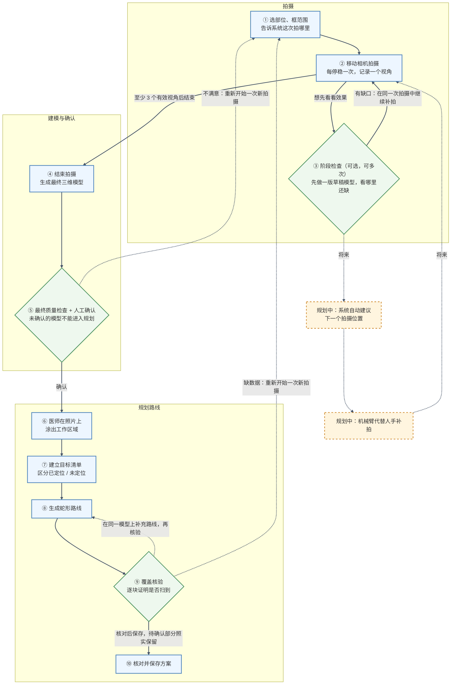

# 系统数据与核心处理流程说明（通俗版）

> 适用读者：非技术同事、合作方、评审人员。
> 依据：2026-10-14 本工作区代码与《技术路线.md》。系统仍在研发中，最新状态以《技术路线.md》顶部为准。

## 一、一句话说明

用一台深度相机从几个角度拍下患者体表，系统把这些画面拼成三维模型；医师在照片上涂出需要处理的区域，系统在这块三维表面上规划一条一行一行来回往复的“蛇形”扫描路线，并逐块核算：哪些地方能确认被扫到，哪些地方还说不准。

打个比方：像给一面墙刷漆。先从几个角度拍照，做出墙的立体模型；再在照片上圈出要刷的范围；然后规划滚筒一行一行来回刷的路线；最后逐块检查哪里确认刷到了，没把握的地方明确标出来，而不是假装已经刷完。

**重要前提**：本系统目前只用于研发演示。它不控制机械臂或治疗设备；算出的位置、距离和路线只用于研发阶段的可视化，不是临床靶点，也没有经过实物精度验证。

## 二、整体流程图

图例：实线是当前可用的流程；虚线是可选的回退路径或尚未实现的方向；橙色虚线框是“规划中”的能力；绿色菱形是检查环节。

## 三、每一步在做什么

### ① 选部位、框范围

- 操作者先选择部位（如前臂、膝部）、患者左侧或右侧、正面或背面、体位，并确认“只针对当前能看到的体表”。这些只是文字标签，用于归档和查找同一任务的历史记录，不包含任何位置坐标。也可以从这里打开同一任务以前的拍摄记录。
- 然后在实时彩色画面上拖一个矩形框，告诉系统“这次重点拍这一块”。框应包含目标和必要的周边。如果框内有效深度不到一半，系统会提示调整距离或取景。
- 这个框只用于指导拍摄、检查缺口，**不是治疗区域**；治疗区域要到第⑥步由医师精细涂抹。

> 留下的记录：部位标签、扫描框。

### ② 移动相机拍摄

- 点“建立参考位置并开始采集”。第一张合格画面所在的位置和朝向被定为**参考位置**，之后所有三维数据都以它为原点记录。
- 操作者缓慢移动相机，每到一个新角度停稳，点“停稳补采一帧”。系统会检查：画面是否清晰、能否和之前的画面对上、相机是否真的停稳、是否仍在允许范围内（相对参考位置约 3 厘米、转动 10 度以内）。全部通过的画面才算一个**有效视角**。
- 至少 3 个有效视角才能生成模型；一次拍摄最长 5 分钟。
- 所有原始彩色照片和深度图都完整保存，之后任何步骤都不会修改它们。系统算出的相机位置另外存放。

> 留下的记录：原始照片、深度图、每帧时间、相机标定；另存系统估算的相机位置。

### ③ 阶段检查（可选，可做多次）

- 拍摄途中可以点“检查当前采集”。系统把已拍的有效视角冻结成一份快照，在后台先做一版**草稿模型**；这期间相机继续跟踪，不用重新开始。
- 检查结果是一张标了颜色的参考照片：
  - **绿色**：模型和照片对得上，有可靠支持；
  - **紫色**：照片上有深度但模型缺了这块，或模型有这块但照片上缺深度；
  - **橙色**：没拍到、超出相机测量范围、模型和照片互相矛盾，或这里没有有效像素。
- 系统同时列出待处理事项：哪一片有问题、原因、建议（如“调整视角并停稳补采”）。它只能指出照片上哪一片有问题，**不会给出三维坐标，也不会告诉你相机该放到哪里**。
- 补拍后再检查，系统逐个像素对比前后两次：哪些变好了、哪些变差了。最多检查 8 次；连续两次没有改善时，系统停止接收补拍，避免无效重复，但仍可以结束拍摄。
- 草稿模型只用于查看缺口，不能用于规划。

> 留下的记录：每次检查单独一个文件夹，含检查结论、待处理事项单和检查图。

### ④ 结束拍摄，生成最终三维模型

点“完成采集并检查质量”后，系统在后台（有时间和内存上限）依次做三件事：

1. **精细校正**各视角的相机位置：全部视角都校正成功才采用，否则沿用原来的位置，并在报告里写明；
2. **剔除不稳定的深度**：用相邻几帧核对每个像素的深度是否稳定，条件不满足时同样不采用，并记录原因；
3. **融合成三维表面**：把所有视角的深度融合成一张连续的表面（由大量小三角片组成的网格），并配上照片颜色；同时另存一份融合点云。

> 留下的记录：三维表面模型、融合点云、贴图（有条件时生成）、处理与重建报告。

### ⑤ 最终质量检查与人工确认

- 模型生成后，系统用第③步同样的方法对照扫描框再检查一次，给出三种结论之一：
  - **参考支持达标**：框内参考照片上的像素都有模型支持；
  - **需检查或补采**：还有缺口；
  - **无法判断**。
- “达标”只说明从参考照片这个角度看，框内都有支持，**不代表整个肢体（如背面、侧面）都拍全了**。扫描框里少量因镜头畸变校正而无法对上的像素，会单独记为“无法判断”，不会因为检查图全是绿色就算作拍够了。
- 如果在还有缺口时结束，系统会照实记为“人工结束、待确认”。
- 操作者或医师查看模型后确认，才能进入规划。确认的意思是“我看过，接受用这个模型做规划”，**不会把缺口改成合格**。
- 不满意就重新开始一次新拍摄。新拍摄是独立的一次，有自己的参考位置；旧的规划不会自动套用到新模型上。
- 没有确认的模型，以及第③步的草稿模型，规划页面一律拒绝打开。

> 留下的记录：采集核验与确认记录、检查图、待处理事项单。

### ⑥ 医师在照片上涂出工作区域

- 医师在参考照片上用方形笔刷涂出需要处理的区域，可以擦除、撤销和重做；可以涂多块分开的区域，也可以在中间留空。
- 系统保存的是“医师涂了哪些像素”本身，这是最权威的依据；同时标出每个像素在模型上有没有对应的表面。
- 涂到了、但模型上缺数据的地方，仍然算“医师要求处理”，只是标为数据缺失，**不会被悄悄去掉**。

> 留下的记录：医师选区（压缩保存涂抹的像素），以及每个像素的模型支持情况。

### ⑦ 建立目标清单

- 系统把医师涂的每个像素对应到三维表面上的小三角片，并算出每一小片的面积，形成**目标清单**。
- 对应不上的像素（没有深度、被遮挡、深度矛盾、超出计算量等）记为“未定位”并写明原因，**不估算面积，也不凭空补出三维位置**。
- 系统另外划出**有效区域**：只有质量够好的表面才允许路线经过；质量不够的部分标为“排除”或“待定”。
- 每次保存或重新打开时都会重新建立清单，不沿用上次的结果；只要输入有任何变化，旧清单就作废。

> 留下的记录：目标清单。

### ⑧ 生成蛇形路线

- 系统按治疗头的行距和有效作用宽度，在每一块区域上一行一行来回排布扫描线（蛇形），并检查每一段都落在质量合格的表面上。
- 相邻两行只在同一块区域内、确认可走的表面上连接；连不上的地方保留为**断点**，不会硬连，也不会跨块连线。
- 行距和作用宽度目前使用占位默认值，或手工填写、尚未验证的数值；治疗深度、外壳直径等其他设备参数暂时只做记录（界面“待用设备参数（仅记录）”），不参与路线计算。真实设备参数确定后再更新。

> 留下的记录：路线，由“扫描段”和“断点”两种片段组成。

### ⑨ 覆盖核验与补充路线

- 系统把目标清单再细分成更小的块，逐块**证明**它确实在治疗头的作用范围内被扫到。能证明的块标为“已确认”。
- 证明不了的块保持“待确认”，并写明原因：质量不够被排除、不在扫描线的保守作用范围内、和已证明的区域连不起来、细分到上限仍无法判断、目标清单里本来就没定位，或在计算量上限内没处理到。
- **“待确认”不等于“漏了”，也不等于“已覆盖”**，只表示现有证据不够下结论。
- 对待确认的区域，可以在同一个模型上追加补充路线。补充方案必须同时满足两条才会被采用：原来已确认的部分一块都不丢；新扫到的部分确实有增加。
- 此外还有两个研发用选项：“严格重建路径”（用更保守的标准判断路线是否站得住）和“变宽作用模型”（允许作用宽度逐段变化）。

> 留下的记录：覆盖证明（重新打开方案时可以复算）。

### ⑩ 核对并保存

- 医师核对路线和核验结果后保存，得到两份结果：
  - **路线包**：路线及其明细；
  - **可编辑方案**（一个 ZIP 文件）：带上模型、参考照片、目标清单、覆盖证明和当时的采集核验记录，可以拿到别处重新打开。
- 重新打开时，系统会独立复核：来源、模型、各项对应关系是否一致，并重新建立目标清单、复算已有证明。任何一项对不上就拒绝打开，不会将就着用。
- 保存不代表全部覆盖完成：待确认部分照实保留。所有结果都标明“不可直接执行”“未经实物精度验证”。

## 四、几个关键说法

| 说法 | 意思 |
| --- | --- |
| 深度相机（RGB-D） | 同时拍彩色照片和“每个像素离相机多远”的深度图。本项目使用 Orbbec Femto Bolt。 |
| 参考位置 | 开始拍摄时第一张合格画面所在的位置和朝向；所有三维数据都以它为原点记录（技术上叫 W0）。 |
| 有效视角 | 停稳、清晰、能和之前画面对上、位置可信、并被系统接纳的一帧画面。 |
| 三维模型（网格） | 由大量小三角片拼成的表面，单位是米。 |
| 参考照片 | 参考位置拍下的彩色照片（经过镜头畸变校正）；缺口检查和医师涂抹都在这张照片上进行。 |
| 草稿模型 / 最终模型 | 拍摄途中阶段检查生成的模型 / 结束拍摄后生成的模型。只有确认过的最终模型能用于规划。 |
| 待确认 | 现有数据或计算不足以下结论。既不是“已覆盖”，也不是“漏了”。 |
| 覆盖证明 | 系统逐块给出的“这一块确实扫到”的计算证据，重新打开方案时可以复算。 |
| 一次拍摄 | 从“开始采集”到“结束”是独立的一次，有自己的参考位置；不同次拍摄的数据不混用。 |

## 五、系统坚持的几条原则

1. **原始照片永不修改**：所有计算结果都另外存放，随时可以从原始数据重新计算。
2. **宁可说“不知道”，不编造结果**：位置不可信就不用；缺数据就标“待确认”并写明原因，不用补洞或硬连线来伪装完成；数值缺失就留空，不用旧数字顶替。
3. **每份结果都可追溯**：记录来自哪次拍摄、哪张参考照片、哪个模型版本；源头一变，旧的规划自动作废。
4. **人工确认不改写质量结论**：确认只表示“同意用于规划”，缺口仍照实记录。
5. **只做研发演示**：不控制机械臂或治疗设备；位置、距离、路线不是临床靶点，未经实物精度验证。

## 六、目前进展（截至 2026-10-14）

| 状态 | 内容 |
| --- | --- |
| 软件中已实现 | ①–⑩ 全流程；同一次拍摄中的阶段检查、补拍和前后对比；最终确认后才能进入规划；方案保存及重新打开时的独立复核。已用录制好的数据回放验证。 |
| 现场已验证 | 2026-10-14 一次真人操作的拍摄做了 3 次阶段检查、2 轮补拍，前后对比和原始数据核查通过。像素对比只说明参考照片上的变化，不代表三维面积或精度。 |
| 仍待现场验收 | 在这次多轮补拍得到的最终模型上完成人工确认、医师实际涂抹选区、生成路线并保存，再整体核对一遍。软件测试通过不等于现场验收通过。 |

尚未实现的方向：

| 后续能力 | 目前的情况 |
| --- | --- |
| 系统自动建议下一个拍摄位置 | 目前只能指出照片上哪一片有问题及原因，不给三维位置或拍摄姿态（这两项在记录中明确留空）。 |
| 机械臂代替人手补拍 | 已预先定好“任务单 → 回传拍摄结果 → 核验结果”三类数据格式，目前用于记录人工补拍；回传的画面仍须通过和人工拍摄相同的检查。机械臂控制、坐标标定和运动执行不在当前阶段。 |
| 生成模型之前就判断拍够没有 | 目前要先在后台做一版草稿模型（阶段检查）才能判断。 |
| 跨次拍摄接续 | 目前每次拍摄互相独立，旧规划不能自动套用到新模型；需要先解决两次拍摄之间的位置对齐和目标对应问题。 |

---

## 附：技术对照表（供开发人员查阅）

| 步骤 | 主要记录 / 对象 | 关键字段（摘录） | 代码（`femto/` 下） |
| --- | --- | --- | --- |
| ① | `task_context.json` 中的 `body_selection`；`derived/scan_roi.json` | `region/side/surface/posture/coverage/confirmed`；`femto-scan-roi-v1`、`rect_norm`、`image_size`、`status`（`pending_reference`→`bound`）、`reference_frame_id`、`session_id`、`calibration_sha256` | `dataset/body_site.py`、`dataset/task_context.py`、`capture/scan_roi.py` |
| ② | `AlignedFrame`（内存）；`rgb/`、`depth/`、`pose/`、`frames.jsonl`、`calibration/`；`derived/local_posed/` | `depth_mm` 为 float32 毫米，落盘为 uint16 毫米；原始 pose `pose_valid=false`、`T_WC=null`；派生 pose `pose_source=online_rgbd_research_grade` | `hardware/orbbec_rgbd.py`、`capture/scan_session.py`、`capture/local_capture.py` |
| ③ | `derived/checkpoints/<uuid>/`：`checkpoint.json`、`scan_feedback.json`、`scan_tasks.json`、`diagnosis.npy`、`scan_check.png` | `femto-scan-feedback-v1`：`binding`（`target_key/stage_id/session_id/reference_frame_id/model_sha256`）、`status`、`tasks[]`、`comparison`；`position_world_m`、`candidate_observation_pose` 固定为 `null` | `capture/local_checkpoint.py`、`capture/scan_feedback.py`、`capture/scan_exchange.py` |
| ④ | `processing_report.json`；`reconstruction/` 下的 `scene_tsdf_mesh_m.ply`、`scene_fused_points_m.ply`、`texture_multiview.png` + `mesh_triangle_uv.npy`、`reconstruction_report.json`；`FixedRGBModel` | `actual_dataset`、`actual_pose_source`、`transform_direction=T_W0_Ct` | `local/local_processing.py`、`pipeline/scene_reconstruction.py`、`annotation/fixed_rgb_geometry.py` |
| ⑤ | `acquisition_completion.json`、`scan_diagnosis.npy`、`scan_check.png`、`scan_tasks.json` | `femto-acquisition-completion-v1`：`assessment_status`、`end_status`、`confirmed_for_planning`、`binding` | `capture/final_assessment.py`、`dataset/acquisition_completion.py` |
| ⑥ | `region.selection_intent`、`region.selection_support` | `femto-selection-intent-v1`、`coordinate_frame=undistorted_reference_rgb`、`unit=pixel`、`selected_mask_runs`（游程编码）；`source` 表示输入方式（如 `physician_square_brush`） | `annotation/selection_intent.py` |
| ⑦ | `TargetLedger` → `target_surface.json/.npz`；effective domain | `femto-original-target-surface-v1`：`pixel_status`、`area_m2`、`barycentric`；`face_class_runs`、`missing_regions`、`effective_width_mm` | `planning/target_surface.py`、`planning/effective_domain.py` |
| ⑧ | `SurfaceTrajectory` → `trajectory.json`；治疗头参数 | `ordered_items` 由 `scan_segment` / `gap` 组成；`points[].role` 为 `scan` / `connector`；`row_spacing_mm`、`effective_treatment_width_mm` | `planning/surface_trajectory.py`、`planning/treatment_head.py` |
| ⑨ | `Certificate` → `coverage_certificate.json/.npz` | `arrays.status`：1 为 confirmed，2–7 为各类待确认原因 | `planning/coverage_certificate.py`、`planning/coverage_workflow.py` |
| ⑩ | 路线包；`planning.region.zip`（含 `project.json`） | 便携采集核验 `femto-portable-acquisition-completion-v1` | `planning/trajectory_export.py`、`planning/region_project.py` |

技术要点：

- **单位与坐标**：深度图为 uint16 毫米（0 表示未知）；三维点、网格、路线单位为米；行距、作用宽度单位为毫米。坐标轴为 RDF（+X 右、+Y 下、+Z 前）。局部补采链中位姿记录里的 `T_WC` 即 `T_W0_Ct`（把当前彩色相机坐标变换到 W0）。
- **两套像素格**：扫描框在原始对齐像素格；检查图、医师选区和目标清单在去畸变参考图上，二者不能直接混用。
- **反投影**：多帧链先把 RGB/深度按 K6 畸变模型 remap 到去畸变网格，再用 `new_K` 生成点云，并以 `inverse(T_WC)` 逐帧做 TSDF 积分（`geometry/rgbd_frames.py`、`pipeline/scene_reconstruction.py`）；单帧质量链用 `geometry/depth_cloud.py` 的 K6 去畸变射线。两者都不是“原始内参 + 无畸变针孔”公式。点云与 TSDF 网格是并行产物，网格不是由点云生成的。
- **规划入口门禁**：`read_completion(require_confirmed=True)` 要求 `confirmed_for_planning=true`，且 `publication.json` 为 `published`；`capture_scope=stage_checkpoint` 的阶段模型一律拒绝。没有扫描框的旧采集保持原语义，不要求确认记录。
- 所有相关 JSON 固定 `execution_ready=false`、`physical_accuracy_verified=false`。
